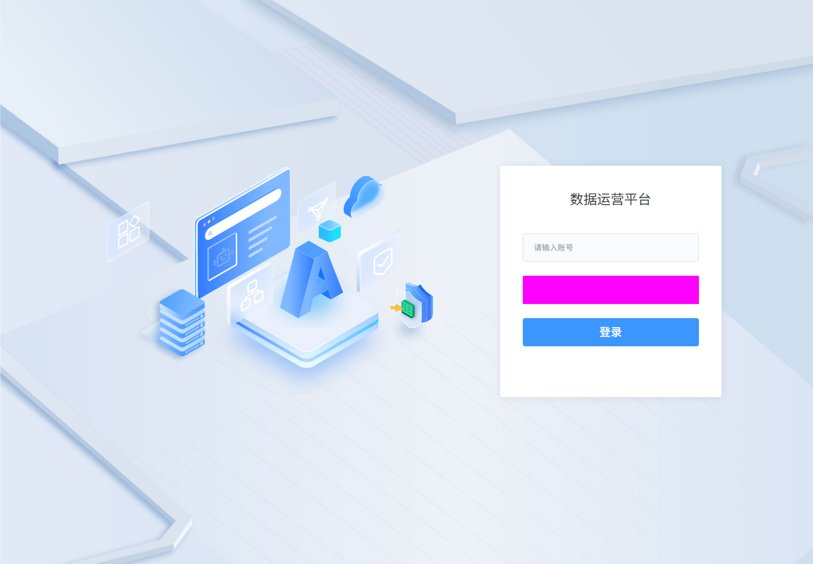

# 登录业务需求说明

修订日期：2026-10-26；需求AUTH-001专项核对。页面证据为2026-10-22历史截图与元素，本轮新增公开前端源码证据。

## 1. 业务目标与使用角色

让已获授权的使用者通过账号和密码完成认证，建立会话并进入平台工作区。入口：/module-login/login；页面标题：数据运营平台。

## 2. 业务范围

覆盖账号密码认证、条件验证码、条件用户协议、请求加密、已有登录检查及认证结果跳转。是否另行提供找回密码、注册或独立SSO入口需产品确认，不从未显示按钮推定。

## 3. 功能需求

### AUTH-001 账号登录

**业务目的**：完成账号密码认证并进入允许访问的平台目标。

**操作与规则**：输入账号和密码，满足条件验证码与协议要求，校验后加密提交。成功按框架transfer或cid分支跳转，失败反馈并恢复可操作状态。

**结果与异常处理【拟定需求】**：只有取得认证成功结果才进入工作区；校验、认证、公钥和网络失败分别反馈，恢复可操作状态且不发送明文兜底请求。

**开发处理细则【拟定需求】**：

- 只使用下列有证据的字段、参数与条件，不添加筛选、分页、统计或未定义业务上下文。
- 认证失败、公钥不可用、加密异常与网络异常分别处理；不发送明文兜底请求。
- 本文分开登记历史画面、静态源码、用户要求和未执行验收；后端规则未取证时不宣称已实现。

<!-- 完整规格:AUTH-001 -->

#### 1. 页面字段清单（AUTH-001）

规格对象：账号密码认证；操作类型：身份认证与会话建立。字段依据E002历史元素、LOGIN-SRC-FORM、LOGIN-SRC-VALIDATOR和LOGIN-SRC-LOCALE；不是列表读取或查询。

| 字段名称 | 类型 | 是否必填 | 默认值 | 长度/范围限制 | 格式规则 | 错误提示 | 页面状态 |
|---|---|---|---|---|---|---|---|
| 账号（页面模型username，请求account） | string / text | 是（客户端非空校验） | 空字符串（客户端草稿） | maxlength=20（前端控件） | 提交使用username.trim() | 账号不能为空（中文语言包） | 可清空；autocomplete=off |
| 密码（页面模型password，请求password） | string / password | 是（客户端非空校验） | 空字符串（客户端草稿） | 客户端lengthGT(4)实际实现为长度≥4 | 提交前RSA-OAEP加密，不对密码trim；摘要SHA-256、MGF1 SHA-256，再Base64编码 | 密码不能为空；字符长度应大于等于4（中文语言包） | 默认遮蔽；focus清空模型；blur把输入DOM值替换为密文 |
| 验证码（页面模型authCode，请求imgCode） | string / text | 显示时客户端非空校验 | 空字符串（客户端草稿） | | codeIMG非空才显示；请求取authCode或源码回退值8888 | 验证码不能为空（中文语言包） | 条件显示，可清空，点击图片刷新 |
| 已阅读《用户协议》（agreeToPrivacyStatement） | 客户端初始boolean | 显示时校验值严格等于true | false（客户端草稿） | | showPrivacyElement为true才显示 | 请勾选用户协议（中文语言包） | 条件显示；协议文本可打开阅读弹窗 |

【页面观察，来源：历史DOM与前端源码】E002显示账号和密码控件；验证码、协议是本轮静态模板确认的条件分支，不表示历史截图已经显示。空白单元格保持为空，不等于无约束；客户端默认草稿不代表服务端默认值。语言包文案尚未通过触发错误实测。

#### 2. 页面交互规则（AUTH-001）

| 控件/按钮 | 交互行为与状态 |
|---|---|
| 账号输入框 | 【页面观察，来源：前端源码】绑定loginForm.username，可输入/清空；失焦执行非空校验，提交时去除首尾空白。没有登录账号字符集正则证据，不套用新增用户的4–20位规则。 |
| 密码输入框 | 【页面观察，来源：前端源码】type初始password。focus清空loginForm.password；blur非空时调用passwBlur，将event.target.value换成RSA密文；提交另从loginForm.password加密组装请求。不能认定DOM替换已经同步清空模型明文；失焦/再次聚焦/回车路径需运行核对。 |
| 登录按钮与Enter | 【页面观察，来源：前端源码】点击按钮或表单keyup Enter调用同一个handleLogin；validate通过后loading=true，再requestLogin。按钮绑定loading。失败catch清loading；源码没有独立if(loading)早退，不能承诺Enter或并发请求已被去重。 |
| 验证码图片 | 【页面观察，来源：前端源码】codeIMG非空才显示验证码行，点击图片重新调用requestBase64；是否使旧码失效、有效期和失败提示由服务端确认。 |
| 用户协议 | 【页面观察，来源：前端源码】getPrivacyStatus返回truthy时显示勾选及链接；首次点击协议下载blob，再以iframe在1000px弹窗打开；后续复用objectURL。关闭操作只结束阅读。 |
| 页面初始化 | 【页面观察，来源：前端源码】created触发取公钥、检查已有登录、取验证码和协议状态；验证码与协议请求各finally令status加1，status≥2才显示表单。该条件不保证公钥已就绪。 |
| 登录结果与返回 | 【页面观察，来源：前端源码】成功调用handleLoginSuccess；失败保留组件中的原模型，清loading，除错误码1109外刷新验证码。实际错误提示由公共请求处理器负责的部分尚未核对；页面没有已确认的取消按钮或离开确认框。 |

#### 3. 业务流程与异常分支（AUTH-001）

1. 【页面观察，来源：前端源码】打开/module-login/login，初始化账号、密码、验证码为空，协议同意为false；并行读取公钥、登录状态、验证码和协议状态。
2. 【页面观察，来源：前端源码】无既有登录时填写账号和密码；验证码及用户协议仅在各自条件成立时展示并校验。
3. 【页面观察，来源：前端源码】点击登录或按Enter，前端表单校验通过后设置loading，将账号trim后写account，将密码加密后写password，连同imgCode、agreeToPrivacyStatement发起登录。
4. 【页面观察，来源：前端源码】登录Promise resolve后处理用户缓存：不同账号时调用清缓存逻辑，再在sessionStorage记录账号标识；不会在该方法中保存密码。
5. 【页面观察，来源：前端源码】普通路径跳到框架transferPath；有cid且为主动点击登录时跳到/common/sso/cas/granting的cid分支。历史E004最终到/dop/stage；不能把它写成所有配置下的直接固定跳转。

| 异常/分支 | 客户端现有定义与开发要求 |
|---|---|
| 账号/密码为空、密码不足4字符 | 【页面观察，来源：前端源码】validate失败则不调用requestLogin；具体错误显示位置、空白字符串判断及组合错误仍需浏览器核对。 |
| 公钥未就绪/取公钥失败/本地加密抛错 | 【待确认】表单显示不等待公钥；同步加密异常不在登录请求Promise catch内，loading能否恢复存在证据缺口。【拟定需求】阻止明文回退，给可重试错误并解除忙碌状态。 |
| 错误凭据/锁定/验证码错误 | 【页面观察，来源：前端源码】请求catch清loading，code不为1109时刷新验证码；1109业务含义、账号锁定阈值、提示文案及旧码状态需后端证据。 |
| 超时、断网、5xx、异常响应 | 【拟定需求】不显示登录成功，不自动连续重放认证；允许显式重试并恢复按钮。仅安全保留账号，不把密码长期保存到storage。真实公共错误处理、凭据清理时机待验证。 |
| 已有登录会话 | 【页面观察，来源：前端源码】userIsLogin返回truthy时走handleLoginSuccess("auto")；不触发主动点击专用cid跳转分支。会话范围与失效机制未验证。 |
| 协议勾选类型 | 【待确认】模型初始false，校验严格true，模板却用el-checkbox-group；应核对运行时发出的boolean/array，不能凭初始值认定可顺利通过。 |

#### 4. 接口与数据规则（AUTH-001）

【页面观察，来源：前端源码】HTTP方法与相对路径来自LOGIN-SRC-API的API包装器及默认commonAuth/commonCaptcha/commonUser前缀。运行时getServiceConfig与API_BASE_URL可能覆盖或增加前缀；本轮没有业务Network或服务端响应。

| 用途 | HTTP方法与相对路径 | 请求参数名称/来源 | 客户端使用的返回值 |
|---|---|---|---|
| 取得登录公钥 | GET /common/auth/login/key | 无业务参数 | 返回字符串包入PUBLIC KEY PEM，再publicKeyFromPem；不保存或展示实际返回值 |
| 提交认证 | POST /common/auth/login | account、password、imgCode、agreeToPrivacyStatement，逐项见下表 | Promise resolve进入登录成功分支；真实HTTP/业务成功判定由公共客户端核对 |
| 检查登录会话 | GET /common/user/pub/login | 无业务参数 | truthy时自动进入成功跳转 |
| 获取验证码 | GET /common/captcha/captcha/img64 | 无业务参数 | truthy时拼data:image/png;base64前缀；falsy则不显示验证码行 |
| 判断协议是否启用 | GET /common/user/privacy/getPrivacyStatus | 无业务参数 | truthy时showPrivacyElement=true |
| 阅读协议文件 | GET /common/user/privacy/getPrivacy | 空对象；responseType=blob | 非空blob转objectURL供iframe阅读 |

| 登录请求参数名称 | 类型/来源 | 处理规则与证据 |
|---|---|---|
| account | string，loginForm.username | trim去除首尾空白；不加密账号的定义见requestLogin |
| password | string，loginForm.password | 公钥RSA-OAEP，SHA-256/MGF1 SHA-256，Base64；字段名仍是password，字段值为加密结果，不能记录实际明文或密文 |
| imgCode | string，loginForm.authCode | 空时回退为源码常量8888；此为客户端分支事实，不能认定可绕过服务端验证码 |
| agreeToPrivacyStatement | 初始boolean，loginForm同名值 | 直接复制当前模型值；条件显示和checkbox-group实际发出类型仍需Network确认 |

请求体形态（仅列字段名与表达式，不含凭据）：{account: username.trim(), password: encryptStr(password), imgCode: authCode或源码回退值, agreeToPrivacyStatement: 当前协议值}。没有证据支持额外添加tenantId、spaceId、userId或幂等键。

【待确认】Content-Type、网关最终路径、是否附带验证码关联Cookie、公共请求/响应拦截器、HTTP及业务成功码、完整成功/失败JSON、会话Cookie/Token设置方式、code=1109含义、服务端校验与密码存储。静态Promise resolve不能当作认证已被服务端验证。

#### 5. 验收标准（AUTH-001）

| 验收编号 | 可执行检查项 | 关联需求 | 状态 |
|---|---|---|---|
| AUTH-AC-003 | 打开登录页核对左侧主题插画、右侧白色卡片、账号→密码→条件验证码/协议→登录顺序；账号20字符控件边界，密码初始遮蔽。 | AUTH-001 | 【拟定，未执行】 |
| AUTH-AC-004 | 隔离测试账号校验通过后，在Network仅检查字段名及不含明文的判定，确认POST相对路径、account的trim、password加密、imgCode和协议值；核对真实登录成功与transfer/cid分支。证据不保存凭据。 | AUTH-001 | 【拟定，未执行】 |
| AUTH-AC-005 | 分别测试账号空、密码空、密码3/4字符、条件验证码缺失和协议未选；确认前端阻止请求。错误凭据/验证码/锁定用测试账号核对服务端拒绝及1109分支，不冒充成功。 | AUTH-001 | 【拟定，未执行】 |
| AUTH-AC-006 | 注入公钥迟到/失败、加密异常、超时、断网和服务异常；不得发送明文回退请求；按钮能恢复，验证码刷新规则和草稿处理可核对。 | AUTH-001 | 【拟定，未执行】 |
| AUTH-AC-007 | 分别点击与Enter、连续点击、密码失焦与重新聚焦、会话失效/已有登录重入；确认无非预期重复认证、错误跳转或长期密码存储。窄屏/200%缩放下表单和条件控件可达。 | AUTH-001 | 【拟定，未执行】 |

#### 6. 权限与安全要求（AUTH-001）

- 【待确认】允许访问本页面及执行该操作的身份来源、有效账号状态、锁定/解锁规则、SSO协议、会话时限和认证后的租户/部门范围。登录页公开可见不代表受保护业务可以匿名访问。
- 【页面观察，来源：前端源码】密码blur时替换输入DOM展示值，提交时另加密请求参数；源码仍从loginForm.password读取密码。不能保证用户按F12就看不到明文，也不能阻止控制本人浏览器的人在输入期间、Vue模型或加密函数前断点中检查该值。
- 【拟定需求，用户本次明确提出密码加密】应将验收目标限定为：正常认证请求的password不以明文传输；无URL/日志/埋点明文泄露；密码不写localStorage/sessionStorage；加密失败禁止退回明文请求。不要以禁用F12或右键作为安全措施。
- 【拟定需求】使用HTTPS保护整个登录链路及公钥获取。客户端RSA不替代TLS，也不证明服务端正确哈希存储、限制重放或抵御脚本窃取；后端密码哈希、审计、限流、会话撤销均需独立确认。本轮未核实这些机制。

#### 7. 页面布局与状态（AUTH-001）

【页面观察】路由/module-login/login。以2026-10-22历史E002截图1440×1000为布局样本：

- 全页浅蓝灰色几何背景铺满视口；左侧为蓝色主题插画，包含大写A、浏览器窗体、数据库与盾牌等图形。插画承担品牌展示，与右侧表单横向并列。
- 右侧为白色登录卡片，位于右半屏、接近垂直居中，带轻微圆角和阴影。该截图卡片约位于x=886、y=294，宽392、高410；这些是样本像素，不是所有分辨率的固定约束。
- 卡片上方居中显示“数据运营平台”；下方从上到下依次为账号输入框、密码输入框、蓝色“登录”按钮。输入与按钮左边缘对齐、宽度接近，卡片内四周留白。
- 验证码和用户协议仅在本轮源码条件成立时插入密码之后、登录按钮之前；E002截图未证明它们已展示。不预设还有忘记密码、注册或其他入口。
- E002密码行被既有洋红色不透明覆盖遮挡；不能把该颜色、内部图标、文字或遮蔽细节当成产品样式。密码控件存在及type由配套JSON和模板交叉确认。

【页面观察，来源：前端CSS】left-right布局使用flex居中、100%背景铺展。源码主卡片默认width=490px、padding=0 60px 100px；另有max-width:1600px等媒体分支；这些是CSS声明，不等于E002实际像素或已测试适配。

| 页面状态 | 当前证据与要求 |
|---|---|
| 初始化 | 源码status≥2才显示表单；公钥未纳入显示门槛。取证未覆盖实际初始化失败画面。 |
| 可输入 | 历史截图展示账号、密码区域及登录按钮；模型初始空值，条件控件按响应显示。 |
| 提交中 | 源码按钮绑定loading；Enter并发保护、键盘焦点和屏幕阅读器提示尚未运行验证。 |
| 校验/认证失败 | 中文语言包提供字段错误；实际全局错误摆放、是否保留密码和图像刷新后布局未取得现场证据。 |
| 成功 | 静态跳转分支及历史工作台截图分别作证；本轮没有重新登录。 |
| 窄屏与缩放 | 【拟定需求】左图与卡片可调整或滚动，账号/密码/条件控件/按钮不遮挡，键盘可达；实际断点和200%缩放需执行验收。 |

#### 8. 证据与待确认项（AUTH-001）

- 【页面观察】[E002历史截图](../evidence/E002-login-ready.png)、[配套元素](../evidence/E002-login-ready.json)证明账号、密码控件及布局；[E004](../evidence/E004-portal-ready.png)只证明当时该会话已进入工作台。
- 【页面观察，来源：前端源码】[2026-10-26登录专项索引](../evidence/auth-review-20261026/README.md)及[原文片段](../evidence/auth-review-20261026/index.json)：LOGIN-SRC-FORM、LOGIN-SRC-API、LOGIN-SRC-VALIDATOR、LOGIN-SRC-LOCALE。保留资源路径、获取时间、原包与片段摘要。
- 【待确认】公钥竞争与异常、blur DOM替换和Vue模型同步、Enter重复登录、验证码/协议真实开关、checkbox-group值类型、SSO/cid及会话恢复；按前述验收逐项执行。
- 【待确认】实际网关路径、Content-Type、Network与后端响应、账号限制、密码哈希、登录限流、会话撤销和审计。现有源码只定义客户端行为。
- 本轮仅公开静态GET与离线阅读，没有执行下载脚本、业务接口、认证尝试或新增截图。全部本节验收为【拟定，未执行】，不能把文档自动校验通过写成登录测试通过。
## 4. 字段与业务规则

字段与请求名映射见AUTH-001第1、4节。账号输入maxlength=20仅为客户端上限；不能从新增用户页面照搬账号格式。密码lengthGT(4)的工具实现使用“小于4则错误”，因此静态客户端下限为4字符，不是“大于4”。

### 对象边界与依赖规则

| 类型 | 本模块规则 |
|---|---|
| 对象边界 | 账号、认证请求和登录会话，不涉及业务对象新增删除。 |
| 客户端依赖 | 公钥、验证码图片、协议状态、公共请求客户端和框架transfer配置。 |
| 服务端待核对 | 身份来源、账号锁定/状态、认证结果、会话建立/撤销、授权范围与审计。 |

## 5. 主要业务流程

初始化依赖 → 展示登录表单 → 输入账号密码及条件项 → 前端校验 → 公钥加密 → 提交认证 → 失败恢复或成功跳转。详细分支见第3节；没有确认的取消按钮和未保存草稿提示不加到流程中。

## 6. 验收标准

以下正式用例与AUTH-001规格内5项检查互补，保留原AUTH-AC-001～007编号；全部【拟定，未执行】。历史成功路径仍只在调研附录记为当时观察，不自动升级本次验收。

| 编号 | 场景 | 业务步骤与预期 | 关联需求 | 执行状态 |
|---|---|---|---|---|
| AUTH-AC-001 | 账号密码认证主流程 | 使用专用测试账号完成校验、加密、认证及真实目标跳转；区分transfer与cid分支，核对服务端会话，证据不保存密码。 | AUTH-001 | 【拟定，未执行】 |
| AUTH-AC-002 | 认证失败与会话恢复 | 核对错误凭据、验证码、协议、公钥失败、已有会话和过期重入；失败不进入工作区，按钮可恢复，普通会话不能跳过服务端认证。 | AUTH-001 | 【拟定，未执行】 |

## 7. 待确认事项

- P0：登录请求真实序列化与成功/失败返回、会话建立与凭据存储；HTTPS、公钥来源、服务端密码哈希和限流机制。
- P0：公钥未就绪与加密异常的恢复，密码失焦替换后模型明文及重入清空行为；不能承诺F12无法看到密码。
- P1：账号空白和字符集规则、验证码有效期及1109含义、用户协议值类型与版本同意记录。
- P1：登录重复触发、会话时限与撤销、SSO/cid策略、窄屏和辅助技术。

### AI开发审查结论

可据静态证据开发表单结构、字段绑定、条件控件和参数适配；加密与错误恢复应按明确需求实现并测试。未取得后端契约、会话及真实请求响应前，不认定生产认证链路已就绪，不把AI拟定错误码或存储方案当原系统事实。

## 8. 需求依据与调研附录

[历史调研记录](./调研记录.md)保持原文；[专项源码证据](../evidence/auth-review-20261026/README.md)为本轮补充，不改变历史取证日期。

| 需求编号 | 页面与源码依据 | 验证边界 |
|---|---|---|
| AUTH-001 | [E002](../evidence/E002-login-ready.png)、[元素](../evidence/E002-login-ready.json)、[E004](../evidence/E004-portal-ready.png)、[登录源码索引](../evidence/auth-review-20261026/README.md) | 历史页面与静态定义；本轮未认证、未捕获业务Network。 |

[总索引](../README.md) · [总览](../00-总览与跨模块流程.md) · [证据索引](../证据索引.md)
