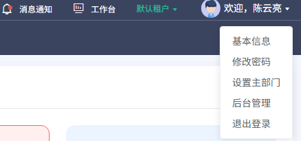

# 用户菜单补充需求

## 1. 范围与入口

右上角用户信息展开后提供账号和平台相关操作。本文件归入工作台公共入口补充，不预先增加独立应用模块；各目标页取证后再确认模块归属。

2026-10-22用户提供截图，随后在用户手动登录的受控Chrome中实际展开菜单，并打开基本信息、修改密码、设置主部门及后台管理。前三项在工作台路径`/dop/stage`内打开弹窗；后台管理在同一标签页进入`/module-common/index`。退出登录未点击。只读打开及取消不能证明保存、改密、切换部门或退出成功。

## 2. 证据与观察

| 证据 | 来源、时间和用途 | 限制 |
|---|---|---|
| U001-user-menu | 用户提供的PNG；本地复核2026-10-22 16:29:32（北京时间）；[登记](../evidence/user-supplied/U001-user-menu.json) | 拍摄时间未知；裁剪图无地址栏、目标页或点击过程；保留业务原文，仅供获授权项目人员查阅 |
| E004-portal-ready | 既有[工作台截图](../evidence/E004-portal-ready.png)及[采样](../evidence/E004-portal-ready.json) | 只作工作台背景，不证明用户菜单的目标页面 |
| R003-user-menu-open | [实际展开截图](../evidence/live-recheck-20261022/R003-user-menu-open.png) | 受控Chrome；完整时间见同名JSON |
| R004-basic-info | [修改用户信息弹窗](../evidence/live-recheck-20261022/R004-basic-info.png) | 只读打开并取消；未上传或保存 |
| R005-password-dialog | [修改密码弹窗](../evidence/live-recheck-20261022/R005-password-dialog.png) | 密码框遮罩，未输入或提交 |
| R007-main-department-options | [主部门与候选](../evidence/live-recheck-20261022/R007-main-department-options.png) | 仅为当前用户候选样本；未切换或确认 |
| R009-backend-navigation | [后台展开导航](../evidence/live-recheck-20261022/R009-backend-navigation.png) | 目标子页单独登记，不由导航证明子功能 |

【页面观察，来源：用户截图U001】从上到下是“基本信息”“修改密码”“设置主部门”“后台管理”“退出登录”。图像只证明这些可见文字和顺序，不能证明DOM禁用状态、权限或点击结果。

【操作观察】本轮使用Playwright控制新启动的可见Chrome，保留用户原浏览器。用户完成登录后，逐项打开前三个弹窗并取消，后台入口同页导航成功。R002采样过早仍为工作台，已标为无效目标证据。完整证据见[本轮索引](../evidence/live-recheck-20261022/README.md)。

## 3. 功能需求

以下5项补充需求和25条验收独立于原143项功能/781条验收。已观察的字段在第4节列出；保存结果与服务端规则仍为拟定或待确认。

### UAC-001 查看与维护基本信息

**业务目的**：当前登录用户确认本人身份及资料，避免在错误账号或部门下办理业务。

**页面依据**：【页面观察】R004：点击“基本信息”在`/dop/stage`打开“修改用户信息”弹窗，包含头像、姓名、邮箱、手机号码以及取消、确认、关闭控件。

**操作与规则【拟定需求】**：

1. 用户进入后，服务端按当前会话读取本人资料；不接收任意用户标识来替换查询本人范围。
2. 【页面观察】姓名、邮箱、手机号码显示必填星标，输入上限分别为100、50、11字符。头像具有文件选择控件，未选择文件。页面未出现账号、组织编辑项，不把它们加入现状表单。
3. 【拟定需求】允许本人维护上述可改字段；前后端均校验批准格式、长度和唯一性，不能通过附加字段修改管理员负责的身份或权限。头像类型、大小、裁剪及替换流程先确认。
4. 保存成功回读资料；失败保留允许编辑输入；取消不改变资料。并发修改提示冲突，不覆盖管理员更新版本。

**开发处理细则【拟定需求】**：输入限本人及批准字段，输出资料版本及真实保存结果。欢迎语和其他模块如何同步待定，不能用提示成功代替持久化。会话过期不继续展示或提交失权资料。

**待确认**：身份来源、邮箱/手机号格式与唯一性、头像规则、欢迎语同步及审计。已执行打开与取消，未验证保存或上传。

### UAC-002 修改密码

**业务目的**：身份系统允许时，用户安全更新本人登录凭据。

**页面依据**：【页面观察】R005：弹窗为“修改密码”，旧密码、新密码、确认密码三项均有必填星标，使用密码控件；有取消、确认和关闭。

**操作与规则【拟定需求】**：

1. 按身份来源决定在本系统改密或跳转受控身份服务；本地账号与SSO的适用范围须先明确。
2. 采用页面已观察的旧密码、新密码、确认密码三个秘密输入。当前控件`maxlength=16`；`min=6`只是password元素属性，没有`minlength`，不能据此确定密码最短6位。秘密不得进入截图、JSON、日志或持久草稿。
3. 确认两次新密码一致，前后端按批准的长度、复杂度、历史重复和更新频率策略校验；本稿不编造阈值。
4. 提交中防重复，成功后按批准策略处理当前/其他会话并显示下一步。取消清空秘密且不改凭据；失败不泄露旧值或内部验证细节。

**开发处理细则【拟定需求】**：本人范围、再次认证、防滥用和审计独立校验。超时不得自动重复改密，提示结果待核实并转批准恢复流程。AI不读取、生成、代办密码；不能为验证而试锁真实账号。

**待确认**：真实最短长度、复杂度与历史密码策略、SSO、锁定/验证码、再次认证、超时恢复和会话撤销。已打开并取消；未输入或提交。

### UAC-003 设置主部门

**业务目的**：明确多部门用户办理业务的主部门；是否为默认填充、当前会话或其他含义需核实。

**页面依据**：【页面观察】R006/R007：同名弹窗有必填“部门”下拉框，提示“请选择主部门”，有取消、确认和关闭。实际展开后可见“数据集成”为选中候选；这只是当前用户样本。

**操作与规则【拟定需求】**：

1. 读取本人当前主部门及有效成员部门候选；服务端验权，不允许选择任意其他组织。
2. 建议在批准作用域内仅有一个主部门；作用域是平台/租户/空间，是否允许为空、单部门行为，均须确认。
3. 用户选择后显示新旧部门及生效范围，再提交；重复选择当前值按无变更处理，成功后回读真实值。
4. 默认填充、既有申请归属、待办和审批候选的变化分别定义；未明确前不能自动迁移存量业务。

**开发处理细则【拟定需求】**：提交时核对候选有效性、成员关系与版本。停用/移除候选、并发和失权拒绝陈旧提交；取消不改变主部门；超时先核实当前值再重试；旧请求不能覆盖新部门上下文。

**待确认**：候选生成规则、唯一作用域、保存方式、生效时机和存量业务影响。必填星标与当前候选已有页面证据，未实际切换部门。

### UAC-004 进入后台管理

**业务目的**：有权限的用户从公共入口进入相应管理工作区。

**页面依据**：【操作观察】R008/R009：点击“后台管理”在同一标签页进入`/module-common/index`，标题“后台管理”。有系统管理、配置管理、监控管理、消息管理、工作流、日志管理6组。各真实子页面和操作见[后台深度需求](../36-后台系统管理/需求说明.md)及[链接核查清单](../全链接核查清单.md)。

**操作与规则【拟定需求】**：

1. 选择入口后按当前身份和批准后台范围鉴权，再进入真实目标页。
2. 无权时显示明确结果，菜单可见不代表取得管理员权限；直接目标地址仍验权。
3. 跨系统认证、回跳、新标签页和租户/部门传递协议须明确，不在URL中传秘密。
4. 失败可重试/返回工作台，不改变账号、组织或配置。

**开发处理细则【拟定需求】**：入口是导航。后台子对象的查询/详情/新增/修改/删除及任务操作逐页取证，不由菜单名称补造用户/角色/组织CRUD。[微服务平台](../35-微服务平台/需求说明.md)不能替代本入口证据。

**待确认**：与顶栏入口的关系、跨系统身份和细粒度权限。目标路径及已展开菜单已取得证据；子页逐项核查，不把菜单可见当作有权提交。

### UAC-005 退出登录

**业务目的**：结束当前会话，避免离开终端后继续以当前用户访问业务。

**页面依据**：【页面观察】U001有“退出登录”；是否确认、去向和跨端范围未知。

**操作与规则【拟定需求】**：

1. 有未保存草稿时按批准规则处理；不能把拟定确认框写成现状。
2. 确认退出后由认证服务撤销规定会话，清理客户端认证与敏感展示，再到批准未登录入口；当前端/所有端/SSO范围须明确。
3. 后退、刷新、直接地址、其他标签及在途响应不能恢复失效身份下的受保护资料。
4. 网络失败/超时区分本地清理和服务端撤销未知，不虚报完全退出；重复退出幂等。取消保留会话，不自动提交草稿或停止服务器任务。

**开发处理细则【拟定需求】**：登出接口、Cookie/SSO撤销、跨标签状态和恢复需单独契约。登录入口已有证据不等于登出结果有证据；AI不负责身份撤销。

**待确认**：撤销范围、确认与草稿策略、异常恢复及回跳。没有点击退出，也没有撤销真实会话。

## 4. 字段、枚举和约束

| 对象 | 已观察 | 拟定字段与缺口 |
|---|---|---|
| 菜单 | 5项文字及顺序 | DOM语义、禁用、权限、键盘和目标未知 |
| 基本信息 | 姓名必填/100；邮箱必填/50；手机号码必填/11；头像文件控件；可取消 | 上限来自当前maxlength；星标不是原生required；页面自行隐藏的联系方式不推测恢复；格式、唯一性、头像规则待确认 |
| 修改密码 | 旧密码、新密码、确认密码必填；三项maxlength=16、min=6、无minlength | 最短长度、复杂度、再次认证、失败限额及会话规则待批准；未输入任何秘密 |
| 主部门 | 部门必填；下拉当前候选“数据集成”已选中；可取消 | 候选不是系统枚举全集；唯一作用域、生效及存量影响未知 |
| 后台管理 | 同页`/module-common/index`；六组导航及实际子页 | 逐页证据见深度文档；跨系统身份、权限和配置生效未知 |
| 退出登录 | 仅入口 | 撤销范围、确认、草稿、失败恢复和回跳未知 |

## 5. 主要流程

【操作观察】展开菜单→基本信息弹窗→取消→修改密码弹窗→取消→主部门弹窗→展开候选→取消→后台管理首页→展开六组导航→进入实际子页面。以上仅为导航和取消结果，不是业务保存流程验收。

【拟定需求】目标独立鉴权→读取明确对象/字段→校验→提交→回读真实结果，失败或取消按对应流程恢复。鉴权、校验提交及回读尚未执行。公共交互见[开发约定](../开发约定与交付边界.md)，身份和部门决策不能由公共模板代填。

## 6. 验收用例

全部【拟定，未执行】，与原781条业务验收分开统计；截图不能证明以下用例通过。

| 编号 | 业务步骤与预期 | 关联需求 | 执行状态 |
|---|---|---|---|
| UAC-AC-001 | 本人信息读取/展示符合批准字段，不能修改URL标识查询他人 | UAC-001 | 【拟定，未执行】 |
| UAC-AC-002 | 批准可改字段检查空值、长度、格式及边界；只读身份字段伪造提交也不能修改 | UAC-001 | 【拟定，未执行】 |
| UAC-AC-003 | 保存成功回读并按规则同步欢迎信息；失败保留输入，重复提交无重复副作用 | UAC-001 | 【拟定，未执行】 |
| UAC-AC-004 | 并发/失权拒绝旧版本提交且不给越权资料，不覆盖管理员新版本 | UAC-001 | 【拟定，未执行】 |
| UAC-AC-005 | 取消/返回、会话过期和键盘焦点恢复符合批准规则 | UAC-001 | 【拟定，未执行】 |
| UAC-AC-006 | 本地与SSO账号按批准身份源改密，不能绕过身份服务 | UAC-002 | 【拟定，未执行】 |
| UAC-AC-007 | 检查密码策略边界、不一致、当前密码错误和失败限额；日志不含秘密 | UAC-002 | 【拟定，未执行】 |
| UAC-AC-008 | 在授权测试环境改密后核对新旧凭据与当前/其他会话，不只凭成功提示判通过 | UAC-002 | 【拟定，未执行】 |
| UAC-AC-009 | 取消清空秘密，超时不自动重交；重复、失权和再次认证过期均可恢复 | UAC-002 | 【拟定，未执行】 |
| UAC-AC-010 | 模型、持久草稿、截图/JSON和审计无秘密，不能伪造账号标识为他人改密 | UAC-002 | 【拟定，未执行】 |
| UAC-AC-011 | 主部门候选限本人有效成员范围，无候选/单候选按批准规则展示 | UAC-003 | 【拟定，未执行】 |
| UAC-AC-012 | 设置成功回读作用域及当前值，不自动迁移存量申请/待办 | UAC-003 | 【拟定，未执行】 |
| UAC-AC-013 | 同值、重复和并发不产生多个有效主部门，候选停用/成员撤回拒绝陈旧请求 | UAC-003 | 【拟定，未执行】 |
| UAC-AC-014 | 取消/失败不变更当前值；超时核实实际值再重试 | UAC-003 | 【拟定，未执行】 |
| UAC-AC-015 | 默认字段/待办变化符合批准规则，旧响应不覆盖新部门，跨租户选择被拒绝 | UAC-003 | 【拟定，未执行】 |
| UAC-AC-016 | 后台路径/标题一致，与顶栏后台/微服务平台关系有目标页证据 | UAC-004 | 【拟定，未执行】 |
| UAC-AC-017 | 有权/无权角色分别验证菜单及直接路径，菜单可见不授予后台权限 | UAC-004 | 【拟定，未执行】 |
| UAC-AC-018 | 跨系统和新标签按批准认证协议进入，URL/日志不含认证秘密 | UAC-004 | 【拟定，未执行】 |
| UAC-AC-019 | 加载失败、会话过期、返回和重试有明确结果，不改平台配置或账号状态 | UAC-004 | 【拟定，未执行】 |
| UAC-AC-020 | 真实子页逐项登记权限和对象，不能用后台首页替代全部子功能验收 | UAC-004 | 【拟定，未执行】 |
| UAC-AC-021 | 授权测试环境退出后，会话按批准范围撤销并回到指定入口 | UAC-005 | 【拟定，未执行】 |
| UAC-AC-022 | 退出后后退/刷新/直接路径/其他标签均按规定失效，不展示受保护内容 | UAC-005 | 【拟定，未执行】 |
| UAC-AC-023 | 未保存草稿有批准路径，取消保留会话；退出不提交草稿或停止业务任务 | UAC-005 | 【拟定，未执行】 |
| UAC-AC-024 | 网络失败或撤销未知不虚报完全成功，重试幂等且恢复方式明确 | UAC-005 | 【拟定，未执行】 |
| UAC-AC-025 | 在途响应/跨标签事件不恢复旧身份，SSO与所有端撤销符合批准策略 | UAC-005 | 【拟定，未执行】 |

## 7. 待确认与开发边界

- P0：退出行为未执行；后台子功能继续按链接清单核对；前三个弹窗的提交及后端校验未执行。
- P0：资料来源/可改范围、密码与再次认证策略、SSO/本地身份、登出会话范围。
- P0：主部门成员范围、唯一作用域、生效时机、存量业务/待办影响。
- P0：后台真实目标及子功能、权限、跨系统认证；不能假定已有用户/角色/组织CRUD。
- P1：长菜单、焦点、错误提示、刷新/跨标签、无候选和版本冲突。

可依据截图制作菜单原型并评审拟定流程，不能宣称账号业务生产开发就绪。后续可只读打开表单/确认页并取消；真实保存、改密、改部门、退出和任务操作须在授权测试范围另行执行。

## 8. 来源链接

[U001截图](../evidence/user-supplied/U001-user-menu.png) · [U001登记](../evidence/user-supplied/U001-user-menu.json) · [工作台需求](./需求说明.md) · [开发就绪审查](../开发就绪审查.md) · [总索引](../README.md)
