# 数据标准管理子页面与操作需求细化

<!-- 业务规格格式:plain-v1 -->
<!-- dss:generated-spec-v1 -->

修订日期：2026-10-27。正文定义目标业务行为；规则依据、实现差异、历史图和后端交付依赖集中在[核查记录](./核查记录.md)。全部应用验收未执行。

## 1. 范围与入口

维护可引用、可审批、可追溯的数据标准文档、术语、模型表、字段、代码集及其分类/版本关系。使用者为经服务端授权的已登录人员；不按一个截图账号推导固定管理员/普通用户角色矩阵。入口：数据开发→数据标准管理。

## 2. 目标页面与覆盖范围

主规格保留12项既有操作，子规格保留19项独立页面/弹窗，按九部分细化字段、逐控件交互、流程异常、调用、验收、安全、布局、关联资料及非功能要求。标准文档/术语/模型表、字段/代码、四类审批与聚合查询分别处理；分类新增与记录新增、保存与审批生效、解除关系与删除标准分别验收。

| 需求编号 | 名称 | 入口/范围 |
|---|---|---|
| DSS-500 | 标准 → 标准体系文档管理 → · 标准文档管理 | /dss/standard/document/docList |
| DSS-508 | 标准 → 标准体系文档管理 → · 标准术语管理 | /dss/standard/document/termList |
| DSS-509 | 标准 → 标准体系文档管理 → · 标准术语管理 → 新增 | /dss/standard/document/termEdit?optType=add |
| DSS-510 | 标准 → 标准体系文档管理 → · 标准术语管理 → 编辑 | /dss/standard/document/termEdit?optType=edit&id={id} |
| DSS-501 | 标准 → 标准体系管理 → · 标准模型表管理 | /dss/standard/system/dataSetList |
| DSS-511 | 标准 → 标准体系管理 → · 标准模型表管理 → 新增（标准模型表分类） | /dss/standard/system/dataSetList |
| DSS-512 | 标准 → 标准体系管理 → · 标准模型表管理 → 编辑 | /dss/standard/system/dataSetEdit?optType=edit&id={id} |
| DSS-513 | 标准 → 标准体系管理 → · 标准模型表管理 → 修改（标准模型表分类） | /dss/standard/system/dataSetList |
| DSS-502 | 标准 → 标准体系管理 → · 标准字段管理 | /dss/standard/system/indexItemList |
| DSS-514 | 标准 → 标准体系管理 → · 标准字段管理 → 新增（标准字段分类节点） | /dss/standard/system/indexItemList |
| DSS-515 | 标准 → 标准体系管理 → · 标准字段管理 → 编辑 | /dss/standard/system/indexItemEdit?optType=edit&id={id} |
| DSS-503 | 标准 → 标准体系管理 → · 标准代码管理 | /dss/standard/system/indexCodeList |
| DSS-516 | 标准 → 标准体系管理 → · 标准代码管理 → 新增（标准代码分类节点） | /dss/standard/system/indexCodeList |
| DSS-517 | 标准 → 标准体系管理 → · 标准代码管理 → 编辑 | /dss/standard/system/indexCodeEdit?optType=edit&id={id} |
| DSS-504 | 标准 → 标准审批管理 → · 标准文档审批 | /dss/standard/audit/docList |
| DSS-505 | 标准 → 标准审批管理 → · 标准模型表审批 | /dss/standard/audit/dataSetList |
| DSS-518 | 标准 → 标准审批管理 → · 标准字段审批 | /dss/standard/audit/indexItemList |
| DSS-506 | 标准 → 标准审批管理 → · 标准代码审批 | /dss/standard/audit/indexCodeList |
| DSS-507 | 标准 → 标准查询 → · 标准查询 | /dss/standard/search/searchList |

## 3. 功能需求

### DSS-500 标准 → 标准体系文档管理 → · 标准文档管理

**业务目的**：标准文档管理；入口：/dss/standard/document/docList。前置条件：已登录且具备相应资源/动作权限。

**操作与规则**：按以下字段、控件、请求和对象标识处理；分类、标准记录、引用关系、版本与审批申请分别管理。

**结果与异常处理**：操作结果须按对象或申请回读；失败、无权、合法空结果与结果未知分别反馈，前端提示不代替服务端业务结果。

**开发处理细则**：

- 固定使用已查字段及调用映射，未知后端约束通过第7节交付包补齐，不由AI自选；字段空白属性不表示无约束。
- 原实现与本次补充目标的差异在核查记录追踪，全部应用验收未执行。

<!-- 完整规格:DSS-500 -->

#### 1. 页面字段清单（DSS-500）

| 字段名称与绑定名 | 类型/控件 | 是否必填 | 默认值 | 长度/范围/单位 | 格式及校验 | 错误提示 | 条件/状态 |
|---|---|---|---|---|---|---|---|
| 标准名称 standardName | string / 文本 | 否 | 空字符串 | 255字符 | trim首尾空白 | 请输入标准名称 |  |
| 标准分级 standardType | string / 可清空单选 | 否 | 空字符串 | A国际、B国家、C行业、D地方、E团体、F企业、G其他 |  |  |  |
| 分类 standardClassifyId / dssStatus / approveStatus | ID / 隐藏固定条件 |  | 1 / 空字符串 / 空字符串 |  | 分类点击取id；根1为全量维护入口；不新增租户字段 |  |  |
| 页号 pageRequest.pageNo | integer | 是 | 1 | 正整数 | 查询、重置、改变页大小回第1页 |  |  |
| 页大小 pageRequest.pageSize | integer | 是 | 20 | 正整数 | 候选10/20/30/40/50/100；不把历史总数当上限 |  |  |
| 排序 pageRequest.order | array<object> | 是 | [{prop:"id",asc:false}] |  | prop为字段键、asc为boolean；服务端限制允许排序字段 |  |  |
| 序号 | 只读文本 |  |  |  |  |  | 返回数据，不由客户端生成 |
| 标准名称 standardName | 只读文本 |  |  |  |  |  | 返回数据，不由客户端生成 |
| 标准编号 standardCode | 只读文本 |  |  |  |  |  | 返回数据，不由客户端生成 |
| 标准分级 standardType | 只读文本 |  |  |  |  |  | 返回数据，不由客户端生成 |
| 发布单位 releaseUnit | 只读文本 |  |  |  |  |  | 返回数据，不由客户端生成 |
| 审批状态 approveStatus | 只读文本 |  |  |  |  |  | 返回数据，不由客户端生成 |
| 创建时间 createTime | 只读文本 |  |  |  |  |  | 返回数据，不由客户端生成 |
| 文档标识 id | 只读文本 |  |  |  |  |  | 返回数据，不由客户端生成 |

新增默认来自模型初始化；编辑显示当前记录，服务器返回标识和状态不作为新增默认。无证据的长度、唯一域、精度单位及提示留空，详见核查记录的外部依赖。

#### 2. 页面交互规则（DSS-500）

| 控件/触发 | 前提及输入 | 行为与联动 | 忙碌/禁用/反馈 | 完成、失败及草稿 |
|---|---|---|---|---|
| 查询/Enter | 草稿合法 | 按当前条件查询并回第1页；所有入口共用查询处理 | 显示表格加载，最新请求有效 | 失败保留条件；旧响应不得覆盖 |
| 重置 | 当前列表 | 清空可编辑筛选，保留当前分类/固定范围，回第1页并查询 | 加载不清除分类 | 不触发写入 |
| 分页/页大小 | 最新total | 按当前条件读指定页；改变大小回第1页 | 禁止无效页；不以截图min/max限制总页数 | 返回保持来源条件；列表刷新清除失效勾选 |
| 分类树/过滤/收起 | 当前有权节点 | 过滤名称不改变记录定义；点击节点更新standardClassifyId并回第1页；收起仅改布局 | 树加载失败可重试，不判无分类 | 恢复当前分类；节点与记录操作分别授权 |
| 顶部/行操作 | 对象、分类及审批允许 | 根1可新增/维护记录；自定义分类可添加已有记录或取消添加；待审批1禁编辑/删除 | 选中集合只包含允许对象 | 分类移除是取消关系，不能当记录删除 |

#### 3. 业务流程与异常分支（DSS-500）

1. 进入标准文档管理，先检查当前对象范围与分类读取结果，初始化分页并请求授权记录。
2. 修改条件仅改查询草稿；查询或重置回第1页，翻页保留已提交筛选。
3. 收到当前请求结果后同时更新列表、total及有效页；合法空结果、读取失败和无权分开显示。
4. 名称链接进入optType=view，编辑进入optType=edit并携当前id；查看禁写，维护后按来源条件回读。

| 异常分支 | 处理与恢复 |
|---|---|
| 合法空结果 | 保留当前条件，显示真实0条；无权/失败不降格为空列表。 |
| 分类/候选失败或失效 | 显示具体依赖失败及重试；不自动扩大到根或其他分类。 |
| 超时、202、5xx、乱序 | 显示请求失败；旧响应丢弃，保留已提交条件；只由用户显式重试。 |
| 会话过期/失权 | 按公共码处理会话和路由，清理受限数据；不能继续显示上一身份内容。 |

#### 4. 接口与数据规则（DSS-500）

| 用途 | HTTP方法 | 相对路径 | 请求参数/来源/转换 | 返回读取与页面处理 |
|---|---|---|---|---|
| 列表查询 | POST | /back/dss/ms/standarddocument/page | JSON：筛选键+固定条件+pageRequest；空值/未传保持模型语义 | 读取datas/total；公共列表兼容数组，但正式DTO须按核查合同 |
| 分类树 | GET | /back/dss/ms/standardclassify/listTree/{id} | id初始1 | standardClassifyName/id/children、inside及父节点字段 |
| 导出权限 | GET | /back/dss/ms/common/isExport | 无业务参数 | truthy才显示导出；不能代替导出端鉴权 |

POST/PUT对象使用JSON；文件使用FormData，boundary由客户端生成。相对路径由模块/dss/ms与网关/back组合；列表读取datas/total。公共202、错误、身份头与超时，以及审批返回差异按第4节公共契约处理；不增造code=0成功协议、DTO、幂等头或固定租户字段。

#### 5. 验收标准（DSS-500）

| 验收编号 | 前置、步骤与可检查结果 | 关联需求 | 状态 |
|---|---|---|---|
| DSS-AC-617 | 在授权账号进入标准文档管理，核对筛选/列顺序、默认分页、中文长值及合法空结果；图内样本数量不作默认值。 | DSS-500 | 未执行 |
| DSS-AC-618 | 输入条件查询、重置、翻页和改变大小，核POST /back/dss/ms/standarddocument/page的参数与datas/total；回读匹配记录，无串分类。 | DSS-500 | 未执行 |
| DSS-AC-619 | 用无权ID、空结果、候选失败与服务端业务拒绝验证区分反馈；不把失败当总数0。 | DSS-500 | 未执行 |
| DSS-AC-620 | 注入断网、202、5xx及乱序响应，只有当前条件结果生效，显式重试恢复；不发写请求。 | DSS-500 | 未执行 |
| DSS-AC-621 | 返回恢复分类、筛选、页码；记录失效或最后页删除后回有效页，列表选择不带到其他对象。 | DSS-500 | 未执行 |

#### 6. 权限与安全要求（DSS-500）

服务端逐对象核验分类、记录、版本、审批申请、引用与文件的读取/写入权限及资源范围；直接URL、改id或隐藏按钮不能绕过。草稿、列表、文件和审计按当前身份与授权范围隔离；适用待审批限制的标准记录由服务端复核状态。TLS、文件内容检查、文本编码和审计各自验收，不把PDF签名引用当账号登录公钥。

#### 7. 页面布局与状态（DSS-500）

- 左侧是目录分类独立白色面板：标题及分类增删改/收起工具、关键字过滤、树；右侧是筛选与表格。树过滤只过滤展示，点击节点才改变查询范围。
- 标准文档管理位于平台导航右侧；上方标题与筛选区，查询/重置在右端；操作工具位于表格右上，表头顺序按本字段表结果列，底部右侧条数、页大小、页码和跳页。
- 初始化/加载、可操作、合法空结果、字段错误、业务拒绝、网络失败分别展示；写入另有提交中、结果未知及回读。宽表局部横滚，长表单纵滚，200%缩放下操作可达。

#### 8. 关联文档（DSS-500）

[规则核查、差异与外部合同](./核查记录.md) · [专项原文及历史索引](../evidence/dss-review-20261027/README.md)。

- [V-DSS-001.png](../evidence/live-recheck-20261022/V-DSS-001.png)
- [V-DSS-001.json](../evidence/live-recheck-20261022/V-DSS-001.json)

#### 9. 非功能性需求（DSS-500）

适用主规格第9节DSS-NFR质量矩阵。权限、文本、查询和资源清理适用全部；保存一致性适用维护/分类；审批事务适用四类审批；文件约束适用PDF与导入导出；本地集合容量适用代码项和四类关联。只读查询不新增账号密码、登录限流或物理执行任务。各项均未执行。

### DSS-508 标准 → 标准体系文档管理 → · 标准术语管理

**业务目的**：标准术语管理；入口：/dss/standard/document/termList。前置条件：已登录且具备相应资源/动作权限。

**操作与规则**：按以下字段、控件、请求和对象标识处理；分类、标准记录、引用关系、版本与审批申请分别管理。

**结果与异常处理**：操作结果须按对象或申请回读；失败、无权、合法空结果与结果未知分别反馈，前端提示不代替服务端业务结果。

**开发处理细则**：

- 固定使用已查字段及调用映射，未知后端约束通过第7节交付包补齐，不由AI自选；字段空白属性不表示无约束。
- 原实现与本次补充目标的差异在核查记录追踪，全部应用验收未执行。

<!-- 完整规格:DSS-508 -->

#### 1. 页面字段清单（DSS-508）

| 字段名称与绑定名 | 类型/控件 | 是否必填 | 默认值 | 长度/范围/单位 | 格式及校验 | 错误提示 | 条件/状态 |
|---|---|---|---|---|---|---|---|
| 术语名称 terminologyName | string / 文本 | 否 | 空字符串 |  | trim首尾空白 | 请输入术语名称 |  |
| 术语类型 terminologyType | string / 搜索单选 | 否 |  | 1业务、2技术 |  |  |  |
| 页号 pageRequest.pageNo | integer | 是 | 1 | 正整数 | 查询、重置、改变页大小回第1页 |  |  |
| 页大小 pageRequest.pageSize | integer | 是 | 20 | 正整数 | 候选10/20/30/40/50/100；不把历史总数当上限 |  |  |
| 排序 pageRequest.order | array<object> | 是 | [{prop:"id",asc:false}] |  | prop为字段键、asc为boolean；服务端限制允许排序字段 |  |  |
| 序号 | 只读文本 |  |  |  |  |  | 返回数据，不由客户端生成 |
| 术语名称 terminologyName | 只读文本 |  |  |  |  |  | 返回数据，不由客户端生成 |
| 定义 terminologyDef | 只读文本 |  |  |  |  |  | 返回数据，不由客户端生成 |
| 来源 terminologySrc | 只读文本 |  |  |  |  |  | 返回数据，不由客户端生成 |
| 类型 terminologyType | 只读文本 |  |  |  |  |  | 返回数据，不由客户端生成 |
| 创建人 createUsername | 只读文本 |  |  |  |  |  | 返回数据，不由客户端生成 |
| 创建时间 createTime | 只读文本 |  |  |  |  |  | 返回数据，不由客户端生成 |
| 术语标识 id | 只读文本 |  |  |  |  |  | 返回数据，不由客户端生成 |

新增默认来自模型初始化；编辑显示当前记录，服务器返回标识和状态不作为新增默认。无证据的长度、唯一域、精度单位及提示留空，详见核查记录的外部依赖。

#### 2. 页面交互规则（DSS-508）

| 控件/触发 | 前提及输入 | 行为与联动 | 忙碌/禁用/反馈 | 完成、失败及草稿 |
|---|---|---|---|---|
| 查询/Enter | 草稿合法 | 按当前条件查询并回第1页；所有入口共用查询处理 | 显示表格加载，最新请求有效 | 失败保留条件；旧响应不得覆盖 |
| 重置 | 当前列表 | 清空可编辑筛选，保留当前分类/固定范围，回第1页并查询 | 加载不清除分类 | 不触发写入 |
| 分页/页大小 | 最新total | 按当前条件读指定页；改变大小回第1页 | 禁止无效页；不以截图min/max限制总页数 | 返回保持来源条件；列表刷新清除失效勾选 |

#### 3. 业务流程与异常分支（DSS-508）

1. 进入标准术语管理，先检查当前对象范围与分类读取结果，初始化分页并请求授权记录。
2. 修改条件仅改查询草稿；查询或重置回第1页，翻页保留已提交筛选。
3. 收到当前请求结果后同时更新列表、total及有效页；合法空结果、读取失败和无权分开显示。
4. 名称链接进入optType=view，编辑进入optType=edit并携当前id；查看禁写，维护后按来源条件回读。

| 异常分支 | 处理与恢复 |
|---|---|
| 合法空结果 | 保留当前条件，显示真实0条；无权/失败不降格为空列表。 |
| 分类/候选失败或失效 | 显示具体依赖失败及重试；不自动扩大到根或其他分类。 |
| 超时、202、5xx、乱序 | 显示请求失败；旧响应丢弃，保留已提交条件；只由用户显式重试。 |
| 会话过期/失权 | 按公共码处理会话和路由，清理受限数据；不能继续显示上一身份内容。 |

#### 4. 接口与数据规则（DSS-508）

| 用途 | HTTP方法 | 相对路径 | 请求参数/来源/转换 | 返回读取与页面处理 |
|---|---|---|---|---|
| 列表查询 | POST | /back/dss/ms/terminology/page | JSON：筛选键+固定条件+pageRequest；空值/未传保持模型语义 | 读取datas/total；公共列表兼容数组，但正式DTO须按核查合同 |

POST/PUT对象使用JSON；文件使用FormData，boundary由客户端生成。相对路径由模块/dss/ms与网关/back组合；列表读取datas/total。公共202、错误、身份头与超时，以及审批返回差异按第4节公共契约处理；不增造code=0成功协议、DTO、幂等头或固定租户字段。

#### 5. 验收标准（DSS-508）

| 验收编号 | 前置、步骤与可检查结果 | 关联需求 | 状态 |
|---|---|---|---|
| DSS-AC-622 | 在授权账号进入标准术语管理，核对筛选/列顺序、默认分页、中文长值及合法空结果；图内样本数量不作默认值。 | DSS-508 | 未执行 |
| DSS-AC-623 | 输入条件查询、重置、翻页和改变大小，核POST /back/dss/ms/terminology/page的参数与datas/total；回读匹配记录，无串分类。 | DSS-508 | 未执行 |
| DSS-AC-624 | 用无权ID、空结果、候选失败与服务端业务拒绝验证区分反馈；不把失败当总数0。 | DSS-508 | 未执行 |
| DSS-AC-625 | 注入断网、202、5xx及乱序响应，只有当前条件结果生效，显式重试恢复；不发写请求。 | DSS-508 | 未执行 |
| DSS-AC-626 | 返回恢复分类、筛选、页码；记录失效或最后页删除后回有效页，列表选择不带到其他对象。 | DSS-508 | 未执行 |

#### 6. 权限与安全要求（DSS-508）

服务端逐对象核验分类、记录、版本、审批申请、引用与文件的读取/写入权限及资源范围；直接URL、改id或隐藏按钮不能绕过。草稿、列表、文件和审计按当前身份与授权范围隔离；适用待审批限制的标准记录由服务端复核状态。TLS、文件内容检查、文本编码和审计各自验收，不把PDF签名引用当账号登录公钥。

#### 7. 页面布局与状态（DSS-508）

- 标准术语管理位于平台导航右侧；上方标题与筛选区，查询/重置在右端；操作工具位于表格右上，表头顺序按本字段表结果列，底部右侧条数、页大小、页码和跳页。
- 初始化/加载、可操作、合法空结果、字段错误、业务拒绝、网络失败分别展示；写入另有提交中、结果未知及回读。宽表局部横滚，长表单纵滚，200%缩放下操作可达。

#### 8. 关联文档（DSS-508）

[规则核查、差异与外部合同](./核查记录.md) · [专项原文及历史索引](../evidence/dss-review-20261027/README.md)。

- [V-DSS-002.png](../evidence/live-recheck-20261022/V-DSS-002.png)
- [V-DSS-002.json](../evidence/live-recheck-20261022/V-DSS-002.json)

#### 9. 非功能性需求（DSS-508）

适用主规格第9节DSS-NFR质量矩阵。权限、文本、查询和资源清理适用全部；保存一致性适用维护/分类；审批事务适用四类审批；文件约束适用PDF与导入导出；本地集合容量适用代码项和四类关联。只读查询不新增账号密码、登录限流或物理执行任务。各项均未执行。

### DSS-509 标准 → 标准体系文档管理 → · 标准术语管理 → 新增

**业务目的**：新增标准术语；入口：/dss/standard/document/termEdit?optType=add。前置条件：已登录且具备相应资源/动作权限。

**操作与规则**：按以下字段、控件、请求和对象标识处理；分类、标准记录、引用关系、版本与审批申请分别管理。

**结果与异常处理**：操作结果须按对象或申请回读；失败、无权、合法空结果与结果未知分别反馈，前端提示不代替服务端业务结果。

**开发处理细则**：

- 固定使用已查字段及调用映射，未知后端约束通过第7节交付包补齐，不由AI自选；字段空白属性不表示无约束。
- 原实现与本次补充目标的差异在核查记录追踪，全部应用验收未执行。

<!-- 完整规格:DSS-509 -->

#### 1. 页面字段清单（DSS-509）

| 字段名称与绑定名 | 类型/控件 | 是否必填 | 默认值 | 长度/范围/单位 | 格式及校验 | 错误提示 | 条件/状态 |
|---|---|---|---|---|---|---|---|
| 术语名称 terminologyName | string / 文本 | 是 | 空字符串 | 100字符 | trim首尾空白 | 请输入术语名称 |  |
| 术语类型 terminologyType | string / 搜索单选 | 否 | 空字符串 | 1业务术语、2技术术语 | 保存枚举键，不传显示文案 |  |  |
| 术语来源 terminologySrc / docId | string+ID / 文档选择 | 否 | 空字符串 |  | 显示禁手工输入，选择文档联动来源与docId；清除同步清理二者 |  |  |
| 定义 terminologyDef | string / 文本 | 是 | 空字符串 | 200字符 | trim首尾空白 | 请输入定义 |  |
| 术语 id | 只读文本 |  |  |  | 编辑GET和PUT使用当前术语id；不使用docId |  | 返回数据，不由客户端生成 |

新增默认来自模型初始化；编辑显示当前记录，服务器返回标识和状态不作为新增默认。无证据的长度、唯一域、精度单位及提示留空，详见核查记录的外部依赖。

#### 2. 页面交互规则（DSS-509）

| 控件/触发 | 前提及输入 | 行为与联动 | 忙碌/禁用/反馈 | 完成、失败及草稿 |
|---|---|---|---|---|
| 参考文档/清除 | 可维护且有文档读取权 | 打开单选文档选择器，查询/500ms防抖、树/列表/分页；确定将id及展示项同步写当前草稿，未选提示 | 加载/失败独立处理，旧对象响应不得串值 | 取消不改草稿；清除同步清除id/名称/编号/适用分级 |
| 提交 | 依赖读取成功、表单合法且有权 | 共享请求锁后一次POST/PUT；服务端复核范围/引用/状态/并发，成功回读 | 整个在途期间禁重复；finally恢复 | 成功受理后核记录/审批；明确失败保留草稿，未知结果先核查 |
| 取消/返回/关闭/后退 | 当前表单 | 有修改时选择继续编辑或放弃；放弃后返回原分类/筛选 | 不调用主记录保存 | 已发生上传/自动填充请求不能撤销其历史；临时文件按服务端策略回收 |

#### 3. 业务流程与异常分支（DSS-509）

1. 从明确新增入口建立空模型，验证分类等上下文；不从列表第一条或样本复制默认值。
2. 术语名称和定义必填，类型可不选；来源从审批通过文档选择，不允许用显示名充当docId。
3. 字段与关联校验通过后，人工提交；公共表单浅复制模型，POST创建或PUT当前id更新；不自行增加幂等键/版本头。
4. 成功提示后回来源列表按稳定ID核对记录及审批结果；保存受理不代表审批通过、生效或物理数据已变更。
5. 失败定位可修改字段并保留草稿；超时/断网结果未知时先查询目标/请求关联，禁止自动重复保存。

| 异常分支 | 处理与恢复 |
|---|---|
| 本地校验/组合失败 | 定位对应项/页，保留合法草稿；依赖未就绪或ID无效不得提交。 |
| 权限、引用、审批/版本冲突 | 显示服务端原因，保持原数据；重新读取确认后再操作，不提供隐式强制覆盖。 |
| 超时、202、5xx、响应丢失 | 区分明确失败与结果未知；finally解除本地锁，未知结果先按稳定ID/申请ID核查。 |
| 重复点击、取消、迟到响应 | 同对象同动作最多一个在途请求；取消不发主记录写请求，离页旧响应不改新对象；上传/批量独立核结果。 |

#### 4. 接口与数据规则（DSS-509）

| 用途 | HTTP方法 | 相对路径 | 请求参数/来源/转换 | 返回读取与页面处理 |
|---|---|---|---|---|
| 提交记录 | POST | /back/dss/ms/terminology | JSON：本字段表的模型键；不伪造服务端id | 公共resolve触发成功提示；完整服务端body、审批与版本合同见核查记录 |
| 来源文档候选 | POST | /back/dss/ms/standarddocument/page | JSON {approveStatus:2,standardName,pageRequest}；单选当前文档id | 读取datas/total及standardName/id |

POST/PUT对象使用JSON；文件使用FormData，boundary由客户端生成。相对路径由模块/dss/ms与网关/back组合；列表读取datas/total。公共202、错误、身份头与超时，以及审批返回差异按第4节公共契约处理；不增造code=0成功协议、DTO、幂等头或固定租户字段。

#### 5. 验收标准（DSS-509）

| 验收编号 | 前置、步骤与可检查结果 | 关联需求 | 状态 |
|---|---|---|---|
| DSS-AC-627 | 打开新增标准术语，逐字段核标签、必填、边界、默认/当前值和禁用；查看模式无保存。 | DSS-509 | 未执行 |
| DSS-AC-628 | 专用数据完成新增，核方法/路径/模型键并按id回读字段及关联；不以成功提示当生效证明。 | DSS-509 | 未执行 |
| DSS-AC-629 | 覆盖必填空白、上限/超限、无效候选、引用失效及当前表单专有组合规则，拒绝时不误报成功。 | DSS-509 | 未执行 |
| DSS-AC-630 | 注入重复提交、202、5xx、超时和并发冲突，核一次逻辑效果；未知结果查询后才允许适用重试。 | DSS-509 | 未执行 |
| DSS-AC-631 | 取消/返回/后退核继续编辑或放弃；主记录不保存、旧记录不变，已上传临时文件按归属回收，底栏与焦点可达。 | DSS-509 | 未执行 |

#### 6. 权限与安全要求（DSS-509）

服务端逐对象核验分类、记录、版本、审批申请、引用与文件的读取/写入权限及资源范围；直接URL、改id或隐藏按钮不能绕过。草稿、列表、文件和审计按当前身份与授权范围隔离；适用待审批限制的标准记录由服务端复核状态。TLS、文件内容检查、文本编码和审计各自验收，不把PDF签名引用当账号登录公钥。

#### 7. 页面布局与状态（DSS-509）

- 标题新增/修改标准术语、右上返回；两列表单第一行术语名称/术语类型，第二行术语来源选择及清除/定义；底部右侧取消、提交，字段错误在对应项下方。
- 初始化/加载、可操作、合法空结果、字段错误、业务拒绝、网络失败分别展示；写入另有提交中、结果未知及回读。宽表局部横滚，长表单纵滚，200%缩放下操作可达。

#### 8. 关联文档（DSS-509）

[规则核查、差异与外部合同](./核查记录.md) · [专项原文及历史索引](../evidence/dss-review-20261027/README.md)。

- [V-DSS-002-op1.png](../evidence/live-recheck-20261022/V-DSS-002-op1.png)
- [V-DSS-002-op1.json](../evidence/live-recheck-20261022/V-DSS-002-op1.json)
- [V-DSS-002-op1-options0.png](../evidence/live-recheck-20261022/V-DSS-002-op1-options0.png)
- [V-DSS-002-op1-options0.json](../evidence/live-recheck-20261022/V-DSS-002-op1-options0.json)

#### 9. 非功能性需求（DSS-509）

适用主规格第9节DSS-NFR质量矩阵。权限、文本、查询和资源清理适用全部；保存一致性适用维护/分类；审批事务适用四类审批；文件约束适用PDF与导入导出；本地集合容量适用代码项和四类关联。只读查询不新增账号密码、登录限流或物理执行任务。各项均未执行。

### DSS-510 标准 → 标准体系文档管理 → · 标准术语管理 → 编辑

**业务目的**：修改标准术语；入口：/dss/standard/document/termEdit?optType=edit&id={id}。前置条件：已登录且具备相应资源/动作权限。

**操作与规则**：按以下字段、控件、请求和对象标识处理；分类、标准记录、引用关系、版本与审批申请分别管理。

**结果与异常处理**：操作结果须按对象或申请回读；失败、无权、合法空结果与结果未知分别反馈，前端提示不代替服务端业务结果。

**开发处理细则**：

- 固定使用已查字段及调用映射，未知后端约束通过第7节交付包补齐，不由AI自选；字段空白属性不表示无约束。
- 原实现与本次补充目标的差异在核查记录追踪，全部应用验收未执行。

<!-- 完整规格:DSS-510 -->

#### 1. 页面字段清单（DSS-510）

| 字段名称与绑定名 | 类型/控件 | 是否必填 | 默认值 | 长度/范围/单位 | 格式及校验 | 错误提示 | 条件/状态 |
|---|---|---|---|---|---|---|---|
| 术语名称 terminologyName | string / 文本 | 是 | 当前记录 | 100字符 | trim首尾空白 | 请输入术语名称 |  |
| 术语类型 terminologyType | string / 搜索单选 | 否 | 当前记录 | 1业务术语、2技术术语 | 保存枚举键，不传显示文案 |  |  |
| 术语来源 terminologySrc / docId | string+ID / 文档选择 | 否 | 当前记录 |  | 显示禁手工输入，选择文档联动来源与docId；清除同步清理二者 |  |  |
| 定义 terminologyDef | string / 文本 | 是 | 当前记录 | 200字符 | trim首尾空白 | 请输入定义 |  |
| 术语 id | 只读文本 |  |  |  | 编辑GET和PUT使用当前术语id；不使用docId |  | 返回数据，不由客户端生成 |

新增默认来自模型初始化；编辑显示当前记录，服务器返回标识和状态不作为新增默认。无证据的长度、唯一域、精度单位及提示留空，详见核查记录的外部依赖。

#### 2. 页面交互规则（DSS-510）

| 控件/触发 | 前提及输入 | 行为与联动 | 忙碌/禁用/反馈 | 完成、失败及草稿 |
|---|---|---|---|---|
| 参考文档/清除 | 可维护且有文档读取权 | 打开单选文档选择器，查询/500ms防抖、树/列表/分页；确定将id及展示项同步写当前草稿，未选提示 | 加载/失败独立处理，旧对象响应不得串值 | 取消不改草稿；清除同步清除id/名称/编号/适用分级 |
| 提交 | 依赖读取成功、表单合法且有权 | 共享请求锁后一次POST/PUT；服务端复核范围/引用/状态/并发，成功回读 | 整个在途期间禁重复；finally恢复 | 成功受理后核记录/审批；明确失败保留草稿，未知结果先核查 |
| 取消/返回/关闭/后退 | 当前表单 | 有修改时选择继续编辑或放弃；放弃后返回原分类/筛选 | 不调用主记录保存 | 已发生上传/自动填充请求不能撤销其历史；临时文件按服务端策略回收 |

#### 3. 业务流程与异常分支（DSS-510）

1. 以当前记录id读取详情并填充；读取失败禁止把空表单当新增；禁用字段保持原值。
2. 术语名称和定义必填，类型可不选；来源从审批通过文档选择，不允许用显示名充当docId。
3. 字段与关联校验通过后，人工提交；公共表单浅复制模型，POST创建或PUT当前id更新；不自行增加幂等键/版本头。
4. 成功提示后回来源列表按稳定ID核对记录及审批结果；保存受理不代表审批通过、生效或物理数据已变更。
5. 失败定位可修改字段并保留草稿；超时/断网结果未知时先查询目标/请求关联，禁止自动重复保存。

| 异常分支 | 处理与恢复 |
|---|---|
| 本地校验/组合失败 | 定位对应项/页，保留合法草稿；依赖未就绪或ID无效不得提交。 |
| 权限、引用、审批/版本冲突 | 显示服务端原因，保持原数据；重新读取确认后再操作，不提供隐式强制覆盖。 |
| 超时、202、5xx、响应丢失 | 区分明确失败与结果未知；finally解除本地锁，未知结果先按稳定ID/申请ID核查。 |
| 重复点击、取消、迟到响应 | 同对象同动作最多一个在途请求；取消不发主记录写请求，离页旧响应不改新对象；上传/批量独立核结果。 |

#### 4. 接口与数据规则（DSS-510）

| 用途 | HTTP方法 | 相对路径 | 请求参数/来源/转换 | 返回读取与页面处理 |
|---|---|---|---|---|
| 详情读取 | GET | /back/dss/ms/terminology/{id} | path id=当前记录id | 返回对象回显，包括只读标识与原有嵌套项 |
| 提交记录 | PUT | /back/dss/ms/terminology/{id} | JSON：本字段表的模型键；保留原记录/子项id，不以名称替代 | 公共resolve触发成功提示；完整服务端body、审批与版本合同见核查记录 |
| 来源文档候选 | POST | /back/dss/ms/standarddocument/page | JSON {approveStatus:2,standardName,pageRequest}；单选当前文档id | 读取datas/total及standardName/id |

POST/PUT对象使用JSON；文件使用FormData，boundary由客户端生成。相对路径由模块/dss/ms与网关/back组合；列表读取datas/total。公共202、错误、身份头与超时，以及审批返回差异按第4节公共契约处理；不增造code=0成功协议、DTO、幂等头或固定租户字段。

#### 5. 验收标准（DSS-510）

| 验收编号 | 前置、步骤与可检查结果 | 关联需求 | 状态 |
|---|---|---|---|
| DSS-AC-632 | 打开修改标准术语，逐字段核标签、必填、边界、默认/当前值和禁用；查看模式无保存。 | DSS-510 | 未执行 |
| DSS-AC-633 | 专用数据完成修改，核方法/路径/模型键并按id回读字段及关联；不以成功提示当生效证明。 | DSS-510 | 未执行 |
| DSS-AC-634 | 覆盖必填空白、上限/超限、无效候选、引用失效及当前表单专有组合规则，拒绝时不误报成功。 | DSS-510 | 未执行 |
| DSS-AC-635 | 注入重复提交、202、5xx、超时和并发冲突，核一次逻辑效果；未知结果查询后才允许适用重试。 | DSS-510 | 未执行 |
| DSS-AC-636 | 取消/返回/后退核继续编辑或放弃；主记录不保存、旧记录不变，已上传临时文件按归属回收，底栏与焦点可达。 | DSS-510 | 未执行 |

#### 6. 权限与安全要求（DSS-510）

服务端逐对象核验分类、记录、版本、审批申请、引用与文件的读取/写入权限及资源范围；直接URL、改id或隐藏按钮不能绕过。草稿、列表、文件和审计按当前身份与授权范围隔离；适用待审批限制的标准记录由服务端复核状态。TLS、文件内容检查、文本编码和审计各自验收，不把PDF签名引用当账号登录公钥。

#### 7. 页面布局与状态（DSS-510）

- 标题新增/修改标准术语、右上返回；两列表单第一行术语名称/术语类型，第二行术语来源选择及清除/定义；底部右侧取消、提交，字段错误在对应项下方。
- 初始化/加载、可操作、合法空结果、字段错误、业务拒绝、网络失败分别展示；写入另有提交中、结果未知及回读。宽表局部横滚，长表单纵滚，200%缩放下操作可达。

#### 8. 关联文档（DSS-510）

[规则核查、差异与外部合同](./核查记录.md) · [专项原文及历史索引](../evidence/dss-review-20261027/README.md)。

- [V-DSS-002-op2.png](../evidence/live-recheck-20261022/V-DSS-002-op2.png)
- [V-DSS-002-op2.json](../evidence/live-recheck-20261022/V-DSS-002-op2.json)
- [V-DSS-002-op2-options0.png](../evidence/live-recheck-20261022/V-DSS-002-op2-options0.png)
- [V-DSS-002-op2-options0.json](../evidence/live-recheck-20261022/V-DSS-002-op2-options0.json)

#### 9. 非功能性需求（DSS-510）

适用主规格第9节DSS-NFR质量矩阵。权限、文本、查询和资源清理适用全部；保存一致性适用维护/分类；审批事务适用四类审批；文件约束适用PDF与导入导出；本地集合容量适用代码项和四类关联。只读查询不新增账号密码、登录限流或物理执行任务。各项均未执行。

### DSS-501 标准 → 标准体系管理 → · 标准模型表管理

**业务目的**：标准模型表管理；入口：/dss/standard/system/dataSetList。前置条件：已登录且具备相应资源/动作权限。

**操作与规则**：按以下字段、控件、请求和对象标识处理；分类、标准记录、引用关系、版本与审批申请分别管理。

**结果与异常处理**：操作结果须按对象或申请回读；失败、无权、合法空结果与结果未知分别反馈，前端提示不代替服务端业务结果。

**开发处理细则**：

- 固定使用已查字段及调用映射，未知后端约束通过第7节交付包补齐，不由AI自选；字段空白属性不表示无约束。
- 原实现与本次补充目标的差异在核查记录追踪，全部应用验收未执行。

<!-- 完整规格:DSS-501 -->

#### 1. 页面字段清单（DSS-501）

| 字段名称与绑定名 | 类型/控件 | 是否必填 | 默认值 | 长度/范围/单位 | 格式及校验 | 错误提示 | 条件/状态 |
|---|---|---|---|---|---|---|---|
| 标准模型表名称 tableName | string / 文本 | 否 | 空字符串 | 255字符 | trim首尾空白 | 请输入标准模型表名称 |  |
| 所属分类 datasetId | ID / 左侧列表 | 是 |  |  | 先POST dataset/list；恢复dataSetTreeId有效项，否则首项；无分类不允许创建/导入 |  |  |
| 审批状态 approveStatus | 隐藏筛选 |  | 空字符串 |  | 不强加只显示审批通过 |  |  |
| 页号 pageRequest.pageNo | integer | 是 | 1 | 正整数 | 查询、重置、改变页大小回第1页 |  |  |
| 页大小 pageRequest.pageSize | integer | 是 | 20 | 正整数 | 候选10/20/30/40/50/100；不把历史总数当上限 |  |  |
| 排序 pageRequest.order | array<object> | 是 | [{prop:"id",asc:false}] |  | prop为字段键、asc为boolean；服务端限制允许排序字段 |  |  |
| 序号 | 只读文本 |  |  |  |  |  | 返回数据，不由客户端生成 |
| 标准模型表编码 tableCode | 只读文本 |  |  |  |  |  | 返回数据，不由客户端生成 |
| 标准模型表名称 tableName | 只读文本 |  |  |  |  |  | 返回数据，不由客户端生成 |
| 说明 remark | 只读文本 |  |  |  |  |  | 返回数据，不由客户端生成 |
| 审批状态 approveStatus | 只读文本 |  |  |  |  |  | 返回数据，不由客户端生成 |
| 关联标准字段 refFieldNum | 只读文本 |  |  |  |  |  | 返回数据，不由客户端生成 |
| 更新时间 createTime | 只读文本 |  |  |  |  |  | 返回数据，不由客户端生成 |
| 标准表标识 id | 只读文本 |  |  |  |  |  | 返回数据，不由客户端生成 |
| 关联组 groupId | 只读文本 |  |  |  |  |  | 返回数据，不由客户端生成 |

新增默认来自模型初始化；编辑显示当前记录，服务器返回标识和状态不作为新增默认。无证据的长度、唯一域、精度单位及提示留空，详见核查记录的外部依赖。

#### 2. 页面交互规则（DSS-501）

| 控件/触发 | 前提及输入 | 行为与联动 | 忙碌/禁用/反馈 | 完成、失败及草稿 |
|---|---|---|---|---|
| 查询/Enter | 草稿合法 | 按当前条件查询并回第1页；所有入口共用查询处理 | 显示表格加载，最新请求有效 | 失败保留条件；旧响应不得覆盖 |
| 重置 | 当前列表 | 清空可编辑筛选，保留当前分类/固定范围，回第1页并查询 | 加载不清除分类 | 不触发写入 |
| 分页/页大小 | 最新total | 按当前条件读指定页；改变大小回第1页 | 禁止无效页；不以截图min/max限制总页数 | 返回保持来源条件；列表刷新清除失效勾选 |
| 分类/新增/编辑/关联字段数 | 有效分类且有相应权限 | 左侧维护dataset；右上新增standardtable；关联数进入dataSetFieldNum?id={id}&groupId={groupId} | 待审批记录禁编辑/删除；未选分类禁创建/导入 | 两个稳定id分开，不因分类保存新增标准表 |

#### 3. 业务流程与异常分支（DSS-501）

1. 进入标准模型表管理，先检查当前对象范围与分类读取结果，初始化分页并请求授权记录。
2. 修改条件仅改查询草稿；查询或重置回第1页，翻页保留已提交筛选。
3. 收到当前请求结果后同时更新列表、total及有效页；合法空结果、读取失败和无权分开显示。
4. 名称链接进入optType=view，编辑进入optType=edit并携当前id；查看禁写，维护后按来源条件回读。

| 异常分支 | 处理与恢复 |
|---|---|
| 合法空结果 | 保留当前条件，显示真实0条；无权/失败不降格为空列表。 |
| 分类/候选失败或失效 | 显示具体依赖失败及重试；不自动扩大到根或其他分类。 |
| 超时、202、5xx、乱序 | 显示请求失败；旧响应丢弃，保留已提交条件；只由用户显式重试。 |
| 会话过期/失权 | 按公共码处理会话和路由，清理受限数据；不能继续显示上一身份内容。 |

#### 4. 接口与数据规则（DSS-501）

| 用途 | HTTP方法 | 相对路径 | 请求参数/来源/转换 | 返回读取与页面处理 |
|---|---|---|---|---|
| 列表查询 | POST | /back/dss/ms/standardtable/page | JSON：筛选键+固定条件+pageRequest；空值/未传保持模型语义 | 读取datas/total；公共列表兼容数组，但正式DTO须按核查合同 |
| 分类候选 | POST | /back/dss/ms/dataset/list | 无显式body，公共层归一 | datasetName/datasetCode/id；sessionStorage只保存所选分类id |

POST/PUT对象使用JSON；文件使用FormData，boundary由客户端生成。相对路径由模块/dss/ms与网关/back组合；列表读取datas/total。公共202、错误、身份头与超时，以及审批返回差异按第4节公共契约处理；不增造code=0成功协议、DTO、幂等头或固定租户字段。

#### 5. 验收标准（DSS-501）

| 验收编号 | 前置、步骤与可检查结果 | 关联需求 | 状态 |
|---|---|---|---|
| DSS-AC-637 | 在授权账号进入标准模型表管理，核对筛选/列顺序、默认分页、中文长值及合法空结果；图内样本数量不作默认值。 | DSS-501 | 未执行 |
| DSS-AC-638 | 输入条件查询、重置、翻页和改变大小，核POST /back/dss/ms/standardtable/page的参数与datas/total；回读匹配记录，无串分类。 | DSS-501 | 未执行 |
| DSS-AC-639 | 用无权ID、空结果、候选失败与服务端业务拒绝验证区分反馈；不把失败当总数0。 | DSS-501 | 未执行 |
| DSS-AC-640 | 注入断网、202、5xx及乱序响应，只有当前条件结果生效，显式重试恢复；不发写请求。 | DSS-501 | 未执行 |
| DSS-AC-641 | 返回恢复分类、筛选、页码；记录失效或最后页删除后回有效页，列表选择不带到其他对象。 | DSS-501 | 未执行 |

#### 6. 权限与安全要求（DSS-501）

服务端逐对象核验分类、记录、版本、审批申请、引用与文件的读取/写入权限及资源范围；直接URL、改id或隐藏按钮不能绕过。草稿、列表、文件和审计按当前身份与授权范围隔离；适用待审批限制的标准记录由服务端复核状态。TLS、文件内容检查、文本编码和审计各自验收，不把PDF签名引用当账号登录公钥。

#### 7. 页面布局与状态（DSS-501）

- 左侧“标准模型表分类”是名称(编码)列表，顶端删除/修改/新增/收起，下面搜索；它不是标准表列表。右侧标准表表格与分类分别维护。
- 标准模型表管理位于平台导航右侧；上方标题与筛选区，查询/重置在右端；操作工具位于表格右上，表头顺序按本字段表结果列，底部右侧条数、页大小、页码和跳页。
- 初始化/加载、可操作、合法空结果、字段错误、业务拒绝、网络失败分别展示；写入另有提交中、结果未知及回读。宽表局部横滚，长表单纵滚，200%缩放下操作可达。

#### 8. 关联文档（DSS-501）

[规则核查、差异与外部合同](./核查记录.md) · [专项原文及历史索引](../evidence/dss-review-20261027/README.md)。

- [V-DSS-003.png](../evidence/live-recheck-20261022/V-DSS-003.png)
- [V-DSS-003.json](../evidence/live-recheck-20261022/V-DSS-003.json)

#### 9. 非功能性需求（DSS-501）

适用主规格第9节DSS-NFR质量矩阵。权限、文本、查询和资源清理适用全部；保存一致性适用维护/分类；审批事务适用四类审批；文件约束适用PDF与导入导出；本地集合容量适用代码项和四类关联。只读查询不新增账号密码、登录限流或物理执行任务。各项均未执行。

### DSS-511 标准 → 标准体系管理 → · 标准模型表管理 → 新增（标准模型表分类）

**业务目的**：新增标准模型表分类；入口：/dss/standard/system/dataSetList。前置条件：已登录且具备相应资源/动作权限。

**操作与规则**：按以下字段、控件、请求和对象标识处理；分类、标准记录、引用关系、版本与审批申请分别管理。

**结果与异常处理**：操作结果须按对象或申请回读；失败、无权、合法空结果与结果未知分别反馈，前端提示不代替服务端业务结果。

**开发处理细则**：

- 固定使用已查字段及调用映射，未知后端约束通过第7节交付包补齐，不由AI自选；字段空白属性不表示无约束。
- 原实现与本次补充目标的差异在核查记录追踪，全部应用验收未执行。

<!-- 完整规格:DSS-511 -->

#### 1. 页面字段清单（DSS-511）

| 字段名称与绑定名 | 类型/控件 | 是否必填 | 默认值 | 长度/范围/单位 | 格式及校验 | 错误提示 | 条件/状态 |
|---|---|---|---|---|---|---|---|
| 标准模型表分类名称 datasetName | string / 文本 | 是 | 空字符串 | 25字符 | trim首尾空白 | 请输入标准模型表分类名称 |  |
| 标准模型表分类编码 datasetCode | string / 文本 | 是 | 空字符串 | 2字符 | 输入剔除非A-Z/a-z并转大写；提示为两位大写字母；目标提交严格校验^[A-Z]{2}$ | 请输入两位大写字母分类编码 |  |
| 说明 remark | string / 文本 | 否 | 空字符串 | 100字符 | trim首尾空白 | 请输入说明 |  |
| 当前分类 id | 只读文本 |  |  |  | 编辑当前curNode.id，非标准表id |  | 返回数据，不由客户端生成 |

新增默认来自模型初始化；编辑显示当前记录，服务器返回标识和状态不作为新增默认。无证据的长度、唯一域、精度单位及提示留空，详见核查记录的外部依赖。

#### 2. 页面交互规则（DSS-511）

| 控件/触发 | 前提及输入 | 行为与联动 | 忙碌/禁用/反馈 | 完成、失败及草稿 |
|---|---|---|---|---|
| 分类新增/修改/确定 | 新增或已选curNode | 新增三项清空；修改回显所选分类，确定先校验再保存，成功重读dataset/list | btnLoading覆盖请求；共享锁防重复 | 关闭丢当前草稿；失败保留 |
| 提交 | 依赖读取成功、表单合法且有权 | 共享请求锁后一次POST/PUT；服务端复核范围/引用/状态/并发，成功回读 | 整个在途期间禁重复；finally恢复 | 成功受理后核记录/审批；明确失败保留草稿，未知结果先核查 |
| 取消/返回/关闭/后退 | 当前表单 | 有修改时选择继续编辑或放弃；放弃后返回原分类/筛选 | 不调用主记录保存 | 已发生上传/自动填充请求不能撤销其历史；临时文件按服务端策略回收 |

#### 3. 业务流程与异常分支（DSS-511）

1. 从明确新增入口建立空模型，验证分类等上下文；不从列表第一条或样本复制默认值。
2. 分类编码输入即时规范化为大写两字母；严格两位是本次目标校验，原必填规则不足的差异见核查记录。
3. 字段与关联校验通过后，人工提交；公共表单浅复制模型，POST创建或PUT当前id更新；不自行增加幂等键/版本头。
4. 成功提示后回来源列表按稳定ID核对记录及审批结果；保存受理不代表审批通过、生效或物理数据已变更。
5. 失败定位可修改字段并保留草稿；超时/断网结果未知时先查询目标/请求关联，禁止自动重复保存。

| 异常分支 | 处理与恢复 |
|---|---|
| 本地校验/组合失败 | 定位对应项/页，保留合法草稿；依赖未就绪或ID无效不得提交。 |
| 权限、引用、审批/版本冲突 | 显示服务端原因，保持原数据；重新读取确认后再操作，不提供隐式强制覆盖。 |
| 超时、202、5xx、响应丢失 | 区分明确失败与结果未知；finally解除本地锁，未知结果先按稳定ID/申请ID核查。 |
| 重复点击、取消、迟到响应 | 同对象同动作最多一个在途请求；取消不发主记录写请求，离页旧响应不改新对象；上传/批量独立核结果。 |

#### 4. 接口与数据规则（DSS-511）

| 用途 | HTTP方法 | 相对路径 | 请求参数/来源/转换 | 返回读取与页面处理 |
|---|---|---|---|---|
| 提交记录 | POST | /back/dss/ms/dataset | JSON：本字段表的模型键；不伪造服务端id | 公共resolve触发成功提示；完整服务端body、审批与版本合同见核查记录 |

POST/PUT对象使用JSON；文件使用FormData，boundary由客户端生成。相对路径由模块/dss/ms与网关/back组合；列表读取datas/total。公共202、错误、身份头与超时，以及审批返回差异按第4节公共契约处理；不增造code=0成功协议、DTO、幂等头或固定租户字段。

#### 5. 验收标准（DSS-511）

| 验收编号 | 前置、步骤与可检查结果 | 关联需求 | 状态 |
|---|---|---|---|
| DSS-AC-642 | 打开新增标准模型表分类，逐字段核标签、必填、边界、默认/当前值和禁用；查看模式无保存。 | DSS-511 | 未执行 |
| DSS-AC-643 | 专用数据完成新增，核方法/路径/模型键并按id回读字段及关联；不以成功提示当生效证明。 | DSS-511 | 未执行 |
| DSS-AC-644 | 覆盖必填空白、上限/超限、无效候选、引用失效及当前表单专有组合规则，拒绝时不误报成功。 | DSS-511 | 未执行 |
| DSS-AC-645 | 注入重复提交、202、5xx、超时和并发冲突，核一次逻辑效果；未知结果查询后才允许适用重试。 | DSS-511 | 未执行 |
| DSS-AC-646 | 取消/返回/后退核继续编辑或放弃；主记录不保存、旧记录不变，已上传临时文件按归属回收，底栏与焦点可达。 | DSS-511 | 未执行 |

#### 6. 权限与安全要求（DSS-511）

服务端逐对象核验分类、记录、版本、审批申请、引用与文件的读取/写入权限及资源范围；直接URL、改id或隐藏按钮不能绕过。草稿、列表、文件和审计按当前身份与授权范围隔离；适用待审批限制的标准记录由服务端复核状态。TLS、文件内容检查、文本编码和审计各自验收，不把PDF签名引用当账号登录公钥。

#### 7. 页面布局与状态（DSS-511）

- 原模型表页上方居中分类弹窗，宽45%且受视口约束；名称与编码左右两列，说明独占下一行；底部右侧关闭、确定，背景当前分类保持。
- 初始化/加载、可操作、合法空结果、字段错误、业务拒绝、网络失败分别展示；写入另有提交中、结果未知及回读。宽表局部横滚，长表单纵滚，200%缩放下操作可达。

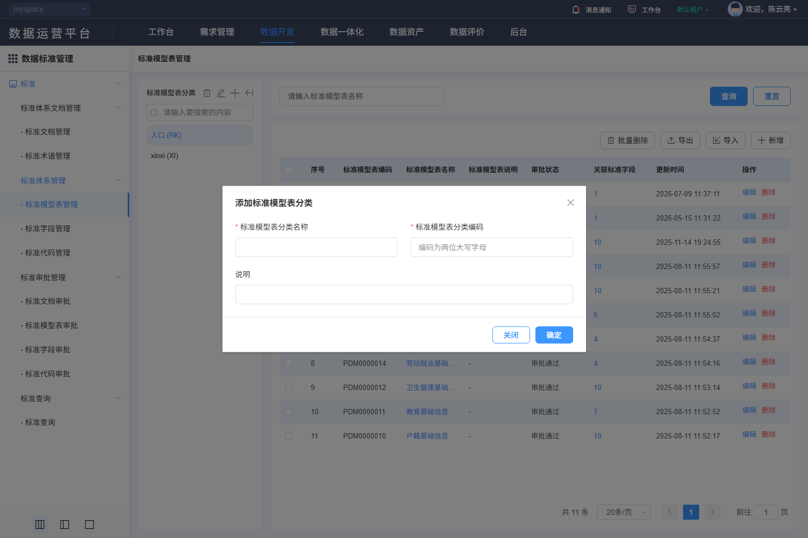

#### 8. 关联文档（DSS-511）

[规则核查、差异与外部合同](./核查记录.md) · [专项原文及历史索引](../evidence/dss-review-20261027/README.md)。

- [V-DSS-003-op1.png](../evidence/live-recheck-20261022/V-DSS-003-op1.png)
- [V-DSS-003-op1.json](../evidence/live-recheck-20261022/V-DSS-003-op1.json)

#### 9. 非功能性需求（DSS-511）

适用主规格第9节DSS-NFR质量矩阵。权限、文本、查询和资源清理适用全部；保存一致性适用维护/分类；审批事务适用四类审批；文件约束适用PDF与导入导出；本地集合容量适用代码项和四类关联。只读查询不新增账号密码、登录限流或物理执行任务。各项均未执行。

### DSS-512 标准 → 标准体系管理 → · 标准模型表管理 → 编辑

**业务目的**：修改标准模型表；入口：/dss/standard/system/dataSetEdit?optType=edit&id={id}。前置条件：已登录且具备相应资源/动作权限。

**操作与规则**：按以下字段、控件、请求和对象标识处理；分类、标准记录、引用关系、版本与审批申请分别管理。

**结果与异常处理**：操作结果须按对象或申请回读；失败、无权、合法空结果与结果未知分别反馈，前端提示不代替服务端业务结果。

**开发处理细则**：

- 固定使用已查字段及调用映射，未知后端约束通过第7节交付包补齐，不由AI自选；字段空白属性不表示无约束。
- 原实现与本次补充目标的差异在核查记录追踪，全部应用验收未执行。

<!-- 完整规格:DSS-512 -->

#### 1. 页面字段清单（DSS-512）

| 字段名称与绑定名 | 类型/控件 | 是否必填 | 默认值 | 长度/范围/单位 | 格式及校验 | 错误提示 | 条件/状态 |
|---|---|---|---|---|---|---|---|
| 所属分类 datasetId | number / hidden | 是 |  |  | 新增来自route.query.datasetId经Number转换；必须是有权有效分类，NaN禁止提交 |  |  |
| 标准模型表名称 tableName | string / 文本 | 是 | 当前记录 | 50字符 | trim首尾空白 | 请输入标准模型表名称 |  |
| 标准模型表编码 tableCode | string / 文本 | 是 | 当前记录 | 最长10字符 | trim；^[a-zA-Z_][a-zA-Z0-9_]+$，至少2字符；编辑/查看禁用 | 请输入标准模型表编码；编码须符合字母/下划线开头的规则 |  |
| 简称 tableShortName | string / 文本 | 否 | 当前记录 | 100字符 | trim首尾空白 | 请输入简称 |  |
| 生效日期 effectiveDate | string / 日期 | 是 | 当前记录 | yyyy-MM-dd | change非空 | 请选择生效日期 |  |
| 参考文档 docId / docName / docCode | ID / 禁用展示+选择 | 否 | null / 空字符串 / 空字符串 |  | 选择绑定文档id及名称/编号；清除三者同步清理；候选限定approveStatus=2（审批通过），不混用生效状态 |  |  |
| 当前记录 id | 只读文本 |  |  |  | 读取路由id；PUT路径使用当前稳定标识，不使用分类或文档id |  | 返回数据，不由客户端生成 |
| 说明 remark | string / 文本 | 否 | 当前记录 | 100字符 | trim首尾空白 | 请输入说明 |  |

新增默认来自模型初始化；编辑显示当前记录，服务器返回标识和状态不作为新增默认。无证据的长度、唯一域、精度单位及提示留空，详见核查记录的外部依赖。

#### 2. 页面交互规则（DSS-512）

| 控件/触发 | 前提及输入 | 行为与联动 | 忙碌/禁用/反馈 | 完成、失败及草稿 |
|---|---|---|---|---|
| 参考文档/清除 | 可维护且有文档读取权 | 打开单选文档选择器，查询/500ms防抖、树/列表/分页；确定将id及展示项同步写当前草稿，未选提示 | 加载/失败独立处理，旧对象响应不得串值 | 取消不改草稿；清除同步清除id/名称/编号/适用分级 |
| 提交 | 依赖读取成功、表单合法且有权 | 共享请求锁后一次POST/PUT；服务端复核范围/引用/状态/并发，成功回读 | 整个在途期间禁重复；finally恢复 | 成功受理后核记录/审批；明确失败保留草稿，未知结果先核查 |
| 取消/返回/关闭/后退 | 当前表单 | 有修改时选择继续编辑或放弃；放弃后返回原分类/筛选 | 不调用主记录保存 | 已发生上传/自动填充请求不能撤销其历史；临时文件按服务端策略回收 |

#### 3. 业务流程与异常分支（DSS-512）

1. 以当前记录id读取详情并填充；读取失败禁止把空表单当新增；禁用字段保持原值。
2. 所属分类来自右侧新增入口，不使用左侧分类新增弹窗。编码新增可录入，编辑保持不可修改；生效日期必填。
3. 字段与关联校验通过后，人工提交；公共表单浅复制模型，POST创建或PUT当前id更新；不自行增加幂等键/版本头。
4. 成功提示后回来源列表按稳定ID核对记录及审批结果；保存受理不代表审批通过、生效或物理数据已变更。
5. 失败定位可修改字段并保留草稿；超时/断网结果未知时先查询目标/请求关联，禁止自动重复保存。

| 异常分支 | 处理与恢复 |
|---|---|
| 本地校验/组合失败 | 定位对应项/页，保留合法草稿；依赖未就绪或ID无效不得提交。 |
| 权限、引用、审批/版本冲突 | 显示服务端原因，保持原数据；重新读取确认后再操作，不提供隐式强制覆盖。 |
| 超时、202、5xx、响应丢失 | 区分明确失败与结果未知；finally解除本地锁，未知结果先按稳定ID/申请ID核查。 |
| 重复点击、取消、迟到响应 | 同对象同动作最多一个在途请求；取消不发主记录写请求，离页旧响应不改新对象；上传/批量独立核结果。 |

#### 4. 接口与数据规则（DSS-512）

| 用途 | HTTP方法 | 相对路径 | 请求参数/来源/转换 | 返回读取与页面处理 |
|---|---|---|---|---|
| 详情读取 | GET | /back/dss/ms/standardtable/{id} | path id=当前记录id | 返回对象回显，包括只读标识与原有嵌套项 |
| 提交记录 | PUT | /back/dss/ms/standardtable/{id} | JSON：本字段表的模型键；保留原记录/子项id，不以名称替代 | 公共resolve触发成功提示；完整服务端body、审批与版本合同见核查记录 |
| 来源文档候选 | POST | /back/dss/ms/standarddocument/page | JSON {approveStatus:2,standardName,pageRequest}；单选当前文档id | 读取datas/total及standardName/id |

POST/PUT对象使用JSON；文件使用FormData，boundary由客户端生成。相对路径由模块/dss/ms与网关/back组合；列表读取datas/total。公共202、错误、身份头与超时，以及审批返回差异按第4节公共契约处理；不增造code=0成功协议、DTO、幂等头或固定租户字段。

#### 5. 验收标准（DSS-512）

| 验收编号 | 前置、步骤与可检查结果 | 关联需求 | 状态 |
|---|---|---|---|
| DSS-AC-647 | 打开修改标准模型表，逐字段核标签、必填、边界、默认/当前值和禁用；查看模式无保存。 | DSS-512 | 未执行 |
| DSS-AC-648 | 专用数据完成修改，核方法/路径/模型键并按id回读字段及关联；不以成功提示当生效证明。 | DSS-512 | 未执行 |
| DSS-AC-649 | 覆盖必填空白、上限/超限、无效候选、引用失效及当前表单专有组合规则，拒绝时不误报成功。 | DSS-512 | 未执行 |
| DSS-AC-650 | 注入重复提交、202、5xx、超时和并发冲突，核一次逻辑效果；未知结果查询后才允许适用重试。 | DSS-512 | 未执行 |
| DSS-AC-651 | 取消/返回/后退核继续编辑或放弃；主记录不保存、旧记录不变，已上传临时文件按归属回收，底栏与焦点可达。 | DSS-512 | 未执行 |

#### 6. 权限与安全要求（DSS-512）

服务端逐对象核验分类、记录、版本、审批申请、引用与文件的读取/写入权限及资源范围；直接URL、改id或隐藏按钮不能绕过。草稿、列表、文件和审计按当前身份与授权范围隔离；适用待审批限制的标准记录由服务端复核状态。TLS、文件内容检查、文本编码和审计各自验收，不把PDF签名引用当账号登录公钥。

#### 7. 页面布局与状态（DSS-512）

- 标题新增/修改标准表、右上返回；第一行模型表名称/编码，第二行简称/生效日期，第三行参考文档(含搜索与清除)/参考标准编号，下方全宽说明；底部右侧取消、提交。
- 初始化/加载、可操作、合法空结果、字段错误、业务拒绝、网络失败分别展示；写入另有提交中、结果未知及回读。宽表局部横滚，长表单纵滚，200%缩放下操作可达。

#### 8. 关联文档（DSS-512）

[规则核查、差异与外部合同](./核查记录.md) · [专项原文及历史索引](../evidence/dss-review-20261027/README.md)。

- [V-DSS-003-op2.png](../evidence/live-recheck-20261022/V-DSS-003-op2.png)
- [V-DSS-003-op2.json](../evidence/live-recheck-20261022/V-DSS-003-op2.json)

#### 9. 非功能性需求（DSS-512）

适用主规格第9节DSS-NFR质量矩阵。权限、文本、查询和资源清理适用全部；保存一致性适用维护/分类；审批事务适用四类审批；文件约束适用PDF与导入导出；本地集合容量适用代码项和四类关联。只读查询不新增账号密码、登录限流或物理执行任务。各项均未执行。

### DSS-513 标准 → 标准体系管理 → · 标准模型表管理 → 修改（标准模型表分类）

**业务目的**：修改标准模型表分类；入口：/dss/standard/system/dataSetList。前置条件：已登录且具备相应资源/动作权限。

**操作与规则**：按以下字段、控件、请求和对象标识处理；分类、标准记录、引用关系、版本与审批申请分别管理。

**结果与异常处理**：操作结果须按对象或申请回读；失败、无权、合法空结果与结果未知分别反馈，前端提示不代替服务端业务结果。

**开发处理细则**：

- 固定使用已查字段及调用映射，未知后端约束通过第7节交付包补齐，不由AI自选；字段空白属性不表示无约束。
- 原实现与本次补充目标的差异在核查记录追踪，全部应用验收未执行。

<!-- 完整规格:DSS-513 -->

#### 1. 页面字段清单（DSS-513）

| 字段名称与绑定名 | 类型/控件 | 是否必填 | 默认值 | 长度/范围/单位 | 格式及校验 | 错误提示 | 条件/状态 |
|---|---|---|---|---|---|---|---|
| 标准模型表分类名称 datasetName | string / 文本 | 是 | 当前记录 | 25字符 | trim首尾空白 | 请输入标准模型表分类名称 |  |
| 标准模型表分类编码 datasetCode | string / 文本 | 是 | 当前记录 | 2字符 | 输入剔除非A-Z/a-z并转大写；提示为两位大写字母；目标提交严格校验^[A-Z]{2}$ | 请输入两位大写字母分类编码 |  |
| 说明 remark | string / 文本 | 否 | 当前记录 | 100字符 | trim首尾空白 | 请输入说明 |  |
| 当前分类 id | 只读文本 |  |  |  | 编辑当前curNode.id，非标准表id |  | 返回数据，不由客户端生成 |

新增默认来自模型初始化；编辑显示当前记录，服务器返回标识和状态不作为新增默认。无证据的长度、唯一域、精度单位及提示留空，详见核查记录的外部依赖。

#### 2. 页面交互规则（DSS-513）

| 控件/触发 | 前提及输入 | 行为与联动 | 忙碌/禁用/反馈 | 完成、失败及草稿 |
|---|---|---|---|---|
| 分类新增/修改/确定 | 新增或已选curNode | 新增三项清空；修改回显所选分类，确定先校验再保存，成功重读dataset/list | btnLoading覆盖请求；共享锁防重复 | 关闭丢当前草稿；失败保留 |
| 提交 | 依赖读取成功、表单合法且有权 | 共享请求锁后一次POST/PUT；服务端复核范围/引用/状态/并发，成功回读 | 整个在途期间禁重复；finally恢复 | 成功受理后核记录/审批；明确失败保留草稿，未知结果先核查 |
| 取消/返回/关闭/后退 | 当前表单 | 有修改时选择继续编辑或放弃；放弃后返回原分类/筛选 | 不调用主记录保存 | 已发生上传/自动填充请求不能撤销其历史；临时文件按服务端策略回收 |

#### 3. 业务流程与异常分支（DSS-513）

1. 以当前记录id读取详情并填充；读取失败禁止把空表单当新增；禁用字段保持原值。
2. 分类编码输入即时规范化为大写两字母；严格两位是本次目标校验，原必填规则不足的差异见核查记录。
3. 字段与关联校验通过后，人工提交；公共表单浅复制模型，POST创建或PUT当前id更新；不自行增加幂等键/版本头。
4. 成功提示后回来源列表按稳定ID核对记录及审批结果；保存受理不代表审批通过、生效或物理数据已变更。
5. 失败定位可修改字段并保留草稿；超时/断网结果未知时先查询目标/请求关联，禁止自动重复保存。

| 异常分支 | 处理与恢复 |
|---|---|
| 本地校验/组合失败 | 定位对应项/页，保留合法草稿；依赖未就绪或ID无效不得提交。 |
| 权限、引用、审批/版本冲突 | 显示服务端原因，保持原数据；重新读取确认后再操作，不提供隐式强制覆盖。 |
| 超时、202、5xx、响应丢失 | 区分明确失败与结果未知；finally解除本地锁，未知结果先按稳定ID/申请ID核查。 |
| 重复点击、取消、迟到响应 | 同对象同动作最多一个在途请求；取消不发主记录写请求，离页旧响应不改新对象；上传/批量独立核结果。 |

#### 4. 接口与数据规则（DSS-513）

| 用途 | HTTP方法 | 相对路径 | 请求参数/来源/转换 | 返回读取与页面处理 |
|---|---|---|---|---|
| 详情读取 | GET | /back/dss/ms/dataset/{id} | path id=当前记录id | 返回对象回显，包括只读标识与原有嵌套项 |
| 提交记录 | PUT | /back/dss/ms/dataset/{id} | JSON：本字段表的模型键；保留原记录/子项id，不以名称替代 | 公共resolve触发成功提示；完整服务端body、审批与版本合同见核查记录 |

POST/PUT对象使用JSON；文件使用FormData，boundary由客户端生成。相对路径由模块/dss/ms与网关/back组合；列表读取datas/total。公共202、错误、身份头与超时，以及审批返回差异按第4节公共契约处理；不增造code=0成功协议、DTO、幂等头或固定租户字段。

#### 5. 验收标准（DSS-513）

| 验收编号 | 前置、步骤与可检查结果 | 关联需求 | 状态 |
|---|---|---|---|
| DSS-AC-652 | 打开修改标准模型表分类，逐字段核标签、必填、边界、默认/当前值和禁用；查看模式无保存。 | DSS-513 | 未执行 |
| DSS-AC-653 | 专用数据完成修改，核方法/路径/模型键并按id回读字段及关联；不以成功提示当生效证明。 | DSS-513 | 未执行 |
| DSS-AC-654 | 覆盖必填空白、上限/超限、无效候选、引用失效及当前表单专有组合规则，拒绝时不误报成功。 | DSS-513 | 未执行 |
| DSS-AC-655 | 注入重复提交、202、5xx、超时和并发冲突，核一次逻辑效果；未知结果查询后才允许适用重试。 | DSS-513 | 未执行 |
| DSS-AC-656 | 取消/返回/后退核继续编辑或放弃；主记录不保存、旧记录不变，已上传临时文件按归属回收，底栏与焦点可达。 | DSS-513 | 未执行 |

#### 6. 权限与安全要求（DSS-513）

服务端逐对象核验分类、记录、版本、审批申请、引用与文件的读取/写入权限及资源范围；直接URL、改id或隐藏按钮不能绕过。草稿、列表、文件和审计按当前身份与授权范围隔离；适用待审批限制的标准记录由服务端复核状态。TLS、文件内容检查、文本编码和审计各自验收，不把PDF签名引用当账号登录公钥。

#### 7. 页面布局与状态（DSS-513）

- 原模型表页上方居中分类弹窗，宽45%且受视口约束；名称与编码左右两列，说明独占下一行；底部右侧关闭、确定，背景当前分类保持。
- 初始化/加载、可操作、合法空结果、字段错误、业务拒绝、网络失败分别展示；写入另有提交中、结果未知及回读。宽表局部横滚，长表单纵滚，200%缩放下操作可达。

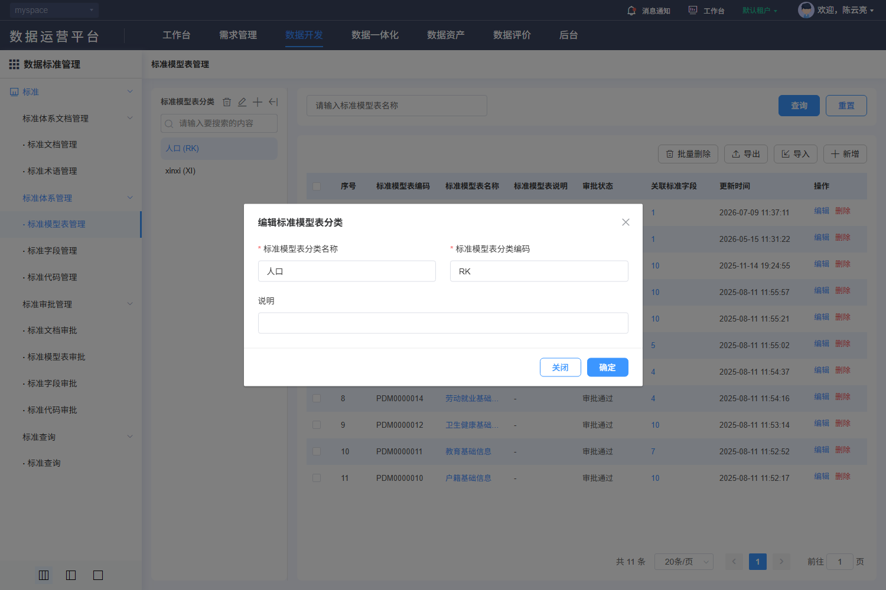

#### 8. 关联文档（DSS-513）

[规则核查、差异与外部合同](./核查记录.md) · [专项原文及历史索引](../evidence/dss-review-20261027/README.md)。

- [V-DSS-003-op3.png](../evidence/live-recheck-20261022/V-DSS-003-op3.png)
- [V-DSS-003-op3.json](../evidence/live-recheck-20261022/V-DSS-003-op3.json)

#### 9. 非功能性需求（DSS-513）

适用主规格第9节DSS-NFR质量矩阵。权限、文本、查询和资源清理适用全部；保存一致性适用维护/分类；审批事务适用四类审批；文件约束适用PDF与导入导出；本地集合容量适用代码项和四类关联。只读查询不新增账号密码、登录限流或物理执行任务。各项均未执行。

### DSS-502 标准 → 标准体系管理 → · 标准字段管理

**业务目的**：标准字段管理；入口：/dss/standard/system/indexItemList。前置条件：已登录且具备相应资源/动作权限。

**操作与规则**：按以下字段、控件、请求和对象标识处理；分类、标准记录、引用关系、版本与审批申请分别管理。

**结果与异常处理**：操作结果须按对象或申请回读；失败、无权、合法空结果与结果未知分别反馈，前端提示不代替服务端业务结果。

**开发处理细则**：

- 固定使用已查字段及调用映射，未知后端约束通过第7节交付包补齐，不由AI自选；字段空白属性不表示无约束。
- 原实现与本次补充目标的差异在核查记录追踪，全部应用验收未执行。

<!-- 完整规格:DSS-502 -->

#### 1. 页面字段清单（DSS-502）

| 字段名称与绑定名 | 类型/控件 | 是否必填 | 默认值 | 长度/范围/单位 | 格式及校验 | 错误提示 | 条件/状态 |
|---|---|---|---|---|---|---|---|
| 标准字段名称 itemName | string / 文本 | 否 | 空字符串 | 255字符 | trim首尾空白 | 请输入标准字段名称 |  |
| 状态 dssStatus / 审批 approveStatus | string / 可清空单选 | 否 | 空字符串 | 状态1待生效/2已生效/3已失效；审批1待审批/2通过/3不通过 |  |  |  |
| 分类 standardClassifyId / returnChild | number / hidden | 是 | 1 / 1 |  | 选择分类刷新，returnChild=1包含子类；页号须回1 |  |  |
| 页号 pageRequest.pageNo | integer | 是 | 1 | 正整数 | 查询、重置、改变页大小回第1页 |  |  |
| 页大小 pageRequest.pageSize | integer | 是 | 20 | 正整数 | 候选10/20/30/40/50/100；不把历史总数当上限 |  |  |
| 排序 pageRequest.order | array<object> | 是 | [{prop:"id",asc:false}] |  | prop为字段键、asc为boolean；服务端限制允许排序字段 |  |  |
| 序号 | 只读文本 |  |  |  |  |  | 返回数据，不由客户端生成 |
| 字段编码 itemCode | 只读文本 |  |  |  |  |  | 返回数据，不由客户端生成 |
| 标准字段名称 itemName | 只读文本 |  |  |  |  |  | 返回数据，不由客户端生成 |
| 定义 itemDef | 只读文本 |  |  |  |  |  | 返回数据，不由客户端生成 |
| 关联代码 categoryCode | 只读文本 |  |  |  |  |  | 返回数据，不由客户端生成 |
| 版本 dssVersion | 只读文本 |  |  |  |  |  | 返回数据，不由客户端生成 |
| 状态 dssStatus | 只读文本 |  |  |  |  |  | 返回数据，不由客户端生成 |
| 审批状态 approveStatus | 只读文本 |  |  |  |  |  | 返回数据，不由客户端生成 |
| 使用频次 useNum | 只读文本 |  |  |  |  |  | 返回数据，不由客户端生成 |
| 创建时间 createTime | 只读文本 |  |  |  |  |  | 返回数据，不由客户端生成 |
| 字段标识 id | 只读文本 |  |  |  |  |  | 返回数据，不由客户端生成 |
| 版本组 groupId | 只读文本 |  |  |  |  |  | 返回数据，不由客户端生成 |

新增默认来自模型初始化；编辑显示当前记录，服务器返回标识和状态不作为新增默认。无证据的长度、唯一域、精度单位及提示留空，详见核查记录的外部依赖。

#### 2. 页面交互规则（DSS-502）

| 控件/触发 | 前提及输入 | 行为与联动 | 忙碌/禁用/反馈 | 完成、失败及草稿 |
|---|---|---|---|---|
| 查询/Enter | 草稿合法 | 按当前条件查询并回第1页；所有入口共用查询处理 | 显示表格加载，最新请求有效 | 失败保留条件；旧响应不得覆盖 |
| 重置 | 当前列表 | 清空可编辑筛选，保留当前分类/固定范围，回第1页并查询 | 加载不清除分类 | 不触发写入 |
| 分页/页大小 | 最新total | 按当前条件读指定页；改变大小回第1页 | 禁止无效页；不以截图min/max限制总页数 | 返回保持来源条件；列表刷新清除失效勾选 |
| 分类树/过滤/收起 | 当前有权节点 | 过滤名称不改变记录定义；点击节点更新standardClassifyId并回第1页；收起仅改布局 | 树加载失败可重试，不判无分类 | 恢复当前分类；节点与记录操作分别授权 |
| 顶部/行操作 | 对象、分类及审批允许 | 根1可新增/维护记录；自定义分类可添加已有记录或取消添加；待审批1禁编辑/删除 | 选中集合只包含允许对象 | 分类移除是取消关系，不能当记录删除 |
| 版本/派生/关联代码 | 当前行有groupId/categoryId | 版本进入indexItemVersion?groupId；派生indexItemDeriveList?groupId；关联代码indexCodeItemList?id=categoryId | 分别鉴权 | 只读下钻不自动派生或修改版本 |

#### 3. 业务流程与异常分支（DSS-502）

1. 进入标准字段管理，先检查当前对象范围与分类读取结果，初始化分页并请求授权记录。
2. 修改条件仅改查询草稿；查询或重置回第1页，翻页保留已提交筛选。
3. 收到当前请求结果后同时更新列表、total及有效页；合法空结果、读取失败和无权分开显示。
4. 名称链接进入optType=view，编辑进入optType=edit并携当前id；查看禁写，维护后按来源条件回读。

| 异常分支 | 处理与恢复 |
|---|---|
| 合法空结果 | 保留当前条件，显示真实0条；无权/失败不降格为空列表。 |
| 分类/候选失败或失效 | 显示具体依赖失败及重试；不自动扩大到根或其他分类。 |
| 超时、202、5xx、乱序 | 显示请求失败；旧响应丢弃，保留已提交条件；只由用户显式重试。 |
| 会话过期/失权 | 按公共码处理会话和路由，清理受限数据；不能继续显示上一身份内容。 |

#### 4. 接口与数据规则（DSS-502）

| 用途 | HTTP方法 | 相对路径 | 请求参数/来源/转换 | 返回读取与页面处理 |
|---|---|---|---|---|
| 列表查询 | POST | /back/dss/ms/standardfield/page | JSON：筛选键+固定条件+pageRequest；空值/未传保持模型语义 | 读取datas/total；公共列表兼容数组，但正式DTO须按核查合同 |
| 分类树 | GET | /back/dss/ms/standardclassify/listTree/{id} | id初始1 | standardClassifyName/id/children、inside及父节点字段 |

POST/PUT对象使用JSON；文件使用FormData，boundary由客户端生成。相对路径由模块/dss/ms与网关/back组合；列表读取datas/total。公共202、错误、身份头与超时，以及审批返回差异按第4节公共契约处理；不增造code=0成功协议、DTO、幂等头或固定租户字段。

#### 5. 验收标准（DSS-502）

| 验收编号 | 前置、步骤与可检查结果 | 关联需求 | 状态 |
|---|---|---|---|
| DSS-AC-657 | 在授权账号进入标准字段管理，核对筛选/列顺序、默认分页、中文长值及合法空结果；图内样本数量不作默认值。 | DSS-502 | 未执行 |
| DSS-AC-658 | 输入条件查询、重置、翻页和改变大小，核POST /back/dss/ms/standardfield/page的参数与datas/total；回读匹配记录，无串分类。 | DSS-502 | 未执行 |
| DSS-AC-659 | 用无权ID、空结果、候选失败与服务端业务拒绝验证区分反馈；不把失败当总数0。 | DSS-502 | 未执行 |
| DSS-AC-660 | 注入断网、202、5xx及乱序响应，只有当前条件结果生效，显式重试恢复；不发写请求。 | DSS-502 | 未执行 |
| DSS-AC-661 | 返回恢复分类、筛选、页码；记录失效或最后页删除后回有效页，列表选择不带到其他对象。 | DSS-502 | 未执行 |

#### 6. 权限与安全要求（DSS-502）

服务端逐对象核验分类、记录、版本、审批申请、引用与文件的读取/写入权限及资源范围；直接URL、改id或隐藏按钮不能绕过。草稿、列表、文件和审计按当前身份与授权范围隔离；适用待审批限制的标准记录由服务端复核状态。TLS、文件内容检查、文本编码和审计各自验收，不把PDF签名引用当账号登录公钥。

#### 7. 页面布局与状态（DSS-502）

- 左侧是目录分类独立白色面板：标题及分类增删改/收起工具、关键字过滤、树；右侧是筛选与表格。树过滤只过滤展示，点击节点才改变查询范围。
- 标准字段管理位于平台导航右侧；上方标题与筛选区，查询/重置在右端；操作工具位于表格右上，表头顺序按本字段表结果列，底部右侧条数、页大小、页码和跳页。
- 初始化/加载、可操作、合法空结果、字段错误、业务拒绝、网络失败分别展示；写入另有提交中、结果未知及回读。宽表局部横滚，长表单纵滚，200%缩放下操作可达。

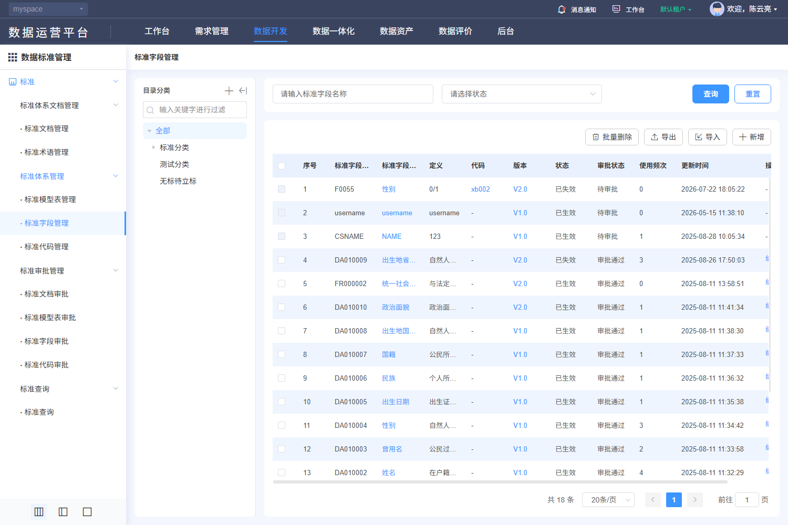

#### 8. 关联文档（DSS-502）

[规则核查、差异与外部合同](./核查记录.md) · [专项原文及历史索引](../evidence/dss-review-20261027/README.md)。

- [V-DSS-004.png](../evidence/live-recheck-20261022/V-DSS-004.png)
- [V-DSS-004.json](../evidence/live-recheck-20261022/V-DSS-004.json)

#### 9. 非功能性需求（DSS-502）

适用主规格第9节DSS-NFR质量矩阵。权限、文本、查询和资源清理适用全部；保存一致性适用维护/分类；审批事务适用四类审批；文件约束适用PDF与导入导出；本地集合容量适用代码项和四类关联。只读查询不新增账号密码、登录限流或物理执行任务。各项均未执行。

### DSS-514 标准 → 标准体系管理 → · 标准字段管理 → 新增（标准字段分类节点）

**业务目的**：新增标准字段分类节点；入口：/dss/standard/system/indexItemList。前置条件：已登录且具备相应资源/动作权限。

**操作与规则**：按以下字段、控件、请求和对象标识处理；分类、标准记录、引用关系、版本与审批申请分别管理。

**结果与异常处理**：操作结果须按对象或申请回读；失败、无权、合法空结果与结果未知分别反馈，前端提示不代替服务端业务结果。

**开发处理细则**：

- 固定使用已查字段及调用映射，未知后端约束通过第7节交付包补齐，不由AI自选；字段空白属性不表示无约束。
- 原实现与本次补充目标的差异在核查记录追踪，全部应用验收未执行。

<!-- 完整规格:DSS-514 -->

#### 1. 页面字段清单（DSS-514）

| 字段名称与绑定名 | 类型/控件 | 是否必填 | 默认值 | 长度/范围/单位 | 格式及校验 | 错误提示 | 条件/状态 |
|---|---|---|---|---|---|---|---|
| 父级节点 parentNode | 只读文本 |  |  |  | 新增显示当前standardClassifyName；编辑显示standardClassifyPname |  | 返回数据，不由客户端生成 |
| 子级节点 standardClassifyName | string / 文本 | 是 | 空字符串 |  | trim首尾空白 | 请输入子级节点 |  |
| 父节点标识 standardClassifyPid | ID / hidden | 是 |  |  | 新增取当前节点id；编辑保留原父id |  |  |
| 当前节点 id / inside | 只读文本 |  |  |  | inside控制内置节点维护；根1不得删除，节点2不显示新增；服务端仍须复核 |  | 返回数据，不由客户端生成 |

新增默认来自模型初始化；编辑显示当前记录，服务器返回标识和状态不作为新增默认。无证据的长度、唯一域、精度单位及提示留空，详见核查记录的外部依赖。

#### 2. 页面交互规则（DSS-514）

| 控件/触发 | 前提及输入 | 行为与联动 | 忙碌/禁用/反馈 | 完成、失败及草稿 |
|---|---|---|---|---|
| 新增/修改/删除节点 | 当前有权节点 | 新增取当前父id；修改保留父id；根1禁删，inside内置节点禁维护，节点2无新增；删除先确认 | 树读写独立锁与失败状态 | 只更分类，不生成字段/代码集；取消不写 |
| 父级/子级输入 | 节点模态打开 | 父级禁用展示，子级trim非空；没有证据的长度不设惯例上限 | 字段错误关联子级 | 成功刷新树并恢复父/当前有效节点 |
| 提交 | 依赖读取成功、表单合法且有权 | 共享请求锁后一次POST/PUT；服务端复核范围/引用/状态/并发，成功回读 | 整个在途期间禁重复；finally恢复 | 成功受理后核记录/审批；明确失败保留草稿，未知结果先核查 |
| 取消/返回/关闭/后退 | 当前表单 | 有修改时选择继续编辑或放弃；放弃后返回原分类/筛选 | 不调用主记录保存 | 已发生上传/自动填充请求不能撤销其历史；临时文件按服务端策略回收 |

#### 3. 业务流程与异常分支（DSS-514）

1. 从明确新增入口建立空模型，验证分类等上下文；不从列表第一条或样本复制默认值。
2. 打开600px节点弹窗，先显示禁用父级和必填子级；确认POST名称和父ID。
3. 修改PUT/{节点id}及删除DELETE/{节点id}分别处理；存在子节点/引用由服务端保护，不默认级联。
4. 字段与关联校验通过后，人工提交；公共表单浅复制模型，POST创建或PUT当前id更新；不自行增加幂等键/版本头。
5. 成功提示后回来源列表按稳定ID核对记录及审批结果；保存受理不代表审批通过、生效或物理数据已变更。
6. 失败定位可修改字段并保留草稿；超时/断网结果未知时先查询目标/请求关联，禁止自动重复保存。

| 异常分支 | 处理与恢复 |
|---|---|
| 本地校验/组合失败 | 定位对应项/页，保留合法草稿；依赖未就绪或ID无效不得提交。 |
| 权限、引用、审批/版本冲突 | 显示服务端原因，保持原数据；重新读取确认后再操作，不提供隐式强制覆盖。 |
| 超时、202、5xx、响应丢失 | 区分明确失败与结果未知；finally解除本地锁，未知结果先按稳定ID/申请ID核查。 |
| 重复点击、取消、迟到响应 | 同对象同动作最多一个在途请求；取消不发主记录写请求，离页旧响应不改新对象；上传/批量独立核结果。 |

#### 4. 接口与数据规则（DSS-514）

| 用途 | HTTP方法 | 相对路径 | 请求参数/来源/转换 | 返回读取与页面处理 |
|---|---|---|---|---|
| 分类树 | GET | /back/dss/ms/standardclassify/listTree/{id} | 初始id=1，复读所选/父节点 | 返回树 |
| 新增分类 | POST | /back/dss/ms/standardclassify | JSON {standardClassifyName,standardClassifyPid} | 成功刷新树 |
| 修改分类 | PUT | /back/dss/ms/standardclassify/{id} | 当前节点id；body同上 | 保留父节点关系 |
| 删除分类 | DELETE | /back/dss/ms/standardclassify/{id} | 人工确认、当前节点id | 重读父节点；引用保护按服务端合同 |

POST/PUT对象使用JSON；文件使用FormData，boundary由客户端生成。相对路径由模块/dss/ms与网关/back组合；列表读取datas/total。公共202、错误、身份头与超时，以及审批返回差异按第4节公共契约处理；不增造code=0成功协议、DTO、幂等头或固定租户字段。

#### 5. 验收标准（DSS-514）

| 验收编号 | 前置、步骤与可检查结果 | 关联需求 | 状态 |
|---|---|---|---|
| DSS-AC-662 | 打开新增标准字段分类节点，逐字段核标签、必填、边界、默认/当前值和禁用；查看模式无保存。 | DSS-514 | 未执行 |
| DSS-AC-663 | 专用数据完成新增，核方法/路径/模型键并按id回读字段及关联；不以成功提示当生效证明。 | DSS-514 | 未执行 |
| DSS-AC-664 | 覆盖必填空白、上限/超限、无效候选、引用失效及当前表单专有组合规则，拒绝时不误报成功。 | DSS-514 | 未执行 |
| DSS-AC-665 | 注入重复提交、202、5xx、超时和并发冲突，核一次逻辑效果；未知结果查询后才允许适用重试。 | DSS-514 | 未执行 |
| DSS-AC-666 | 取消/返回/后退核继续编辑或放弃；主记录不保存、旧记录不变，已上传临时文件按归属回收，底栏与焦点可达。 | DSS-514 | 未执行 |

#### 6. 权限与安全要求（DSS-514）

服务端逐对象核验分类、记录、版本、审批申请、引用与文件的读取/写入权限及资源范围；直接URL、改id或隐藏按钮不能绕过。草稿、列表、文件和审计按当前身份与授权范围隔离；适用待审批限制的标准记录由服务端复核状态。TLS、文件内容检查、文本编码和审计各自验收，不把PDF签名引用当账号登录公钥。

#### 7. 页面布局与状态（DSS-514）

- 左分类树上方居中600px“新增节点/编辑节点”弹窗，父级禁用输入在左、子级可编辑输入在右，底部取消/确定；背景不是标准字段/代码记录表单。
- 初始化/加载、可操作、合法空结果、字段错误、业务拒绝、网络失败分别展示；写入另有提交中、结果未知及回读。宽表局部横滚，长表单纵滚，200%缩放下操作可达。

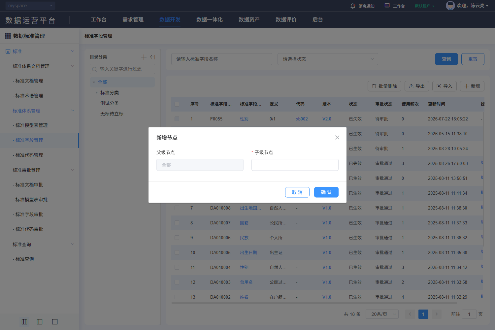

#### 8. 关联文档（DSS-514）

[规则核查、差异与外部合同](./核查记录.md) · [专项原文及历史索引](../evidence/dss-review-20261027/README.md)。

- [V-DSS-004-op1.png](../evidence/live-recheck-20261022/V-DSS-004-op1.png)
- [V-DSS-004-op1.json](../evidence/live-recheck-20261022/V-DSS-004-op1.json)

#### 9. 非功能性需求（DSS-514）

适用主规格第9节DSS-NFR质量矩阵。权限、文本、查询和资源清理适用全部；保存一致性适用维护/分类；审批事务适用四类审批；文件约束适用PDF与导入导出；本地集合容量适用代码项和四类关联。只读查询不新增账号密码、登录限流或物理执行任务。各项均未执行。

### DSS-515 标准 → 标准体系管理 → · 标准字段管理 → 编辑

**业务目的**：修改标准字段；入口：/dss/standard/system/indexItemEdit?optType=edit&id={id}。前置条件：已登录且具备相应资源/动作权限。

**操作与规则**：按以下字段、控件、请求和对象标识处理；分类、标准记录、引用关系、版本与审批申请分别管理。

**结果与异常处理**：操作结果须按对象或申请回读；失败、无权、合法空结果与结果未知分别反馈，前端提示不代替服务端业务结果。

**开发处理细则**：

- 固定使用已查字段及调用映射，未知后端约束通过第7节交付包补齐，不由AI自选；字段空白属性不表示无约束。
- 原实现与本次补充目标的差异在核查记录追踪，全部应用验收未执行。

<!-- 完整规格:DSS-515 -->

#### 1. 页面字段清单（DSS-515）

| 字段名称与绑定名 | 类型/控件 | 是否必填 | 默认值 | 长度/范围/单位 | 格式及校验 | 错误提示 | 条件/状态 |
|---|---|---|---|---|---|---|---|
| 分类上下文 collectId | number / hidden |  |  |  | 来自route.query.collectId经Number转换；与字段id、groupId区别；无有效值时由合同规定省略，不能发送NaN |  |  |
| 字段编码 itemCode | string / 文本 | 是 | 当前记录 | 10字符 | 新增仅字母/数字；编辑禁用；保持大小写，不从样本自动编码 | 请输入字段编码 |  |
| 主题分类 themeClassify | string / 文本 | 否 | 当前记录 | 100字符 | trim首尾空白 | 请输入主题分类 |  |
| 标准字段名称 itemName | string / 文本 | 是 | 当前记录 | 50字符 | trim首尾空白 | 请输入标准字段名称 |  |
| 定义 itemDef | string / 文本 | 是 | 当前记录 | 100字符 | trim首尾空白 | 请输入定义 |  |
| 生效日期 effectiveDate / 失效日期 expireDate | string / 日期 | 生效是；失效否 | 当前记录 | yyyy-MM-dd | 两值都有时expireDate必须严格晚于effectiveDate；相等拒绝 | 请选择生效日期；失效日期必须晚于生效日期 |  |
| 英文名称 itemNameEn | string / 文本 | 是 | 当前记录 | 100字符 | trim；^[a-zA-Z_][a-zA-Z0-9_]+$，至少2字符 | 请输入英文名称；格式不合法 |  |
| 中文全拼 itemNameCn | string / 文本 | 否 | 当前记录 | 100字符 | trim首尾空白 | 请输入中文全拼 |  |
| 建议字段命名 recommendName | string / 文本 | 否 | 当前记录 | 100字符 | trim首尾空白 | 请输入建议字段命名 |  |
| 第二显示名 secondName | string / 文本 | 否 | 当前记录 | 100字符 | trim首尾空白 | 请输入第二显示名 |  |
| 参考标准文档 docId / docName / standardCode | ID / 文档选择 | 否 | null / 空字符串 / 空字符串 |  | docName是组件展示；GET回显docManageDo.standardName，提交绑定docId、standardCode |  |  |
| 参考标准分级 standardType | string / radio | 是 |  | A～G | 选择文档同步分级，允许按表单规则选择；清除文档清此值 | 请选择参考标准分级 |  |
| 数据类型 dataType | string / 搜索单选 |  | 当前记录 |  | GET db/types取得dbType/desc/needLength/needPrecision；按dbType绑定，不固化历史8种选项 |  |  |
| 长度比较 length1Type / length2Type | number / 单选 | 显示长度时首组必填；展开后第二组必填 | 当前记录 | 1大于等于、2等于、3小于等于、4不限制 | needLength控制显示；移除第二组同步清length2Type/colLength2 |  |  |
| 数据长度 colLength1 / colLength2 | number / 输入 | 适用且比较符非4时必填 | 当前记录 | min=1 | 比较符4时禁用对应数值且不要求已禁用值；组合区间须满足服务端类型合同；maxlength=100不能当数值最大值 |  |  |
| 精度比较 precision1Type / precision2Type | number / 单选 | 显示精度时首组必填；展开后第二组必填 | 当前记录 | 比较符同长度 | needPrecision控制显示；移除第二组清precision2Type/colPrecision2 |  |  |
| 数据精度 colPrecision1 / colPrecision2 | number / 输入 | 适用且比较符非4时必填 | 当前记录 | min=0 | 0为合法值，不能当空；比较符4不校验禁用值；精度与长度关系按类型合同 |  |  |
| 是否可为空 nullAble | number / radio | 是 |  | 0否、1是 | 0是有效选择 | 请选择是否可为空 |  |
| 数据格式 dataFormat | string / 文本 | 否 | 当前记录 | 100字符 | trim首尾空白 | 请输入数据格式 |  |
| 数据规则 dataRule | string / 文本 | 否 | 当前记录 | 100字符 | trim首尾空白 | 请输入数据规则 |  |
| 编码规则 codingRule | string / 文本 | 否 | 当前记录 | 100字符 | trim首尾空白 | 请输入编码规则 |  |
| 计量单位 measure | string / 文本 | 否 | 当前记录 | 100字符 | trim首尾空白 | 请输入计量单位 |  |
| 关联代码 categoryId / categoryName / standardTypeCategory | ID+展示 / 选择 | 否 |  |  | 选代码集id，同时回显名称与分级；categoryName为展示，standardTypeCategory只读；清除三项同步清理 |  |  |
| 一数一源 dataAndSource | string / 文本 | 否 | 当前记录 | 100字符 | trim首尾空白 | 请输入一数一源 |  |
| 更新频率 updateFrequency | string / 文本 | 否 | 当前记录 | 100字符 | trim首尾空白 | 请输入更新频率 |  |
| 安全分级分类 safety | string / radio | 否 | 当前记录 | 1～5分别SL1～SL5 | 回显转字符串；安全分级为标准元数据，不自动授予数据读取权 |  |  |
| 字段 id / 版本 groupId、dssVersion | 只读文本 |  |  |  | 字段版本读取后保持；不可将groupId当PUT/{id} |  | 返回数据，不由客户端生成 |

新增默认来自模型初始化；编辑显示当前记录，服务器返回标识和状态不作为新增默认。无证据的长度、唯一域、精度单位及提示留空，详见核查记录的外部依赖。

#### 2. 页面交互规则（DSS-515）

| 控件/触发 | 前提及输入 | 行为与联动 | 忙碌/禁用/反馈 | 完成、失败及草稿 |
|---|---|---|---|---|
| 参考文档/清除 | 可维护且有文档读取权 | 打开单选文档选择器，查询/500ms防抖、树/列表/分页；确定将id及展示项同步写当前草稿，未选提示 | 加载/失败独立处理，旧对象响应不得串值 | 取消不改草稿；清除同步清除id/名称/编号/适用分级 |
| 关联代码/清除 | 当前可编辑 | 选择代码集，写categoryId与名称/分级；清除全部关联键 | 加载失败保留当前关联 | 取消选择不改原值 |
| 数据类型/长度/精度/加减 | db/types加载成功 | 按needLength/needPrecision显示；+展开第二比较组，×清第二组；比较符4禁数值且豁免数值必填 | 候选失败阻断依赖型提交 | 改类型清不适用约束，0精度保留 |
| 数据格式 change | 非空或清空草稿 | 调用autofill解析格式，按返回dataType与长度/精度更新；自动结果与手工修改绑定同一输入版本 | 显示解析中/失败；不执行格式文本 | 旧响应不能覆盖新输入；失败保留原合法值 |
| 提交 | 依赖读取成功、表单合法且有权 | 共享请求锁后一次POST/PUT；服务端复核范围/引用/状态/并发，成功回读 | 整个在途期间禁重复；finally恢复 | 成功受理后核记录/审批；明确失败保留草稿，未知结果先核查 |
| 取消/返回/关闭/后退 | 当前表单 | 有修改时选择继续编辑或放弃；放弃后返回原分类/筛选 | 不调用主记录保存 | 已发生上传/自动填充请求不能撤销其历史；临时文件按服务端策略回收 |

#### 3. 业务流程与异常分支（DSS-515）

1. 以当前记录id读取详情并填充；读取失败禁止把空表单当新增；禁用字段保持原值。
2. 按基础/业务/技术/管理四卡读取当前字段；严格日期先后、英文名正则、空值0、显示条件与引用有效性分别校验。
3. 自动填充为规则解析调用，不是大模型生成或字段保存；提交仍由用户明确触发。
4. 字段与关联校验通过后，人工提交；公共表单浅复制模型，POST创建或PUT当前id更新；不自行增加幂等键/版本头。
5. 成功提示后回来源列表按稳定ID核对记录及审批结果；保存受理不代表审批通过、生效或物理数据已变更。
6. 失败定位可修改字段并保留草稿；超时/断网结果未知时先查询目标/请求关联，禁止自动重复保存。

| 异常分支 | 处理与恢复 |
|---|---|
| 本地校验/组合失败 | 定位对应项/页，保留合法草稿；依赖未就绪或ID无效不得提交。 |
| 权限、引用、审批/版本冲突 | 显示服务端原因，保持原数据；重新读取确认后再操作，不提供隐式强制覆盖。 |
| 超时、202、5xx、响应丢失 | 区分明确失败与结果未知；finally解除本地锁，未知结果先按稳定ID/申请ID核查。 |
| 重复点击、取消、迟到响应 | 同对象同动作最多一个在途请求；取消不发主记录写请求，离页旧响应不改新对象；上传/批量独立核结果。 |

#### 4. 接口与数据规则（DSS-515）

| 用途 | HTTP方法 | 相对路径 | 请求参数/来源/转换 | 返回读取与页面处理 |
|---|---|---|---|---|
| 详情读取 | GET | /back/dss/ms/standardfield/{id} | path id=当前记录id | 返回对象回显，包括只读标识与原有嵌套项 |
| 提交记录 | PUT | /back/dss/ms/standardfield/{id} | JSON：本字段表的模型键；保留原记录/子项id，不以名称替代 | 公共resolve触发成功提示；完整服务端body、审批与版本合同见核查记录 |
| 数据类型 | GET | /back/dss/ms/standardfield/db/types | 无业务参数 | array {dbType,desc,needLength,needPrecision}，不是静态8选项 |
| 格式解析 | GET | /back/dss/ms/standardfield/autofill | query dataFormat=当前格式，必须正确URL编码，不能原串拼接 | dataType、length1Type/colLength1/length2Type/colLength2、precision1Type/colPrecision1/precision2Type/colPrecision2；colLength/colPrecision控制适用性 |
| 来源文档候选 | POST | /back/dss/ms/standarddocument/page | JSON {approveStatus:2,standardName,pageRequest}；单选当前文档id | 读取datas/total及standardName/id |
| 代码候选 | POST | /back/dss/ms/standardcode/page | JSON {dssStatus:2,codeNoOrName,standardClassifyId?,pageRequest} | 选择id/categoryName/standardType，不猜自动过滤规则 |

POST/PUT对象使用JSON；文件使用FormData，boundary由客户端生成。相对路径由模块/dss/ms与网关/back组合；列表读取datas/total。公共202、错误、身份头与超时，以及审批返回差异按第4节公共契约处理；不增造code=0成功协议、DTO、幂等头或固定租户字段。

#### 5. 验收标准（DSS-515）

| 验收编号 | 前置、步骤与可检查结果 | 关联需求 | 状态 |
|---|---|---|---|
| DSS-AC-667 | 打开修改标准字段，逐字段核标签、必填、边界、默认/当前值和禁用；查看模式无保存。 | DSS-515 | 未执行 |
| DSS-AC-668 | 专用数据完成修改，核方法/路径/模型键并按id回读字段及关联；不以成功提示当生效证明。 | DSS-515 | 未执行 |
| DSS-AC-669 | 覆盖必填空白、上限/超限、无效候选、引用失效及当前表单专有组合规则，拒绝时不误报成功。 | DSS-515 | 未执行 |
| DSS-AC-670 | 注入重复提交、202、5xx、超时和并发冲突，核一次逻辑效果；未知结果查询后才允许适用重试。 | DSS-515 | 未执行 |
| DSS-AC-671 | 取消/返回/后退核继续编辑或放弃；主记录不保存、旧记录不变，已上传临时文件按归属回收，底栏与焦点可达。 | DSS-515 | 未执行 |

#### 6. 权限与安全要求（DSS-515）

服务端逐对象核验分类、记录、版本、审批申请、引用与文件的读取/写入权限及资源范围；直接URL、改id或隐藏按钮不能绕过。草稿、列表、文件和审计按当前身份与授权范围隔离；适用待审批限制的标准记录由服务端复核状态。TLS、文件内容检查、文本编码和审计各自验收，不把PDF签名引用当账号登录公钥。

#### 7. 页面布局与状态（DSS-515）

- 右侧纵向四张白色属性卡，每卡两列。基础：编码/主题；业务：名称/定义、生效/失效；技术：英文/全拼、建议命名/第二显示、参考文档/编号/分级、类型、长度与精度组合、可空、格式/规则、编码规则/单位、关联代码及分级；管理：一数一源/更新频率、安全分级。主体独立纵滚，底部取消/提交固定但不能覆盖末项。历史首屏仅到参考编号，下部按组件结构交付。
- 初始化/加载、可操作、合法空结果、字段错误、业务拒绝、网络失败分别展示；写入另有提交中、结果未知及回读。宽表局部横滚，长表单纵滚，200%缩放下操作可达。

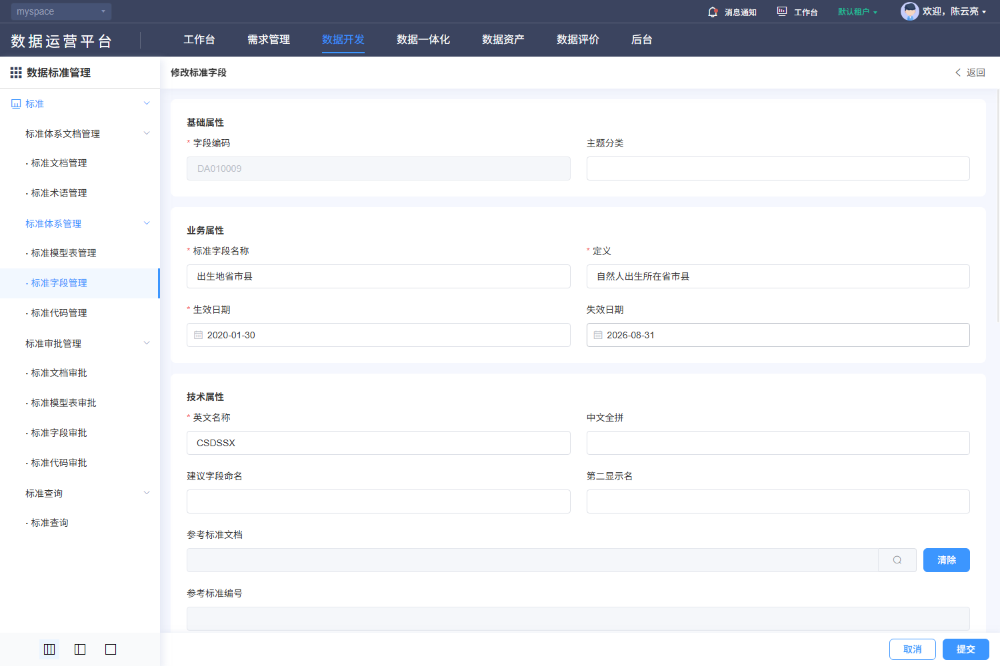

#### 8. 关联文档（DSS-515）

[规则核查、差异与外部合同](./核查记录.md) · [专项原文及历史索引](../evidence/dss-review-20261027/README.md)。

- [V-DSS-004-op2.png](../evidence/live-recheck-20261022/V-DSS-004-op2.png)
- [V-DSS-004-op2.json](../evidence/live-recheck-20261022/V-DSS-004-op2.json)
- [V-DSS-004-op2-options0.png](../evidence/live-recheck-20261022/V-DSS-004-op2-options0.png)
- [V-DSS-004-op2-options0.json](../evidence/live-recheck-20261022/V-DSS-004-op2-options0.json)
- [V-DSS-004-op2-options1.png](../evidence/live-recheck-20261022/V-DSS-004-op2-options1.png)
- [V-DSS-004-op2-options1.json](../evidence/live-recheck-20261022/V-DSS-004-op2-options1.json)

#### 9. 非功能性需求（DSS-515）

适用主规格第9节DSS-NFR质量矩阵。权限、文本、查询和资源清理适用全部；保存一致性适用维护/分类；审批事务适用四类审批；文件约束适用PDF与导入导出；本地集合容量适用代码项和四类关联。只读查询不新增账号密码、登录限流或物理执行任务。各项均未执行。

### DSS-503 标准 → 标准体系管理 → · 标准代码管理

**业务目的**：标准代码管理；入口：/dss/standard/system/indexCodeList。前置条件：已登录且具备相应资源/动作权限。

**操作与规则**：按以下字段、控件、请求和对象标识处理；分类、标准记录、引用关系、版本与审批申请分别管理。

**结果与异常处理**：操作结果须按对象或申请回读；失败、无权、合法空结果与结果未知分别反馈，前端提示不代替服务端业务结果。

**开发处理细则**：

- 固定使用已查字段及调用映射，未知后端约束通过第7节交付包补齐，不由AI自选；字段空白属性不表示无约束。
- 原实现与本次补充目标的差异在核查记录追踪，全部应用验收未执行。

<!-- 完整规格:DSS-503 -->

#### 1. 页面字段清单（DSS-503）

| 字段名称与绑定名 | 类型/控件 | 是否必填 | 默认值 | 长度/范围/单位 | 格式及校验 | 错误提示 | 条件/状态 |
|---|---|---|---|---|---|---|---|
| 代码名称 categoryName | string / 文本 | 否 | 空字符串 | 255字符 | trim首尾空白 | 请输入代码名称 |  |
| 标准分级 standardType | string / 单选 | 否 | 空字符串 | A国际、B国家、C行业、D地方、E团体、F企业、G其他 |  |  |  |
| 状态 dssStatus / 审批 approveStatus | string / 可清空单选 | 否 | 空字符串 | 状态/审批分别使用枚举 |  |  |  |
| 分类 standardClassifyId / returnChild | number / hidden | 是 | 1 / 1 |  | 左树切换回第1页；包含子类 |  |  |
| 页号 pageRequest.pageNo | integer | 是 | 1 | 正整数 | 查询、重置、改变页大小回第1页 |  |  |
| 页大小 pageRequest.pageSize | integer | 是 | 20 | 正整数 | 候选10/20/30/40/50/100；不把历史总数当上限 |  |  |
| 排序 pageRequest.order | array<object> | 是 | [{prop:"id",asc:false}] |  | prop为字段键、asc为boolean；服务端限制允许排序字段 |  |  |
| 序号 | 只读文本 |  |  |  |  |  | 返回数据，不由客户端生成 |
| 代码编码 categoryCode | 只读文本 |  |  |  |  |  | 返回数据，不由客户端生成 |
| 代码名称 categoryName | 只读文本 |  |  |  |  |  | 返回数据，不由客户端生成 |
| 标准分级 standardType | 只读文本 |  |  |  |  |  | 返回数据，不由客户端生成 |
| 代码项数 itemNum | 只读文本 |  |  |  |  |  | 返回数据，不由客户端生成 |
| 审批状态 approveStatus | 只读文本 |  |  |  |  |  | 返回数据，不由客户端生成 |
| 使用频次 useNum | 只读文本 |  |  |  |  |  | 返回数据，不由客户端生成 |
| 说明 remark | 只读文本 |  |  |  |  |  | 返回数据，不由客户端生成 |
| 创建时间 createTime | 只读文本 |  |  |  |  |  | 返回数据，不由客户端生成 |
| 代码集标识 id | 只读文本 |  |  |  |  |  | 返回数据，不由客户端生成 |

新增默认来自模型初始化；编辑显示当前记录，服务器返回标识和状态不作为新增默认。无证据的长度、唯一域、精度单位及提示留空，详见核查记录的外部依赖。

#### 2. 页面交互规则（DSS-503）

| 控件/触发 | 前提及输入 | 行为与联动 | 忙碌/禁用/反馈 | 完成、失败及草稿 |
|---|---|---|---|---|
| 查询/Enter | 草稿合法 | 按当前条件查询并回第1页；所有入口共用查询处理 | 显示表格加载，最新请求有效 | 失败保留条件；旧响应不得覆盖 |
| 重置 | 当前列表 | 清空可编辑筛选，保留当前分类/固定范围，回第1页并查询 | 加载不清除分类 | 不触发写入 |
| 分页/页大小 | 最新total | 按当前条件读指定页；改变大小回第1页 | 禁止无效页；不以截图min/max限制总页数 | 返回保持来源条件；列表刷新清除失效勾选 |
| 分类树/过滤/收起 | 当前有权节点 | 过滤名称不改变记录定义；点击节点更新standardClassifyId并回第1页；收起仅改布局 | 树加载失败可重试，不判无分类 | 恢复当前分类；节点与记录操作分别授权 |
| 顶部/行操作 | 对象、分类及审批允许 | 根1可新增/维护记录；自定义分类可添加已有记录或取消添加；待审批1禁编辑/删除 | 选中集合只包含允许对象 | 分类移除是取消关系，不能当记录删除 |

#### 3. 业务流程与异常分支（DSS-503）

1. 进入标准代码管理，先检查当前对象范围与分类读取结果，初始化分页并请求授权记录。
2. 修改条件仅改查询草稿；查询或重置回第1页，翻页保留已提交筛选。
3. 收到当前请求结果后同时更新列表、total及有效页；合法空结果、读取失败和无权分开显示。
4. 名称链接进入optType=view，编辑进入optType=edit并携当前id；查看禁写，维护后按来源条件回读。

| 异常分支 | 处理与恢复 |
|---|---|
| 合法空结果 | 保留当前条件，显示真实0条；无权/失败不降格为空列表。 |
| 分类/候选失败或失效 | 显示具体依赖失败及重试；不自动扩大到根或其他分类。 |
| 超时、202、5xx、乱序 | 显示请求失败；旧响应丢弃，保留已提交条件；只由用户显式重试。 |
| 会话过期/失权 | 按公共码处理会话和路由，清理受限数据；不能继续显示上一身份内容。 |

#### 4. 接口与数据规则（DSS-503）

| 用途 | HTTP方法 | 相对路径 | 请求参数/来源/转换 | 返回读取与页面处理 |
|---|---|---|---|---|
| 列表查询 | POST | /back/dss/ms/standardcode/page | JSON：筛选键+固定条件+pageRequest；空值/未传保持模型语义 | 读取datas/total；公共列表兼容数组，但正式DTO须按核查合同 |
| 分类树 | GET | /back/dss/ms/standardclassify/listTree/{id} | id初始1 | standardClassifyName/id/children、inside及父节点字段 |

POST/PUT对象使用JSON；文件使用FormData，boundary由客户端生成。相对路径由模块/dss/ms与网关/back组合；列表读取datas/total。公共202、错误、身份头与超时，以及审批返回差异按第4节公共契约处理；不增造code=0成功协议、DTO、幂等头或固定租户字段。

#### 5. 验收标准（DSS-503）

| 验收编号 | 前置、步骤与可检查结果 | 关联需求 | 状态 |
|---|---|---|---|
| DSS-AC-672 | 在授权账号进入标准代码管理，核对筛选/列顺序、默认分页、中文长值及合法空结果；图内样本数量不作默认值。 | DSS-503 | 未执行 |
| DSS-AC-673 | 输入条件查询、重置、翻页和改变大小，核POST /back/dss/ms/standardcode/page的参数与datas/total；回读匹配记录，无串分类。 | DSS-503 | 未执行 |
| DSS-AC-674 | 用无权ID、空结果、候选失败与服务端业务拒绝验证区分反馈；不把失败当总数0。 | DSS-503 | 未执行 |
| DSS-AC-675 | 注入断网、202、5xx及乱序响应，只有当前条件结果生效，显式重试恢复；不发写请求。 | DSS-503 | 未执行 |
| DSS-AC-676 | 返回恢复分类、筛选、页码；记录失效或最后页删除后回有效页，列表选择不带到其他对象。 | DSS-503 | 未执行 |

#### 6. 权限与安全要求（DSS-503）

服务端逐对象核验分类、记录、版本、审批申请、引用与文件的读取/写入权限及资源范围；直接URL、改id或隐藏按钮不能绕过。草稿、列表、文件和审计按当前身份与授权范围隔离；适用待审批限制的标准记录由服务端复核状态。TLS、文件内容检查、文本编码和审计各自验收，不把PDF签名引用当账号登录公钥。

#### 7. 页面布局与状态（DSS-503）

- 左侧是目录分类独立白色面板：标题及分类增删改/收起工具、关键字过滤、树；右侧是筛选与表格。树过滤只过滤展示，点击节点才改变查询范围。
- 标准代码管理位于平台导航右侧；上方标题与筛选区，查询/重置在右端；操作工具位于表格右上，表头顺序按本字段表结果列，底部右侧条数、页大小、页码和跳页。
- 初始化/加载、可操作、合法空结果、字段错误、业务拒绝、网络失败分别展示；写入另有提交中、结果未知及回读。宽表局部横滚，长表单纵滚，200%缩放下操作可达。

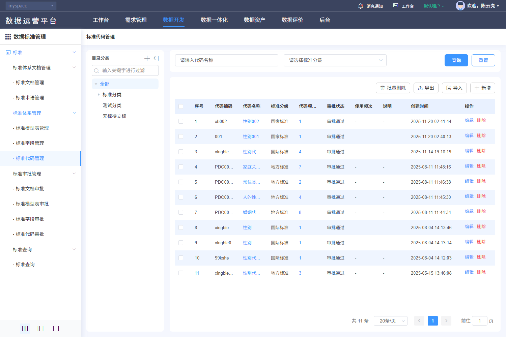

#### 8. 关联文档（DSS-503）

[规则核查、差异与外部合同](./核查记录.md) · [专项原文及历史索引](../evidence/dss-review-20261027/README.md)。

- [V-DSS-005.png](../evidence/live-recheck-20261022/V-DSS-005.png)
- [V-DSS-005.json](../evidence/live-recheck-20261022/V-DSS-005.json)

#### 9. 非功能性需求（DSS-503）

适用主规格第9节DSS-NFR质量矩阵。权限、文本、查询和资源清理适用全部；保存一致性适用维护/分类；审批事务适用四类审批；文件约束适用PDF与导入导出；本地集合容量适用代码项和四类关联。只读查询不新增账号密码、登录限流或物理执行任务。各项均未执行。

### DSS-516 标准 → 标准体系管理 → · 标准代码管理 → 新增（标准代码分类节点）

**业务目的**：新增标准代码分类节点；入口：/dss/standard/system/indexCodeList。前置条件：已登录且具备相应资源/动作权限。

**操作与规则**：按以下字段、控件、请求和对象标识处理；分类、标准记录、引用关系、版本与审批申请分别管理。

**结果与异常处理**：操作结果须按对象或申请回读；失败、无权、合法空结果与结果未知分别反馈，前端提示不代替服务端业务结果。

**开发处理细则**：

- 固定使用已查字段及调用映射，未知后端约束通过第7节交付包补齐，不由AI自选；字段空白属性不表示无约束。
- 原实现与本次补充目标的差异在核查记录追踪，全部应用验收未执行。

<!-- 完整规格:DSS-516 -->

#### 1. 页面字段清单（DSS-516）

| 字段名称与绑定名 | 类型/控件 | 是否必填 | 默认值 | 长度/范围/单位 | 格式及校验 | 错误提示 | 条件/状态 |
|---|---|---|---|---|---|---|---|
| 父级节点 parentNode | 只读文本 |  |  |  | 新增显示当前standardClassifyName；编辑显示standardClassifyPname |  | 返回数据，不由客户端生成 |
| 子级节点 standardClassifyName | string / 文本 | 是 | 空字符串 |  | trim首尾空白 | 请输入子级节点 |  |
| 父节点标识 standardClassifyPid | ID / hidden | 是 |  |  | 新增取当前节点id；编辑保留原父id |  |  |
| 当前节点 id / inside | 只读文本 |  |  |  | inside控制内置节点维护；根1不得删除，节点2不显示新增；服务端仍须复核 |  | 返回数据，不由客户端生成 |

新增默认来自模型初始化；编辑显示当前记录，服务器返回标识和状态不作为新增默认。无证据的长度、唯一域、精度单位及提示留空，详见核查记录的外部依赖。

#### 2. 页面交互规则（DSS-516）

| 控件/触发 | 前提及输入 | 行为与联动 | 忙碌/禁用/反馈 | 完成、失败及草稿 |
|---|---|---|---|---|
| 新增/修改/删除节点 | 当前有权节点 | 新增取当前父id；修改保留父id；根1禁删，inside内置节点禁维护，节点2无新增；删除先确认 | 树读写独立锁与失败状态 | 只更分类，不生成字段/代码集；取消不写 |
| 父级/子级输入 | 节点模态打开 | 父级禁用展示，子级trim非空；没有证据的长度不设惯例上限 | 字段错误关联子级 | 成功刷新树并恢复父/当前有效节点 |
| 提交 | 依赖读取成功、表单合法且有权 | 共享请求锁后一次POST/PUT；服务端复核范围/引用/状态/并发，成功回读 | 整个在途期间禁重复；finally恢复 | 成功受理后核记录/审批；明确失败保留草稿，未知结果先核查 |
| 取消/返回/关闭/后退 | 当前表单 | 有修改时选择继续编辑或放弃；放弃后返回原分类/筛选 | 不调用主记录保存 | 已发生上传/自动填充请求不能撤销其历史；临时文件按服务端策略回收 |

#### 3. 业务流程与异常分支（DSS-516）

1. 从明确新增入口建立空模型，验证分类等上下文；不从列表第一条或样本复制默认值。
2. 打开600px节点弹窗，先显示禁用父级和必填子级；确认POST名称和父ID。
3. 修改PUT/{节点id}及删除DELETE/{节点id}分别处理；存在子节点/引用由服务端保护，不默认级联。
4. 字段与关联校验通过后，人工提交；公共表单浅复制模型，POST创建或PUT当前id更新；不自行增加幂等键/版本头。
5. 成功提示后回来源列表按稳定ID核对记录及审批结果；保存受理不代表审批通过、生效或物理数据已变更。
6. 失败定位可修改字段并保留草稿；超时/断网结果未知时先查询目标/请求关联，禁止自动重复保存。

| 异常分支 | 处理与恢复 |
|---|---|
| 本地校验/组合失败 | 定位对应项/页，保留合法草稿；依赖未就绪或ID无效不得提交。 |
| 权限、引用、审批/版本冲突 | 显示服务端原因，保持原数据；重新读取确认后再操作，不提供隐式强制覆盖。 |
| 超时、202、5xx、响应丢失 | 区分明确失败与结果未知；finally解除本地锁，未知结果先按稳定ID/申请ID核查。 |
| 重复点击、取消、迟到响应 | 同对象同动作最多一个在途请求；取消不发主记录写请求，离页旧响应不改新对象；上传/批量独立核结果。 |

#### 4. 接口与数据规则（DSS-516）

| 用途 | HTTP方法 | 相对路径 | 请求参数/来源/转换 | 返回读取与页面处理 |
|---|---|---|---|---|
| 分类树 | GET | /back/dss/ms/standardclassify/listTree/{id} | 初始id=1，复读所选/父节点 | 返回树 |
| 新增分类 | POST | /back/dss/ms/standardclassify | JSON {standardClassifyName,standardClassifyPid} | 成功刷新树 |
| 修改分类 | PUT | /back/dss/ms/standardclassify/{id} | 当前节点id；body同上 | 保留父节点关系 |
| 删除分类 | DELETE | /back/dss/ms/standardclassify/{id} | 人工确认、当前节点id | 重读父节点；引用保护按服务端合同 |

POST/PUT对象使用JSON；文件使用FormData，boundary由客户端生成。相对路径由模块/dss/ms与网关/back组合；列表读取datas/total。公共202、错误、身份头与超时，以及审批返回差异按第4节公共契约处理；不增造code=0成功协议、DTO、幂等头或固定租户字段。

#### 5. 验收标准（DSS-516）

| 验收编号 | 前置、步骤与可检查结果 | 关联需求 | 状态 |
|---|---|---|---|
| DSS-AC-677 | 打开新增标准代码分类节点，逐字段核标签、必填、边界、默认/当前值和禁用；查看模式无保存。 | DSS-516 | 未执行 |
| DSS-AC-678 | 专用数据完成新增，核方法/路径/模型键并按id回读字段及关联；不以成功提示当生效证明。 | DSS-516 | 未执行 |
| DSS-AC-679 | 覆盖必填空白、上限/超限、无效候选、引用失效及当前表单专有组合规则，拒绝时不误报成功。 | DSS-516 | 未执行 |
| DSS-AC-680 | 注入重复提交、202、5xx、超时和并发冲突，核一次逻辑效果；未知结果查询后才允许适用重试。 | DSS-516 | 未执行 |
| DSS-AC-681 | 取消/返回/后退核继续编辑或放弃；主记录不保存、旧记录不变，已上传临时文件按归属回收，底栏与焦点可达。 | DSS-516 | 未执行 |

#### 6. 权限与安全要求（DSS-516）

服务端逐对象核验分类、记录、版本、审批申请、引用与文件的读取/写入权限及资源范围；直接URL、改id或隐藏按钮不能绕过。草稿、列表、文件和审计按当前身份与授权范围隔离；适用待审批限制的标准记录由服务端复核状态。TLS、文件内容检查、文本编码和审计各自验收，不把PDF签名引用当账号登录公钥。

#### 7. 页面布局与状态（DSS-516）

- 左分类树上方居中600px“新增节点/编辑节点”弹窗，父级禁用输入在左、子级可编辑输入在右，底部取消/确定；背景不是标准字段/代码记录表单。
- 初始化/加载、可操作、合法空结果、字段错误、业务拒绝、网络失败分别展示；写入另有提交中、结果未知及回读。宽表局部横滚，长表单纵滚，200%缩放下操作可达。

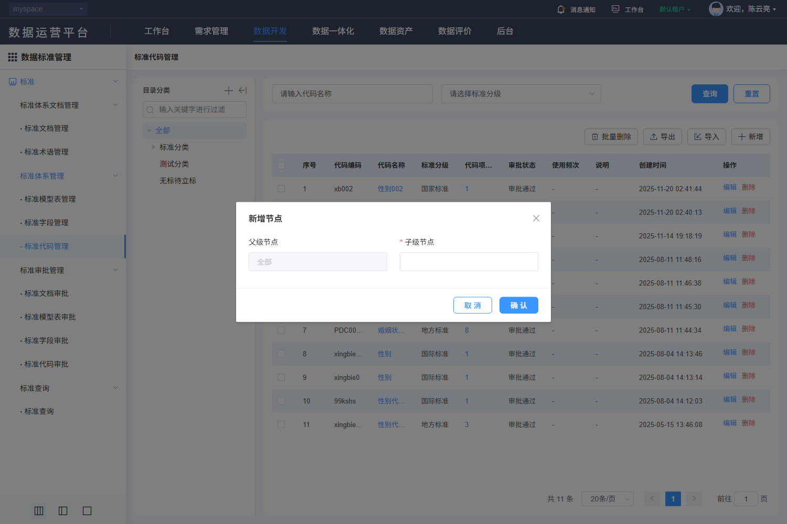

#### 8. 关联文档（DSS-516）

[规则核查、差异与外部合同](./核查记录.md) · [专项原文及历史索引](../evidence/dss-review-20261027/README.md)。

- [V-DSS-005-op1.png](../evidence/live-recheck-20261022/V-DSS-005-op1.png)
- [V-DSS-005-op1.json](../evidence/live-recheck-20261022/V-DSS-005-op1.json)

#### 9. 非功能性需求（DSS-516）

适用主规格第9节DSS-NFR质量矩阵。权限、文本、查询和资源清理适用全部；保存一致性适用维护/分类；审批事务适用四类审批；文件约束适用PDF与导入导出；本地集合容量适用代码项和四类关联。只读查询不新增账号密码、登录限流或物理执行任务。各项均未执行。

### DSS-517 标准 → 标准体系管理 → · 标准代码管理 → 编辑

**业务目的**：修改标准代码；入口：/dss/standard/system/indexCodeEdit?optType=edit&id={id}。前置条件：已登录且具备相应资源/动作权限。

**操作与规则**：按以下字段、控件、请求和对象标识处理；分类、标准记录、引用关系、版本与审批申请分别管理。

**结果与异常处理**：操作结果须按对象或申请回读；失败、无权、合法空结果与结果未知分别反馈，前端提示不代替服务端业务结果。

**开发处理细则**：

- 固定使用已查字段及调用映射，未知后端约束通过第7节交付包补齐，不由AI自选；字段空白属性不表示无约束。
- 原实现与本次补充目标的差异在核查记录追踪，全部应用验收未执行。

<!-- 完整规格:DSS-517 -->

#### 1. 页面字段清单（DSS-517）

| 字段名称与绑定名 | 类型/控件 | 是否必填 | 默认值 | 长度/范围/单位 | 格式及校验 | 错误提示 | 条件/状态 |
|---|---|---|---|---|---|---|---|
| 分类上下文 categoryId | number / hidden |  |  |  | 来自路由categoryId；与当前代码集id及代码项归属区别；无效NaN不得提交 |  |  |
| 代码名称 categoryName | string / 文本 | 是 | 当前记录 | 50字符 | trim首尾空白 | 请输入代码名称 |  |
| 代码编码 categoryCode | string / 文本 | 是 | 当前记录 | 10字符 | trim；编辑/查看禁用；不从占位文字推导正则 | 请输入代码编码 |  |
| 参考文档 docId / docName / docCode | ID / 禁用展示+选择 | 否 | null / 空字符串 / 空字符串 |  | 选择绑定文档id及名称/编号；清除三者同步清理；候选限定approveStatus=2（审批通过），不混用生效状态 |  |  |
| 当前记录 id | 只读文本 |  |  |  | 读取路由id；PUT路径使用当前稳定标识，不使用分类或文档id |  | 返回数据，不由客户端生成 |
| 参考标准分级 standardType | string / radio | 是 | 当前记录 | A国际、B国家、C行业、D地方、E团体、F企业、G其他 | 选择参考文档联动；清除文档清分级 | 请选择参考标准分级 |  |
| 代码项 itemList | array<object> / 本地分页表 | 是 | [] | 至少1行 | 每行itemCode/itemName非空且分别在完整清单内唯一；不是只验当前页 | 请配置代码项 |  |
| 代码 itemList[].itemCode / 名称 itemName | string / 两输入 | 行内是 | 当前记录 |  | 分别非空、完整集合精确匹配查重；不得用序号作ID | 代码/名称不能为空；代码/名称重复 |  |
| 行说明 itemList[].remark | string / 输入 | 否 | 当前记录 |  | 作为文本，不执行表达式；无依据长度留空 |  |  |
| 代码项归属 itemList[].categoryCode / id | string / hidden |  |  |  | 提交前各行categoryCode取当前父代码编码；编辑保留子项稳定id |  |  |
| 本地 pageNo / pageSize / total | integer | 是 | 1 / 20 / 0 | 正整数 | itemList完整数组slice分页；翻页不另发服务器代码项请求，删除按原页计算全局索引 |  |  |
| 说明 remark | string / 文本 | 否 | 当前记录 | 250字符 | trim首尾空白 | 请输入说明 |  |

新增默认来自模型初始化；编辑显示当前记录，服务器返回标识和状态不作为新增默认。无证据的长度、唯一域、精度单位及提示留空，详见核查记录的外部依赖。

#### 2. 页面交互规则（DSS-517）

| 控件/触发 | 前提及输入 | 行为与联动 | 忙碌/禁用/反馈 | 完成、失败及草稿 |
|---|---|---|---|---|
| 参考文档/清除 | 可维护且有文档读取权 | 打开单选文档选择器，查询/500ms防抖、树/列表/分页；确定将id及展示项同步写当前草稿，未选提示 | 加载/失败独立处理，旧对象响应不得串值 | 取消不改草稿；清除同步清除id/名称/编号/适用分级 |
| 新增代码项 | 完整草稿校验通过 | 头部插入空itemCode/itemName/remark行，回本地第1页，total随集合更新 | 未完成行先校验；完整集合查重 | 只改itemList草稿，不立即POST代码项 |
| 行删除/确认/本地分页 | 当前页行及全局索引 | 确认后按原pageNo/pageSize算globalIndex，再splice；删除末页末条后调整页号 | 取消保持清单；最后一行清空时total=0 | 不误删上一页行；保存时提交全清单 |
| 代码/名称/说明 | 当前可编辑行 | 代码和名称分别非空、全集唯一；所有页有错都定位对应行和页 | 错误项不因翻页消失 | itemList归属与父代码编码一致 |
| 提交 | 依赖读取成功、表单合法且有权 | 共享请求锁后一次POST/PUT；服务端复核范围/引用/状态/并发，成功回读 | 整个在途期间禁重复；finally恢复 | 成功受理后核记录/审批；明确失败保留草稿，未知结果先核查 |
| 取消/返回/关闭/后退 | 当前表单 | 有修改时选择继续编辑或放弃；放弃后返回原分类/筛选 | 不调用主记录保存 | 已发生上传/自动填充请求不能撤销其历史；临时文件按服务端策略回收 |

#### 3. 业务流程与异常分支（DSS-517）

1. 以当前记录id读取详情并填充；读取失败禁止把空表单当新增；禁用字段保持原值。
2. 先读取代码集及完整itemList，不把当前20条当全部。
3. 参考文档联动三项与分级；代码编码编辑禁用。保存前在完整itemList验空/重，并给每行赋当前categoryCode。
4. 字段与关联校验通过后，人工提交；公共表单浅复制模型，POST创建或PUT当前id更新；不自行增加幂等键/版本头。
5. 成功提示后回来源列表按稳定ID核对记录及审批结果；保存受理不代表审批通过、生效或物理数据已变更。
6. 失败定位可修改字段并保留草稿；超时/断网结果未知时先查询目标/请求关联，禁止自动重复保存。

| 异常分支 | 处理与恢复 |
|---|---|
| 本地校验/组合失败 | 定位对应项/页，保留合法草稿；依赖未就绪或ID无效不得提交。 |
| 权限、引用、审批/版本冲突 | 显示服务端原因，保持原数据；重新读取确认后再操作，不提供隐式强制覆盖。 |
| 超时、202、5xx、响应丢失 | 区分明确失败与结果未知；finally解除本地锁，未知结果先按稳定ID/申请ID核查。 |
| 重复点击、取消、迟到响应 | 同对象同动作最多一个在途请求；取消不发主记录写请求，离页旧响应不改新对象；上传/批量独立核结果。 |

#### 4. 接口与数据规则（DSS-517）

| 用途 | HTTP方法 | 相对路径 | 请求参数/来源/转换 | 返回读取与页面处理 |
|---|---|---|---|---|
| 详情读取 | GET | /back/dss/ms/standardcode/{id} | path id=当前记录id | 返回对象回显，包括只读标识与原有嵌套项 |
| 提交记录 | PUT | /back/dss/ms/standardcode/{id} | JSON：本字段表的模型键；保留原记录/子项id，不以名称替代 | 公共resolve触发成功提示；完整服务端body、审批与版本合同见核查记录 |
| 来源文档候选 | POST | /back/dss/ms/standarddocument/page | JSON {approveStatus:2,standardName,pageRequest}；单选当前文档id | 读取datas/total及standardName/id |

POST/PUT对象使用JSON；文件使用FormData，boundary由客户端生成。相对路径由模块/dss/ms与网关/back组合；列表读取datas/total。公共202、错误、身份头与超时，以及审批返回差异按第4节公共契约处理；不增造code=0成功协议、DTO、幂等头或固定租户字段。

#### 5. 验收标准（DSS-517）

| 验收编号 | 前置、步骤与可检查结果 | 关联需求 | 状态 |
|---|---|---|---|
| DSS-AC-682 | 打开修改标准代码，逐字段核标签、必填、边界、默认/当前值和禁用；查看模式无保存。 | DSS-517 | 未执行 |
| DSS-AC-683 | 专用数据完成修改，核方法/路径/模型键并按id回读字段及关联；不以成功提示当生效证明。 | DSS-517 | 未执行 |
| DSS-AC-684 | 覆盖必填空白、上限/超限、无效候选、引用失效及当前表单专有组合规则，拒绝时不误报成功。 | DSS-517 | 未执行 |
| DSS-AC-685 | 注入重复提交、202、5xx、超时和并发冲突，核一次逻辑效果；未知结果查询后才允许适用重试。 | DSS-517 | 未执行 |
| DSS-AC-686 | 取消/返回/后退核继续编辑或放弃；主记录不保存、旧记录不变，已上传临时文件按归属回收，底栏与焦点可达。 | DSS-517 | 未执行 |

#### 6. 权限与安全要求（DSS-517）

服务端逐对象核验分类、记录、版本、审批申请、引用与文件的读取/写入权限及资源范围；直接URL、改id或隐藏按钮不能绕过。草稿、列表、文件和审计按当前身份与授权范围隔离；适用待审批限制的标准记录由服务端复核状态。TLS、文件内容检查、文本编码和审计各自验收，不把PDF签名引用当账号登录公钥。

#### 7. 页面布局与状态（DSS-517）

- 两列表单：名称/禁用编码、参考文档(搜索和清除)/编号；下方全宽分级单选；代码项区标题左、右上新增，列序号/代码/名称/说明/删除，区底右侧本地分页；最后全宽说明，固定取消/提交。
- 初始化/加载、可操作、合法空结果、字段错误、业务拒绝、网络失败分别展示；写入另有提交中、结果未知及回读。宽表局部横滚，长表单纵滚，200%缩放下操作可达。

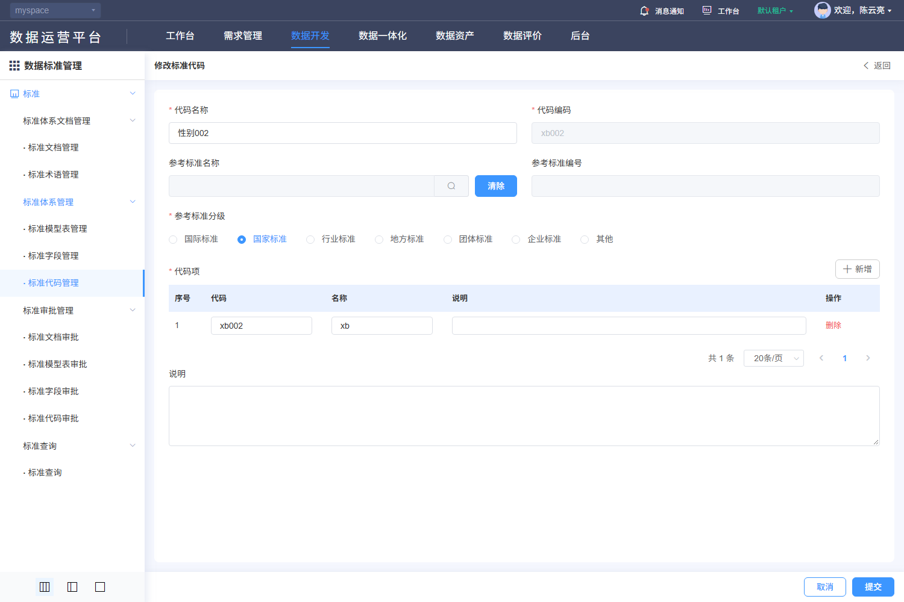

#### 8. 关联文档（DSS-517）

[规则核查、差异与外部合同](./核查记录.md) · [专项原文及历史索引](../evidence/dss-review-20261027/README.md)。

- [V-DSS-005-op2.png](../evidence/live-recheck-20261022/V-DSS-005-op2.png)
- [V-DSS-005-op2.json](../evidence/live-recheck-20261022/V-DSS-005-op2.json)
- [V-DSS-005-op2-options0.png](../evidence/live-recheck-20261022/V-DSS-005-op2-options0.png)
- [V-DSS-005-op2-options0.json](../evidence/live-recheck-20261022/V-DSS-005-op2-options0.json)

#### 9. 非功能性需求（DSS-517）

适用主规格第9节DSS-NFR质量矩阵。权限、文本、查询和资源清理适用全部；保存一致性适用维护/分类；审批事务适用四类审批；文件约束适用PDF与导入导出；本地集合容量适用代码项和四类关联。只读查询不新增账号密码、登录限流或物理执行任务。各项均未执行。

### DSS-504 标准 → 标准审批管理 → · 标准文档审批

**业务目的**：标准文档审批；入口：/dss/standard/audit/docList。前置条件：已登录且具备相应资源/动作权限。

**操作与规则**：按以下字段、控件、请求和对象标识处理；分类、标准记录、引用关系、版本与审批申请分别管理。

**结果与异常处理**：操作结果须按对象或申请回读；失败、无权、合法空结果与结果未知分别反馈，前端提示不代替服务端业务结果。

**开发处理细则**：

- 固定使用已查字段及调用映射，未知后端约束通过第7节交付包补齐，不由AI自选；字段空白属性不表示无约束。
- 原实现与本次补充目标的差异在核查记录追踪，全部应用验收未执行。

<!-- 完整规格:DSS-504 -->

#### 1. 页面字段清单（DSS-504）

| 字段名称与绑定名 | 类型/控件 | 是否必填 | 默认值 | 长度/范围/单位 | 格式及校验 | 错误提示 | 条件/状态 |
|---|---|---|---|---|---|---|---|
| 对象名称/编码关键字 str | string / 文本 | 否 | 空字符串 | 255字符 | trim首尾空白 | 请输入对象名称/编码关键字 |  |
| 申请类型 actionType | string / 单选 | 否 |  | 1新增、2变更、3删除、4导入 |  |  |  |
| 任务状态 approveStatus | string或number / 单选 | 否 |  | 1待审批、2通过、3不通过 | 申请页可筛；审批页固定1，不被普通筛选覆盖 |  |  |
| 对象类型 approveType | number / hidden | 是 | 1 | 1文档、2模型表、3字段、4代码 | 固定业务类型；不得用表单名称猜id |  |  |
| 页号 pageRequest.pageNo | integer | 是 | 1 | 正整数 | 查询、重置、改变页大小回第1页 |  |  |
| 页大小 pageRequest.pageSize | integer | 是 | 20 | 正整数 | 候选10/20/30/40/50/100；不把历史总数当上限 |  |  |
| 排序 pageRequest.order | array<object> | 是 | [{prop:"id",asc:false}] |  | prop为字段键、asc为boolean；服务端限制允许排序字段 |  |  |
| 对象名称 str1 | 只读文本 |  |  |  |  |  | 返回数据，不由客户端生成 |
| 对象编码 str2 | 只读文本 |  |  |  |  |  | 返回数据，不由客户端生成 |
| 申请类型 actionType | 只读文本 |  |  |  |  |  | 返回数据，不由客户端生成 |
| 申请人 applyUserName | 只读文本 |  |  |  |  |  | 返回数据，不由客户端生成 |
| 申请时间 createTime | 只读文本 |  |  |  |  |  | 返回数据，不由客户端生成 |
| 原因说明 remark | 只读文本 |  |  |  |  |  | 返回数据，不由客户端生成 |
| 任务状态 approveStatus | 只读文本 |  |  |  |  |  | 返回数据，不由客户端生成 |
| 申请标识 id | 只读文本 |  |  |  |  |  | 返回数据，不由客户端生成 |
| 审批结果 formData.approveStatus | number / 单选 | 审批时是 |  | 2通过、3不通过 | 不能选择待审批1 | 请选择审批结果 |  |
| 审批意见 formData.approveIdea | string / textarea | 审批时是 | 空字符串 | 详情与批量弹窗均255字符 | 非空；保持意见原文 | 请输入审批意见 |  |
| 旧值 oldDo / 新值 newDo / auditInfo | 只读文本 |  |  |  | 详情使用申请id；按对象完整字段及嵌套代码项比较，查看结果只读 |  | 返回数据，不由客户端生成 |

新增默认来自模型初始化；编辑显示当前记录，服务器返回标识和状态不作为新增默认。无证据的长度、唯一域、精度单位及提示留空，详见核查记录的外部依赖。

#### 2. 页面交互规则（DSS-504）

| 控件/触发 | 前提及输入 | 行为与联动 | 忙碌/禁用/反馈 | 完成、失败及草稿 |
|---|---|---|---|---|
| 标准申请/标准审批页签 | 拥有对应页面权限；审批页需approveList | 各自查询approve/page，申请固定类型；审批固定类型+状态1 | 切页签重置页号、选择及旧响应 | 无审批权不能靠直接路由提交 |
| 查询/Enter | 草稿合法 | 按当前条件查询并回第1页；所有入口共用查询处理 | 显示表格加载，最新请求有效 | 失败保留条件；旧响应不得覆盖 |
| 重置 | 当前列表 | 清空可编辑筛选，保留当前分类/固定范围，回第1页并查询 | 加载不清除分类 | 不触发写入 |
| 分页/页大小 | 最新total | 按当前条件读指定页；改变大小回第1页 | 禁止无效页；不以截图min/max限制总页数 | 返回保持来源条件；列表刷新清除失效勾选 |
| 对象名称/查看/审批 | 当前申请id | 进入docAuditDetail?id={申请id}&optType=view或audit；GET申请旧新值，变更差异高亮 | 读取失败不能启用审批 | 刷新直入必须重建申请元数据，不能依赖上一页Vuex残留 |
| 批量审批/确定 | 只选当前有权待审申请 | 500px弹窗选择2/3及必填意见；PUT approveBatch携ids | 整个请求共用锁；不是只禁3秒 | 取消不请求；结果未知逐申请回读，不盲重放 |
| 详情确认/返回 | 当前audit模式、表单合法 | PUT approve/{申请id}结果与意见；view模式禁提交 | applyLoading恢复；冲突重新读取 | 结果落地与标准生效/版本同步按事务合同 |

#### 3. 业务流程与异常分支（DSS-504）

1. 选择当前类型的申请或审批页签，查询当前权限范围；同一名称的不同申请按申请id区分。
2. 打开详情读取oldDo/newDo并展示差异，申请人/时间/类型与申请对应；历史记录只读。
3. 有权待审申请可单项或批量填写结果及意见，确认后服务端原子复核状态与权限。
4. 成功回读每个申请状态及标准版本/有效性；竞争审批、业务拒绝或部分失败必须解释实际结果。
5. 超时/响应不明确先GET申请，意见草稿保留且无自动重放；返回恢复原页签/条件。

| 异常分支 | 处理与恢复 |
|---|---|
| 本地校验/组合失败 | 定位对应项/页，保留合法草稿；依赖未就绪或ID无效不得提交。 |
| 权限、引用、审批/版本冲突 | 显示服务端原因，保持原数据；重新读取确认后再操作，不提供隐式强制覆盖。 |
| 超时、202、5xx、响应丢失 | 区分明确失败与结果未知；finally解除本地锁，未知结果先按稳定ID/申请ID核查。 |
| 重复点击、取消、迟到响应 | 同对象同动作最多一个在途请求；取消不发主记录写请求，离页旧响应不改新对象；上传/批量独立核结果。 |

#### 4. 接口与数据规则（DSS-504）

| 用途 | HTTP方法 | 相对路径 | 请求参数/来源/转换 | 返回读取与页面处理 |
|---|---|---|---|---|
| 申请/待审列表 | POST | /back/dss/ms/approve/page | JSON {approveType:1,str,actionType,approveStatus?,pageRequest}；审批固定approveStatus=1 | datas/total及申请标识，申请/审批权限分别核验 |
| 申请详情 | GET | /back/dss/ms/approve/{id} | path id=申请id | oldDo/newDo；完整元数据响应由服务端合同补齐 |
| 单项审批 | PUT | /back/dss/ms/approve/{id} | JSON {approveStatus:2或3,approveIdea} | 当前详情使用!response.code判断；成功回读申请 |
| 批量审批 | PUT | /back/dss/ms/approve/approveBatch | JSON {approveStatus:2或3,approveIdea,ids:array<ID>} | 当前批量使用falsy响应判成功；与单项不同，按核查差异统一合同 |

POST/PUT对象使用JSON；文件使用FormData，boundary由客户端生成。相对路径由模块/dss/ms与网关/back组合；列表读取datas/total。公共202、错误、身份头与超时，以及审批返回差异按第4节公共契约处理；不增造code=0成功协议、DTO、幂等头或固定租户字段。

#### 5. 验收标准（DSS-504）

| 验收编号 | 前置、步骤与可检查结果 | 关联需求 | 状态 |
|---|---|---|---|
| DSS-AC-687 | 核标准文档审批两页签、固定approveType=1、审批固定状态1；不同权限显示与直接接口拒绝一致。 | DSS-504 | 未执行 |
| DSS-AC-688 | 专用申请打开详情核旧/新值、所有差异与元数据；以申请id审批2/3并回读任务及标准版本，不用标准id代替。 | DSS-504 | 未执行 |
| DSS-AC-689 | 空结果/空意见/无结果、无权、已审、并发审批及批量混入其他类型均被正确拒绝且不误生效。 | DSS-504 | 未执行 |
| DSS-AC-690 | 注入单项truthy/falsy body、批量错误、202/5xx和响应丢失，防假成功；未知结果逐id核查再决定重试。 | DSS-504 | 未执行 |
| DSS-AC-691 | 取消批量/详情不发送审批；返回/刷新/直达重建正确申请，不串上一条auditInfo，焦点与上下文恢复。 | DSS-504 | 未执行 |

#### 6. 权限与安全要求（DSS-504）

服务端逐对象核验分类、记录、版本、审批申请、引用与文件的读取/写入权限及资源范围；直接URL、改id或隐藏按钮不能绕过。草稿、列表、文件和审计按当前身份与授权范围隔离；适用待审批限制的标准记录由服务端复核状态。TLS、文件内容检查、文本编码和审计各自验收，不把PDF签名引用当账号登录公钥。

#### 7. 页面布局与状态（DSS-504）

- 导航右侧上方标准申请/标准审批页签；其下名称、申请类型、任务状态及右端查询/重置；申请表列序号、名称、编码、类型、申请人、申请时间、原因、任务状态，底部右分页。审批页另有勾选和审批操作。
- 详情主区域按旧值/新值对照表展示字段变化，申请与审批信息在独立面板；view待审不显示可编辑审批表单，已审显示只读结果/意见；audit显示可选结果、必填意见、取消/确认。批量500px模态纵排结果、意见和底部取消/确定。
- 初始化/加载、可操作、合法空结果、字段错误、业务拒绝、网络失败分别展示；写入另有提交中、结果未知及回读。宽表局部横滚，长表单纵滚，200%缩放下操作可达。

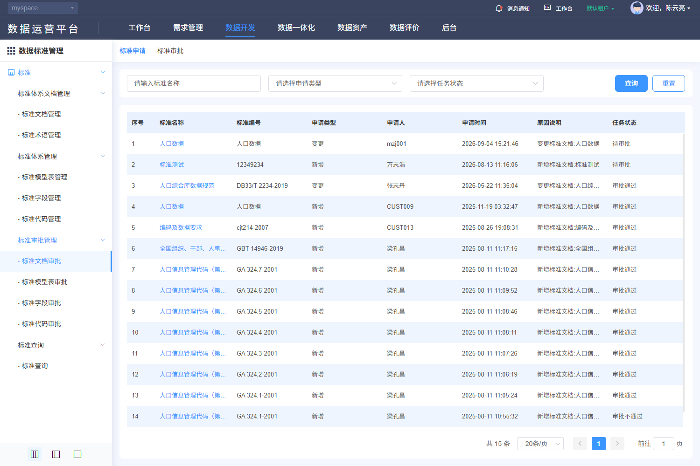

#### 8. 关联文档（DSS-504）

[规则核查、差异与外部合同](./核查记录.md) · [专项原文及历史索引](../evidence/dss-review-20261027/README.md)。

- [V-DSS-006.png](../evidence/live-recheck-20261022/V-DSS-006.png)
- [V-DSS-006.json](../evidence/live-recheck-20261022/V-DSS-006.json)

#### 9. 非功能性需求（DSS-504）

适用主规格第9节DSS-NFR质量矩阵。权限、文本、查询和资源清理适用全部；保存一致性适用维护/分类；审批事务适用四类审批；文件约束适用PDF与导入导出；本地集合容量适用代码项和四类关联。只读查询不新增账号密码、登录限流或物理执行任务。各项均未执行。

### DSS-505 标准 → 标准审批管理 → · 标准模型表审批

**业务目的**：标准模型表审批；入口：/dss/standard/audit/dataSetList。前置条件：已登录且具备相应资源/动作权限。

**操作与规则**：按以下字段、控件、请求和对象标识处理；分类、标准记录、引用关系、版本与审批申请分别管理。

**结果与异常处理**：操作结果须按对象或申请回读；失败、无权、合法空结果与结果未知分别反馈，前端提示不代替服务端业务结果。

**开发处理细则**：

- 固定使用已查字段及调用映射，未知后端约束通过第7节交付包补齐，不由AI自选；字段空白属性不表示无约束。
- 原实现与本次补充目标的差异在核查记录追踪，全部应用验收未执行。

<!-- 完整规格:DSS-505 -->

#### 1. 页面字段清单（DSS-505）

| 字段名称与绑定名 | 类型/控件 | 是否必填 | 默认值 | 长度/范围/单位 | 格式及校验 | 错误提示 | 条件/状态 |
|---|---|---|---|---|---|---|---|
| 对象名称/编码关键字 str | string / 文本 | 否 | 空字符串 | 255字符 | trim首尾空白 | 请输入对象名称/编码关键字 |  |
| 申请类型 actionType | string / 单选 | 否 |  | 1新增、2变更、3删除、4导入 |  |  |  |
| 任务状态 approveStatus | string或number / 单选 | 否 |  | 1待审批、2通过、3不通过 | 申请页可筛；审批页固定1，不被普通筛选覆盖 |  |  |
| 对象类型 approveType | number / hidden | 是 | 2 | 1文档、2模型表、3字段、4代码 | 固定业务类型；不得用表单名称猜id |  |  |
| 页号 pageRequest.pageNo | integer | 是 | 1 | 正整数 | 查询、重置、改变页大小回第1页 |  |  |
| 页大小 pageRequest.pageSize | integer | 是 | 20 | 正整数 | 候选10/20/30/40/50/100；不把历史总数当上限 |  |  |
| 排序 pageRequest.order | array<object> | 是 | [{prop:"id",asc:false}] |  | prop为字段键、asc为boolean；服务端限制允许排序字段 |  |  |
| 对象名称 str1 | 只读文本 |  |  |  |  |  | 返回数据，不由客户端生成 |
| 对象编码 str2 | 只读文本 |  |  |  |  |  | 返回数据，不由客户端生成 |
| 申请类型 actionType | 只读文本 |  |  |  |  |  | 返回数据，不由客户端生成 |
| 申请人 applyUserName | 只读文本 |  |  |  |  |  | 返回数据，不由客户端生成 |
| 申请时间 createTime | 只读文本 |  |  |  |  |  | 返回数据，不由客户端生成 |
| 原因说明 remark | 只读文本 |  |  |  |  |  | 返回数据，不由客户端生成 |
| 任务状态 approveStatus | 只读文本 |  |  |  |  |  | 返回数据，不由客户端生成 |
| 申请标识 id | 只读文本 |  |  |  |  |  | 返回数据，不由客户端生成 |
| 审批结果 formData.approveStatus | number / 单选 | 审批时是 |  | 2通过、3不通过 | 不能选择待审批1 | 请选择审批结果 |  |
| 审批意见 formData.approveIdea | string / textarea | 审批时是 | 空字符串 | 详情与批量弹窗均255字符 | 非空；保持意见原文 | 请输入审批意见 |  |
| 旧值 oldDo / 新值 newDo / auditInfo | 只读文本 |  |  |  | 详情使用申请id；按对象完整字段及嵌套代码项比较，查看结果只读 |  | 返回数据，不由客户端生成 |

新增默认来自模型初始化；编辑显示当前记录，服务器返回标识和状态不作为新增默认。无证据的长度、唯一域、精度单位及提示留空，详见核查记录的外部依赖。

#### 2. 页面交互规则（DSS-505）

| 控件/触发 | 前提及输入 | 行为与联动 | 忙碌/禁用/反馈 | 完成、失败及草稿 |
|---|---|---|---|---|
| 标准申请/标准审批页签 | 拥有对应页面权限；审批页需approveList | 各自查询approve/page，申请固定类型；审批固定类型+状态1 | 切页签重置页号、选择及旧响应 | 无审批权不能靠直接路由提交 |
| 查询/Enter | 草稿合法 | 按当前条件查询并回第1页；所有入口共用查询处理 | 显示表格加载，最新请求有效 | 失败保留条件；旧响应不得覆盖 |
| 重置 | 当前列表 | 清空可编辑筛选，保留当前分类/固定范围，回第1页并查询 | 加载不清除分类 | 不触发写入 |
| 分页/页大小 | 最新total | 按当前条件读指定页；改变大小回第1页 | 禁止无效页；不以截图min/max限制总页数 | 返回保持来源条件；列表刷新清除失效勾选 |
| 对象名称/查看/审批 | 当前申请id | 进入dataSetAuditDetail?id={申请id}&optType=view或audit；GET申请旧新值，变更差异高亮 | 读取失败不能启用审批 | 刷新直入必须重建申请元数据，不能依赖上一页Vuex残留 |
| 批量审批/确定 | 只选当前有权待审申请 | 500px弹窗选择2/3及必填意见；PUT approveBatch携ids | 整个请求共用锁；不是只禁3秒 | 取消不请求；结果未知逐申请回读，不盲重放 |
| 详情确认/返回 | 当前audit模式、表单合法 | PUT approve/{申请id}结果与意见；view模式禁提交 | applyLoading恢复；冲突重新读取 | 结果落地与标准生效/版本同步按事务合同 |

#### 3. 业务流程与异常分支（DSS-505）

1. 选择当前类型的申请或审批页签，查询当前权限范围；同一名称的不同申请按申请id区分。
2. 打开详情读取oldDo/newDo并展示差异，申请人/时间/类型与申请对应；历史记录只读。
3. 有权待审申请可单项或批量填写结果及意见，确认后服务端原子复核状态与权限。
4. 成功回读每个申请状态及标准版本/有效性；竞争审批、业务拒绝或部分失败必须解释实际结果。
5. 超时/响应不明确先GET申请，意见草稿保留且无自动重放；返回恢复原页签/条件。

| 异常分支 | 处理与恢复 |
|---|---|
| 本地校验/组合失败 | 定位对应项/页，保留合法草稿；依赖未就绪或ID无效不得提交。 |
| 权限、引用、审批/版本冲突 | 显示服务端原因，保持原数据；重新读取确认后再操作，不提供隐式强制覆盖。 |
| 超时、202、5xx、响应丢失 | 区分明确失败与结果未知；finally解除本地锁，未知结果先按稳定ID/申请ID核查。 |
| 重复点击、取消、迟到响应 | 同对象同动作最多一个在途请求；取消不发主记录写请求，离页旧响应不改新对象；上传/批量独立核结果。 |

#### 4. 接口与数据规则（DSS-505）

| 用途 | HTTP方法 | 相对路径 | 请求参数/来源/转换 | 返回读取与页面处理 |
|---|---|---|---|---|
| 申请/待审列表 | POST | /back/dss/ms/approve/page | JSON {approveType:2,str,actionType,approveStatus?,pageRequest}；审批固定approveStatus=1 | datas/total及申请标识，申请/审批权限分别核验 |
| 申请详情 | GET | /back/dss/ms/approve/{id} | path id=申请id | oldDo/newDo；完整元数据响应由服务端合同补齐 |
| 单项审批 | PUT | /back/dss/ms/approve/{id} | JSON {approveStatus:2或3,approveIdea} | 当前详情使用!response.code判断；成功回读申请 |
| 批量审批 | PUT | /back/dss/ms/approve/approveBatch | JSON {approveStatus:2或3,approveIdea,ids:array<ID>} | 当前批量使用falsy响应判成功；与单项不同，按核查差异统一合同 |

POST/PUT对象使用JSON；文件使用FormData，boundary由客户端生成。相对路径由模块/dss/ms与网关/back组合；列表读取datas/total。公共202、错误、身份头与超时，以及审批返回差异按第4节公共契约处理；不增造code=0成功协议、DTO、幂等头或固定租户字段。

#### 5. 验收标准（DSS-505）

| 验收编号 | 前置、步骤与可检查结果 | 关联需求 | 状态 |
|---|---|---|---|
| DSS-AC-692 | 核标准模型表审批两页签、固定approveType=2、审批固定状态1；不同权限显示与直接接口拒绝一致。 | DSS-505 | 未执行 |
| DSS-AC-693 | 专用申请打开详情核旧/新值、所有差异与元数据；以申请id审批2/3并回读任务及标准版本，不用标准id代替。 | DSS-505 | 未执行 |
| DSS-AC-694 | 空结果/空意见/无结果、无权、已审、并发审批及批量混入其他类型均被正确拒绝且不误生效。 | DSS-505 | 未执行 |
| DSS-AC-695 | 注入单项truthy/falsy body、批量错误、202/5xx和响应丢失，防假成功；未知结果逐id核查再决定重试。 | DSS-505 | 未执行 |
| DSS-AC-696 | 取消批量/详情不发送审批；返回/刷新/直达重建正确申请，不串上一条auditInfo，焦点与上下文恢复。 | DSS-505 | 未执行 |

#### 6. 权限与安全要求（DSS-505）

服务端逐对象核验分类、记录、版本、审批申请、引用与文件的读取/写入权限及资源范围；直接URL、改id或隐藏按钮不能绕过。草稿、列表、文件和审计按当前身份与授权范围隔离；适用待审批限制的标准记录由服务端复核状态。TLS、文件内容检查、文本编码和审计各自验收，不把PDF签名引用当账号登录公钥。

#### 7. 页面布局与状态（DSS-505）

- 导航右侧上方标准申请/标准审批页签；其下名称、申请类型、任务状态及右端查询/重置；申请表列序号、名称、编码、类型、申请人、申请时间、原因、任务状态，底部右分页。审批页另有勾选和审批操作。
- 详情主区域按旧值/新值对照表展示字段变化，申请与审批信息在独立面板；view待审不显示可编辑审批表单，已审显示只读结果/意见；audit显示可选结果、必填意见、取消/确认。批量500px模态纵排结果、意见和底部取消/确定。
- 初始化/加载、可操作、合法空结果、字段错误、业务拒绝、网络失败分别展示；写入另有提交中、结果未知及回读。宽表局部横滚，长表单纵滚，200%缩放下操作可达。

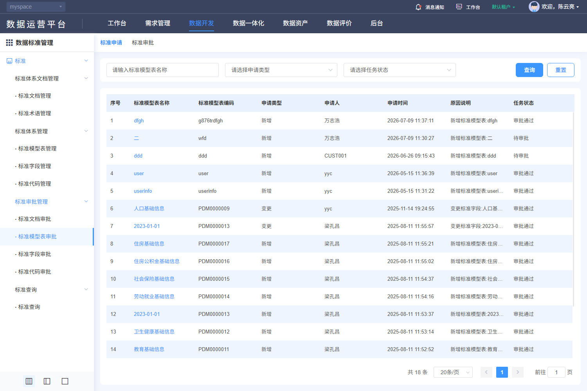

#### 8. 关联文档（DSS-505）

[规则核查、差异与外部合同](./核查记录.md) · [专项原文及历史索引](../evidence/dss-review-20261027/README.md)。

- [V-DSS-007.png](../evidence/live-recheck-20261022/V-DSS-007.png)
- [V-DSS-007.json](../evidence/live-recheck-20261022/V-DSS-007.json)

#### 9. 非功能性需求（DSS-505）

适用主规格第9节DSS-NFR质量矩阵。权限、文本、查询和资源清理适用全部；保存一致性适用维护/分类；审批事务适用四类审批；文件约束适用PDF与导入导出；本地集合容量适用代码项和四类关联。只读查询不新增账号密码、登录限流或物理执行任务。各项均未执行。

### DSS-518 标准 → 标准审批管理 → · 标准字段审批

**业务目的**：标准字段审批；入口：/dss/standard/audit/indexItemList。前置条件：已登录且具备相应资源/动作权限。

**操作与规则**：按以下字段、控件、请求和对象标识处理；分类、标准记录、引用关系、版本与审批申请分别管理。

**结果与异常处理**：操作结果须按对象或申请回读；失败、无权、合法空结果与结果未知分别反馈，前端提示不代替服务端业务结果。

**开发处理细则**：

- 固定使用已查字段及调用映射，未知后端约束通过第7节交付包补齐，不由AI自选；字段空白属性不表示无约束。
- 原实现与本次补充目标的差异在核查记录追踪，全部应用验收未执行。

<!-- 完整规格:DSS-518 -->

#### 1. 页面字段清单（DSS-518）

| 字段名称与绑定名 | 类型/控件 | 是否必填 | 默认值 | 长度/范围/单位 | 格式及校验 | 错误提示 | 条件/状态 |
|---|---|---|---|---|---|---|---|
| 对象名称/编码关键字 str | string / 文本 | 否 | 空字符串 | 255字符 | trim首尾空白 | 请输入对象名称/编码关键字 |  |
| 申请类型 actionType | string / 单选 | 否 |  | 1新增、2变更、3删除、4导入 |  |  |  |
| 任务状态 approveStatus | string或number / 单选 | 否 |  | 1待审批、2通过、3不通过 | 申请页可筛；审批页固定1，不被普通筛选覆盖 |  |  |
| 对象类型 approveType | number / hidden | 是 | 3 | 1文档、2模型表、3字段、4代码 | 固定业务类型；不得用表单名称猜id |  |  |
| 页号 pageRequest.pageNo | integer | 是 | 1 | 正整数 | 查询、重置、改变页大小回第1页 |  |  |
| 页大小 pageRequest.pageSize | integer | 是 | 20 | 正整数 | 候选10/20/30/40/50/100；不把历史总数当上限 |  |  |
| 排序 pageRequest.order | array<object> | 是 | [{prop:"id",asc:false}] |  | prop为字段键、asc为boolean；服务端限制允许排序字段 |  |  |
| 对象名称 str1 | 只读文本 |  |  |  |  |  | 返回数据，不由客户端生成 |
| 对象编码 str2 | 只读文本 |  |  |  |  |  | 返回数据，不由客户端生成 |
| 申请类型 actionType | 只读文本 |  |  |  |  |  | 返回数据，不由客户端生成 |
| 申请人 applyUserName | 只读文本 |  |  |  |  |  | 返回数据，不由客户端生成 |
| 申请时间 createTime | 只读文本 |  |  |  |  |  | 返回数据，不由客户端生成 |
| 原因说明 remark | 只读文本 |  |  |  |  |  | 返回数据，不由客户端生成 |
| 任务状态 approveStatus | 只读文本 |  |  |  |  |  | 返回数据，不由客户端生成 |
| 申请标识 id | 只读文本 |  |  |  |  |  | 返回数据，不由客户端生成 |
| 审批结果 formData.approveStatus | number / 单选 | 审批时是 |  | 2通过、3不通过 | 不能选择待审批1 | 请选择审批结果 |  |
| 审批意见 formData.approveIdea | string / textarea | 审批时是 | 空字符串 | 详情与批量弹窗均255字符 | 非空；保持意见原文 | 请输入审批意见 |  |
| 旧值 oldDo / 新值 newDo / auditInfo | 只读文本 |  |  |  | 详情使用申请id；按对象完整字段及嵌套代码项比较，查看结果只读 |  | 返回数据，不由客户端生成 |

新增默认来自模型初始化；编辑显示当前记录，服务器返回标识和状态不作为新增默认。无证据的长度、唯一域、精度单位及提示留空，详见核查记录的外部依赖。

#### 2. 页面交互规则（DSS-518）

| 控件/触发 | 前提及输入 | 行为与联动 | 忙碌/禁用/反馈 | 完成、失败及草稿 |
|---|---|---|---|---|
| 标准申请/标准审批页签 | 拥有对应页面权限；审批页需approveList | 各自查询approve/page，申请固定类型；审批固定类型+状态1 | 切页签重置页号、选择及旧响应 | 无审批权不能靠直接路由提交 |
| 查询/Enter | 草稿合法 | 按当前条件查询并回第1页；所有入口共用查询处理 | 显示表格加载，最新请求有效 | 失败保留条件；旧响应不得覆盖 |
| 重置 | 当前列表 | 清空可编辑筛选，保留当前分类/固定范围，回第1页并查询 | 加载不清除分类 | 不触发写入 |
| 分页/页大小 | 最新total | 按当前条件读指定页；改变大小回第1页 | 禁止无效页；不以截图min/max限制总页数 | 返回保持来源条件；列表刷新清除失效勾选 |
| 对象名称/查看/审批 | 当前申请id | 进入indexItemAuditDetail?id={申请id}&optType=view或audit；GET申请旧新值，变更差异高亮 | 读取失败不能启用审批 | 刷新直入必须重建申请元数据，不能依赖上一页Vuex残留 |
| 批量审批/确定 | 只选当前有权待审申请 | 500px弹窗选择2/3及必填意见；PUT approveBatch携ids | 整个请求共用锁；不是只禁3秒 | 取消不请求；结果未知逐申请回读，不盲重放 |
| 详情确认/返回 | 当前audit模式、表单合法 | PUT approve/{申请id}结果与意见；view模式禁提交 | applyLoading恢复；冲突重新读取 | 结果落地与标准生效/版本同步按事务合同 |

#### 3. 业务流程与异常分支（DSS-518）

1. 选择当前类型的申请或审批页签，查询当前权限范围；同一名称的不同申请按申请id区分。
2. 打开详情读取oldDo/newDo并展示差异，申请人/时间/类型与申请对应；历史记录只读。
3. 有权待审申请可单项或批量填写结果及意见，确认后服务端原子复核状态与权限。
4. 成功回读每个申请状态及标准版本/有效性；竞争审批、业务拒绝或部分失败必须解释实际结果。
5. 超时/响应不明确先GET申请，意见草稿保留且无自动重放；返回恢复原页签/条件。

| 异常分支 | 处理与恢复 |
|---|---|
| 本地校验/组合失败 | 定位对应项/页，保留合法草稿；依赖未就绪或ID无效不得提交。 |
| 权限、引用、审批/版本冲突 | 显示服务端原因，保持原数据；重新读取确认后再操作，不提供隐式强制覆盖。 |
| 超时、202、5xx、响应丢失 | 区分明确失败与结果未知；finally解除本地锁，未知结果先按稳定ID/申请ID核查。 |
| 重复点击、取消、迟到响应 | 同对象同动作最多一个在途请求；取消不发主记录写请求，离页旧响应不改新对象；上传/批量独立核结果。 |

#### 4. 接口与数据规则（DSS-518）

| 用途 | HTTP方法 | 相对路径 | 请求参数/来源/转换 | 返回读取与页面处理 |
|---|---|---|---|---|
| 申请/待审列表 | POST | /back/dss/ms/approve/page | JSON {approveType:3,str,actionType,approveStatus?,pageRequest}；审批固定approveStatus=1 | datas/total及申请标识，申请/审批权限分别核验 |
| 申请详情 | GET | /back/dss/ms/approve/{id} | path id=申请id | oldDo/newDo；完整元数据响应由服务端合同补齐 |
| 单项审批 | PUT | /back/dss/ms/approve/{id} | JSON {approveStatus:2或3,approveIdea} | 当前详情使用!response.code判断；成功回读申请 |
| 批量审批 | PUT | /back/dss/ms/approve/approveBatch | JSON {approveStatus:2或3,approveIdea,ids:array<ID>} | 当前批量使用falsy响应判成功；与单项不同，按核查差异统一合同 |

POST/PUT对象使用JSON；文件使用FormData，boundary由客户端生成。相对路径由模块/dss/ms与网关/back组合；列表读取datas/total。公共202、错误、身份头与超时，以及审批返回差异按第4节公共契约处理；不增造code=0成功协议、DTO、幂等头或固定租户字段。

#### 5. 验收标准（DSS-518）

| 验收编号 | 前置、步骤与可检查结果 | 关联需求 | 状态 |
|---|---|---|---|
| DSS-AC-697 | 核标准字段审批两页签、固定approveType=3、审批固定状态1；不同权限显示与直接接口拒绝一致。 | DSS-518 | 未执行 |
| DSS-AC-698 | 专用申请打开详情核旧/新值、所有差异与元数据；以申请id审批2/3并回读任务及标准版本，不用标准id代替。 | DSS-518 | 未执行 |
| DSS-AC-699 | 空结果/空意见/无结果、无权、已审、并发审批及批量混入其他类型均被正确拒绝且不误生效。 | DSS-518 | 未执行 |
| DSS-AC-700 | 注入单项truthy/falsy body、批量错误、202/5xx和响应丢失，防假成功；未知结果逐id核查再决定重试。 | DSS-518 | 未执行 |
| DSS-AC-701 | 取消批量/详情不发送审批；返回/刷新/直达重建正确申请，不串上一条auditInfo，焦点与上下文恢复。 | DSS-518 | 未执行 |

#### 6. 权限与安全要求（DSS-518）

服务端逐对象核验分类、记录、版本、审批申请、引用与文件的读取/写入权限及资源范围；直接URL、改id或隐藏按钮不能绕过。草稿、列表、文件和审计按当前身份与授权范围隔离；适用待审批限制的标准记录由服务端复核状态。TLS、文件内容检查、文本编码和审计各自验收，不把PDF签名引用当账号登录公钥。

#### 7. 页面布局与状态（DSS-518）

- 导航右侧上方标准申请/标准审批页签；其下名称、申请类型、任务状态及右端查询/重置；申请表列序号、名称、编码、类型、申请人、申请时间、原因、任务状态，底部右分页。审批页另有勾选和审批操作。
- 详情主区域按旧值/新值对照表展示字段变化，申请与审批信息在独立面板；view待审不显示可编辑审批表单，已审显示只读结果/意见；audit显示可选结果、必填意见、取消/确认。批量500px模态纵排结果、意见和底部取消/确定。
- 初始化/加载、可操作、合法空结果、字段错误、业务拒绝、网络失败分别展示；写入另有提交中、结果未知及回读。宽表局部横滚，长表单纵滚，200%缩放下操作可达。

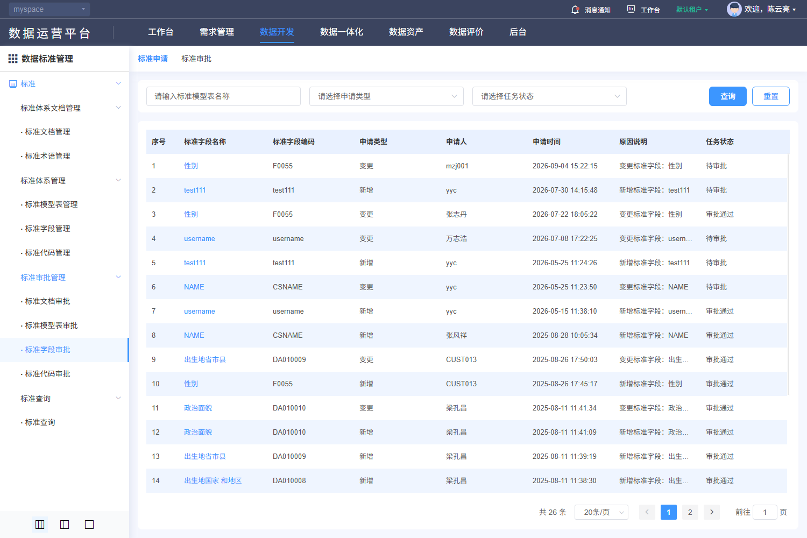

#### 8. 关联文档（DSS-518）

[规则核查、差异与外部合同](./核查记录.md) · [专项原文及历史索引](../evidence/dss-review-20261027/README.md)。

- [V-DSS-008.png](../evidence/live-recheck-20261022/V-DSS-008.png)
- [V-DSS-008.json](../evidence/live-recheck-20261022/V-DSS-008.json)

#### 9. 非功能性需求（DSS-518）

适用主规格第9节DSS-NFR质量矩阵。权限、文本、查询和资源清理适用全部；保存一致性适用维护/分类；审批事务适用四类审批；文件约束适用PDF与导入导出；本地集合容量适用代码项和四类关联。只读查询不新增账号密码、登录限流或物理执行任务。各项均未执行。

### DSS-506 标准 → 标准审批管理 → · 标准代码审批

**业务目的**：标准代码审批；入口：/dss/standard/audit/indexCodeList。前置条件：已登录且具备相应资源/动作权限。

**操作与规则**：按以下字段、控件、请求和对象标识处理；分类、标准记录、引用关系、版本与审批申请分别管理。

**结果与异常处理**：操作结果须按对象或申请回读；失败、无权、合法空结果与结果未知分别反馈，前端提示不代替服务端业务结果。

**开发处理细则**：

- 固定使用已查字段及调用映射，未知后端约束通过第7节交付包补齐，不由AI自选；字段空白属性不表示无约束。
- 原实现与本次补充目标的差异在核查记录追踪，全部应用验收未执行。

<!-- 完整规格:DSS-506 -->

#### 1. 页面字段清单（DSS-506）

| 字段名称与绑定名 | 类型/控件 | 是否必填 | 默认值 | 长度/范围/单位 | 格式及校验 | 错误提示 | 条件/状态 |
|---|---|---|---|---|---|---|---|
| 对象名称/编码关键字 str | string / 文本 | 否 | 空字符串 | 255字符 | trim首尾空白 | 请输入对象名称/编码关键字 |  |
| 申请类型 actionType | string / 单选 | 否 |  | 1新增、2变更、3删除、4导入 |  |  |  |
| 任务状态 approveStatus | string或number / 单选 | 否 |  | 1待审批、2通过、3不通过 | 申请页可筛；审批页固定1，不被普通筛选覆盖 |  |  |
| 对象类型 approveType | number / hidden | 是 | 4 | 1文档、2模型表、3字段、4代码 | 固定业务类型；不得用表单名称猜id |  |  |
| 页号 pageRequest.pageNo | integer | 是 | 1 | 正整数 | 查询、重置、改变页大小回第1页 |  |  |
| 页大小 pageRequest.pageSize | integer | 是 | 20 | 正整数 | 候选10/20/30/40/50/100；不把历史总数当上限 |  |  |
| 排序 pageRequest.order | array<object> | 是 | [{prop:"id",asc:false}] |  | prop为字段键、asc为boolean；服务端限制允许排序字段 |  |  |
| 对象名称 str1 | 只读文本 |  |  |  |  |  | 返回数据，不由客户端生成 |
| 对象编码 str2 | 只读文本 |  |  |  |  |  | 返回数据，不由客户端生成 |
| 申请类型 actionType | 只读文本 |  |  |  |  |  | 返回数据，不由客户端生成 |
| 申请人 applyUserName | 只读文本 |  |  |  |  |  | 返回数据，不由客户端生成 |
| 申请时间 createTime | 只读文本 |  |  |  |  |  | 返回数据，不由客户端生成 |
| 原因说明 remark | 只读文本 |  |  |  |  |  | 返回数据，不由客户端生成 |
| 任务状态 approveStatus | 只读文本 |  |  |  |  |  | 返回数据，不由客户端生成 |
| 申请标识 id | 只读文本 |  |  |  |  |  | 返回数据，不由客户端生成 |
| 审批结果 formData.approveStatus | number / 单选 | 审批时是 |  | 2通过、3不通过 | 不能选择待审批1 | 请选择审批结果 |  |
| 审批意见 formData.approveIdea | string / textarea | 审批时是 | 空字符串 | 详情与批量弹窗均255字符 | 非空；保持意见原文 | 请输入审批意见 |  |
| 旧值 oldDo / 新值 newDo / auditInfo | 只读文本 |  |  |  | 详情使用申请id；按对象完整字段及嵌套代码项比较，查看结果只读 |  | 返回数据，不由客户端生成 |

新增默认来自模型初始化；编辑显示当前记录，服务器返回标识和状态不作为新增默认。无证据的长度、唯一域、精度单位及提示留空，详见核查记录的外部依赖。

#### 2. 页面交互规则（DSS-506）

| 控件/触发 | 前提及输入 | 行为与联动 | 忙碌/禁用/反馈 | 完成、失败及草稿 |
|---|---|---|---|---|
| 标准申请/标准审批页签 | 拥有对应页面权限；审批页需approveList | 各自查询approve/page，申请固定类型；审批固定类型+状态1 | 切页签重置页号、选择及旧响应 | 无审批权不能靠直接路由提交 |
| 查询/Enter | 草稿合法 | 按当前条件查询并回第1页；所有入口共用查询处理 | 显示表格加载，最新请求有效 | 失败保留条件；旧响应不得覆盖 |
| 重置 | 当前列表 | 清空可编辑筛选，保留当前分类/固定范围，回第1页并查询 | 加载不清除分类 | 不触发写入 |
| 分页/页大小 | 最新total | 按当前条件读指定页；改变大小回第1页 | 禁止无效页；不以截图min/max限制总页数 | 返回保持来源条件；列表刷新清除失效勾选 |
| 对象名称/查看/审批 | 当前申请id | 进入indexCodeAuditDetail?id={申请id}&optType=view或audit；GET申请旧新值，变更差异高亮 | 读取失败不能启用审批 | 刷新直入必须重建申请元数据，不能依赖上一页Vuex残留 |
| 批量审批/确定 | 只选当前有权待审申请 | 500px弹窗选择2/3及必填意见；PUT approveBatch携ids | 整个请求共用锁；不是只禁3秒 | 取消不请求；结果未知逐申请回读，不盲重放 |
| 详情确认/返回 | 当前audit模式、表单合法 | PUT approve/{申请id}结果与意见；view模式禁提交 | applyLoading恢复；冲突重新读取 | 结果落地与标准生效/版本同步按事务合同 |

#### 3. 业务流程与异常分支（DSS-506）

1. 选择当前类型的申请或审批页签，查询当前权限范围；同一名称的不同申请按申请id区分。
2. 打开详情读取oldDo/newDo并展示差异，申请人/时间/类型与申请对应；历史记录只读。
3. 有权待审申请可单项或批量填写结果及意见，确认后服务端原子复核状态与权限。
4. 成功回读每个申请状态及标准版本/有效性；竞争审批、业务拒绝或部分失败必须解释实际结果。
5. 超时/响应不明确先GET申请，意见草稿保留且无自动重放；返回恢复原页签/条件。

| 异常分支 | 处理与恢复 |
|---|---|
| 本地校验/组合失败 | 定位对应项/页，保留合法草稿；依赖未就绪或ID无效不得提交。 |
| 权限、引用、审批/版本冲突 | 显示服务端原因，保持原数据；重新读取确认后再操作，不提供隐式强制覆盖。 |
| 超时、202、5xx、响应丢失 | 区分明确失败与结果未知；finally解除本地锁，未知结果先按稳定ID/申请ID核查。 |
| 重复点击、取消、迟到响应 | 同对象同动作最多一个在途请求；取消不发主记录写请求，离页旧响应不改新对象；上传/批量独立核结果。 |

#### 4. 接口与数据规则（DSS-506）

| 用途 | HTTP方法 | 相对路径 | 请求参数/来源/转换 | 返回读取与页面处理 |
|---|---|---|---|---|
| 申请/待审列表 | POST | /back/dss/ms/approve/page | JSON {approveType:4,str,actionType,approveStatus?,pageRequest}；审批固定approveStatus=1 | datas/total及申请标识，申请/审批权限分别核验 |
| 申请详情 | GET | /back/dss/ms/approve/{id} | path id=申请id | oldDo/newDo；完整元数据响应由服务端合同补齐 |
| 单项审批 | PUT | /back/dss/ms/approve/{id} | JSON {approveStatus:2或3,approveIdea} | 当前详情使用!response.code判断；成功回读申请 |
| 批量审批 | PUT | /back/dss/ms/approve/approveBatch | JSON {approveStatus:2或3,approveIdea,ids:array<ID>} | 当前批量使用falsy响应判成功；与单项不同，按核查差异统一合同 |

POST/PUT对象使用JSON；文件使用FormData，boundary由客户端生成。相对路径由模块/dss/ms与网关/back组合；列表读取datas/total。公共202、错误、身份头与超时，以及审批返回差异按第4节公共契约处理；不增造code=0成功协议、DTO、幂等头或固定租户字段。

#### 5. 验收标准（DSS-506）

| 验收编号 | 前置、步骤与可检查结果 | 关联需求 | 状态 |
|---|---|---|---|
| DSS-AC-702 | 核标准代码审批两页签、固定approveType=4、审批固定状态1；不同权限显示与直接接口拒绝一致。 | DSS-506 | 未执行 |
| DSS-AC-703 | 专用申请打开详情核旧/新值、所有差异与元数据；以申请id审批2/3并回读任务及标准版本，不用标准id代替。 | DSS-506 | 未执行 |
| DSS-AC-704 | 空结果/空意见/无结果、无权、已审、并发审批及批量混入其他类型均被正确拒绝且不误生效。 | DSS-506 | 未执行 |
| DSS-AC-705 | 注入单项truthy/falsy body、批量错误、202/5xx和响应丢失，防假成功；未知结果逐id核查再决定重试。 | DSS-506 | 未执行 |
| DSS-AC-706 | 取消批量/详情不发送审批；返回/刷新/直达重建正确申请，不串上一条auditInfo，焦点与上下文恢复。 | DSS-506 | 未执行 |

#### 6. 权限与安全要求（DSS-506）

服务端逐对象核验分类、记录、版本、审批申请、引用与文件的读取/写入权限及资源范围；直接URL、改id或隐藏按钮不能绕过。草稿、列表、文件和审计按当前身份与授权范围隔离；适用待审批限制的标准记录由服务端复核状态。TLS、文件内容检查、文本编码和审计各自验收，不把PDF签名引用当账号登录公钥。

#### 7. 页面布局与状态（DSS-506）

- 导航右侧上方标准申请/标准审批页签；其下名称、申请类型、任务状态及右端查询/重置；申请表列序号、名称、编码、类型、申请人、申请时间、原因、任务状态，底部右分页。审批页另有勾选和审批操作。
- 详情主区域按旧值/新值对照表展示字段变化，申请与审批信息在独立面板；view待审不显示可编辑审批表单，已审显示只读结果/意见；audit显示可选结果、必填意见、取消/确认。批量500px模态纵排结果、意见和底部取消/确定。
- 初始化/加载、可操作、合法空结果、字段错误、业务拒绝、网络失败分别展示；写入另有提交中、结果未知及回读。宽表局部横滚，长表单纵滚，200%缩放下操作可达。

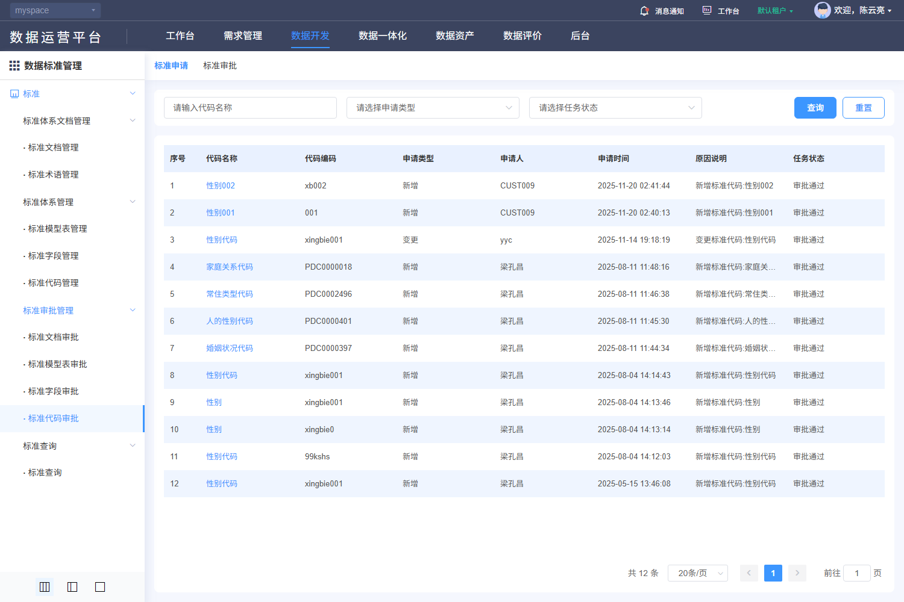

#### 8. 关联文档（DSS-506）

[规则核查、差异与外部合同](./核查记录.md) · [专项原文及历史索引](../evidence/dss-review-20261027/README.md)。

- [V-DSS-009.png](../evidence/live-recheck-20261022/V-DSS-009.png)
- [V-DSS-009.json](../evidence/live-recheck-20261022/V-DSS-009.json)

#### 9. 非功能性需求（DSS-506）

适用主规格第9节DSS-NFR质量矩阵。权限、文本、查询和资源清理适用全部；保存一致性适用维护/分类；审批事务适用四类审批；文件约束适用PDF与导入导出；本地集合容量适用代码项和四类关联。只读查询不新增账号密码、登录限流或物理执行任务。各项均未执行。

### DSS-507 标准 → 标准查询 → · 标准查询

**业务目的**：标准查询；入口：/dss/standard/search/searchList。前置条件：已登录且具备相应资源/动作权限。

**操作与规则**：按以下字段、控件、请求和对象标识处理；分类、标准记录、引用关系、版本与审批申请分别管理。

**结果与异常处理**：操作结果须按对象或申请回读；失败、无权、合法空结果与结果未知分别反馈，前端提示不代替服务端业务结果。

**开发处理细则**：

- 固定使用已查字段及调用映射，未知后端约束通过第7节交付包补齐，不由AI自选；字段空白属性不表示无约束。
- 原实现与本次补充目标的差异在核查记录追踪，全部应用验收未执行。

<!-- 完整规格:DSS-507 -->

#### 1. 页面字段清单（DSS-507）

| 字段名称与绑定名 | 类型/控件 | 是否必填 | 默认值 | 长度/范围/单位 | 格式及校验 | 错误提示 | 条件/状态 |
|---|---|---|---|---|---|---|---|
| 查询对象 form.searchObj | string / 搜索单选 | 是 | 空字符串 | doc文档、dataSet模型表、indexItem字段、indexCode代码 | 选择后点击查询才应用 | 请选择查询对象 |  |
| 名称 form.queryName | string / 文本 | 否 | 空字符串 | 255字符 | trim首尾空白 | 请输入名称 |  |
| 页号 pageRequest.pageNo | integer | 是 | 1 | 正整数 | 查询、重置、改变页大小回第1页 |  |  |
| 页大小 pageRequest.pageSize | integer | 是 | 20 | 正整数 | 候选10/20/30/40/50/100；不把历史总数当上限 |  |  |
| 排序 pageRequest.order | array<object> | 是 | [{prop:"id",asc:false}] |  | prop为字段键、asc为boolean；服务端限制允许排序字段 |  |  |
| 结果实体 id / datasetId / collectId / categoryId | 只读文本 |  |  |  | 各类型只读详情携所需上下文；不混用申请id |  | 返回数据，不由客户端生成 |
| 类型对应列 | 只读文本 |  |  |  | 文档/标准表/字段/代码分别使用各自管理列表的对象字段和状态，不合成一个未知DTO |  | 返回数据，不由客户端生成 |

新增默认来自模型初始化；编辑显示当前记录，服务器返回标识和状态不作为新增默认。无证据的长度、唯一域、精度单位及提示留空，详见核查记录的外部依赖。

#### 2. 页面交互规则（DSS-507）

| 控件/触发 | 前提及输入 | 行为与联动 | 忙碌/禁用/反馈 | 完成、失败及草稿 |
|---|---|---|---|---|
| 查询/Enter | 已选对象类型 | 将form复制为已提交searchObj/queryName，渲染对应子组件并按对象名称键POST查询 | 请求中显示加载；类型切换取消旧响应 | 缺类型不发查询；名称允许空以查当前类型 |
| 重置 | 任意状态 | form及已提交对象/名称均清空，卸载结果组件 | 显示查询结果提示区域 | 不自动查四种对象全部记录 |
| 名称/关联代码 | 当前授权结果行 | searchEdit?optType=view&id&type={doc/dataSet/indexItem/indexCode}；字段代码链接进indexCodeItemList?id=categoryId | 详情只读、分别验权 | 返回恢复原form及查询结果条件 |

#### 3. 业务流程与异常分支（DSS-507）

1. 初始仅显示对象选择、名称和结果提示，不把尚未选择对象的提示当真实查询空结果。
2. 选择四类之一并输入名称，点击查询后只请求当前类型分页接口。
3. 结果使用该类列与分页；名称进入聚合只读详情，关联数和代码项仍按目标权限加载。
4. 重置清空结果；返回恢复查询条件；技术失败与合法空结果分开。

| 异常分支 | 处理与恢复 |
|---|---|
| 合法空结果 | 保留当前条件，显示真实0条；无权/失败不降格为空列表。 |
| 分类/候选失败或失效 | 显示具体依赖失败及重试；不自动扩大到根或其他分类。 |
| 超时、202、5xx、乱序 | 显示请求失败；旧响应丢弃，保留已提交条件；只由用户显式重试。 |
| 会话过期/失权 | 按公共码处理会话和路由，清理受限数据；不能继续显示上一身份内容。 |

#### 4. 接口与数据规则（DSS-507）

| 用途 | HTTP方法 | 相对路径 | 请求参数/来源/转换 | 返回读取与页面处理 |
|---|---|---|---|---|
| 文档查询 | POST | /back/dss/ms/standarddocument/page | JSON {standardName:queryName,pageRequest} | datas/total |
| 模型表查询 | POST | /back/dss/ms/standardtable/page | JSON {tableName:queryName,pageRequest} | datas/total |
| 字段查询 | POST | /back/dss/ms/standardfield/page | JSON {itemName:queryName,pageRequest} | datas/total |
| 代码查询 | POST | /back/dss/ms/standardcode/page | JSON {categoryName:queryName,pageRequest} | datas/total |

POST/PUT对象使用JSON；文件使用FormData，boundary由客户端生成。相对路径由模块/dss/ms与网关/back组合；列表读取datas/total。公共202、错误、身份头与超时，以及审批返回差异按第4节公共契约处理；不增造code=0成功协议、DTO、幂等头或固定租户字段。

#### 5. 验收标准（DSS-507）

| 验收编号 | 前置、步骤与可检查结果 | 关联需求 | 状态 |
|---|---|---|---|
| DSS-AC-707 | 核四对象选择、名称255边界、初始提示；缺类型查询显示字段提示且不请求。 | DSS-507 | 未执行 |
| DSS-AC-708 | 依次查询四类，核各自名称键/分页/列和只读详情上下文，其他类型不同时请求。 | DSS-507 | 未执行 |
| DSS-AC-709 | 合法无匹配、无权、失效关联与依赖失败有不同反馈，按类型区分ID。 | DSS-507 | 未执行 |
| DSS-AC-710 | 乱序/超时/202/5xx不覆盖当前类型或假显示无数据，重试保留已提交条件。 | DSS-507 | 未执行 |
| DSS-AC-711 | 重置卸载旧结果，返回与刷新恢复受控，查看不出现保存/审批或隐藏写入。 | DSS-507 | 未执行 |

#### 6. 权限与安全要求（DSS-507）

服务端逐对象核验分类、记录、版本、审批申请、引用与文件的读取/写入权限及资源范围；直接URL、改id或隐藏按钮不能绕过。草稿、列表、文件和审计按当前身份与授权范围隔离；适用待审批限制的标准记录由服务端复核状态。TLS、文件内容检查、文本编码和审计各自验收，不把PDF签名引用当账号登录公钥。

#### 7. 页面布局与状态（DSS-507）

- 顶部对象选择在左、名称输入居中、查询/重置在右；下方独立白色查询结果区。初始显示“查询结果的展示”和“没有查到数据”，查询后替换为选定对象表格及分页；不能在未请求时把提示认定为服务返回0条。
- 初始化/加载、可操作、合法空结果、字段错误、业务拒绝、网络失败分别展示；写入另有提交中、结果未知及回读。宽表局部横滚，长表单纵滚，200%缩放下操作可达。

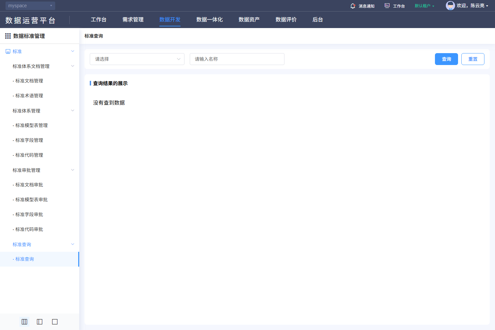

#### 8. 关联文档（DSS-507）

[规则核查、差异与外部合同](./核查记录.md) · [专项原文及历史索引](../evidence/dss-review-20261027/README.md)。

- [V-DSS-010.png](../evidence/live-recheck-20261022/V-DSS-010.png)
- [V-DSS-010.json](../evidence/live-recheck-20261022/V-DSS-010.json)

#### 9. 非功能性需求（DSS-507）

适用主规格第9节DSS-NFR质量矩阵。权限、文本、查询和资源清理适用全部；保存一致性适用维护/分类；审批事务适用四类审批；文件约束适用PDF与导入导出；本地集合容量适用代码项和四类关联。只读查询不新增账号密码、登录限流或物理执行任务。各项均未执行。

## 4. 字段与业务规则

| 范围 | 明确规则与交付约束 |
|---|---|
| 标识和对象 | dataset是模型表分类，standardtable是标准表；standardclassify是目录树；standardfield记录id、groupId版本组、collectId分类分开；standardcode父记录id、categoryCode及itemList子id分开；approve/{id}使用申请id。稳定ID唯一域、编码唯一域与版本算法按后端合同，不从样本推断。 |
| 标准/审批枚举 | standardType=A～G国际/国家/行业/地方/团体/企业/其他；standardState=1现行、2废止；dssStatus=1待生效、2已生效、3已失效；approveStatus=1待审批、2审批通过、3审批不通过；actionType=1新增、2变更、3删除、4导入。不同维度不能互换。 |
| 其他枚举 | terminologyType字符串键1业务术语、2技术术语；nullAble数字0否、1是；safety字符串1～5分别SL1公开信息、SL2个体匿名化/非涉密统计、SL3个体非敏感、SL4个体敏感、SL5国家核心数据。安全标签本身不证明数据访问授权。 |
| 长度与精度 | getDbTypes响应的needLength/needPrecision控制字段；比较符数字1≥、2=、3≤、4不限制。长度≥1，精度≥0；第二组移除清值。比较符4不要求禁用数值；原校验仍要求数值的差异单独追踪。区间相容性/单位/最大值须服务端发布，不猜数据库字节或小数位语义。 |
| 日期与文本 | 表单日期value-format=yyyy-MM-dd，字段生效严格早于失效；文档发布/实施关系不新增无依据限制。文本trim和前端maxlength不证明服务端规则；状态/安全回显的字符串转换与0/false/undefined/null保持，不将0判空。 |
| 文档四类关联 | docEdit默认first基本信息，fields/terminologys/tables/codes各自关联页签。字段、术语、表、代码调用各自POST/page；初始大候选请求pageSize=9999不是容量保证。确定按id加入父草稿，解除确认后只更新父数组；term/code按id去重，统一目标要求四类均去重。字段参数dssStatus=2,isDoc=true,keyWord；不得因未加载某页判旧引用不存在。 |
| 文档参考选择 | POST standarddocument/page，固定dssStatus=2，名称standardName与分页，500ms防抖，关闭销毁定时器；单选确定同时写id和名称/编号/适用分级，取消保留原值。术语清除必须同步form.docId，模型表清除必须同步form.docName；两处原实现差异见核查记录。 |
| 分类与归属 | GET standardclassify/listTree/{id}初始1；名称过滤不写库。节点添加POST standardclassify {standardClassifyName,standardClassifyPid}，修改PUT/{id}同体、删除DELETE/{id}；内置inside与根1/特殊2门控仍需服务端保护。文档/字段/代码的/classify/add/{分类id}及/classify/remove/{分类id}提交JSON array<ID>，只改归属关系。dataset/list及dataset三字段CRUD与上述树分开。 |
| 导入与导出 | 文档、标准表、字段、代码分别/{资源}/upload/excel POST FormData；四资源为standarddocument/standardtable/standardfield/standardcode，标准表另append datasetId。单.xls/.xlsx≤10 MiB，auto-upload=false，确认才上传；原name.split(".")[1]检查须修复为末扩展名并服务端复核。GET各资源/export/template与/export/excel用blob/rawData；标准表附datasetId，其他现调用未带当前筛选，不能宣称按筛选导出。导出前GET common/isExport门控。 |
| 导入结果 | 当前uploadSuccess不验证逐行结果就提示；目标须有受理/完成/失败、成功/失败行和错误定位、事务/重复/审批策略。缺导入服务合同的真实批处理交付受阻；不能因为HTTP成功而把部分导入记全部成功。下载错误JSON/blob不能伪装正常Excel。 |
| 模型表关联字段 | dataSetFieldNum携id/groupId；查询standardfield/page，新增候选tabIdNotEq=groupId，关联POST standardtable/ref（现包装器路径末尾有空格），解除POST standardtable/ref/remove。空格是否被实际客户端规范化不能猜，完整请求体、引用版本、事务与回读按后端合同交付；不自行修剪证据原文。 |
| 字段历史与派生 | 版本路由indexItemVersion?groupId，比较indexItemVersionCompare，派生indexItemDeriveList?groupId；当前有页面定义但完整版本/派生/差异算法、评分与引用影响合同未齐，见第7节独立交付包。入口不等于完整实现或验收。 |
| 代码项独立查询 | GET/编辑完整itemList与只读POST codeitem/page {categoryId,itemName,itemCode,pageRequest}区别；后者用于代码项查看，不代替编辑全集。查询防抖500ms；页内删除先算globalIndex再调页号，空清单同步total=0。 |
| 审批快照与响应 | 四approveType依次1/2/3/4；POST approve/page，名称/编码共同str，申请actionType/approveStatus可选，审批固定1。GET approve/{申请id}读取oldDo/newDo。详情PUT响应!result.code才显示成功，批量PUT approveBatch只在falsy结果时提示；必须对齐统一合同并覆盖反例，不能笼统写code=0。申请元数据目前依赖Vuex auditInfo，目标直入/刷新须由当前申请重建。 |
| 公共请求 | 父应用配置API_BASE_URL叠加/back；模块getModuleUrlPrefix("dss")或默认/dss/ms。POST/PUT对象JSON、GET入params；withCredentials=true，认证/CSRF/时间戳/nonce/签名由公共层按协议附加，不保存实际值。正常2xx除202返回data；202及HTTP错误读code/msg后reject；1002清失效认证回登录、1003无权限、1012刷新，1109走改密；不在本模块执行改密。 |
| 超时覆盖 | 路径规则非负timeout优先，否则请求number timeout，再无数值回退20000ms；0可能无限，不能将回退值当每个路径已生效值。有限超时/未知结果为本次交付目标，见NFR-007。 |

## 5. 主要业务流程

读取身份/分类→查询授权对象→按id/版本读取→编辑字段与独立关联草稿→校验及人工确认→提交对应资源→服务端授权/事务/审批→按记录与申请回读→失败/未知结果恢复。术语无需套标准审批状态；分类维护不建标准；只读查询不套确认保存。

## 6. 验收标准

保留所有既有功能验收编号。各功能五项检查与下列跨流程/历史检查共同执行，状态均为未执行；历史编号涉及未形成完整后端合同的范围须按第7节交付包补齐后再验收。

| 验收编号 | 场景、步骤与可检查结果 | 关联需求 | 状态 |
|---|---|---|---|
| DSS-AC-500 | 有权限时进入所列路径，页面标题、字段与对象一致；无样本仍保留正确上下文 | DSS-500 | 未执行 |
| DSS-AC-501 | 加载失败后重试，保留已提交查询条件；迟到响应不能覆盖新条件 | DSS-500 | 未执行 |
| DSS-AC-502 | 越权对象和跨空间标识被服务端拒绝，列表隐藏不能代替服务端鉴权 | DSS-500 | 未执行 |
| DSS-AC-503 | 有权限时进入所列路径，页面标题、字段与对象一致；无样本仍保留正确上下文 | DSS-508 | 未执行 |
| DSS-AC-504 | 加载失败后重试，保留已提交查询条件；迟到响应不能覆盖新条件 | DSS-508 | 未执行 |
| DSS-AC-505 | 越权对象和跨空间标识被服务端拒绝，列表隐藏不能代替服务端鉴权 | DSS-508 | 未执行 |
| DSS-AC-506 | 打开目标后必填与长度边界、禁用字段和关联对象校验分别符合批准规则 | DSS-509 | 未执行 |
| DSS-AC-507 | 取消后原记录不变；保存失败可修正；超时核查结果后重试，重复提交只产生一次效果 | DSS-509 | 未执行 |
| DSS-AC-508 | 无权限、并发更新或关联对象失效时拒绝提交且给出可恢复提示 | DSS-509 | 未执行 |
| DSS-AC-509 | 打开目标后必填与长度边界、禁用字段和关联对象校验分别符合批准规则 | DSS-510 | 未执行 |
| DSS-AC-510 | 取消后原记录不变；保存失败可修正；超时核查结果后重试，重复提交只产生一次效果 | DSS-510 | 未执行 |
| DSS-AC-511 | 无权限、并发更新或关联对象失效时拒绝提交且给出可恢复提示 | DSS-510 | 未执行 |
| DSS-AC-512 | 有权限时进入所列路径，页面标题、字段与对象一致；无样本仍保留正确上下文 | DSS-501 | 未执行 |
| DSS-AC-513 | 加载失败后重试，保留已提交查询条件；迟到响应不能覆盖新条件 | DSS-501 | 未执行 |
| DSS-AC-514 | 越权对象和跨空间标识被服务端拒绝，列表隐藏不能代替服务端鉴权 | DSS-501 | 未执行 |
| DSS-AC-515 | 打开目标后必填与长度边界、禁用字段和关联对象校验分别符合批准规则 | DSS-511 | 未执行 |
| DSS-AC-516 | 取消后原记录不变；保存失败可修正；超时核查结果后重试，重复提交只产生一次效果 | DSS-511 | 未执行 |
| DSS-AC-517 | 无权限、并发更新或关联对象失效时拒绝提交且给出可恢复提示 | DSS-511 | 未执行 |
| DSS-AC-518 | 打开目标后必填与长度边界、禁用字段和关联对象校验分别符合批准规则 | DSS-512 | 未执行 |
| DSS-AC-519 | 取消后原记录不变；保存失败可修正；超时核查结果后重试，重复提交只产生一次效果 | DSS-512 | 未执行 |
| DSS-AC-520 | 无权限、并发更新或关联对象失效时拒绝提交且给出可恢复提示 | DSS-512 | 未执行 |
| DSS-AC-521 | 打开目标后必填与长度边界、禁用字段和关联对象校验分别符合批准规则 | DSS-513 | 未执行 |
| DSS-AC-522 | 取消后原记录不变；保存失败可修正；超时核查结果后重试，重复提交只产生一次效果 | DSS-513 | 未执行 |
| DSS-AC-523 | 无权限、并发更新或关联对象失效时拒绝提交且给出可恢复提示 | DSS-513 | 未执行 |
| DSS-AC-524 | 有权限时进入所列路径，页面标题、字段与对象一致；无样本仍保留正确上下文 | DSS-502 | 未执行 |
| DSS-AC-525 | 加载失败后重试，保留已提交查询条件；迟到响应不能覆盖新条件 | DSS-502 | 未执行 |
| DSS-AC-526 | 越权对象和跨空间标识被服务端拒绝，列表隐藏不能代替服务端鉴权 | DSS-502 | 未执行 |
| DSS-AC-527 | 打开目标后必填与长度边界、禁用字段和关联对象校验分别符合批准规则 | DSS-514 | 未执行 |
| DSS-AC-528 | 取消后原记录不变；保存失败可修正；超时核查结果后重试，重复提交只产生一次效果 | DSS-514 | 未执行 |
| DSS-AC-529 | 无权限、并发更新或关联对象失效时拒绝提交且给出可恢复提示 | DSS-514 | 未执行 |
| DSS-AC-530 | 打开目标后必填与长度边界、禁用字段和关联对象校验分别符合批准规则 | DSS-515 | 未执行 |
| DSS-AC-531 | 取消后原记录不变；保存失败可修正；超时核查结果后重试，重复提交只产生一次效果 | DSS-515 | 未执行 |
| DSS-AC-532 | 无权限、并发更新或关联对象失效时拒绝提交且给出可恢复提示 | DSS-515 | 未执行 |
| DSS-AC-533 | 有权限时进入所列路径，页面标题、字段与对象一致；无样本仍保留正确上下文 | DSS-503 | 未执行 |
| DSS-AC-534 | 加载失败后重试，保留已提交查询条件；迟到响应不能覆盖新条件 | DSS-503 | 未执行 |
| DSS-AC-535 | 越权对象和跨空间标识被服务端拒绝，列表隐藏不能代替服务端鉴权 | DSS-503 | 未执行 |
| DSS-AC-536 | 打开目标后必填与长度边界、禁用字段和关联对象校验分别符合批准规则 | DSS-516 | 未执行 |
| DSS-AC-537 | 取消后原记录不变；保存失败可修正；超时核查结果后重试，重复提交只产生一次效果 | DSS-516 | 未执行 |
| DSS-AC-538 | 无权限、并发更新或关联对象失效时拒绝提交且给出可恢复提示 | DSS-516 | 未执行 |
| DSS-AC-539 | 打开目标后必填与长度边界、禁用字段和关联对象校验分别符合批准规则 | DSS-517 | 未执行 |
| DSS-AC-540 | 取消后原记录不变；保存失败可修正；超时核查结果后重试，重复提交只产生一次效果 | DSS-517 | 未执行 |
| DSS-AC-541 | 无权限、并发更新或关联对象失效时拒绝提交且给出可恢复提示 | DSS-517 | 未执行 |
| DSS-AC-542 | 有权限时进入所列路径，页面标题、字段与对象一致；无样本仍保留正确上下文 | DSS-504 | 未执行 |
| DSS-AC-543 | 加载失败后重试，保留已提交查询条件；迟到响应不能覆盖新条件 | DSS-504 | 未执行 |
| DSS-AC-544 | 越权对象和跨空间标识被服务端拒绝，列表隐藏不能代替服务端鉴权 | DSS-504 | 未执行 |
| DSS-AC-545 | 有权限时进入所列路径，页面标题、字段与对象一致；无样本仍保留正确上下文 | DSS-505 | 未执行 |
| DSS-AC-546 | 加载失败后重试，保留已提交查询条件；迟到响应不能覆盖新条件 | DSS-505 | 未执行 |
| DSS-AC-547 | 越权对象和跨空间标识被服务端拒绝，列表隐藏不能代替服务端鉴权 | DSS-505 | 未执行 |
| DSS-AC-548 | 有权限时进入所列路径，页面标题、字段与对象一致；无样本仍保留正确上下文 | DSS-518 | 未执行 |
| DSS-AC-549 | 加载失败后重试，保留已提交查询条件；迟到响应不能覆盖新条件 | DSS-518 | 未执行 |
| DSS-AC-550 | 越权对象和跨空间标识被服务端拒绝，列表隐藏不能代替服务端鉴权 | DSS-518 | 未执行 |
| DSS-AC-551 | 有权限时进入所列路径，页面标题、字段与对象一致；无样本仍保留正确上下文 | DSS-506 | 未执行 |
| DSS-AC-552 | 加载失败后重试，保留已提交查询条件；迟到响应不能覆盖新条件 | DSS-506 | 未执行 |
| DSS-AC-553 | 越权对象和跨空间标识被服务端拒绝，列表隐藏不能代替服务端鉴权 | DSS-506 | 未执行 |
| DSS-AC-554 | 有权限时进入所列路径，页面标题、字段与对象一致；无样本仍保留正确上下文 | DSS-507 | 未执行 |
| DSS-AC-555 | 加载失败后重试，保留已提交查询条件；迟到响应不能覆盖新条件 | DSS-507 | 未执行 |
| DSS-AC-556 | 越权对象和跨空间标识被服务端拒绝，列表隐藏不能代替服务端鉴权 | DSS-507 | 未执行 |

## 7. 实现与交付边界

| 历史操作编号 | 范围 | 具体入口、调用与交付约束 |
|---|---|---|
| DSS-101 | 查看标准文档 | docEdit?optType=view&id；GET standarddocument/{id}，沿用文档字段与四关联，只读禁保存。 |
| DSS-106 | 查看标准术语 | termEdit?optType=view&id；GET terminology/{id}，沿用术语字段，只读。 |
| DSS-111 | 查看标准模型表 | dataSetEdit?optType=view&id&datasetId；GET standardtable/{id}；关联字段另页。 |
| DSS-115 | 查询标准字段 | DSS-502；standardfield/page及树，不再说只有导航。 |
| DSS-116 | 查看标准字段 | indexItemEdit?optType=view&id；GET standardfield/{id}，四卡只读。 |
| DSS-117 | 新增标准字段 | 右侧记录新增进入indexItemEdit?optType=add；POST standardfield，字段与DSS-515同初始化/校验但编码可填；左树新增DSS-514只建分类。 |
| DSS-118 | 修改标准字段 | DSS-515；PUT standardfield/{id}，编码禁改与版本/审批约束。 |
| DSS-119 | 删除标准字段 | DELETE standardfield/{id}，批量POST standardfield/remove array<ID>；待审禁止，确认/引用/审批/未知结果沿用删除规则。 |
| DSS-120 | 查询标准代码 | DSS-503；standardcode/page及分类树。 |
| DSS-121 | 查看标准代码 | indexCodeEdit?optType=view&id；GET standardcode/{id}，完整代码项只读。 |
| DSS-122 | 新增标准代码 | 右侧记录新增indexCodeEdit?optType=add；POST standardcode；按DSS-517字段/全集查重，编码可填；左树DSS-516只建分类。 |
| DSS-123 | 修改标准代码 | DSS-517；PUT standardcode/{id}；编码禁改。 |
| DSS-124 | 删除标准代码 | DELETE standardcode/{id}或POST standardcode/remove array<ID>；沿用确认/审批/引用/未知结果规则。 |
| DSS-125 | 查询审批 | 拆四类型DSS-504/505/518/506，按申请id而不是标准id。 |
| DSS-126 | 查看审批 | 各auditDetail读取approve/{申请id}，旧新快照与申请信息独立。 |
| DSS-127 | 新增审批 | 由标准新增/变更/删除/导入产生申请；当前没有独立人工创建任意申请表单，不造POST approve。 |
| DSS-128 | 修改审批 | 实际是决定2/3及意见：PUT approve/{申请id}或approveBatch，不允许编辑历史快照。 |
| DSS-129 | 删除审批 | 所查组件无独立删除申请入口；撤回、取消/清理与留存须专门合同，不能套DELETE approve。 |

**外部交付包**：角色/资源动作矩阵、OpenAPI与真实响应/错误、编码唯一域、并发/事务、审批快照/生效/重提/撤回、版本与引用保护、导入逐行结果/恢复、文件归属/留存须完成联调。版本比较、派生、评分、模型表关联字段的完整DTO与算法仅查到入口/部分调用，按核查记录逐项补齐，不能由AI套通用CRUD。已有字段与调用足以支持明确范围的前端和契约测试开发，不等于生产持久化、审批或安全交付完成。

## 8. 关联资料

[主规格](./需求说明.md) · [子页面细则](./子页面与操作细化.md) · [核查记录](./核查记录.md) · [专项证据](../evidence/dss-review-20261027/README.md) · [调研归档](./调研记录.md) · [总索引](../README.md) · [生成源](../../../scripts/dss-requirement-spec.js)

质量矩阵与测量条件统一见[主规格第9节](./需求说明.md#9-非功能性需求)，应用验收均未执行。
