# 数据标准管理业务需求说明

<!-- 业务规格格式:plain-v1 -->
<!-- dss:generated-spec-v1 -->

修订日期：2026-10-27。正文定义目标业务行为；规则依据、实现差异、历史图和后端交付依赖集中在[核查记录](./核查记录.md)。全部应用验收未执行。

## 1. 业务目标与使用角色

维护可引用、可审批、可追溯的数据标准文档、术语、模型表、字段、代码集及其分类/版本关系。使用者为经服务端授权的已登录人员；不按一个截图账号推导固定管理员/普通用户角色矩阵。入口：数据开发→数据标准管理。

## 2. 业务范围

主规格保留12项既有操作，子规格保留19项独立页面/弹窗，按九部分细化字段、逐控件交互、流程异常、调用、验收、安全、布局、关联资料及非功能要求。标准文档/术语/模型表、字段/代码、四类审批与聚合查询分别处理；分类新增与记录新增、保存与审批生效、解除关系与删除标准分别验收。

| 需求编号 | 名称 | 入口/范围 |
|---|---|---|
| DSS-100 | 查询标准文档 | /dss/standard/document/docList |
| DSS-102 | 新增标准文档 | /dss/standard/document/docEdit?optType=add |
| DSS-103 | 修改标准文档 | /dss/standard/document/docEdit?optType=edit&id={id} |
| DSS-104 | 删除标准文档 | /dss/standard/document/docList |
| DSS-105 | 查询标准术语 | /dss/standard/document/termList |
| DSS-107 | 新增标准术语 | /dss/standard/document/termEdit?optType=add |
| DSS-108 | 修改标准术语 | /dss/standard/document/termEdit?optType=edit&id={id} |
| DSS-109 | 删除标准术语 | /dss/standard/document/termList |
| DSS-110 | 查询标准模型表 | /dss/standard/system/dataSetList |
| DSS-112 | 新增标准模型表 | /dss/standard/system/dataSetEdit?optType=add |
| DSS-113 | 修改标准模型表 | /dss/standard/system/dataSetEdit?optType=edit&id={id} |
| DSS-114 | 删除标准模型表 | /dss/standard/system/dataSetList |

## 3. 功能需求

### DSS-100 查询标准文档

**业务目的**：标准文档管理；入口：/dss/standard/document/docList。前置条件：已登录且具备相应资源/动作权限。

**操作与规则**：按以下字段、控件、请求和对象标识处理；分类、标准记录、引用关系、版本与审批申请分别管理。

**结果与异常处理**：操作结果须按对象或申请回读；失败、无权、合法空结果与结果未知分别反馈，前端提示不代替服务端业务结果。

**开发处理细则**：

- 固定使用已查字段及调用映射，未知后端约束通过第7节交付包补齐，不由AI自选；字段空白属性不表示无约束。
- 原实现与本次补充目标的差异在核查记录追踪，全部应用验收未执行。

<!-- 完整规格:DSS-100 -->

#### 1. 页面字段清单（DSS-100）

| 字段名称与绑定名 | 类型/控件 | 是否必填 | 默认值 | 长度/范围/单位 | 格式及校验 | 错误提示 | 条件/状态 |
|---|---|---|---|---|---|---|---|
| 标准名称 standardName | string / 文本 | 否 | 空字符串 | 255字符 | trim首尾空白 | 请输入标准名称 |  |
| 标准分级 standardType | string / 可清空单选 | 否 | 空字符串 | A国际、B国家、C行业、D地方、E团体、F企业、G其他 |  |  |  |
| 分类 standardClassifyId / dssStatus / approveStatus | ID / 隐藏固定条件 |  | 1 / 空字符串 / 空字符串 |  | 分类点击取id；根1为全量维护入口；不新增租户字段 |  |  |
| 页号 pageRequest.pageNo | integer | 是 | 1 | 正整数 | 查询、重置、改变页大小回第1页 |  |  |
| 页大小 pageRequest.pageSize | integer | 是 | 20 | 正整数 | 候选10/20/30/40/50/100；不把历史总数当上限 |  |  |
| 排序 pageRequest.order | array<object> | 是 | [{prop:"id",asc:false}] |  | prop为字段键、asc为boolean；服务端限制允许排序字段 |  |  |
| 序号 | 只读文本 |  |  |  |  |  | 返回数据，不由客户端生成 |
| 标准名称 standardName | 只读文本 |  |  |  |  |  | 返回数据，不由客户端生成 |
| 标准编号 standardCode | 只读文本 |  |  |  |  |  | 返回数据，不由客户端生成 |
| 标准分级 standardType | 只读文本 |  |  |  |  |  | 返回数据，不由客户端生成 |
| 发布单位 releaseUnit | 只读文本 |  |  |  |  |  | 返回数据，不由客户端生成 |
| 审批状态 approveStatus | 只读文本 |  |  |  |  |  | 返回数据，不由客户端生成 |
| 创建时间 createTime | 只读文本 |  |  |  |  |  | 返回数据，不由客户端生成 |
| 文档标识 id | 只读文本 |  |  |  |  |  | 返回数据，不由客户端生成 |

新增默认来自模型初始化；编辑显示当前记录，服务器返回标识和状态不作为新增默认。无证据的长度、唯一域、精度单位及提示留空，详见核查记录的外部依赖。

#### 2. 页面交互规则（DSS-100）

| 控件/触发 | 前提及输入 | 行为与联动 | 忙碌/禁用/反馈 | 完成、失败及草稿 |
|---|---|---|---|---|
| 查询/Enter | 草稿合法 | 按当前条件查询并回第1页；所有入口共用查询处理 | 显示表格加载，最新请求有效 | 失败保留条件；旧响应不得覆盖 |
| 重置 | 当前列表 | 清空可编辑筛选，保留当前分类/固定范围，回第1页并查询 | 加载不清除分类 | 不触发写入 |
| 分页/页大小 | 最新total | 按当前条件读指定页；改变大小回第1页 | 禁止无效页；不以截图min/max限制总页数 | 返回保持来源条件；列表刷新清除失效勾选 |
| 分类树/过滤/收起 | 当前有权节点 | 过滤名称不改变记录定义；点击节点更新standardClassifyId并回第1页；收起仅改布局 | 树加载失败可重试，不判无分类 | 恢复当前分类；节点与记录操作分别授权 |
| 顶部/行操作 | 对象、分类及审批允许 | 根1可新增/维护记录；自定义分类可添加已有记录或取消添加；待审批1禁编辑/删除 | 选中集合只包含允许对象 | 分类移除是取消关系，不能当记录删除 |

#### 3. 业务流程与异常分支（DSS-100）

1. 进入标准文档管理，先检查当前对象范围与分类读取结果，初始化分页并请求授权记录。
2. 修改条件仅改查询草稿；查询或重置回第1页，翻页保留已提交筛选。
3. 收到当前请求结果后同时更新列表、total及有效页；合法空结果、读取失败和无权分开显示。
4. 名称链接进入optType=view，编辑进入optType=edit并携当前id；查看禁写，维护后按来源条件回读。

| 异常分支 | 处理与恢复 |
|---|---|
| 合法空结果 | 保留当前条件，显示真实0条；无权/失败不降格为空列表。 |
| 分类/候选失败或失效 | 显示具体依赖失败及重试；不自动扩大到根或其他分类。 |
| 超时、202、5xx、乱序 | 显示请求失败；旧响应丢弃，保留已提交条件；只由用户显式重试。 |
| 会话过期/失权 | 按公共码处理会话和路由，清理受限数据；不能继续显示上一身份内容。 |

#### 4. 接口与数据规则（DSS-100）

| 用途 | HTTP方法 | 相对路径 | 请求参数/来源/转换 | 返回读取与页面处理 |
|---|---|---|---|---|
| 列表查询 | POST | /back/dss/ms/standarddocument/page | JSON：筛选键+固定条件+pageRequest；空值/未传保持模型语义 | 读取datas/total；公共列表兼容数组，但正式DTO须按核查合同 |
| 分类树 | GET | /back/dss/ms/standardclassify/listTree/{id} | id初始1 | standardClassifyName/id/children、inside及父节点字段 |
| 导出权限 | GET | /back/dss/ms/common/isExport | 无业务参数 | truthy才显示导出；不能代替导出端鉴权 |

POST/PUT对象使用JSON；文件使用FormData，boundary由客户端生成。相对路径由模块/dss/ms与网关/back组合；列表读取datas/total。公共202、错误、身份头与超时，以及审批返回差异按第4节公共契约处理；不增造code=0成功协议、DTO、幂等头或固定租户字段。

#### 5. 验收标准（DSS-100）

| 验收编号 | 前置、步骤与可检查结果 | 关联需求 | 状态 |
|---|---|---|---|
| DSS-AC-557 | 在授权账号进入标准文档管理，核对筛选/列顺序、默认分页、中文长值及合法空结果；图内样本数量不作默认值。 | DSS-100 | 未执行 |
| DSS-AC-558 | 输入条件查询、重置、翻页和改变大小，核POST /back/dss/ms/standarddocument/page的参数与datas/total；回读匹配记录，无串分类。 | DSS-100 | 未执行 |
| DSS-AC-559 | 用无权ID、空结果、候选失败与服务端业务拒绝验证区分反馈；不把失败当总数0。 | DSS-100 | 未执行 |
| DSS-AC-560 | 注入断网、202、5xx及乱序响应，只有当前条件结果生效，显式重试恢复；不发写请求。 | DSS-100 | 未执行 |
| DSS-AC-561 | 返回恢复分类、筛选、页码；记录失效或最后页删除后回有效页，列表选择不带到其他对象。 | DSS-100 | 未执行 |

#### 6. 权限与安全要求（DSS-100）

服务端逐对象核验分类、记录、版本、审批申请、引用与文件的读取/写入权限及资源范围；直接URL、改id或隐藏按钮不能绕过。草稿、列表、文件和审计按当前身份与授权范围隔离；适用待审批限制的标准记录由服务端复核状态。TLS、文件内容检查、文本编码和审计各自验收，不把PDF签名引用当账号登录公钥。

#### 7. 页面布局与状态（DSS-100）

- 左侧是目录分类独立白色面板：标题及分类增删改/收起工具、关键字过滤、树；右侧是筛选与表格。树过滤只过滤展示，点击节点才改变查询范围。
- 标准文档管理位于平台导航右侧；上方标题与筛选区，查询/重置在右端；操作工具位于表格右上，表头顺序按本字段表结果列，底部右侧条数、页大小、页码和跳页。
- 初始化/加载、可操作、合法空结果、字段错误、业务拒绝、网络失败分别展示；写入另有提交中、结果未知及回读。宽表局部横滚，长表单纵滚，200%缩放下操作可达。

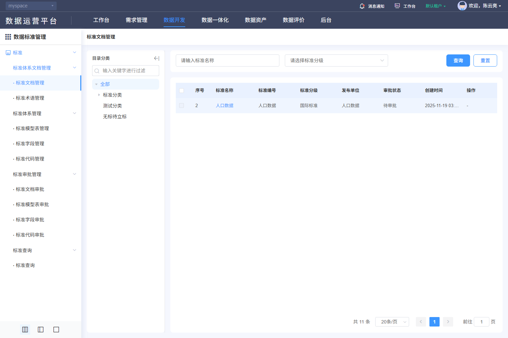

#### 8. 关联文档（DSS-100）

[规则核查、差异与外部合同](./核查记录.md) · [专项原文及历史索引](../evidence/dss-review-20261027/README.md)。

- [V-DSS-001.png](../evidence/live-recheck-20261022/V-DSS-001.png)
- [V-DSS-001.json](../evidence/live-recheck-20261022/V-DSS-001.json)
- [F202-DSS-document-delete-cancel.png](../evidence/F202-DSS-document-delete-cancel.png)
- [F202-DSS-document-delete-cancel.json](../evidence/F202-DSS-document-delete-cancel.json)
- [F196-DSS-document-query.png](../evidence/F196-DSS-document-query.png)
- [F196-DSS-document-query.json](../evidence/F196-DSS-document-query.json)
- [F197-DSS-document-reset.png](../evidence/F197-DSS-document-reset.png)
- [F197-DSS-document-reset.json](../evidence/F197-DSS-document-reset.json)

#### 9. 非功能性需求（DSS-100）

适用主规格第9节DSS-NFR质量矩阵。权限、文本、查询和资源清理适用全部；保存一致性适用维护/分类；审批事务适用四类审批；文件约束适用PDF与导入导出；本地集合容量适用代码项和四类关联。只读查询不新增账号密码、登录限流或物理执行任务。各项均未执行。

### DSS-102 新增标准文档

**业务目的**：新增标准文档；入口：/dss/standard/document/docEdit?optType=add。前置条件：已登录且具备相应资源/动作权限。

**操作与规则**：按以下字段、控件、请求和对象标识处理；分类、标准记录、引用关系、版本与审批申请分别管理。

**结果与异常处理**：操作结果须按对象或申请回读；失败、无权、合法空结果与结果未知分别反馈，前端提示不代替服务端业务结果。

**开发处理细则**：

- 固定使用已查字段及调用映射，未知后端约束通过第7节交付包补齐，不由AI自选；字段空白属性不表示无约束。
- 原实现与本次补充目标的差异在核查记录追踪，全部应用验收未执行。

<!-- 完整规格:DSS-102 -->

#### 1. 页面字段清单（DSS-102）

| 字段名称与绑定名 | 类型/控件 | 是否必填 | 默认值 | 长度/范围/单位 | 格式及校验 | 错误提示 | 条件/状态 |
|---|---|---|---|---|---|---|---|
| 标准名称 standardName | string / 文本 | 是 | 空字符串 | 250字符 | trim首尾空白 | 请输入标准名称 |  |
| 英文名称 standardNameEn | string / 文本 | 否 | 空字符串 | 250字符 | trim首尾空白 | 请输入英文名称 |  |
| 标准编号 standardCode | string / 文本 | 是 | 空字符串 | 100字符 | trim首尾空白 | 请输入标准编号 |  |
| 批准发布部门 releaseUnit | string / 文本 | 是 | 空字符串 | 255字符 | trim首尾空白 | 请输入批准发布部门 |  |
| 标准分级 standardType | string / 单选 | 是 | 空字符串 | A国际、B国家、C行业、D地方、E团体、F企业、G其他 | 新增可选；编辑/查看禁用 | 请选择标准分级 |  |
| 标准状态 standardState | string / 单选 | 是 | 空字符串 | 1现行、2废止 | 读取数值转字符串回显；编辑/查看禁用 | 请选择标准状态 |  |
| 发布日期 releaseDate / 实施日期 effectDate | string / 日期，两控件 | 是 | 空字符串 | yyyy-MM-dd | 分别change非空；不自行施加过去/未来限制 | 请选择发布日期/实施日期 |  |
| 标准文档 standardDoc / standardDocName | 文件key / PDF上传 | 否 | 空字符串 | 单文件1个；≤10 MiB；application/pdf | 选择文件立即上传，FormData键file及businessKey=DSSMS；成功返回值写standardDoc，不能拿本地路径替代 |  | 上传中禁提交 |
| 替代以下标准 standardReplace | string / 文本 | 否 | 空字符串 | 100字符 | trim首尾空白 | 请输入替代以下标准 |  |
| 标准适用范围 standardSummary | string / 文本 | 否 | 空字符串 | 250字符 | trim首尾空白 | 请输入标准适用范围 |  |
| 关联标准字段 fields / 术语 terminologys / 模型表 tables / 代码 codes | array<object> / 四页签 | 否 | [] |  | 按各对象稳定id保存；新增/解除仅改草稿，主记录提交时持久化；不能因候选未加载完清空旧关联 |  |  |
| 记录 id / 审批状态 approveStatus | 只读文本 |  |  |  | 编辑GET/{id}回显；待审批不得再次维护；保存受理与审批生效分开 |  | 返回数据，不由客户端生成 |

新增默认来自模型初始化；编辑显示当前记录，服务器返回标识和状态不作为新增默认。无证据的长度、唯一域、精度单位及提示留空，详见核查记录的外部依赖。

#### 2. 页面交互规则（DSS-102）

| 控件/触发 | 前提及输入 | 行为与联动 | 忙碌/禁用/反馈 | 完成、失败及草稿 |
|---|---|---|---|---|
| 基本信息/四关联页签 | 当前表单 | 默认基本信息；字段、术语、模型表、代码各保存独立数组；关联多选按id去重，解除先确认且只改草稿 | 候选未加载不抹旧引用；提交一次保存全部 | 取消选择不改主草稿；已失效引用给原因 |
| 选择PDF/移除/预览 | 文件≤10 MiB且PDF | 选择即POST uploadDoc；移除清standardDoc，不代表远端删除；已保存文件先getSignKey再受权下载 | 上传中阻止提交；失败恢复；临时文件不可预览 | view以PDF弹窗分页预览；edit下载；离开释放objectURL |
| 提交 | 依赖读取成功、表单合法且有权 | 共享请求锁后一次POST/PUT；服务端复核范围/引用/状态/并发，成功回读 | 整个在途期间禁重复；finally恢复 | 成功受理后核记录/审批；明确失败保留草稿，未知结果先核查 |
| 取消/返回/关闭/后退 | 当前表单 | 有修改时选择继续编辑或放弃；放弃后返回原分类/筛选 | 不调用主记录保存 | 已发生上传/自动填充请求不能撤销其历史；临时文件按服务端策略回收 |

#### 3. 业务流程与异常分支（DSS-102）

1. 从明确新增入口建立空模型，验证分类等上下文；不从列表第一条或样本复制默认值。
2. 补齐7个必填项；日期按yyyy-MM-dd传递。
3. 四关联数组按稳定对象ID取值，不因pageSize=9999的候选截断而丢旧关联。
4. 字段与关联校验通过后，人工提交；公共表单浅复制模型，POST创建或PUT当前id更新；不自行增加幂等键/版本头。
5. 成功提示后回来源列表按稳定ID核对记录及审批结果；保存受理不代表审批通过、生效或物理数据已变更。
6. 失败定位可修改字段并保留草稿；超时/断网结果未知时先查询目标/请求关联，禁止自动重复保存。

| 异常分支 | 处理与恢复 |
|---|---|
| 本地校验/组合失败 | 定位对应项/页，保留合法草稿；依赖未就绪或ID无效不得提交。 |
| 权限、引用、审批/版本冲突 | 显示服务端原因，保持原数据；重新读取确认后再操作，不提供隐式强制覆盖。 |
| 超时、202、5xx、响应丢失 | 区分明确失败与结果未知；finally解除本地锁，未知结果先按稳定ID/申请ID核查。 |
| 重复点击、取消、迟到响应 | 同对象同动作最多一个在途请求；取消不发主记录写请求，离页旧响应不改新对象；上传/批量独立核结果。 |

#### 4. 接口与数据规则（DSS-102）

| 用途 | HTTP方法 | 相对路径 | 请求参数/来源/转换 | 返回读取与页面处理 |
|---|---|---|---|---|
| 提交记录 | POST | /back/dss/ms/standarddocument | JSON：本字段表的模型键；不伪造服务端id | 公共resolve触发成功提示；完整服务端body、审批与版本合同见核查记录 |
| 上传PDF | POST | /back/dss/ms/standarddocument/uploadDoc | FormData {file,businessKey:"DSSMS"}；由浏览器生成multipart boundary | 返回值写standardDoc；不等同主表保存 |
| 文件签名引用 | GET | /back/dss/ms/standarddocument/getSignKey | query key=已保存standardDoc | 临时签名仅供下载，不写日志/URL分享 |
| 授权下载 | GET | /back/common/oss/oss/downloadFileObject | query key=签名引用，businessDescription="1111"；responseType=blob、rawData | 读取原始响应data供预览/下载；错误blob不能作为PDF |
| 四类关联候选 | POST | /back/dss/ms/{standardfield&#124;terminology&#124;standardtable&#124;standardcode}/page | 四个独立资源；按页pageRequest，字段选择含dssStatus:2、isDoc:true、keyWord；模型表另有分类 | 字段写fields，术语terminologys，模型表tables，代码codes；详见第4节 |

POST/PUT对象使用JSON；文件使用FormData，boundary由客户端生成。相对路径由模块/dss/ms与网关/back组合；列表读取datas/total。公共202、错误、身份头与超时，以及审批返回差异按第4节公共契约处理；不增造code=0成功协议、DTO、幂等头或固定租户字段。

#### 5. 验收标准（DSS-102）

| 验收编号 | 前置、步骤与可检查结果 | 关联需求 | 状态 |
|---|---|---|---|
| DSS-AC-562 | 打开新增标准文档，逐字段核标签、必填、边界、默认/当前值和禁用；查看模式无保存。 | DSS-102 | 未执行 |
| DSS-AC-563 | 专用数据完成新增，核方法/路径/模型键并按id回读字段及关联；不以成功提示当生效证明。 | DSS-102 | 未执行 |
| DSS-AC-564 | 覆盖必填空白、上限/超限、无效候选、引用失效及当前表单专有组合规则，拒绝时不误报成功。 | DSS-102 | 未执行 |
| DSS-AC-565 | 注入重复提交、202、5xx、超时和并发冲突，核一次逻辑效果；未知结果查询后才允许适用重试。 | DSS-102 | 未执行 |
| DSS-AC-566 | 取消/返回/后退核继续编辑或放弃；主记录不保存、旧记录不变，已上传临时文件按归属回收，底栏与焦点可达。 | DSS-102 | 未执行 |

#### 6. 权限与安全要求（DSS-102）

服务端逐对象核验分类、记录、版本、审批申请、引用与文件的读取/写入权限及资源范围；直接URL、改id或隐藏按钮不能绕过。草稿、列表、文件和审计按当前身份与授权范围隔离；适用待审批限制的标准记录由服务端复核状态。TLS、文件内容检查、文本编码和审计各自验收，不把PDF签名引用当账号登录公钥。

#### 7. 页面布局与状态（DSS-102）

- 标题为新增/修改标准文档，右上返回；白色主体默认基本信息页签，其余为关联标准字段、术语、模型表、代码。基本信息两列：标准名称/英文名、编号/发布部门、分级/状态、发布/实施日期；其后上传、替代标准和适用范围。底部固定取消、提交；长页主体滚动不被底栏遮住。
- PDF预览居中模态，有上一页/下一页及当前/总页数；页边界禁越界、失败独立提示。历史文档图未覆盖所有关联页签，布局以各组件结构及核查记录范围交付。
- 初始化/加载、可操作、合法空结果、字段错误、业务拒绝、网络失败分别展示；写入另有提交中、结果未知及回读。宽表局部横滚，长表单纵滚，200%缩放下操作可达。

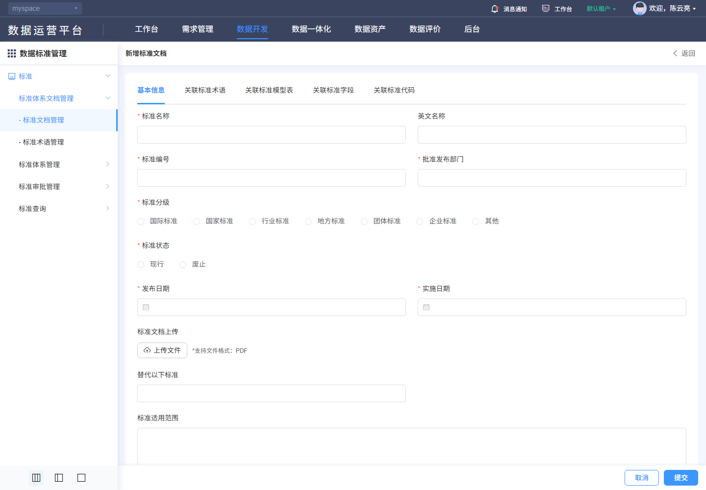

#### 8. 关联文档（DSS-102）

[规则核查、差异与外部合同](./核查记录.md) · [专项原文及历史索引](../evidence/dss-review-20261027/README.md)。

- [E034-standard-add.png](../evidence/E034-standard-add.png)
- [E034-standard-add.json](../evidence/E034-standard-add.json)

#### 9. 非功能性需求（DSS-102）

适用主规格第9节DSS-NFR质量矩阵。权限、文本、查询和资源清理适用全部；保存一致性适用维护/分类；审批事务适用四类审批；文件约束适用PDF与导入导出；本地集合容量适用代码项和四类关联。只读查询不新增账号密码、登录限流或物理执行任务。各项均未执行。

### DSS-103 修改标准文档

**业务目的**：修改标准文档；入口：/dss/standard/document/docEdit?optType=edit&id={id}。前置条件：已登录且具备相应资源/动作权限。

**操作与规则**：按以下字段、控件、请求和对象标识处理；分类、标准记录、引用关系、版本与审批申请分别管理。

**结果与异常处理**：操作结果须按对象或申请回读；失败、无权、合法空结果与结果未知分别反馈，前端提示不代替服务端业务结果。

**开发处理细则**：

- 固定使用已查字段及调用映射，未知后端约束通过第7节交付包补齐，不由AI自选；字段空白属性不表示无约束。
- 原实现与本次补充目标的差异在核查记录追踪，全部应用验收未执行。

<!-- 完整规格:DSS-103 -->

#### 1. 页面字段清单（DSS-103）

| 字段名称与绑定名 | 类型/控件 | 是否必填 | 默认值 | 长度/范围/单位 | 格式及校验 | 错误提示 | 条件/状态 |
|---|---|---|---|---|---|---|---|
| 标准名称 standardName | string / 文本 | 是 | 当前记录 | 250字符 | trim首尾空白 | 请输入标准名称 |  |
| 英文名称 standardNameEn | string / 文本 | 否 | 当前记录 | 250字符 | trim首尾空白 | 请输入英文名称 |  |
| 标准编号 standardCode | string / 文本 | 是 | 当前记录 | 100字符 | trim首尾空白 | 请输入标准编号 |  |
| 批准发布部门 releaseUnit | string / 文本 | 是 | 当前记录 | 255字符 | trim首尾空白 | 请输入批准发布部门 |  |
| 标准分级 standardType | string / 单选 | 是 | 当前记录 | A国际、B国家、C行业、D地方、E团体、F企业、G其他 | 新增可选；编辑/查看禁用 | 请选择标准分级 |  |
| 标准状态 standardState | string / 单选 | 是 | 当前记录 | 1现行、2废止 | 读取数值转字符串回显；编辑/查看禁用 | 请选择标准状态 |  |
| 发布日期 releaseDate / 实施日期 effectDate | string / 日期，两控件 | 是 | 当前记录 | yyyy-MM-dd | 分别change非空；不自行施加过去/未来限制 | 请选择发布日期/实施日期 |  |
| 标准文档 standardDoc / standardDocName | 文件key / PDF上传 | 否 | 当前记录 | 单文件1个；≤10 MiB；application/pdf | 选择文件立即上传，FormData键file及businessKey=DSSMS；成功返回值写standardDoc，不能拿本地路径替代 |  | 上传中禁提交 |
| 替代以下标准 standardReplace | string / 文本 | 否 | 当前记录 | 100字符 | trim首尾空白 | 请输入替代以下标准 |  |
| 标准适用范围 standardSummary | string / 文本 | 否 | 当前记录 | 250字符 | trim首尾空白 | 请输入标准适用范围 |  |
| 关联标准字段 fields / 术语 terminologys / 模型表 tables / 代码 codes | array<object> / 四页签 | 否 | [] |  | 按各对象稳定id保存；新增/解除仅改草稿，主记录提交时持久化；不能因候选未加载完清空旧关联 |  |  |
| 记录 id / 审批状态 approveStatus | 只读文本 |  |  |  | 编辑GET/{id}回显；待审批不得再次维护；保存受理与审批生效分开 |  | 返回数据，不由客户端生成 |

新增默认来自模型初始化；编辑显示当前记录，服务器返回标识和状态不作为新增默认。无证据的长度、唯一域、精度单位及提示留空，详见核查记录的外部依赖。

#### 2. 页面交互规则（DSS-103）

| 控件/触发 | 前提及输入 | 行为与联动 | 忙碌/禁用/反馈 | 完成、失败及草稿 |
|---|---|---|---|---|
| 基本信息/四关联页签 | 当前表单 | 默认基本信息；字段、术语、模型表、代码各保存独立数组；关联多选按id去重，解除先确认且只改草稿 | 候选未加载不抹旧引用；提交一次保存全部 | 取消选择不改主草稿；已失效引用给原因 |
| 选择PDF/移除/预览 | 文件≤10 MiB且PDF | 选择即POST uploadDoc；移除清standardDoc，不代表远端删除；已保存文件先getSignKey再受权下载 | 上传中阻止提交；失败恢复；临时文件不可预览 | view以PDF弹窗分页预览；edit下载；离开释放objectURL |
| 提交 | 依赖读取成功、表单合法且有权 | 共享请求锁后一次POST/PUT；服务端复核范围/引用/状态/并发，成功回读 | 整个在途期间禁重复；finally恢复 | 成功受理后核记录/审批；明确失败保留草稿，未知结果先核查 |
| 取消/返回/关闭/后退 | 当前表单 | 有修改时选择继续编辑或放弃；放弃后返回原分类/筛选 | 不调用主记录保存 | 已发生上传/自动填充请求不能撤销其历史；临时文件按服务端策略回收 |

#### 3. 业务流程与异常分支（DSS-103）

1. 以当前记录id读取详情并填充；读取失败禁止把空表单当新增；禁用字段保持原值。
2. 补齐7个必填项；日期按yyyy-MM-dd传递。
3. 四关联数组按稳定对象ID取值，不因pageSize=9999的候选截断而丢旧关联。
4. 字段与关联校验通过后，人工提交；公共表单浅复制模型，POST创建或PUT当前id更新；不自行增加幂等键/版本头。
5. 成功提示后回来源列表按稳定ID核对记录及审批结果；保存受理不代表审批通过、生效或物理数据已变更。
6. 失败定位可修改字段并保留草稿；超时/断网结果未知时先查询目标/请求关联，禁止自动重复保存。

| 异常分支 | 处理与恢复 |
|---|---|
| 本地校验/组合失败 | 定位对应项/页，保留合法草稿；依赖未就绪或ID无效不得提交。 |
| 权限、引用、审批/版本冲突 | 显示服务端原因，保持原数据；重新读取确认后再操作，不提供隐式强制覆盖。 |
| 超时、202、5xx、响应丢失 | 区分明确失败与结果未知；finally解除本地锁，未知结果先按稳定ID/申请ID核查。 |
| 重复点击、取消、迟到响应 | 同对象同动作最多一个在途请求；取消不发主记录写请求，离页旧响应不改新对象；上传/批量独立核结果。 |

#### 4. 接口与数据规则（DSS-103）

| 用途 | HTTP方法 | 相对路径 | 请求参数/来源/转换 | 返回读取与页面处理 |
|---|---|---|---|---|
| 详情读取 | GET | /back/dss/ms/standarddocument/{id} | path id=当前记录id | 返回对象回显，包括只读标识与原有嵌套项 |
| 提交记录 | PUT | /back/dss/ms/standarddocument/{id} | JSON：本字段表的模型键；保留原记录/子项id，不以名称替代 | 公共resolve触发成功提示；完整服务端body、审批与版本合同见核查记录 |
| 上传PDF | POST | /back/dss/ms/standarddocument/uploadDoc | FormData {file,businessKey:"DSSMS"}；由浏览器生成multipart boundary | 返回值写standardDoc；不等同主表保存 |
| 文件签名引用 | GET | /back/dss/ms/standarddocument/getSignKey | query key=已保存standardDoc | 临时签名仅供下载，不写日志/URL分享 |
| 授权下载 | GET | /back/common/oss/oss/downloadFileObject | query key=签名引用，businessDescription="1111"；responseType=blob、rawData | 读取原始响应data供预览/下载；错误blob不能作为PDF |
| 四类关联候选 | POST | /back/dss/ms/{standardfield&#124;terminology&#124;standardtable&#124;standardcode}/page | 四个独立资源；按页pageRequest，字段选择含dssStatus:2、isDoc:true、keyWord；模型表另有分类 | 字段写fields，术语terminologys，模型表tables，代码codes；详见第4节 |

POST/PUT对象使用JSON；文件使用FormData，boundary由客户端生成。相对路径由模块/dss/ms与网关/back组合；列表读取datas/total。公共202、错误、身份头与超时，以及审批返回差异按第4节公共契约处理；不增造code=0成功协议、DTO、幂等头或固定租户字段。

#### 5. 验收标准（DSS-103）

| 验收编号 | 前置、步骤与可检查结果 | 关联需求 | 状态 |
|---|---|---|---|
| DSS-AC-567 | 打开修改标准文档，逐字段核标签、必填、边界、默认/当前值和禁用；查看模式无保存。 | DSS-103 | 未执行 |
| DSS-AC-568 | 专用数据完成修改，核方法/路径/模型键并按id回读字段及关联；不以成功提示当生效证明。 | DSS-103 | 未执行 |
| DSS-AC-569 | 覆盖必填空白、上限/超限、无效候选、引用失效及当前表单专有组合规则，拒绝时不误报成功。 | DSS-103 | 未执行 |
| DSS-AC-570 | 注入重复提交、202、5xx、超时和并发冲突，核一次逻辑效果；未知结果查询后才允许适用重试。 | DSS-103 | 未执行 |
| DSS-AC-571 | 取消/返回/后退核继续编辑或放弃；主记录不保存、旧记录不变，已上传临时文件按归属回收，底栏与焦点可达。 | DSS-103 | 未执行 |

#### 6. 权限与安全要求（DSS-103）

服务端逐对象核验分类、记录、版本、审批申请、引用与文件的读取/写入权限及资源范围；直接URL、改id或隐藏按钮不能绕过。草稿、列表、文件和审计按当前身份与授权范围隔离；适用待审批限制的标准记录由服务端复核状态。TLS、文件内容检查、文本编码和审计各自验收，不把PDF签名引用当账号登录公钥。

#### 7. 页面布局与状态（DSS-103）

- 标题为新增/修改标准文档，右上返回；白色主体默认基本信息页签，其余为关联标准字段、术语、模型表、代码。基本信息两列：标准名称/英文名、编号/发布部门、分级/状态、发布/实施日期；其后上传、替代标准和适用范围。底部固定取消、提交；长页主体滚动不被底栏遮住。
- PDF预览居中模态，有上一页/下一页及当前/总页数；页边界禁越界、失败独立提示。历史文档图未覆盖所有关联页签，布局以各组件结构及核查记录范围交付。
- 初始化/加载、可操作、合法空结果、字段错误、业务拒绝、网络失败分别展示；写入另有提交中、结果未知及回读。宽表局部横滚，长表单纵滚，200%缩放下操作可达。

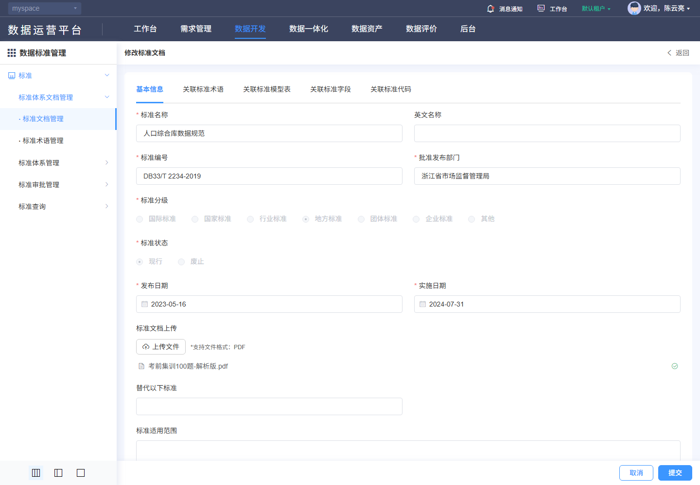

#### 8. 关联文档（DSS-103）

[规则核查、差异与外部合同](./核查记录.md) · [专项原文及历史索引](../evidence/dss-review-20261027/README.md)。

- [F198-DSS-document-edit.png](../evidence/F198-DSS-document-edit.png)
- [F198-DSS-document-edit.json](../evidence/F198-DSS-document-edit.json)
- [F053-DSS-document-edit-cancel.png](../evidence/F053-DSS-document-edit-cancel.png)
- [F053-DSS-document-edit-cancel.json](../evidence/F053-DSS-document-edit-cancel.json)
- [F199-DSS-document-edit-cancel.png](../evidence/F199-DSS-document-edit-cancel.png)
- [F199-DSS-document-edit-cancel.json](../evidence/F199-DSS-document-edit-cancel.json)

#### 9. 非功能性需求（DSS-103）

适用主规格第9节DSS-NFR质量矩阵。权限、文本、查询和资源清理适用全部；保存一致性适用维护/分类；审批事务适用四类审批；文件约束适用PDF与导入导出；本地集合容量适用代码项和四类关联。只读查询不新增账号密码、登录限流或物理执行任务。各项均未执行。

### DSS-104 删除标准文档

**业务目的**：删除标准文档；入口：/dss/standard/document/docList。前置条件：已登录且具备相应资源/动作权限。

**操作与规则**：按以下字段、控件、请求和对象标识处理；分类、标准记录、引用关系、版本与审批申请分别管理。

**结果与异常处理**：操作结果须按对象或申请回读；失败、无权、合法空结果与结果未知分别反馈，前端提示不代替服务端业务结果。

**开发处理细则**：

- 固定使用已查字段及调用映射，未知后端约束通过第7节交付包补齐，不由AI自选；字段空白属性不表示无约束。
- 原实现与本次补充目标的差异在核查记录追踪，全部应用验收未执行。

<!-- 完整规格:DSS-104 -->

#### 1. 页面字段清单（DSS-104）

| 字段名称与绑定名 | 类型/控件 | 是否必填 | 默认值 | 长度/范围/单位 | 格式及校验 | 错误提示 | 条件/状态 |
|---|---|---|---|---|---|---|---|
| 目标 id / name | 只读文本 |  |  |  | 来自当前行；确认显示可辨识名称并绑定原id |  | 返回数据，不由客户端生成 |
| 批量 multipleSelection[].id | 只读文本 |  |  |  | 只含有权可删记录；待审批对象排除 |  | 返回数据，不由客户端生成 |
| 确认内容 | 只读文本 |  |  |  | 删除后不可恢复的警告；是否软删除不由文案推断 |  | 返回数据，不由客户端生成 |
| 引用/审批/并发状态 | 只读文本 |  |  |  | 服务端删除前原子重查，不由按钮隐藏代替 |  | 返回数据，不由客户端生成 |

新增默认来自模型初始化；编辑显示当前记录，服务器返回标识和状态不作为新增默认。无证据的长度、唯一域、精度单位及提示留空，详见核查记录的外部依赖。

#### 2. 页面交互规则（DSS-104）

| 控件/触发 | 前提及输入 | 行为与联动 | 忙碌/禁用/反馈 | 完成、失败及草稿 |
|---|---|---|---|---|
| 行删除/批量删除 | 有权且选中允许对象 | 先打开确认；取消直接关闭，人工确认后发删除请求 | 在途禁重复；失败保留对象 | 成功回读列表，末页回有效页；超时先查目标 |
| 取消/关闭 | 确认框打开 | 不发送删除/批量删除 | 焦点回原入口 | 保留筛选与页码 |

#### 3. 业务流程与异常分支（DSS-104）

1. 在标准文档当前范围核对目标id、名称和选中集合。
2. 确认前不提交；确认后服务端重查权限、引用、审批和版本，拒绝时保持记录。
3. 成功回读当前范围，删除末页末条回有效页；结果未知先按id查询，不对相邻行重发。

| 异常分支 | 处理与恢复 |
|---|---|
| 本地校验/组合失败 | 定位对应项/页，保留合法草稿；依赖未就绪或ID无效不得提交。 |
| 权限、引用、审批/版本冲突 | 显示服务端原因，保持原数据；重新读取确认后再操作，不提供隐式强制覆盖。 |
| 超时、202、5xx、响应丢失 | 区分明确失败与结果未知；finally解除本地锁，未知结果先按稳定ID/申请ID核查。 |
| 重复点击、取消、迟到响应 | 同对象同动作最多一个在途请求；取消不发主记录写请求，离页旧响应不改新对象；上传/批量独立核结果。 |

#### 4. 接口与数据规则（DSS-104）

| 用途 | HTTP方法 | 相对路径 | 请求参数/来源/转换 | 返回读取与页面处理 |
|---|---|---|---|---|
| 删除单记录 | DELETE | /back/dss/ms/standarddocument/{id} | path id=当前记录；无伪造级联body | 成功后查询列表；删除可能形成审批申请，不能当已物理删除 |
| 批量删除 | POST | /back/dss/ms/standarddocument/remove | JSON array<ID>，来自multipleSelection | 逐条结果/事务策略按后端合同；不能把无响应等于全部成功 |
| 列表查询 | POST | /back/dss/ms/standarddocument/page | JSON：筛选键+固定条件+pageRequest；空值/未传保持模型语义 | 读取datas/total；公共列表兼容数组，但正式DTO须按核查合同 |

POST/PUT对象使用JSON；文件使用FormData，boundary由客户端生成。相对路径由模块/dss/ms与网关/back组合；列表读取datas/total。公共202、错误、身份头与超时，以及审批返回差异按第4节公共契约处理；不增造code=0成功协议、DTO、幂等头或固定租户字段。

#### 5. 验收标准（DSS-104）

| 验收编号 | 前置、步骤与可检查结果 | 关联需求 | 状态 |
|---|---|---|---|
| DSS-AC-572 | 打开标准文档单删/批删确认，核id和名称与选中对象一致；无选择时不提交。 | DSS-104 | 未执行 |
| DSS-AC-573 | 专用可删除对象确认后核DELETE或POST/remove及回读结果，审批受理与最终删除分开验收。 | DSS-104 | 未执行 |
| DSS-AC-574 | 存在引用、待审批、无权或已处理对象被拒绝，不误删其他记录；批量部分失败明确列出。 | DSS-104 | 未执行 |
| DSS-AC-575 | 双会话删除、响应丢失及重复点击，至多一次逻辑效果，未知结果按id查询再决定重试。 | DSS-104 | 未执行 |
| DSS-AC-576 | 取消/关闭0次删除请求，原记录与上下文不变，末页末条处理及焦点恢复正确。 | DSS-104 | 未执行 |

#### 6. 权限与安全要求（DSS-104）

服务端逐对象核验分类、记录、版本、审批申请、引用与文件的读取/写入权限及资源范围；直接URL、改id或隐藏按钮不能绕过。草稿、列表、文件和审计按当前身份与授权范围隔离；适用待审批限制的标准记录由服务端复核状态。TLS、文件内容检查、文本编码和审计各自验收，不把PDF签名引用当账号登录公钥。

#### 7. 页面布局与状态（DSS-104）

- 在原列表上方显示删除确认和确认/取消按钮，背景仍可识别对象；内容清楚显示对象类型、名称和批量数量。失败/忙碌不遮取消反馈，关闭焦点返回原删除入口。
- 初始化/加载、可操作、合法空结果、字段错误、业务拒绝、网络失败分别展示；写入另有提交中、结果未知及回读。宽表局部横滚，长表单纵滚，200%缩放下操作可达。

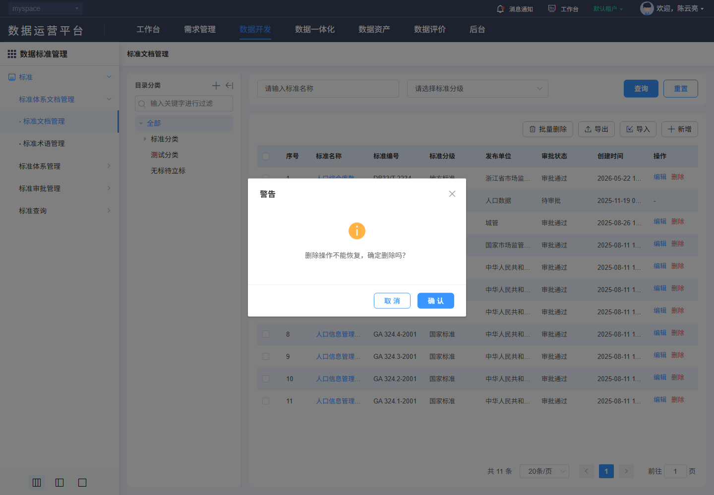

#### 8. 关联文档（DSS-104）

[规则核查、差异与外部合同](./核查记录.md) · [专项原文及历史索引](../evidence/dss-review-20261027/README.md)。

- [F201-DSS-document-delete.png](../evidence/F201-DSS-document-delete.png)
- [F201-DSS-document-delete.json](../evidence/F201-DSS-document-delete.json)
- [F200-DSS-document-delete-guard.png](../evidence/F200-DSS-document-delete-guard.png)
- [F200-DSS-document-delete-guard.json](../evidence/F200-DSS-document-delete-guard.json)
- [F202-DSS-document-delete-cancel.png](../evidence/F202-DSS-document-delete-cancel.png)
- [F202-DSS-document-delete-cancel.json](../evidence/F202-DSS-document-delete-cancel.json)

#### 9. 非功能性需求（DSS-104）

适用主规格第9节DSS-NFR质量矩阵。权限、文本、查询和资源清理适用全部；保存一致性适用维护/分类；审批事务适用四类审批；文件约束适用PDF与导入导出；本地集合容量适用代码项和四类关联。只读查询不新增账号密码、登录限流或物理执行任务。各项均未执行。

### DSS-105 查询标准术语

**业务目的**：标准术语管理；入口：/dss/standard/document/termList。前置条件：已登录且具备相应资源/动作权限。

**操作与规则**：按以下字段、控件、请求和对象标识处理；分类、标准记录、引用关系、版本与审批申请分别管理。

**结果与异常处理**：操作结果须按对象或申请回读；失败、无权、合法空结果与结果未知分别反馈，前端提示不代替服务端业务结果。

**开发处理细则**：

- 固定使用已查字段及调用映射，未知后端约束通过第7节交付包补齐，不由AI自选；字段空白属性不表示无约束。
- 原实现与本次补充目标的差异在核查记录追踪，全部应用验收未执行。

<!-- 完整规格:DSS-105 -->

#### 1. 页面字段清单（DSS-105）

| 字段名称与绑定名 | 类型/控件 | 是否必填 | 默认值 | 长度/范围/单位 | 格式及校验 | 错误提示 | 条件/状态 |
|---|---|---|---|---|---|---|---|
| 术语名称 terminologyName | string / 文本 | 否 | 空字符串 |  | trim首尾空白 | 请输入术语名称 |  |
| 术语类型 terminologyType | string / 搜索单选 | 否 |  | 1业务、2技术 |  |  |  |
| 页号 pageRequest.pageNo | integer | 是 | 1 | 正整数 | 查询、重置、改变页大小回第1页 |  |  |
| 页大小 pageRequest.pageSize | integer | 是 | 20 | 正整数 | 候选10/20/30/40/50/100；不把历史总数当上限 |  |  |
| 排序 pageRequest.order | array<object> | 是 | [{prop:"id",asc:false}] |  | prop为字段键、asc为boolean；服务端限制允许排序字段 |  |  |
| 序号 | 只读文本 |  |  |  |  |  | 返回数据，不由客户端生成 |
| 术语名称 terminologyName | 只读文本 |  |  |  |  |  | 返回数据，不由客户端生成 |
| 定义 terminologyDef | 只读文本 |  |  |  |  |  | 返回数据，不由客户端生成 |
| 来源 terminologySrc | 只读文本 |  |  |  |  |  | 返回数据，不由客户端生成 |
| 类型 terminologyType | 只读文本 |  |  |  |  |  | 返回数据，不由客户端生成 |
| 创建人 createUsername | 只读文本 |  |  |  |  |  | 返回数据，不由客户端生成 |
| 创建时间 createTime | 只读文本 |  |  |  |  |  | 返回数据，不由客户端生成 |
| 术语标识 id | 只读文本 |  |  |  |  |  | 返回数据，不由客户端生成 |

新增默认来自模型初始化；编辑显示当前记录，服务器返回标识和状态不作为新增默认。无证据的长度、唯一域、精度单位及提示留空，详见核查记录的外部依赖。

#### 2. 页面交互规则（DSS-105）

| 控件/触发 | 前提及输入 | 行为与联动 | 忙碌/禁用/反馈 | 完成、失败及草稿 |
|---|---|---|---|---|
| 查询/Enter | 草稿合法 | 按当前条件查询并回第1页；所有入口共用查询处理 | 显示表格加载，最新请求有效 | 失败保留条件；旧响应不得覆盖 |
| 重置 | 当前列表 | 清空可编辑筛选，保留当前分类/固定范围，回第1页并查询 | 加载不清除分类 | 不触发写入 |
| 分页/页大小 | 最新total | 按当前条件读指定页；改变大小回第1页 | 禁止无效页；不以截图min/max限制总页数 | 返回保持来源条件；列表刷新清除失效勾选 |

#### 3. 业务流程与异常分支（DSS-105）

1. 进入标准术语管理，先检查当前对象范围与分类读取结果，初始化分页并请求授权记录。
2. 修改条件仅改查询草稿；查询或重置回第1页，翻页保留已提交筛选。
3. 收到当前请求结果后同时更新列表、total及有效页；合法空结果、读取失败和无权分开显示。
4. 名称链接进入optType=view，编辑进入optType=edit并携当前id；查看禁写，维护后按来源条件回读。

| 异常分支 | 处理与恢复 |
|---|---|
| 合法空结果 | 保留当前条件，显示真实0条；无权/失败不降格为空列表。 |
| 分类/候选失败或失效 | 显示具体依赖失败及重试；不自动扩大到根或其他分类。 |
| 超时、202、5xx、乱序 | 显示请求失败；旧响应丢弃，保留已提交条件；只由用户显式重试。 |
| 会话过期/失权 | 按公共码处理会话和路由，清理受限数据；不能继续显示上一身份内容。 |

#### 4. 接口与数据规则（DSS-105）

| 用途 | HTTP方法 | 相对路径 | 请求参数/来源/转换 | 返回读取与页面处理 |
|---|---|---|---|---|
| 列表查询 | POST | /back/dss/ms/terminology/page | JSON：筛选键+固定条件+pageRequest；空值/未传保持模型语义 | 读取datas/total；公共列表兼容数组，但正式DTO须按核查合同 |

POST/PUT对象使用JSON；文件使用FormData，boundary由客户端生成。相对路径由模块/dss/ms与网关/back组合；列表读取datas/total。公共202、错误、身份头与超时，以及审批返回差异按第4节公共契约处理；不增造code=0成功协议、DTO、幂等头或固定租户字段。

#### 5. 验收标准（DSS-105）

| 验收编号 | 前置、步骤与可检查结果 | 关联需求 | 状态 |
|---|---|---|---|
| DSS-AC-577 | 在授权账号进入标准术语管理，核对筛选/列顺序、默认分页、中文长值及合法空结果；图内样本数量不作默认值。 | DSS-105 | 未执行 |
| DSS-AC-578 | 输入条件查询、重置、翻页和改变大小，核POST /back/dss/ms/terminology/page的参数与datas/total；回读匹配记录，无串分类。 | DSS-105 | 未执行 |
| DSS-AC-579 | 用无权ID、空结果、候选失败与服务端业务拒绝验证区分反馈；不把失败当总数0。 | DSS-105 | 未执行 |
| DSS-AC-580 | 注入断网、202、5xx及乱序响应，只有当前条件结果生效，显式重试恢复；不发写请求。 | DSS-105 | 未执行 |
| DSS-AC-581 | 返回恢复分类、筛选、页码；记录失效或最后页删除后回有效页，列表选择不带到其他对象。 | DSS-105 | 未执行 |

#### 6. 权限与安全要求（DSS-105）

服务端逐对象核验分类、记录、版本、审批申请、引用与文件的读取/写入权限及资源范围；直接URL、改id或隐藏按钮不能绕过。草稿、列表、文件和审计按当前身份与授权范围隔离；适用待审批限制的标准记录由服务端复核状态。TLS、文件内容检查、文本编码和审计各自验收，不把PDF签名引用当账号登录公钥。

#### 7. 页面布局与状态（DSS-105）

- 标准术语管理位于平台导航右侧；上方标题与筛选区，查询/重置在右端；操作工具位于表格右上，表头顺序按本字段表结果列，底部右侧条数、页大小、页码和跳页。
- 初始化/加载、可操作、合法空结果、字段错误、业务拒绝、网络失败分别展示；写入另有提交中、结果未知及回读。宽表局部横滚，长表单纵滚，200%缩放下操作可达。

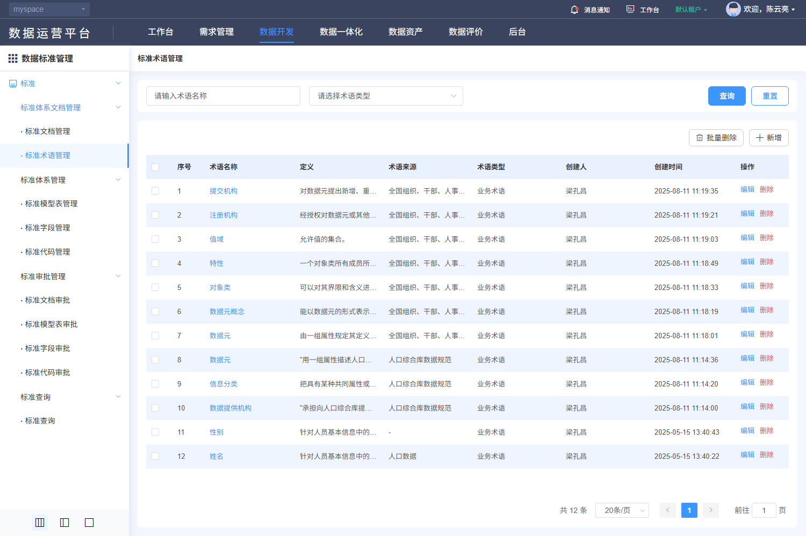

#### 8. 关联文档（DSS-105）

[规则核查、差异与外部合同](./核查记录.md) · [专项原文及历史索引](../evidence/dss-review-20261027/README.md)。

- [V-DSS-002.png](../evidence/live-recheck-20261022/V-DSS-002.png)
- [V-DSS-002.json](../evidence/live-recheck-20261022/V-DSS-002.json)
- [F212-DSS-term-delete-cancel.png](../evidence/F212-DSS-term-delete-cancel.png)
- [F212-DSS-term-delete-cancel.json](../evidence/F212-DSS-term-delete-cancel.json)
- [F204-DSS-term-query.png](../evidence/F204-DSS-term-query.png)
- [F204-DSS-term-query.json](../evidence/F204-DSS-term-query.json)
- [F205-DSS-term-reset.png](../evidence/F205-DSS-term-reset.png)
- [F205-DSS-term-reset.json](../evidence/F205-DSS-term-reset.json)

#### 9. 非功能性需求（DSS-105）

适用主规格第9节DSS-NFR质量矩阵。权限、文本、查询和资源清理适用全部；保存一致性适用维护/分类；审批事务适用四类审批；文件约束适用PDF与导入导出；本地集合容量适用代码项和四类关联。只读查询不新增账号密码、登录限流或物理执行任务。各项均未执行。

### DSS-107 新增标准术语

**业务目的**：新增标准术语；入口：/dss/standard/document/termEdit?optType=add。前置条件：已登录且具备相应资源/动作权限。

**操作与规则**：按以下字段、控件、请求和对象标识处理；分类、标准记录、引用关系、版本与审批申请分别管理。

**结果与异常处理**：操作结果须按对象或申请回读；失败、无权、合法空结果与结果未知分别反馈，前端提示不代替服务端业务结果。

**开发处理细则**：

- 固定使用已查字段及调用映射，未知后端约束通过第7节交付包补齐，不由AI自选；字段空白属性不表示无约束。
- 原实现与本次补充目标的差异在核查记录追踪，全部应用验收未执行。

<!-- 完整规格:DSS-107 -->

#### 1. 页面字段清单（DSS-107）

| 字段名称与绑定名 | 类型/控件 | 是否必填 | 默认值 | 长度/范围/单位 | 格式及校验 | 错误提示 | 条件/状态 |
|---|---|---|---|---|---|---|---|
| 术语名称 terminologyName | string / 文本 | 是 | 空字符串 | 100字符 | trim首尾空白 | 请输入术语名称 |  |
| 术语类型 terminologyType | string / 搜索单选 | 否 | 空字符串 | 1业务术语、2技术术语 | 保存枚举键，不传显示文案 |  |  |
| 术语来源 terminologySrc / docId | string+ID / 文档选择 | 否 | 空字符串 |  | 显示禁手工输入，选择文档联动来源与docId；清除同步清理二者 |  |  |
| 定义 terminologyDef | string / 文本 | 是 | 空字符串 | 200字符 | trim首尾空白 | 请输入定义 |  |
| 术语 id | 只读文本 |  |  |  | 编辑GET和PUT使用当前术语id；不使用docId |  | 返回数据，不由客户端生成 |

新增默认来自模型初始化；编辑显示当前记录，服务器返回标识和状态不作为新增默认。无证据的长度、唯一域、精度单位及提示留空，详见核查记录的外部依赖。

#### 2. 页面交互规则（DSS-107）

| 控件/触发 | 前提及输入 | 行为与联动 | 忙碌/禁用/反馈 | 完成、失败及草稿 |
|---|---|---|---|---|
| 参考文档/清除 | 可维护且有文档读取权 | 打开单选文档选择器，查询/500ms防抖、树/列表/分页；确定将id及展示项同步写当前草稿，未选提示 | 加载/失败独立处理，旧对象响应不得串值 | 取消不改草稿；清除同步清除id/名称/编号/适用分级 |
| 提交 | 依赖读取成功、表单合法且有权 | 共享请求锁后一次POST/PUT；服务端复核范围/引用/状态/并发，成功回读 | 整个在途期间禁重复；finally恢复 | 成功受理后核记录/审批；明确失败保留草稿，未知结果先核查 |
| 取消/返回/关闭/后退 | 当前表单 | 有修改时选择继续编辑或放弃；放弃后返回原分类/筛选 | 不调用主记录保存 | 已发生上传/自动填充请求不能撤销其历史；临时文件按服务端策略回收 |

#### 3. 业务流程与异常分支（DSS-107）

1. 从明确新增入口建立空模型，验证分类等上下文；不从列表第一条或样本复制默认值。
2. 术语名称和定义必填，类型可不选；来源从审批通过文档选择，不允许用显示名充当docId。
3. 字段与关联校验通过后，人工提交；公共表单浅复制模型，POST创建或PUT当前id更新；不自行增加幂等键/版本头。
4. 成功提示后回来源列表按稳定ID核对记录及审批结果；保存受理不代表审批通过、生效或物理数据已变更。
5. 失败定位可修改字段并保留草稿；超时/断网结果未知时先查询目标/请求关联，禁止自动重复保存。

| 异常分支 | 处理与恢复 |
|---|---|
| 本地校验/组合失败 | 定位对应项/页，保留合法草稿；依赖未就绪或ID无效不得提交。 |
| 权限、引用、审批/版本冲突 | 显示服务端原因，保持原数据；重新读取确认后再操作，不提供隐式强制覆盖。 |
| 超时、202、5xx、响应丢失 | 区分明确失败与结果未知；finally解除本地锁，未知结果先按稳定ID/申请ID核查。 |
| 重复点击、取消、迟到响应 | 同对象同动作最多一个在途请求；取消不发主记录写请求，离页旧响应不改新对象；上传/批量独立核结果。 |

#### 4. 接口与数据规则（DSS-107）

| 用途 | HTTP方法 | 相对路径 | 请求参数/来源/转换 | 返回读取与页面处理 |
|---|---|---|---|---|
| 提交记录 | POST | /back/dss/ms/terminology | JSON：本字段表的模型键；不伪造服务端id | 公共resolve触发成功提示；完整服务端body、审批与版本合同见核查记录 |
| 来源文档候选 | POST | /back/dss/ms/standarddocument/page | JSON {approveStatus:2,standardName,pageRequest}；单选当前文档id | 读取datas/total及standardName/id |

POST/PUT对象使用JSON；文件使用FormData，boundary由客户端生成。相对路径由模块/dss/ms与网关/back组合；列表读取datas/total。公共202、错误、身份头与超时，以及审批返回差异按第4节公共契约处理；不增造code=0成功协议、DTO、幂等头或固定租户字段。

#### 5. 验收标准（DSS-107）

| 验收编号 | 前置、步骤与可检查结果 | 关联需求 | 状态 |
|---|---|---|---|
| DSS-AC-582 | 打开新增标准术语，逐字段核标签、必填、边界、默认/当前值和禁用；查看模式无保存。 | DSS-107 | 未执行 |
| DSS-AC-583 | 专用数据完成新增，核方法/路径/模型键并按id回读字段及关联；不以成功提示当生效证明。 | DSS-107 | 未执行 |
| DSS-AC-584 | 覆盖必填空白、上限/超限、无效候选、引用失效及当前表单专有组合规则，拒绝时不误报成功。 | DSS-107 | 未执行 |
| DSS-AC-585 | 注入重复提交、202、5xx、超时和并发冲突，核一次逻辑效果；未知结果查询后才允许适用重试。 | DSS-107 | 未执行 |
| DSS-AC-586 | 取消/返回/后退核继续编辑或放弃；主记录不保存、旧记录不变，已上传临时文件按归属回收，底栏与焦点可达。 | DSS-107 | 未执行 |

#### 6. 权限与安全要求（DSS-107）

服务端逐对象核验分类、记录、版本、审批申请、引用与文件的读取/写入权限及资源范围；直接URL、改id或隐藏按钮不能绕过。草稿、列表、文件和审计按当前身份与授权范围隔离；适用待审批限制的标准记录由服务端复核状态。TLS、文件内容检查、文本编码和审计各自验收，不把PDF签名引用当账号登录公钥。

#### 7. 页面布局与状态（DSS-107）

- 标题新增/修改标准术语、右上返回；两列表单第一行术语名称/术语类型，第二行术语来源选择及清除/定义；底部右侧取消、提交，字段错误在对应项下方。
- 初始化/加载、可操作、合法空结果、字段错误、业务拒绝、网络失败分别展示；写入另有提交中、结果未知及回读。宽表局部横滚，长表单纵滚，200%缩放下操作可达。

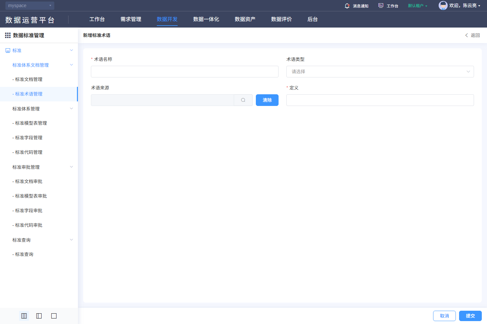

#### 8. 关联文档（DSS-107）

[规则核查、差异与外部合同](./核查记录.md) · [专项原文及历史索引](../evidence/dss-review-20261027/README.md)。

- [V-DSS-002-op1.png](../evidence/live-recheck-20261022/V-DSS-002-op1.png)
- [V-DSS-002-op1.json](../evidence/live-recheck-20261022/V-DSS-002-op1.json)
- [V-DSS-002-op1-options0.png](../evidence/live-recheck-20261022/V-DSS-002-op1-options0.png)
- [V-DSS-002-op1-options0.json](../evidence/live-recheck-20261022/V-DSS-002-op1-options0.json)
- [F206-DSS-term-add.png](../evidence/F206-DSS-term-add.png)
- [F206-DSS-term-add.json](../evidence/F206-DSS-term-add.json)
- [F207-DSS-term-add-cancel.png](../evidence/F207-DSS-term-add-cancel.png)
- [F207-DSS-term-add-cancel.json](../evidence/F207-DSS-term-add-cancel.json)

#### 9. 非功能性需求（DSS-107）

适用主规格第9节DSS-NFR质量矩阵。权限、文本、查询和资源清理适用全部；保存一致性适用维护/分类；审批事务适用四类审批；文件约束适用PDF与导入导出；本地集合容量适用代码项和四类关联。只读查询不新增账号密码、登录限流或物理执行任务。各项均未执行。

### DSS-108 修改标准术语

**业务目的**：修改标准术语；入口：/dss/standard/document/termEdit?optType=edit&id={id}。前置条件：已登录且具备相应资源/动作权限。

**操作与规则**：按以下字段、控件、请求和对象标识处理；分类、标准记录、引用关系、版本与审批申请分别管理。

**结果与异常处理**：操作结果须按对象或申请回读；失败、无权、合法空结果与结果未知分别反馈，前端提示不代替服务端业务结果。

**开发处理细则**：

- 固定使用已查字段及调用映射，未知后端约束通过第7节交付包补齐，不由AI自选；字段空白属性不表示无约束。
- 原实现与本次补充目标的差异在核查记录追踪，全部应用验收未执行。

<!-- 完整规格:DSS-108 -->

#### 1. 页面字段清单（DSS-108）

| 字段名称与绑定名 | 类型/控件 | 是否必填 | 默认值 | 长度/范围/单位 | 格式及校验 | 错误提示 | 条件/状态 |
|---|---|---|---|---|---|---|---|
| 术语名称 terminologyName | string / 文本 | 是 | 当前记录 | 100字符 | trim首尾空白 | 请输入术语名称 |  |
| 术语类型 terminologyType | string / 搜索单选 | 否 | 当前记录 | 1业务术语、2技术术语 | 保存枚举键，不传显示文案 |  |  |
| 术语来源 terminologySrc / docId | string+ID / 文档选择 | 否 | 当前记录 |  | 显示禁手工输入，选择文档联动来源与docId；清除同步清理二者 |  |  |
| 定义 terminologyDef | string / 文本 | 是 | 当前记录 | 200字符 | trim首尾空白 | 请输入定义 |  |
| 术语 id | 只读文本 |  |  |  | 编辑GET和PUT使用当前术语id；不使用docId |  | 返回数据，不由客户端生成 |

新增默认来自模型初始化；编辑显示当前记录，服务器返回标识和状态不作为新增默认。无证据的长度、唯一域、精度单位及提示留空，详见核查记录的外部依赖。

#### 2. 页面交互规则（DSS-108）

| 控件/触发 | 前提及输入 | 行为与联动 | 忙碌/禁用/反馈 | 完成、失败及草稿 |
|---|---|---|---|---|
| 参考文档/清除 | 可维护且有文档读取权 | 打开单选文档选择器，查询/500ms防抖、树/列表/分页；确定将id及展示项同步写当前草稿，未选提示 | 加载/失败独立处理，旧对象响应不得串值 | 取消不改草稿；清除同步清除id/名称/编号/适用分级 |
| 提交 | 依赖读取成功、表单合法且有权 | 共享请求锁后一次POST/PUT；服务端复核范围/引用/状态/并发，成功回读 | 整个在途期间禁重复；finally恢复 | 成功受理后核记录/审批；明确失败保留草稿，未知结果先核查 |
| 取消/返回/关闭/后退 | 当前表单 | 有修改时选择继续编辑或放弃；放弃后返回原分类/筛选 | 不调用主记录保存 | 已发生上传/自动填充请求不能撤销其历史；临时文件按服务端策略回收 |

#### 3. 业务流程与异常分支（DSS-108）

1. 以当前记录id读取详情并填充；读取失败禁止把空表单当新增；禁用字段保持原值。
2. 术语名称和定义必填，类型可不选；来源从审批通过文档选择，不允许用显示名充当docId。
3. 字段与关联校验通过后，人工提交；公共表单浅复制模型，POST创建或PUT当前id更新；不自行增加幂等键/版本头。
4. 成功提示后回来源列表按稳定ID核对记录及审批结果；保存受理不代表审批通过、生效或物理数据已变更。
5. 失败定位可修改字段并保留草稿；超时/断网结果未知时先查询目标/请求关联，禁止自动重复保存。

| 异常分支 | 处理与恢复 |
|---|---|
| 本地校验/组合失败 | 定位对应项/页，保留合法草稿；依赖未就绪或ID无效不得提交。 |
| 权限、引用、审批/版本冲突 | 显示服务端原因，保持原数据；重新读取确认后再操作，不提供隐式强制覆盖。 |
| 超时、202、5xx、响应丢失 | 区分明确失败与结果未知；finally解除本地锁，未知结果先按稳定ID/申请ID核查。 |
| 重复点击、取消、迟到响应 | 同对象同动作最多一个在途请求；取消不发主记录写请求，离页旧响应不改新对象；上传/批量独立核结果。 |

#### 4. 接口与数据规则（DSS-108）

| 用途 | HTTP方法 | 相对路径 | 请求参数/来源/转换 | 返回读取与页面处理 |
|---|---|---|---|---|
| 详情读取 | GET | /back/dss/ms/terminology/{id} | path id=当前记录id | 返回对象回显，包括只读标识与原有嵌套项 |
| 提交记录 | PUT | /back/dss/ms/terminology/{id} | JSON：本字段表的模型键；保留原记录/子项id，不以名称替代 | 公共resolve触发成功提示；完整服务端body、审批与版本合同见核查记录 |
| 来源文档候选 | POST | /back/dss/ms/standarddocument/page | JSON {approveStatus:2,standardName,pageRequest}；单选当前文档id | 读取datas/total及standardName/id |

POST/PUT对象使用JSON；文件使用FormData，boundary由客户端生成。相对路径由模块/dss/ms与网关/back组合；列表读取datas/total。公共202、错误、身份头与超时，以及审批返回差异按第4节公共契约处理；不增造code=0成功协议、DTO、幂等头或固定租户字段。

#### 5. 验收标准（DSS-108）

| 验收编号 | 前置、步骤与可检查结果 | 关联需求 | 状态 |
|---|---|---|---|
| DSS-AC-587 | 打开修改标准术语，逐字段核标签、必填、边界、默认/当前值和禁用；查看模式无保存。 | DSS-108 | 未执行 |
| DSS-AC-588 | 专用数据完成修改，核方法/路径/模型键并按id回读字段及关联；不以成功提示当生效证明。 | DSS-108 | 未执行 |
| DSS-AC-589 | 覆盖必填空白、上限/超限、无效候选、引用失效及当前表单专有组合规则，拒绝时不误报成功。 | DSS-108 | 未执行 |
| DSS-AC-590 | 注入重复提交、202、5xx、超时和并发冲突，核一次逻辑效果；未知结果查询后才允许适用重试。 | DSS-108 | 未执行 |
| DSS-AC-591 | 取消/返回/后退核继续编辑或放弃；主记录不保存、旧记录不变，已上传临时文件按归属回收，底栏与焦点可达。 | DSS-108 | 未执行 |

#### 6. 权限与安全要求（DSS-108）

服务端逐对象核验分类、记录、版本、审批申请、引用与文件的读取/写入权限及资源范围；直接URL、改id或隐藏按钮不能绕过。草稿、列表、文件和审计按当前身份与授权范围隔离；适用待审批限制的标准记录由服务端复核状态。TLS、文件内容检查、文本编码和审计各自验收，不把PDF签名引用当账号登录公钥。

#### 7. 页面布局与状态（DSS-108）

- 标题新增/修改标准术语、右上返回；两列表单第一行术语名称/术语类型，第二行术语来源选择及清除/定义；底部右侧取消、提交，字段错误在对应项下方。
- 初始化/加载、可操作、合法空结果、字段错误、业务拒绝、网络失败分别展示；写入另有提交中、结果未知及回读。宽表局部横滚，长表单纵滚，200%缩放下操作可达。

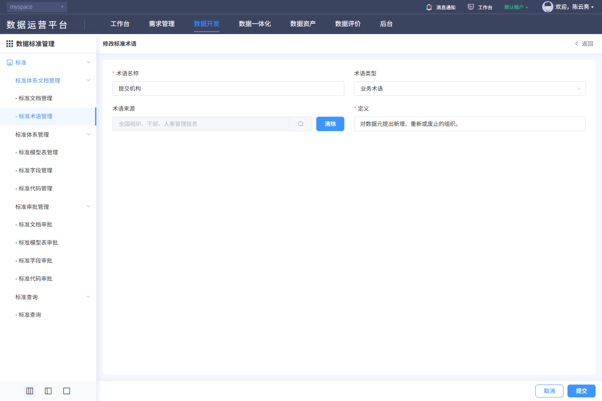

#### 8. 关联文档（DSS-108）

[规则核查、差异与外部合同](./核查记录.md) · [专项原文及历史索引](../evidence/dss-review-20261027/README.md)。

- [V-DSS-002-op2.png](../evidence/live-recheck-20261022/V-DSS-002-op2.png)
- [V-DSS-002-op2.json](../evidence/live-recheck-20261022/V-DSS-002-op2.json)
- [V-DSS-002-op2-options0.png](../evidence/live-recheck-20261022/V-DSS-002-op2-options0.png)
- [V-DSS-002-op2-options0.json](../evidence/live-recheck-20261022/V-DSS-002-op2-options0.json)
- [F208-DSS-term-edit.png](../evidence/F208-DSS-term-edit.png)
- [F208-DSS-term-edit.json](../evidence/F208-DSS-term-edit.json)
- [F209-DSS-term-edit-cancel.png](../evidence/F209-DSS-term-edit-cancel.png)
- [F209-DSS-term-edit-cancel.json](../evidence/F209-DSS-term-edit-cancel.json)

#### 9. 非功能性需求（DSS-108）

适用主规格第9节DSS-NFR质量矩阵。权限、文本、查询和资源清理适用全部；保存一致性适用维护/分类；审批事务适用四类审批；文件约束适用PDF与导入导出；本地集合容量适用代码项和四类关联。只读查询不新增账号密码、登录限流或物理执行任务。各项均未执行。

### DSS-109 删除标准术语

**业务目的**：删除标准术语；入口：/dss/standard/document/termList。前置条件：已登录且具备相应资源/动作权限。

**操作与规则**：按以下字段、控件、请求和对象标识处理；分类、标准记录、引用关系、版本与审批申请分别管理。

**结果与异常处理**：操作结果须按对象或申请回读；失败、无权、合法空结果与结果未知分别反馈，前端提示不代替服务端业务结果。

**开发处理细则**：

- 固定使用已查字段及调用映射，未知后端约束通过第7节交付包补齐，不由AI自选；字段空白属性不表示无约束。
- 原实现与本次补充目标的差异在核查记录追踪，全部应用验收未执行。

<!-- 完整规格:DSS-109 -->

#### 1. 页面字段清单（DSS-109）

| 字段名称与绑定名 | 类型/控件 | 是否必填 | 默认值 | 长度/范围/单位 | 格式及校验 | 错误提示 | 条件/状态 |
|---|---|---|---|---|---|---|---|
| 目标 id / name | 只读文本 |  |  |  | 来自当前行；确认显示可辨识名称并绑定原id |  | 返回数据，不由客户端生成 |
| 批量 multipleSelection[].id | 只读文本 |  |  |  | 只含有权可删记录；待审批对象排除 |  | 返回数据，不由客户端生成 |
| 确认内容 | 只读文本 |  |  |  | 删除后不可恢复的警告；是否软删除不由文案推断 |  | 返回数据，不由客户端生成 |
| 引用/审批/并发状态 | 只读文本 |  |  |  | 服务端删除前原子重查，不由按钮隐藏代替 |  | 返回数据，不由客户端生成 |

新增默认来自模型初始化；编辑显示当前记录，服务器返回标识和状态不作为新增默认。无证据的长度、唯一域、精度单位及提示留空，详见核查记录的外部依赖。

#### 2. 页面交互规则（DSS-109）

| 控件/触发 | 前提及输入 | 行为与联动 | 忙碌/禁用/反馈 | 完成、失败及草稿 |
|---|---|---|---|---|
| 行删除/批量删除 | 有权且选中允许对象 | 先打开确认；取消直接关闭，人工确认后发删除请求 | 在途禁重复；失败保留对象 | 成功回读列表，末页回有效页；超时先查目标 |
| 取消/关闭 | 确认框打开 | 不发送删除/批量删除 | 焦点回原入口 | 保留筛选与页码 |

#### 3. 业务流程与异常分支（DSS-109）

1. 在标准术语当前范围核对目标id、名称和选中集合。
2. 确认前不提交；确认后服务端重查权限、引用、审批和版本，拒绝时保持记录。
3. 成功回读当前范围，删除末页末条回有效页；结果未知先按id查询，不对相邻行重发。

| 异常分支 | 处理与恢复 |
|---|---|
| 本地校验/组合失败 | 定位对应项/页，保留合法草稿；依赖未就绪或ID无效不得提交。 |
| 权限、引用、审批/版本冲突 | 显示服务端原因，保持原数据；重新读取确认后再操作，不提供隐式强制覆盖。 |
| 超时、202、5xx、响应丢失 | 区分明确失败与结果未知；finally解除本地锁，未知结果先按稳定ID/申请ID核查。 |
| 重复点击、取消、迟到响应 | 同对象同动作最多一个在途请求；取消不发主记录写请求，离页旧响应不改新对象；上传/批量独立核结果。 |

#### 4. 接口与数据规则（DSS-109）

| 用途 | HTTP方法 | 相对路径 | 请求参数/来源/转换 | 返回读取与页面处理 |
|---|---|---|---|---|
| 删除单记录 | DELETE | /back/dss/ms/terminology/{id} | path id=当前记录；无伪造级联body | 成功后查询列表；删除可能形成审批申请，不能当已物理删除 |
| 批量删除 | POST | /back/dss/ms/terminology/remove | JSON array<ID>，来自multipleSelection | 逐条结果/事务策略按后端合同；不能把无响应等于全部成功 |
| 列表查询 | POST | /back/dss/ms/terminology/page | JSON：筛选键+固定条件+pageRequest；空值/未传保持模型语义 | 读取datas/total；公共列表兼容数组，但正式DTO须按核查合同 |

POST/PUT对象使用JSON；文件使用FormData，boundary由客户端生成。相对路径由模块/dss/ms与网关/back组合；列表读取datas/total。公共202、错误、身份头与超时，以及审批返回差异按第4节公共契约处理；不增造code=0成功协议、DTO、幂等头或固定租户字段。

#### 5. 验收标准（DSS-109）

| 验收编号 | 前置、步骤与可检查结果 | 关联需求 | 状态 |
|---|---|---|---|
| DSS-AC-592 | 打开标准术语单删/批删确认，核id和名称与选中对象一致；无选择时不提交。 | DSS-109 | 未执行 |
| DSS-AC-593 | 专用可删除对象确认后核DELETE或POST/remove及回读结果，审批受理与最终删除分开验收。 | DSS-109 | 未执行 |
| DSS-AC-594 | 存在引用、待审批、无权或已处理对象被拒绝，不误删其他记录；批量部分失败明确列出。 | DSS-109 | 未执行 |
| DSS-AC-595 | 双会话删除、响应丢失及重复点击，至多一次逻辑效果，未知结果按id查询再决定重试。 | DSS-109 | 未执行 |
| DSS-AC-596 | 取消/关闭0次删除请求，原记录与上下文不变，末页末条处理及焦点恢复正确。 | DSS-109 | 未执行 |

#### 6. 权限与安全要求（DSS-109）

服务端逐对象核验分类、记录、版本、审批申请、引用与文件的读取/写入权限及资源范围；直接URL、改id或隐藏按钮不能绕过。草稿、列表、文件和审计按当前身份与授权范围隔离；适用待审批限制的标准记录由服务端复核状态。TLS、文件内容检查、文本编码和审计各自验收，不把PDF签名引用当账号登录公钥。

#### 7. 页面布局与状态（DSS-109）

- 在原列表上方显示删除确认和确认/取消按钮，背景仍可识别对象；内容清楚显示对象类型、名称和批量数量。失败/忙碌不遮取消反馈，关闭焦点返回原删除入口。
- 初始化/加载、可操作、合法空结果、字段错误、业务拒绝、网络失败分别展示；写入另有提交中、结果未知及回读。宽表局部横滚，长表单纵滚，200%缩放下操作可达。

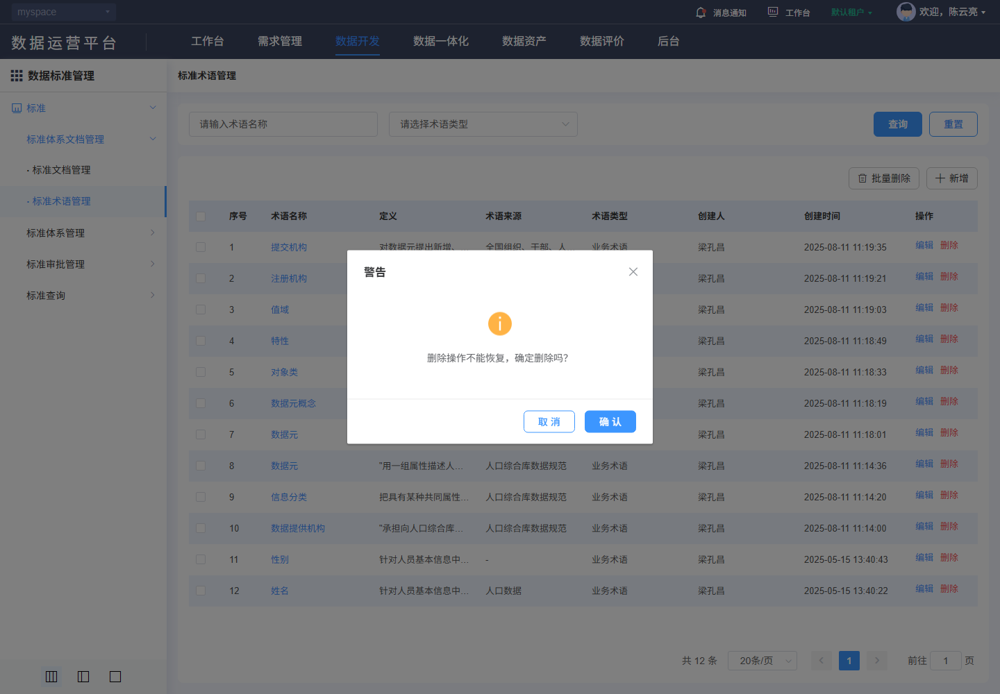

#### 8. 关联文档（DSS-109）

[规则核查、差异与外部合同](./核查记录.md) · [专项原文及历史索引](../evidence/dss-review-20261027/README.md)。

- [F211-DSS-term-delete.png](../evidence/F211-DSS-term-delete.png)
- [F211-DSS-term-delete.json](../evidence/F211-DSS-term-delete.json)
- [F210-DSS-term-delete-guard.png](../evidence/F210-DSS-term-delete-guard.png)
- [F210-DSS-term-delete-guard.json](../evidence/F210-DSS-term-delete-guard.json)
- [F212-DSS-term-delete-cancel.png](../evidence/F212-DSS-term-delete-cancel.png)
- [F212-DSS-term-delete-cancel.json](../evidence/F212-DSS-term-delete-cancel.json)

#### 9. 非功能性需求（DSS-109）

适用主规格第9节DSS-NFR质量矩阵。权限、文本、查询和资源清理适用全部；保存一致性适用维护/分类；审批事务适用四类审批；文件约束适用PDF与导入导出；本地集合容量适用代码项和四类关联。只读查询不新增账号密码、登录限流或物理执行任务。各项均未执行。

### DSS-110 查询标准模型表

**业务目的**：标准模型表管理；入口：/dss/standard/system/dataSetList。前置条件：已登录且具备相应资源/动作权限。

**操作与规则**：按以下字段、控件、请求和对象标识处理；分类、标准记录、引用关系、版本与审批申请分别管理。

**结果与异常处理**：操作结果须按对象或申请回读；失败、无权、合法空结果与结果未知分别反馈，前端提示不代替服务端业务结果。

**开发处理细则**：

- 固定使用已查字段及调用映射，未知后端约束通过第7节交付包补齐，不由AI自选；字段空白属性不表示无约束。
- 原实现与本次补充目标的差异在核查记录追踪，全部应用验收未执行。

<!-- 完整规格:DSS-110 -->

#### 1. 页面字段清单（DSS-110）

| 字段名称与绑定名 | 类型/控件 | 是否必填 | 默认值 | 长度/范围/单位 | 格式及校验 | 错误提示 | 条件/状态 |
|---|---|---|---|---|---|---|---|
| 标准模型表名称 tableName | string / 文本 | 否 | 空字符串 | 255字符 | trim首尾空白 | 请输入标准模型表名称 |  |
| 所属分类 datasetId | ID / 左侧列表 | 是 |  |  | 先POST dataset/list；恢复dataSetTreeId有效项，否则首项；无分类不允许创建/导入 |  |  |
| 审批状态 approveStatus | 隐藏筛选 |  | 空字符串 |  | 不强加只显示审批通过 |  |  |
| 页号 pageRequest.pageNo | integer | 是 | 1 | 正整数 | 查询、重置、改变页大小回第1页 |  |  |
| 页大小 pageRequest.pageSize | integer | 是 | 20 | 正整数 | 候选10/20/30/40/50/100；不把历史总数当上限 |  |  |
| 排序 pageRequest.order | array<object> | 是 | [{prop:"id",asc:false}] |  | prop为字段键、asc为boolean；服务端限制允许排序字段 |  |  |
| 序号 | 只读文本 |  |  |  |  |  | 返回数据，不由客户端生成 |
| 标准模型表编码 tableCode | 只读文本 |  |  |  |  |  | 返回数据，不由客户端生成 |
| 标准模型表名称 tableName | 只读文本 |  |  |  |  |  | 返回数据，不由客户端生成 |
| 说明 remark | 只读文本 |  |  |  |  |  | 返回数据，不由客户端生成 |
| 审批状态 approveStatus | 只读文本 |  |  |  |  |  | 返回数据，不由客户端生成 |
| 关联标准字段 refFieldNum | 只读文本 |  |  |  |  |  | 返回数据，不由客户端生成 |
| 更新时间 createTime | 只读文本 |  |  |  |  |  | 返回数据，不由客户端生成 |
| 标准表标识 id | 只读文本 |  |  |  |  |  | 返回数据，不由客户端生成 |
| 关联组 groupId | 只读文本 |  |  |  |  |  | 返回数据，不由客户端生成 |

新增默认来自模型初始化；编辑显示当前记录，服务器返回标识和状态不作为新增默认。无证据的长度、唯一域、精度单位及提示留空，详见核查记录的外部依赖。

#### 2. 页面交互规则（DSS-110）

| 控件/触发 | 前提及输入 | 行为与联动 | 忙碌/禁用/反馈 | 完成、失败及草稿 |
|---|---|---|---|---|
| 查询/Enter | 草稿合法 | 按当前条件查询并回第1页；所有入口共用查询处理 | 显示表格加载，最新请求有效 | 失败保留条件；旧响应不得覆盖 |
| 重置 | 当前列表 | 清空可编辑筛选，保留当前分类/固定范围，回第1页并查询 | 加载不清除分类 | 不触发写入 |
| 分页/页大小 | 最新total | 按当前条件读指定页；改变大小回第1页 | 禁止无效页；不以截图min/max限制总页数 | 返回保持来源条件；列表刷新清除失效勾选 |
| 分类/新增/编辑/关联字段数 | 有效分类且有相应权限 | 左侧维护dataset；右上新增standardtable；关联数进入dataSetFieldNum?id={id}&groupId={groupId} | 待审批记录禁编辑/删除；未选分类禁创建/导入 | 两个稳定id分开，不因分类保存新增标准表 |

#### 3. 业务流程与异常分支（DSS-110）

1. 进入标准模型表管理，先检查当前对象范围与分类读取结果，初始化分页并请求授权记录。
2. 修改条件仅改查询草稿；查询或重置回第1页，翻页保留已提交筛选。
3. 收到当前请求结果后同时更新列表、total及有效页；合法空结果、读取失败和无权分开显示。
4. 名称链接进入optType=view，编辑进入optType=edit并携当前id；查看禁写，维护后按来源条件回读。

| 异常分支 | 处理与恢复 |
|---|---|
| 合法空结果 | 保留当前条件，显示真实0条；无权/失败不降格为空列表。 |
| 分类/候选失败或失效 | 显示具体依赖失败及重试；不自动扩大到根或其他分类。 |
| 超时、202、5xx、乱序 | 显示请求失败；旧响应丢弃，保留已提交条件；只由用户显式重试。 |
| 会话过期/失权 | 按公共码处理会话和路由，清理受限数据；不能继续显示上一身份内容。 |

#### 4. 接口与数据规则（DSS-110）

| 用途 | HTTP方法 | 相对路径 | 请求参数/来源/转换 | 返回读取与页面处理 |
|---|---|---|---|---|
| 列表查询 | POST | /back/dss/ms/standardtable/page | JSON：筛选键+固定条件+pageRequest；空值/未传保持模型语义 | 读取datas/total；公共列表兼容数组，但正式DTO须按核查合同 |
| 分类候选 | POST | /back/dss/ms/dataset/list | 无显式body，公共层归一 | datasetName/datasetCode/id；sessionStorage只保存所选分类id |

POST/PUT对象使用JSON；文件使用FormData，boundary由客户端生成。相对路径由模块/dss/ms与网关/back组合；列表读取datas/total。公共202、错误、身份头与超时，以及审批返回差异按第4节公共契约处理；不增造code=0成功协议、DTO、幂等头或固定租户字段。

#### 5. 验收标准（DSS-110）

| 验收编号 | 前置、步骤与可检查结果 | 关联需求 | 状态 |
|---|---|---|---|
| DSS-AC-597 | 在授权账号进入标准模型表管理，核对筛选/列顺序、默认分页、中文长值及合法空结果；图内样本数量不作默认值。 | DSS-110 | 未执行 |
| DSS-AC-598 | 输入条件查询、重置、翻页和改变大小，核POST /back/dss/ms/standardtable/page的参数与datas/total；回读匹配记录，无串分类。 | DSS-110 | 未执行 |
| DSS-AC-599 | 用无权ID、空结果、候选失败与服务端业务拒绝验证区分反馈；不把失败当总数0。 | DSS-110 | 未执行 |
| DSS-AC-600 | 注入断网、202、5xx及乱序响应，只有当前条件结果生效，显式重试恢复；不发写请求。 | DSS-110 | 未执行 |
| DSS-AC-601 | 返回恢复分类、筛选、页码；记录失效或最后页删除后回有效页，列表选择不带到其他对象。 | DSS-110 | 未执行 |

#### 6. 权限与安全要求（DSS-110）

服务端逐对象核验分类、记录、版本、审批申请、引用与文件的读取/写入权限及资源范围；直接URL、改id或隐藏按钮不能绕过。草稿、列表、文件和审计按当前身份与授权范围隔离；适用待审批限制的标准记录由服务端复核状态。TLS、文件内容检查、文本编码和审计各自验收，不把PDF签名引用当账号登录公钥。

#### 7. 页面布局与状态（DSS-110）

- 左侧“标准模型表分类”是名称(编码)列表，顶端删除/修改/新增/收起，下面搜索；它不是标准表列表。右侧标准表表格与分类分别维护。
- 标准模型表管理位于平台导航右侧；上方标题与筛选区，查询/重置在右端；操作工具位于表格右上，表头顺序按本字段表结果列，底部右侧条数、页大小、页码和跳页。
- 初始化/加载、可操作、合法空结果、字段错误、业务拒绝、网络失败分别展示；写入另有提交中、结果未知及回读。宽表局部横滚，长表单纵滚，200%缩放下操作可达。

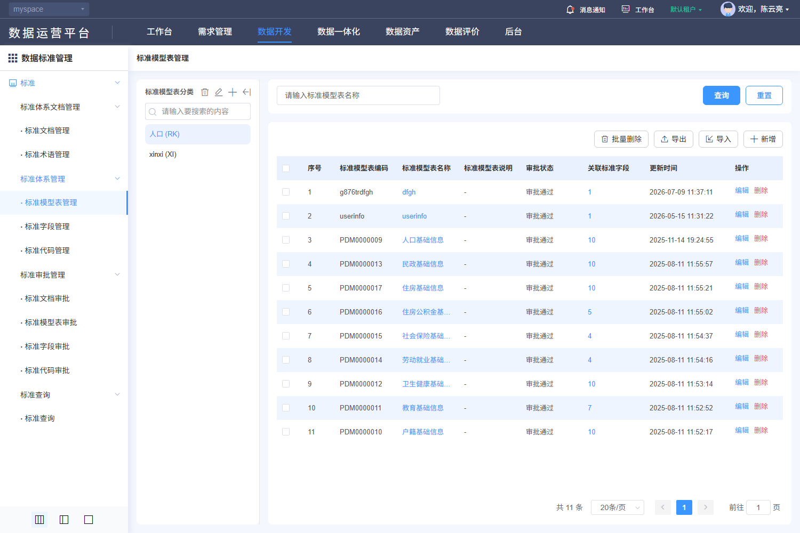

#### 8. 关联文档（DSS-110）

[规则核查、差异与外部合同](./核查记录.md) · [专项原文及历史索引](../evidence/dss-review-20261027/README.md)。

- [V-DSS-003.png](../evidence/live-recheck-20261022/V-DSS-003.png)
- [V-DSS-003.json](../evidence/live-recheck-20261022/V-DSS-003.json)
- [F222-DSS-system-delete-cancel.png](../evidence/F222-DSS-system-delete-cancel.png)
- [F222-DSS-system-delete-cancel.json](../evidence/F222-DSS-system-delete-cancel.json)
- [F214-DSS-system-query.png](../evidence/F214-DSS-system-query.png)
- [F214-DSS-system-query.json](../evidence/F214-DSS-system-query.json)
- [F215-DSS-system-reset.png](../evidence/F215-DSS-system-reset.png)
- [F215-DSS-system-reset.json](../evidence/F215-DSS-system-reset.json)

#### 9. 非功能性需求（DSS-110）

适用主规格第9节DSS-NFR质量矩阵。权限、文本、查询和资源清理适用全部；保存一致性适用维护/分类；审批事务适用四类审批；文件约束适用PDF与导入导出；本地集合容量适用代码项和四类关联。只读查询不新增账号密码、登录限流或物理执行任务。各项均未执行。

### DSS-112 新增标准模型表

**业务目的**：新增标准模型表；入口：/dss/standard/system/dataSetEdit?optType=add。前置条件：已登录且具备相应资源/动作权限。

**操作与规则**：按以下字段、控件、请求和对象标识处理；分类、标准记录、引用关系、版本与审批申请分别管理。

**结果与异常处理**：操作结果须按对象或申请回读；失败、无权、合法空结果与结果未知分别反馈，前端提示不代替服务端业务结果。

**开发处理细则**：

- 固定使用已查字段及调用映射，未知后端约束通过第7节交付包补齐，不由AI自选；字段空白属性不表示无约束。
- 原实现与本次补充目标的差异在核查记录追踪，全部应用验收未执行。

<!-- 完整规格:DSS-112 -->

#### 1. 页面字段清单（DSS-112）

| 字段名称与绑定名 | 类型/控件 | 是否必填 | 默认值 | 长度/范围/单位 | 格式及校验 | 错误提示 | 条件/状态 |
|---|---|---|---|---|---|---|---|
| 所属分类 datasetId | number / hidden | 是 |  |  | 新增来自route.query.datasetId经Number转换；必须是有权有效分类，NaN禁止提交 |  |  |
| 标准模型表名称 tableName | string / 文本 | 是 | 空字符串 | 50字符 | trim首尾空白 | 请输入标准模型表名称 |  |
| 标准模型表编码 tableCode | string / 文本 | 是 | 空字符串 | 最长10字符 | trim；^[a-zA-Z_][a-zA-Z0-9_]+$，至少2字符；编辑/查看禁用 | 请输入标准模型表编码；编码须符合字母/下划线开头的规则 |  |
| 简称 tableShortName | string / 文本 | 否 | 空字符串 | 100字符 | trim首尾空白 | 请输入简称 |  |
| 生效日期 effectiveDate | string / 日期 | 是 | 空字符串 | yyyy-MM-dd | change非空 | 请选择生效日期 |  |
| 参考文档 docId / docName / docCode | ID / 禁用展示+选择 | 否 | null / 空字符串 / 空字符串 |  | 选择绑定文档id及名称/编号；清除三者同步清理；候选限定approveStatus=2（审批通过），不混用生效状态 |  |  |
| 当前记录 id | 只读文本 |  |  |  | 读取路由id；PUT路径使用当前稳定标识，不使用分类或文档id |  | 返回数据，不由客户端生成 |
| 说明 remark | string / 文本 | 否 | 空字符串 | 100字符 | trim首尾空白 | 请输入说明 |  |

新增默认来自模型初始化；编辑显示当前记录，服务器返回标识和状态不作为新增默认。无证据的长度、唯一域、精度单位及提示留空，详见核查记录的外部依赖。

#### 2. 页面交互规则（DSS-112）

| 控件/触发 | 前提及输入 | 行为与联动 | 忙碌/禁用/反馈 | 完成、失败及草稿 |
|---|---|---|---|---|
| 参考文档/清除 | 可维护且有文档读取权 | 打开单选文档选择器，查询/500ms防抖、树/列表/分页；确定将id及展示项同步写当前草稿，未选提示 | 加载/失败独立处理，旧对象响应不得串值 | 取消不改草稿；清除同步清除id/名称/编号/适用分级 |
| 提交 | 依赖读取成功、表单合法且有权 | 共享请求锁后一次POST/PUT；服务端复核范围/引用/状态/并发，成功回读 | 整个在途期间禁重复；finally恢复 | 成功受理后核记录/审批；明确失败保留草稿，未知结果先核查 |
| 取消/返回/关闭/后退 | 当前表单 | 有修改时选择继续编辑或放弃；放弃后返回原分类/筛选 | 不调用主记录保存 | 已发生上传/自动填充请求不能撤销其历史；临时文件按服务端策略回收 |

#### 3. 业务流程与异常分支（DSS-112）

1. 从明确新增入口建立空模型，验证分类等上下文；不从列表第一条或样本复制默认值。
2. 所属分类来自右侧新增入口，不使用左侧分类新增弹窗。编码新增可录入，编辑保持不可修改；生效日期必填。
3. 字段与关联校验通过后，人工提交；公共表单浅复制模型，POST创建或PUT当前id更新；不自行增加幂等键/版本头。
4. 成功提示后回来源列表按稳定ID核对记录及审批结果；保存受理不代表审批通过、生效或物理数据已变更。
5. 失败定位可修改字段并保留草稿；超时/断网结果未知时先查询目标/请求关联，禁止自动重复保存。

| 异常分支 | 处理与恢复 |
|---|---|
| 本地校验/组合失败 | 定位对应项/页，保留合法草稿；依赖未就绪或ID无效不得提交。 |
| 权限、引用、审批/版本冲突 | 显示服务端原因，保持原数据；重新读取确认后再操作，不提供隐式强制覆盖。 |
| 超时、202、5xx、响应丢失 | 区分明确失败与结果未知；finally解除本地锁，未知结果先按稳定ID/申请ID核查。 |
| 重复点击、取消、迟到响应 | 同对象同动作最多一个在途请求；取消不发主记录写请求，离页旧响应不改新对象；上传/批量独立核结果。 |

#### 4. 接口与数据规则（DSS-112）

| 用途 | HTTP方法 | 相对路径 | 请求参数/来源/转换 | 返回读取与页面处理 |
|---|---|---|---|---|
| 提交记录 | POST | /back/dss/ms/standardtable | JSON：本字段表的模型键；不伪造服务端id | 公共resolve触发成功提示；完整服务端body、审批与版本合同见核查记录 |
| 来源文档候选 | POST | /back/dss/ms/standarddocument/page | JSON {approveStatus:2,standardName,pageRequest}；单选当前文档id | 读取datas/total及standardName/id |

POST/PUT对象使用JSON；文件使用FormData，boundary由客户端生成。相对路径由模块/dss/ms与网关/back组合；列表读取datas/total。公共202、错误、身份头与超时，以及审批返回差异按第4节公共契约处理；不增造code=0成功协议、DTO、幂等头或固定租户字段。

#### 5. 验收标准（DSS-112）

| 验收编号 | 前置、步骤与可检查结果 | 关联需求 | 状态 |
|---|---|---|---|
| DSS-AC-602 | 打开新增标准模型表，逐字段核标签、必填、边界、默认/当前值和禁用；查看模式无保存。 | DSS-112 | 未执行 |
| DSS-AC-603 | 专用数据完成新增，核方法/路径/模型键并按id回读字段及关联；不以成功提示当生效证明。 | DSS-112 | 未执行 |
| DSS-AC-604 | 覆盖必填空白、上限/超限、无效候选、引用失效及当前表单专有组合规则，拒绝时不误报成功。 | DSS-112 | 未执行 |
| DSS-AC-605 | 注入重复提交、202、5xx、超时和并发冲突，核一次逻辑效果；未知结果查询后才允许适用重试。 | DSS-112 | 未执行 |
| DSS-AC-606 | 取消/返回/后退核继续编辑或放弃；主记录不保存、旧记录不变，已上传临时文件按归属回收，底栏与焦点可达。 | DSS-112 | 未执行 |

#### 6. 权限与安全要求（DSS-112）

服务端逐对象核验分类、记录、版本、审批申请、引用与文件的读取/写入权限及资源范围；直接URL、改id或隐藏按钮不能绕过。草稿、列表、文件和审计按当前身份与授权范围隔离；适用待审批限制的标准记录由服务端复核状态。TLS、文件内容检查、文本编码和审计各自验收，不把PDF签名引用当账号登录公钥。

#### 7. 页面布局与状态（DSS-112）

- 标题新增/修改标准表、右上返回；第一行模型表名称/编码，第二行简称/生效日期，第三行参考文档(含搜索与清除)/参考标准编号，下方全宽说明；底部右侧取消、提交。
- 初始化/加载、可操作、合法空结果、字段错误、业务拒绝、网络失败分别展示；写入另有提交中、结果未知及回读。宽表局部横滚，长表单纵滚，200%缩放下操作可达。

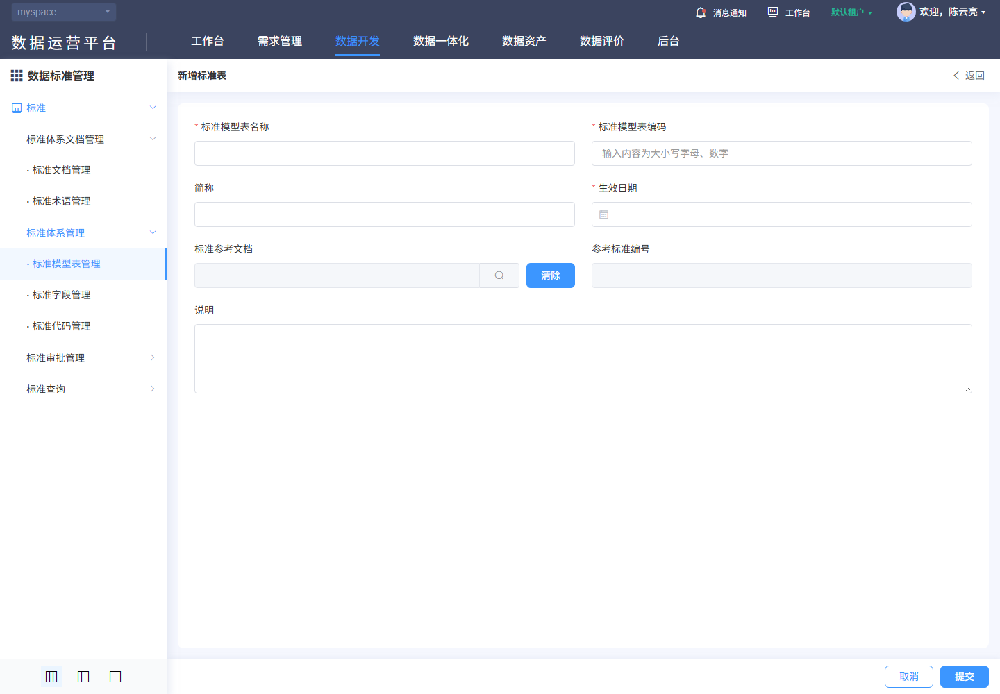

#### 8. 关联文档（DSS-112）

[规则核查、差异与外部合同](./核查记录.md) · [专项原文及历史索引](../evidence/dss-review-20261027/README.md)。

- [F216-DSS-system-add.png](../evidence/F216-DSS-system-add.png)
- [F216-DSS-system-add.json](../evidence/F216-DSS-system-add.json)
- [F217-DSS-system-add-cancel.png](../evidence/F217-DSS-system-add-cancel.png)
- [F217-DSS-system-add-cancel.json](../evidence/F217-DSS-system-add-cancel.json)

#### 9. 非功能性需求（DSS-112）

适用主规格第9节DSS-NFR质量矩阵。权限、文本、查询和资源清理适用全部；保存一致性适用维护/分类；审批事务适用四类审批；文件约束适用PDF与导入导出；本地集合容量适用代码项和四类关联。只读查询不新增账号密码、登录限流或物理执行任务。各项均未执行。

### DSS-113 修改标准模型表

**业务目的**：修改标准模型表；入口：/dss/standard/system/dataSetEdit?optType=edit&id={id}。前置条件：已登录且具备相应资源/动作权限。

**操作与规则**：按以下字段、控件、请求和对象标识处理；分类、标准记录、引用关系、版本与审批申请分别管理。

**结果与异常处理**：操作结果须按对象或申请回读；失败、无权、合法空结果与结果未知分别反馈，前端提示不代替服务端业务结果。

**开发处理细则**：

- 固定使用已查字段及调用映射，未知后端约束通过第7节交付包补齐，不由AI自选；字段空白属性不表示无约束。
- 原实现与本次补充目标的差异在核查记录追踪，全部应用验收未执行。

<!-- 完整规格:DSS-113 -->

#### 1. 页面字段清单（DSS-113）

| 字段名称与绑定名 | 类型/控件 | 是否必填 | 默认值 | 长度/范围/单位 | 格式及校验 | 错误提示 | 条件/状态 |
|---|---|---|---|---|---|---|---|
| 所属分类 datasetId | number / hidden | 是 |  |  | 新增来自route.query.datasetId经Number转换；必须是有权有效分类，NaN禁止提交 |  |  |
| 标准模型表名称 tableName | string / 文本 | 是 | 当前记录 | 50字符 | trim首尾空白 | 请输入标准模型表名称 |  |
| 标准模型表编码 tableCode | string / 文本 | 是 | 当前记录 | 最长10字符 | trim；^[a-zA-Z_][a-zA-Z0-9_]+$，至少2字符；编辑/查看禁用 | 请输入标准模型表编码；编码须符合字母/下划线开头的规则 |  |
| 简称 tableShortName | string / 文本 | 否 | 当前记录 | 100字符 | trim首尾空白 | 请输入简称 |  |
| 生效日期 effectiveDate | string / 日期 | 是 | 当前记录 | yyyy-MM-dd | change非空 | 请选择生效日期 |  |
| 参考文档 docId / docName / docCode | ID / 禁用展示+选择 | 否 | null / 空字符串 / 空字符串 |  | 选择绑定文档id及名称/编号；清除三者同步清理；候选限定approveStatus=2（审批通过），不混用生效状态 |  |  |
| 当前记录 id | 只读文本 |  |  |  | 读取路由id；PUT路径使用当前稳定标识，不使用分类或文档id |  | 返回数据，不由客户端生成 |
| 说明 remark | string / 文本 | 否 | 当前记录 | 100字符 | trim首尾空白 | 请输入说明 |  |

新增默认来自模型初始化；编辑显示当前记录，服务器返回标识和状态不作为新增默认。无证据的长度、唯一域、精度单位及提示留空，详见核查记录的外部依赖。

#### 2. 页面交互规则（DSS-113）

| 控件/触发 | 前提及输入 | 行为与联动 | 忙碌/禁用/反馈 | 完成、失败及草稿 |
|---|---|---|---|---|
| 参考文档/清除 | 可维护且有文档读取权 | 打开单选文档选择器，查询/500ms防抖、树/列表/分页；确定将id及展示项同步写当前草稿，未选提示 | 加载/失败独立处理，旧对象响应不得串值 | 取消不改草稿；清除同步清除id/名称/编号/适用分级 |
| 提交 | 依赖读取成功、表单合法且有权 | 共享请求锁后一次POST/PUT；服务端复核范围/引用/状态/并发，成功回读 | 整个在途期间禁重复；finally恢复 | 成功受理后核记录/审批；明确失败保留草稿，未知结果先核查 |
| 取消/返回/关闭/后退 | 当前表单 | 有修改时选择继续编辑或放弃；放弃后返回原分类/筛选 | 不调用主记录保存 | 已发生上传/自动填充请求不能撤销其历史；临时文件按服务端策略回收 |

#### 3. 业务流程与异常分支（DSS-113）

1. 以当前记录id读取详情并填充；读取失败禁止把空表单当新增；禁用字段保持原值。
2. 所属分类来自右侧新增入口，不使用左侧分类新增弹窗。编码新增可录入，编辑保持不可修改；生效日期必填。
3. 字段与关联校验通过后，人工提交；公共表单浅复制模型，POST创建或PUT当前id更新；不自行增加幂等键/版本头。
4. 成功提示后回来源列表按稳定ID核对记录及审批结果；保存受理不代表审批通过、生效或物理数据已变更。
5. 失败定位可修改字段并保留草稿；超时/断网结果未知时先查询目标/请求关联，禁止自动重复保存。

| 异常分支 | 处理与恢复 |
|---|---|
| 本地校验/组合失败 | 定位对应项/页，保留合法草稿；依赖未就绪或ID无效不得提交。 |
| 权限、引用、审批/版本冲突 | 显示服务端原因，保持原数据；重新读取确认后再操作，不提供隐式强制覆盖。 |
| 超时、202、5xx、响应丢失 | 区分明确失败与结果未知；finally解除本地锁，未知结果先按稳定ID/申请ID核查。 |
| 重复点击、取消、迟到响应 | 同对象同动作最多一个在途请求；取消不发主记录写请求，离页旧响应不改新对象；上传/批量独立核结果。 |

#### 4. 接口与数据规则（DSS-113）

| 用途 | HTTP方法 | 相对路径 | 请求参数/来源/转换 | 返回读取与页面处理 |
|---|---|---|---|---|
| 详情读取 | GET | /back/dss/ms/standardtable/{id} | path id=当前记录id | 返回对象回显，包括只读标识与原有嵌套项 |
| 提交记录 | PUT | /back/dss/ms/standardtable/{id} | JSON：本字段表的模型键；保留原记录/子项id，不以名称替代 | 公共resolve触发成功提示；完整服务端body、审批与版本合同见核查记录 |
| 来源文档候选 | POST | /back/dss/ms/standarddocument/page | JSON {approveStatus:2,standardName,pageRequest}；单选当前文档id | 读取datas/total及standardName/id |

POST/PUT对象使用JSON；文件使用FormData，boundary由客户端生成。相对路径由模块/dss/ms与网关/back组合；列表读取datas/total。公共202、错误、身份头与超时，以及审批返回差异按第4节公共契约处理；不增造code=0成功协议、DTO、幂等头或固定租户字段。

#### 5. 验收标准（DSS-113）

| 验收编号 | 前置、步骤与可检查结果 | 关联需求 | 状态 |
|---|---|---|---|
| DSS-AC-607 | 打开修改标准模型表，逐字段核标签、必填、边界、默认/当前值和禁用；查看模式无保存。 | DSS-113 | 未执行 |
| DSS-AC-608 | 专用数据完成修改，核方法/路径/模型键并按id回读字段及关联；不以成功提示当生效证明。 | DSS-113 | 未执行 |
| DSS-AC-609 | 覆盖必填空白、上限/超限、无效候选、引用失效及当前表单专有组合规则，拒绝时不误报成功。 | DSS-113 | 未执行 |
| DSS-AC-610 | 注入重复提交、202、5xx、超时和并发冲突，核一次逻辑效果；未知结果查询后才允许适用重试。 | DSS-113 | 未执行 |
| DSS-AC-611 | 取消/返回/后退核继续编辑或放弃；主记录不保存、旧记录不变，已上传临时文件按归属回收，底栏与焦点可达。 | DSS-113 | 未执行 |

#### 6. 权限与安全要求（DSS-113）

服务端逐对象核验分类、记录、版本、审批申请、引用与文件的读取/写入权限及资源范围；直接URL、改id或隐藏按钮不能绕过。草稿、列表、文件和审计按当前身份与授权范围隔离；适用待审批限制的标准记录由服务端复核状态。TLS、文件内容检查、文本编码和审计各自验收，不把PDF签名引用当账号登录公钥。

#### 7. 页面布局与状态（DSS-113）

- 标题新增/修改标准表、右上返回；第一行模型表名称/编码，第二行简称/生效日期，第三行参考文档(含搜索与清除)/参考标准编号，下方全宽说明；底部右侧取消、提交。
- 初始化/加载、可操作、合法空结果、字段错误、业务拒绝、网络失败分别展示；写入另有提交中、结果未知及回读。宽表局部横滚，长表单纵滚，200%缩放下操作可达。

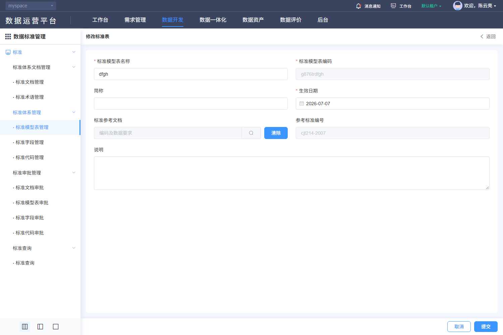

#### 8. 关联文档（DSS-113）

[规则核查、差异与外部合同](./核查记录.md) · [专项原文及历史索引](../evidence/dss-review-20261027/README.md)。

- [V-DSS-003-op2.png](../evidence/live-recheck-20261022/V-DSS-003-op2.png)
- [V-DSS-003-op2.json](../evidence/live-recheck-20261022/V-DSS-003-op2.json)
- [F218-DSS-system-edit.png](../evidence/F218-DSS-system-edit.png)
- [F218-DSS-system-edit.json](../evidence/F218-DSS-system-edit.json)
- [F219-DSS-system-edit-cancel.png](../evidence/F219-DSS-system-edit-cancel.png)
- [F219-DSS-system-edit-cancel.json](../evidence/F219-DSS-system-edit-cancel.json)

#### 9. 非功能性需求（DSS-113）

适用主规格第9节DSS-NFR质量矩阵。权限、文本、查询和资源清理适用全部；保存一致性适用维护/分类；审批事务适用四类审批；文件约束适用PDF与导入导出；本地集合容量适用代码项和四类关联。只读查询不新增账号密码、登录限流或物理执行任务。各项均未执行。

### DSS-114 删除标准模型表

**业务目的**：删除标准模型表；入口：/dss/standard/system/dataSetList。前置条件：已登录且具备相应资源/动作权限。

**操作与规则**：按以下字段、控件、请求和对象标识处理；分类、标准记录、引用关系、版本与审批申请分别管理。

**结果与异常处理**：操作结果须按对象或申请回读；失败、无权、合法空结果与结果未知分别反馈，前端提示不代替服务端业务结果。

**开发处理细则**：

- 固定使用已查字段及调用映射，未知后端约束通过第7节交付包补齐，不由AI自选；字段空白属性不表示无约束。
- 原实现与本次补充目标的差异在核查记录追踪，全部应用验收未执行。

<!-- 完整规格:DSS-114 -->

#### 1. 页面字段清单（DSS-114）

| 字段名称与绑定名 | 类型/控件 | 是否必填 | 默认值 | 长度/范围/单位 | 格式及校验 | 错误提示 | 条件/状态 |
|---|---|---|---|---|---|---|---|
| 目标 id / name | 只读文本 |  |  |  | 来自当前行；确认显示可辨识名称并绑定原id |  | 返回数据，不由客户端生成 |
| 批量 multipleSelection[].id | 只读文本 |  |  |  | 只含有权可删记录；待审批对象排除 |  | 返回数据，不由客户端生成 |
| 确认内容 | 只读文本 |  |  |  | 删除后不可恢复的警告；是否软删除不由文案推断 |  | 返回数据，不由客户端生成 |
| 引用/审批/并发状态 | 只读文本 |  |  |  | 服务端删除前原子重查，不由按钮隐藏代替 |  | 返回数据，不由客户端生成 |

新增默认来自模型初始化；编辑显示当前记录，服务器返回标识和状态不作为新增默认。无证据的长度、唯一域、精度单位及提示留空，详见核查记录的外部依赖。

#### 2. 页面交互规则（DSS-114）

| 控件/触发 | 前提及输入 | 行为与联动 | 忙碌/禁用/反馈 | 完成、失败及草稿 |
|---|---|---|---|---|
| 行删除/批量删除 | 有权且选中允许对象 | 先打开确认；取消直接关闭，人工确认后发删除请求 | 在途禁重复；失败保留对象 | 成功回读列表，末页回有效页；超时先查目标 |
| 取消/关闭 | 确认框打开 | 不发送删除/批量删除 | 焦点回原入口 | 保留筛选与页码 |

#### 3. 业务流程与异常分支（DSS-114）

1. 在标准模型表当前范围核对目标id、名称和选中集合。
2. 确认前不提交；确认后服务端重查权限、引用、审批和版本，拒绝时保持记录。
3. 成功回读当前范围，删除末页末条回有效页；结果未知先按id查询，不对相邻行重发。

| 异常分支 | 处理与恢复 |
|---|---|
| 本地校验/组合失败 | 定位对应项/页，保留合法草稿；依赖未就绪或ID无效不得提交。 |
| 权限、引用、审批/版本冲突 | 显示服务端原因，保持原数据；重新读取确认后再操作，不提供隐式强制覆盖。 |
| 超时、202、5xx、响应丢失 | 区分明确失败与结果未知；finally解除本地锁，未知结果先按稳定ID/申请ID核查。 |
| 重复点击、取消、迟到响应 | 同对象同动作最多一个在途请求；取消不发主记录写请求，离页旧响应不改新对象；上传/批量独立核结果。 |

#### 4. 接口与数据规则（DSS-114）

| 用途 | HTTP方法 | 相对路径 | 请求参数/来源/转换 | 返回读取与页面处理 |
|---|---|---|---|---|
| 删除单记录 | DELETE | /back/dss/ms/standardtable/{id} | path id=当前记录；无伪造级联body | 成功后查询列表；删除可能形成审批申请，不能当已物理删除 |
| 批量删除 | POST | /back/dss/ms/standardtable/remove | JSON array<ID>，来自multipleSelection | 逐条结果/事务策略按后端合同；不能把无响应等于全部成功 |
| 列表查询 | POST | /back/dss/ms/standardtable/page | JSON：筛选键+固定条件+pageRequest；空值/未传保持模型语义 | 读取datas/total；公共列表兼容数组，但正式DTO须按核查合同 |

POST/PUT对象使用JSON；文件使用FormData，boundary由客户端生成。相对路径由模块/dss/ms与网关/back组合；列表读取datas/total。公共202、错误、身份头与超时，以及审批返回差异按第4节公共契约处理；不增造code=0成功协议、DTO、幂等头或固定租户字段。

#### 5. 验收标准（DSS-114）

| 验收编号 | 前置、步骤与可检查结果 | 关联需求 | 状态 |
|---|---|---|---|
| DSS-AC-612 | 打开标准模型表单删/批删确认，核id和名称与选中对象一致；无选择时不提交。 | DSS-114 | 未执行 |
| DSS-AC-613 | 专用可删除对象确认后核DELETE或POST/remove及回读结果，审批受理与最终删除分开验收。 | DSS-114 | 未执行 |
| DSS-AC-614 | 存在引用、待审批、无权或已处理对象被拒绝，不误删其他记录；批量部分失败明确列出。 | DSS-114 | 未执行 |
| DSS-AC-615 | 双会话删除、响应丢失及重复点击，至多一次逻辑效果，未知结果按id查询再决定重试。 | DSS-114 | 未执行 |
| DSS-AC-616 | 取消/关闭0次删除请求，原记录与上下文不变，末页末条处理及焦点恢复正确。 | DSS-114 | 未执行 |

#### 6. 权限与安全要求（DSS-114）

服务端逐对象核验分类、记录、版本、审批申请、引用与文件的读取/写入权限及资源范围；直接URL、改id或隐藏按钮不能绕过。草稿、列表、文件和审计按当前身份与授权范围隔离；适用待审批限制的标准记录由服务端复核状态。TLS、文件内容检查、文本编码和审计各自验收，不把PDF签名引用当账号登录公钥。

#### 7. 页面布局与状态（DSS-114）

- 在原列表上方显示删除确认和确认/取消按钮，背景仍可识别对象；内容清楚显示对象类型、名称和批量数量。失败/忙碌不遮取消反馈，关闭焦点返回原删除入口。
- 初始化/加载、可操作、合法空结果、字段错误、业务拒绝、网络失败分别展示；写入另有提交中、结果未知及回读。宽表局部横滚，长表单纵滚，200%缩放下操作可达。

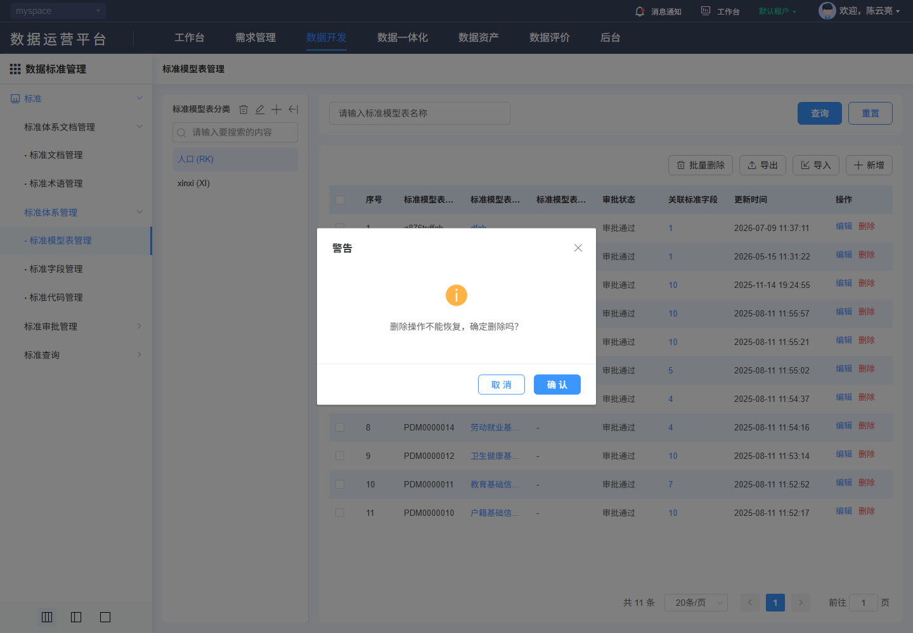

#### 8. 关联文档（DSS-114）

[规则核查、差异与外部合同](./核查记录.md) · [专项原文及历史索引](../evidence/dss-review-20261027/README.md)。

- [F221-DSS-system-delete.png](../evidence/F221-DSS-system-delete.png)
- [F221-DSS-system-delete.json](../evidence/F221-DSS-system-delete.json)
- [F220-DSS-system-delete-guard.png](../evidence/F220-DSS-system-delete-guard.png)
- [F220-DSS-system-delete-guard.json](../evidence/F220-DSS-system-delete-guard.json)
- [F222-DSS-system-delete-cancel.png](../evidence/F222-DSS-system-delete-cancel.png)
- [F222-DSS-system-delete-cancel.json](../evidence/F222-DSS-system-delete-cancel.json)

#### 9. 非功能性需求（DSS-114）

适用主规格第9节DSS-NFR质量矩阵。权限、文本、查询和资源清理适用全部；保存一致性适用维护/分类；审批事务适用四类审批；文件约束适用PDF与导入导出；本地集合容量适用代码项和四类关联。只读查询不新增账号密码、登录限流或物理执行任务。各项均未执行。

## 4. 字段与业务规则

| 范围 | 明确规则与交付约束 |
|---|---|
| 标识和对象 | dataset是模型表分类，standardtable是标准表；standardclassify是目录树；standardfield记录id、groupId版本组、collectId分类分开；standardcode父记录id、categoryCode及itemList子id分开；approve/{id}使用申请id。稳定ID唯一域、编码唯一域与版本算法按后端合同，不从样本推断。 |
| 标准/审批枚举 | standardType=A～G国际/国家/行业/地方/团体/企业/其他；standardState=1现行、2废止；dssStatus=1待生效、2已生效、3已失效；approveStatus=1待审批、2审批通过、3审批不通过；actionType=1新增、2变更、3删除、4导入。不同维度不能互换。 |
| 其他枚举 | terminologyType字符串键1业务术语、2技术术语；nullAble数字0否、1是；safety字符串1～5分别SL1公开信息、SL2个体匿名化/非涉密统计、SL3个体非敏感、SL4个体敏感、SL5国家核心数据。安全标签本身不证明数据访问授权。 |
| 长度与精度 | getDbTypes响应的needLength/needPrecision控制字段；比较符数字1≥、2=、3≤、4不限制。长度≥1，精度≥0；第二组移除清值。比较符4不要求禁用数值；原校验仍要求数值的差异单独追踪。区间相容性/单位/最大值须服务端发布，不猜数据库字节或小数位语义。 |
| 日期与文本 | 表单日期value-format=yyyy-MM-dd，字段生效严格早于失效；文档发布/实施关系不新增无依据限制。文本trim和前端maxlength不证明服务端规则；状态/安全回显的字符串转换与0/false/undefined/null保持，不将0判空。 |
| 文档四类关联 | docEdit默认first基本信息，fields/terminologys/tables/codes各自关联页签。字段、术语、表、代码调用各自POST/page；初始大候选请求pageSize=9999不是容量保证。确定按id加入父草稿，解除确认后只更新父数组；term/code按id去重，统一目标要求四类均去重。字段参数dssStatus=2,isDoc=true,keyWord；不得因未加载某页判旧引用不存在。 |
| 文档参考选择 | POST standarddocument/page，固定dssStatus=2，名称standardName与分页，500ms防抖，关闭销毁定时器；单选确定同时写id和名称/编号/适用分级，取消保留原值。术语清除必须同步form.docId，模型表清除必须同步form.docName；两处原实现差异见核查记录。 |
| 分类与归属 | GET standardclassify/listTree/{id}初始1；名称过滤不写库。节点添加POST standardclassify {standardClassifyName,standardClassifyPid}，修改PUT/{id}同体、删除DELETE/{id}；内置inside与根1/特殊2门控仍需服务端保护。文档/字段/代码的/classify/add/{分类id}及/classify/remove/{分类id}提交JSON array<ID>，只改归属关系。dataset/list及dataset三字段CRUD与上述树分开。 |
| 导入与导出 | 文档、标准表、字段、代码分别/{资源}/upload/excel POST FormData；四资源为standarddocument/standardtable/standardfield/standardcode，标准表另append datasetId。单.xls/.xlsx≤10 MiB，auto-upload=false，确认才上传；原name.split(".")[1]检查须修复为末扩展名并服务端复核。GET各资源/export/template与/export/excel用blob/rawData；标准表附datasetId，其他现调用未带当前筛选，不能宣称按筛选导出。导出前GET common/isExport门控。 |
| 导入结果 | 当前uploadSuccess不验证逐行结果就提示；目标须有受理/完成/失败、成功/失败行和错误定位、事务/重复/审批策略。缺导入服务合同的真实批处理交付受阻；不能因为HTTP成功而把部分导入记全部成功。下载错误JSON/blob不能伪装正常Excel。 |
| 模型表关联字段 | dataSetFieldNum携id/groupId；查询standardfield/page，新增候选tabIdNotEq=groupId，关联POST standardtable/ref（现包装器路径末尾有空格），解除POST standardtable/ref/remove。空格是否被实际客户端规范化不能猜，完整请求体、引用版本、事务与回读按后端合同交付；不自行修剪证据原文。 |
| 字段历史与派生 | 版本路由indexItemVersion?groupId，比较indexItemVersionCompare，派生indexItemDeriveList?groupId；当前有页面定义但完整版本/派生/差异算法、评分与引用影响合同未齐，见第7节独立交付包。入口不等于完整实现或验收。 |
| 代码项独立查询 | GET/编辑完整itemList与只读POST codeitem/page {categoryId,itemName,itemCode,pageRequest}区别；后者用于代码项查看，不代替编辑全集。查询防抖500ms；页内删除先算globalIndex再调页号，空清单同步total=0。 |
| 审批快照与响应 | 四approveType依次1/2/3/4；POST approve/page，名称/编码共同str，申请actionType/approveStatus可选，审批固定1。GET approve/{申请id}读取oldDo/newDo。详情PUT响应!result.code才显示成功，批量PUT approveBatch只在falsy结果时提示；必须对齐统一合同并覆盖反例，不能笼统写code=0。申请元数据目前依赖Vuex auditInfo，目标直入/刷新须由当前申请重建。 |
| 公共请求 | 父应用配置API_BASE_URL叠加/back；模块getModuleUrlPrefix("dss")或默认/dss/ms。POST/PUT对象JSON、GET入params；withCredentials=true，认证/CSRF/时间戳/nonce/签名由公共层按协议附加，不保存实际值。正常2xx除202返回data；202及HTTP错误读code/msg后reject；1002清失效认证回登录、1003无权限、1012刷新，1109走改密；不在本模块执行改密。 |
| 超时覆盖 | 路径规则非负timeout优先，否则请求number timeout，再无数值回退20000ms；0可能无限，不能将回退值当每个路径已生效值。有限超时/未知结果为本次交付目标，见NFR-007。 |

## 5. 主要业务流程

读取身份/分类→查询授权对象→按id/版本读取→编辑字段与独立关联草稿→校验及人工确认→提交对应资源→服务端授权/事务/审批→按记录与申请回读→失败/未知结果恢复。术语无需套标准审批状态；分类维护不建标准；只读查询不套确认保存。

## 6. 验收标准

保留所有既有功能验收编号。各功能五项检查与下列跨流程/历史检查共同执行，状态均为未执行；历史编号涉及未形成完整后端合同的范围须按第7节交付包补齐后再验收。

| 验收编号 | 场景 | 操作与可检查结果 | 关联需求 | 状态 |
|---|---|---|---|---|
| DSS-AC-001 | 查询与结果 | 在具备本模块访问权限时进入标准文档管理，使用已定义条件查询，核对本需求列出的结果列；无匹配时显示空结果。 | DSS-100 | 未执行 |
| DSS-AC-002 | 异常与边界 | 查询失败、重试及重置；恢复默认条件并核对分页、排序和授权范围。 | DSS-100 | 未执行 |
| DSS-AC-003 | 新增主流程 | 按 DSS-102 填写全部必填项并完成配置，提交后提示成功且新对象可在列表找到；保存后另核审批/生效状态。 | DSS-102 | 未执行 |
| DSS-AC-004 | 异常与边界 | 必填为空、已明确长度的临界值/超限、非法组合、取消重入、提交失败重试和重复提交；外部合同缺失项按第7节受阻包补齐后执行，不由客户端猜测。 | DSS-102 | 未执行 |
| DSS-AC-005 | 修改主流程 | 打开既有对象，核对回显和不可修改项，修改允许维护的字段后保存，再次进入应显示更新结果。 | DSS-103 | 未执行 |
| DSS-AC-006 | 异常与边界 | 清空必填、尝试改变受保护字段、取消修改、并发保存、保存失败重试和重复保存。 | DSS-103 | 未执行 |
| DSS-AC-007 | 删除确认与取消 | 发起删除后确认目标和影响，点击取消；对象仍可查询且内容保持不变。 | DSS-104 | 未执行 |
| DSS-AC-008 | 异常与边界 | 被引用/待审批对象、权限不足、重复确认和删除失败；确认后的影响与恢复方式按评审规则验收。 | DSS-104 | 未执行 |
| DSS-AC-009 | 查询与结果 | 在具备本模块访问权限时进入标准术语管理，使用已定义条件查询，核对本需求列出的结果列；无匹配时显示空结果。 | DSS-105 | 未执行 |
| DSS-AC-010 | 异常与边界 | 查询失败、重试及重置；恢复默认条件并核对分页、排序和授权范围。 | DSS-105 | 未执行 |
| DSS-AC-011 | 新增主流程 | 按 DSS-107 填写全部必填项并完成配置，提交后提示成功且新对象可在列表找到；保存后另核审批/生效状态。 | DSS-107 | 未执行 |
| DSS-AC-012 | 异常与边界 | 必填为空、已明确长度的临界值/超限、非法组合、取消重入、提交失败重试和重复提交；外部合同缺失项按第7节受阻包补齐后执行，不由客户端猜测。 | DSS-107 | 未执行 |
| DSS-AC-013 | 修改主流程 | 打开既有对象，核对回显和不可修改项，修改允许维护的字段后保存，再次进入应显示更新结果。 | DSS-108 | 未执行 |
| DSS-AC-014 | 异常与边界 | 清空必填、尝试改变受保护字段、取消修改、并发保存、保存失败重试和重复保存。 | DSS-108 | 未执行 |
| DSS-AC-015 | 删除确认与取消 | 发起删除后确认目标和影响，点击取消；对象仍可查询且内容保持不变。 | DSS-109 | 未执行 |
| DSS-AC-016 | 异常与边界 | 被引用/待审批对象、权限不足、重复确认和删除失败；确认后的影响与恢复方式按评审规则验收。 | DSS-109 | 未执行 |
| DSS-AC-017 | 查询与结果 | 在具备本模块访问权限时进入标准模型表管理，使用已定义条件查询，核对本需求列出的结果列；无匹配时显示空结果。 | DSS-110 | 未执行 |
| DSS-AC-018 | 异常与边界 | 查询失败、重试及重置；恢复默认条件并核对分页、排序和授权范围。 | DSS-110 | 未执行 |
| DSS-AC-019 | 新增主流程 | 按 DSS-112 填写全部必填项并完成配置，提交后提示成功且新对象可在列表找到；保存后另核审批/生效状态。 | DSS-112 | 未执行 |
| DSS-AC-020 | 异常与边界 | 必填为空、已明确长度的临界值/超限、非法组合、取消重入、提交失败重试和重复提交；外部合同缺失项按第7节受阻包补齐后执行，不由客户端猜测。 | DSS-112 | 未执行 |
| DSS-AC-021 | 修改主流程 | 打开既有对象，核对回显和不可修改项，修改允许维护的字段后保存，再次进入应显示更新结果。 | DSS-113 | 未执行 |
| DSS-AC-022 | 异常与边界 | 清空必填、尝试改变受保护字段、取消修改、并发保存、保存失败重试和重复保存。 | DSS-113 | 未执行 |
| DSS-AC-023 | 删除确认与取消 | 发起删除后确认目标和影响，点击取消；对象仍可查询且内容保持不变。 | DSS-114 | 未执行 |
| DSS-AC-024 | 异常与边界 | 被引用/待审批对象、权限不足、重复确认和删除失败；确认后的影响与恢复方式按评审规则验收。 | DSS-114 | 未执行 |
| DSS-AC-025 | 查询竞态与返回恢复 | 先发条件A再发B，使A后返回；界面最终显示B的结果及总数。进入详情再返回，应恢复已提交条件、页码和排序；查询失败不将旧结果冒充新结果。 | DSS-100 | 未执行 |
| DSS-AC-026 | 数据隔离 | 同一用户在两个授权范围不同的空间分别查询；结果只含各自可见记录。直接改变请求中的空间标识不扩大访问范围。授权范围按平台发布矩阵；不得自行增加空间参数。 | DSS-100 | 未执行 |
| DSS-AC-027 | 标准名称长度边界 | 其他字段合法，分别输入249、250、251个普通中文字符。前两组通过该字段长度校验；超限输入被阻止或显示长度错误，服务端拒绝超限。字符计数口径先按公共规则确认。 | DSS-102 | 未执行 |
| DSS-AC-028 | 英文名称长度边界 | 其他字段合法，分别输入249、250、251个普通中文字符。前两组通过该字段长度校验；超限输入被阻止或显示长度错误，服务端拒绝超限。字符计数口径先按公共规则确认。 | DSS-102 | 未执行 |
| DSS-AC-029 | 标准编号长度边界 | 其他字段合法，分别输入99、100、101个普通中文字符。前两组通过该字段长度校验；超限输入被阻止或显示长度错误，服务端拒绝超限。字符计数口径先按公共规则确认。 | DSS-102 | 未执行 |
| DSS-AC-030 | 批准发布部门长度边界 | 其他字段合法，分别输入254、255、256个普通中文字符。前两组通过该字段长度校验；超限输入被阻止或显示长度错误，服务端拒绝超限。字符计数口径先按公共规则确认。 | DSS-102 | 未执行 |
| DSS-AC-031 | 替代以下标准长度边界 | 其他字段合法，分别输入99、100、101个普通中文字符。前两组通过该字段长度校验；超限输入被阻止或显示长度错误，服务端拒绝超限。字符计数口径先按公共规则确认。 | DSS-102 | 未执行 |
| DSS-AC-032 | 标准适用范围长度边界 | 其他字段合法，分别输入249、250、251个普通中文字符。前两组通过该字段长度校验；超限输入被阻止或显示长度错误，服务端拒绝超限。字符计数口径先按公共规则确认。 | DSS-102 | 未执行 |
| DSS-AC-033 | 取消后重入 | 修改任一可编辑字段及子项后取消；无业务保存请求；重新进入读取原持久化值。PDF选择可能已上传，取消不保存主记录；临时附件按归属回收。 | DSS-102 | 未执行 |
| DSS-AC-034 | 提交失败和结果未知 | 模拟明确失败时保留输入及子项并允许重试；模拟写入超时时显示结果待核实，查询同一操作标识的结果后决定重试，不立即生成第二对象。 | DSS-102 | 未执行 |
| DSS-AC-035 | 越权及重复请求 | 无维护权限或关联对象跨授权范围时服务端拒绝且无数据变化；同一操作标识连续提交两次仅形成一次业务结果。错误码按公共开发规则。 | DSS-102 | 未执行 |
| DSS-AC-036 | 标准名称必填 | 其他字段合法，仅将标准名称置空后提交；字段旁显示必填原因，未发送业务写入，已填内容保留。文本trim后空白按空值拒绝。 | DSS-103 | 未执行 |
| DSS-AC-037 | 标准名称长度边界 | 其他字段合法，分别输入249、250、251个普通中文字符。前两组通过该字段长度校验；超限输入被阻止或显示长度错误，服务端拒绝超限。字符计数口径先按公共规则确认。 | DSS-103 | 未执行 |
| DSS-AC-038 | 英文名称长度边界 | 其他字段合法，分别输入249、250、251个普通中文字符。前两组通过该字段长度校验；超限输入被阻止或显示长度错误，服务端拒绝超限。字符计数口径先按公共规则确认。 | DSS-103 | 未执行 |
| DSS-AC-039 | 标准编号必填 | 其他字段合法，仅将标准编号置空后提交；字段旁显示必填原因，未发送业务写入，已填内容保留。文本trim后空白按空值拒绝。 | DSS-103 | 未执行 |
| DSS-AC-040 | 标准编号长度边界 | 其他字段合法，分别输入99、100、101个普通中文字符。前两组通过该字段长度校验；超限输入被阻止或显示长度错误，服务端拒绝超限。字符计数口径先按公共规则确认。 | DSS-103 | 未执行 |
| DSS-AC-041 | 批准发布部门必填 | 其他字段合法，仅将批准发布部门置空后提交；字段旁显示必填原因，未发送业务写入，已填内容保留。文本trim后空白按空值拒绝。 | DSS-103 | 未执行 |
| DSS-AC-042 | 批准发布部门长度边界 | 其他字段合法，分别输入254、255、256个普通中文字符。前两组通过该字段长度校验；超限输入被阻止或显示长度错误，服务端拒绝超限。字符计数口径先按公共规则确认。 | DSS-103 | 未执行 |
| DSS-AC-043 | 标准分级保护 | 打开本场景，标准分级按页面范围不可编辑；构造改动请求时服务端拒绝越权变更或保持原值，重新读取仍为原值。禁用项保持原值，服务端拒绝非法改动。 | DSS-103 | 未执行 |
| DSS-AC-044 | 标准状态保护 | 打开本场景，标准状态按页面范围不可编辑；构造改动请求时服务端拒绝越权变更或保持原值，重新读取仍为原值。禁用项保持原值，服务端拒绝非法改动。 | DSS-103 | 未执行 |
| DSS-AC-045 | 发布日期必填 | 其他字段合法，仅将发布日期置空后提交；字段旁显示必填原因，未发送业务写入，已填内容保留。文本trim后空白按空值拒绝。 | DSS-103 | 未执行 |
| DSS-AC-046 | 实施日期必填 | 其他字段合法，仅将实施日期置空后提交；字段旁显示必填原因，未发送业务写入，已填内容保留。文本trim后空白按空值拒绝。 | DSS-103 | 未执行 |
| DSS-AC-047 | 替代以下标准长度边界 | 其他字段合法，分别输入99、100、101个普通中文字符。前两组通过该字段长度校验；超限输入被阻止或显示长度错误，服务端拒绝超限。字符计数口径先按公共规则确认。 | DSS-103 | 未执行 |
| DSS-AC-048 | 标准适用范围长度边界 | 其他字段合法，分别输入249、250、251个普通中文字符。前两组通过该字段长度校验；超限输入被阻止或显示长度错误，服务端拒绝超限。字符计数口径先按公共规则确认。 | DSS-103 | 未执行 |
| DSS-AC-049 | 取消后重入 | 修改任一可编辑字段及子项后取消；无业务保存请求；重新进入读取原持久化值。PDF选择可能已上传，取消不保存主记录；临时附件按归属回收。 | DSS-103 | 未执行 |
| DSS-AC-050 | 提交失败和结果未知 | 模拟明确失败时保留输入及子项并允许重试；模拟写入超时时显示结果待核实，查询同一操作标识的结果后决定重试，不立即生成第二对象。 | DSS-103 | 未执行 |
| DSS-AC-051 | 越权及重复请求 | 无维护权限或关联对象跨授权范围时服务端拒绝且无数据变化；同一操作标识连续提交两次仅形成一次业务结果。错误码按公共开发规则。 | DSS-103 | 未执行 |
| DSS-AC-052 | 取消删除零影响 | 打开确认后取消或关闭确认层；抓取请求确认无业务删除，目标及子项仍存在。取消后可再次发起；失败时不显示删除成功。 | DSS-104 | 未执行 |
| DSS-AC-053 | 删除版本与引用冲突 | 确认前让另一操作者修改目标或建立引用；删除返回冲突/引用阻止信息且对象仍在。重复确认同一删除不重复清理；逻辑/物理删除范围须先确认。 | DSS-104 | 未执行 |
| DSS-AC-054 | 查询竞态与返回恢复 | 先发条件A再发B，使A后返回；界面最终显示B的结果及总数。进入详情再返回，应恢复已提交条件、页码和排序；查询失败不将旧结果冒充新结果。 | DSS-105 | 未执行 |
| DSS-AC-055 | 数据隔离 | 同一用户在两个授权范围不同的空间分别查询；结果只含各自可见记录。直接改变请求中的空间标识不扩大访问范围。授权范围按平台发布矩阵；不得自行增加空间参数。 | DSS-105 | 未执行 |
| DSS-AC-056 | 术语名称必填 | 其他字段合法，仅将术语名称置空后提交；字段旁显示必填原因，未发送业务写入，已填内容保留。文本trim后空白按空值拒绝。 | DSS-107 | 未执行 |
| DSS-AC-057 | 术语名称长度边界 | 其他字段合法，分别输入99、100、101个普通中文字符。前两组通过该字段长度校验；超限输入被阻止或显示长度错误，服务端拒绝超限。字符计数口径先按公共规则确认。 | DSS-107 | 未执行 |
| DSS-AC-058 | 术语来源保护 | 打开本场景，术语来源按页面范围不可编辑；构造改动请求时服务端拒绝越权变更或保持原值，重新读取仍为原值。禁用项保持原值，服务端拒绝非法改动。 | DSS-107 | 未执行 |
| DSS-AC-059 | 定义必填 | 其他字段合法，仅将定义置空后提交；字段旁显示必填原因，未发送业务写入，已填内容保留。文本trim后空白按空值拒绝。 | DSS-107 | 未执行 |
| DSS-AC-060 | 定义长度边界 | 其他字段合法，分别输入199、200、201个普通中文字符。前两组通过该字段长度校验；超限输入被阻止或显示长度错误，服务端拒绝超限。字符计数口径先按公共规则确认。 | DSS-107 | 未执行 |
| DSS-AC-061 | 取消后重入 | 修改任一可编辑字段及子项后取消；无业务保存请求；重新进入读取原持久化值。PDF选择可能已上传，取消不保存主记录；临时附件按归属回收。 | DSS-107 | 未执行 |
| DSS-AC-062 | 提交失败和结果未知 | 模拟明确失败时保留输入及子项并允许重试；模拟写入超时时显示结果待核实，查询同一操作标识的结果后决定重试，不立即生成第二对象。 | DSS-107 | 未执行 |
| DSS-AC-063 | 越权及重复请求 | 无维护权限或关联对象跨授权范围时服务端拒绝且无数据变化；同一操作标识连续提交两次仅形成一次业务结果。错误码按公共开发规则。 | DSS-107 | 未执行 |
| DSS-AC-064 | 术语名称必填 | 其他字段合法，仅将术语名称置空后提交；字段旁显示必填原因，未发送业务写入，已填内容保留。文本trim后空白按空值拒绝。 | DSS-108 | 未执行 |
| DSS-AC-065 | 术语名称长度边界 | 其他字段合法，分别输入99、100、101个普通中文字符。前两组通过该字段长度校验；超限输入被阻止或显示长度错误，服务端拒绝超限。字符计数口径先按公共规则确认。 | DSS-108 | 未执行 |
| DSS-AC-066 | 术语来源保护 | 打开本场景，术语来源按页面范围不可编辑；构造改动请求时服务端拒绝越权变更或保持原值，重新读取仍为原值。禁用项保持原值，服务端拒绝非法改动。 | DSS-108 | 未执行 |
| DSS-AC-067 | 定义必填 | 其他字段合法，仅将定义置空后提交；字段旁显示必填原因，未发送业务写入，已填内容保留。文本trim后空白按空值拒绝。 | DSS-108 | 未执行 |
| DSS-AC-068 | 定义长度边界 | 其他字段合法，分别输入199、200、201个普通中文字符。前两组通过该字段长度校验；超限输入被阻止或显示长度错误，服务端拒绝超限。字符计数口径先按公共规则确认。 | DSS-108 | 未执行 |
| DSS-AC-069 | 取消后重入 | 修改任一可编辑字段及子项后取消；无业务保存请求；重新进入读取原持久化值。PDF选择可能已上传，取消不保存主记录；临时附件按归属回收。 | DSS-108 | 未执行 |
| DSS-AC-070 | 提交失败和结果未知 | 模拟明确失败时保留输入及子项并允许重试；模拟写入超时时显示结果待核实，查询同一操作标识的结果后决定重试，不立即生成第二对象。 | DSS-108 | 未执行 |
| DSS-AC-071 | 越权及重复请求 | 无维护权限或关联对象跨授权范围时服务端拒绝且无数据变化；同一操作标识连续提交两次仅形成一次业务结果。错误码按公共开发规则。 | DSS-108 | 未执行 |
| DSS-AC-072 | 取消删除零影响 | 打开确认后取消或关闭确认层；抓取请求确认无业务删除，目标及子项仍存在。取消后可再次发起；失败时不显示删除成功。 | DSS-109 | 未执行 |
| DSS-AC-073 | 删除版本与引用冲突 | 确认前让另一操作者修改目标或建立引用；删除返回冲突/引用阻止信息且对象仍在。重复确认同一删除不重复清理；逻辑/物理删除范围须先确认。 | DSS-109 | 未执行 |
| DSS-AC-074 | 查询竞态与返回恢复 | 先发条件A再发B，使A后返回；界面最终显示B的结果及总数。进入详情再返回，应恢复已提交条件、页码和排序；查询失败不将旧结果冒充新结果。 | DSS-110 | 未执行 |
| DSS-AC-075 | 数据隔离 | 同一用户在两个授权范围不同的空间分别查询；结果只含各自可见记录。直接改变请求中的空间标识不扩大访问范围。授权范围按平台发布矩阵；不得自行增加空间参数。 | DSS-110 | 未执行 |
| DSS-AC-076 | 标准模型表名称必填 | 其他字段合法，仅将标准模型表名称置空后提交；字段旁显示必填原因，未发送业务写入，已填内容保留。文本trim后空白按空值拒绝。 | DSS-112 | 未执行 |
| DSS-AC-077 | 标准模型表名称长度边界 | 其他字段合法，分别输入49、50、51个普通中文字符。前两组通过该字段长度校验；超限输入被阻止或显示长度错误，服务端拒绝超限。字符计数口径先按公共规则确认。 | DSS-112 | 未执行 |
| DSS-AC-078 | 标准模型表编码必填 | 其他字段合法，仅将标准模型表编码置空后提交；字段旁显示必填原因，未发送业务写入，已填内容保留。文本trim后空白按空值拒绝。 | DSS-112 | 未执行 |
| DSS-AC-079 | 标准模型表编码长度边界 | 其他字段合法，分别输入9、10、11个普通中文字符。前两组通过该字段长度校验；超限输入被阻止或显示长度错误，服务端拒绝超限。字符计数口径先按公共规则确认。 | DSS-112 | 未执行 |
| DSS-AC-080 | 简称长度边界 | 其他字段合法，分别输入99、100、101个普通中文字符。前两组通过该字段长度校验；超限输入被阻止或显示长度错误，服务端拒绝超限。字符计数口径先按公共规则确认。 | DSS-112 | 未执行 |
| DSS-AC-081 | 生效日期必填 | 其他字段合法，仅将生效日期置空后提交；字段旁显示必填原因，未发送业务写入，已填内容保留。文本trim后空白按空值拒绝。 | DSS-112 | 未执行 |
| DSS-AC-082 | 标准参考文档保护 | 打开本场景，标准参考文档按页面范围不可编辑；构造改动请求时服务端拒绝越权变更或保持原值，重新读取仍为原值。禁用项保持原值，服务端拒绝非法改动。 | DSS-112 | 未执行 |
| DSS-AC-083 | 参考标准编号保护 | 打开本场景，参考标准编号按页面范围不可编辑；构造改动请求时服务端拒绝越权变更或保持原值，重新读取仍为原值。禁用项保持原值，服务端拒绝非法改动。 | DSS-112 | 未执行 |
| DSS-AC-084 | 说明长度边界 | 其他字段合法，分别输入99、100、101个普通中文字符。前两组通过该字段长度校验；超限输入被阻止或显示长度错误，服务端拒绝超限。字符计数口径先按公共规则确认。 | DSS-112 | 未执行 |
| DSS-AC-085 | 取消后重入 | 修改任一可编辑字段及子项后取消；无业务保存请求；重新进入读取原持久化值。PDF选择可能已上传，取消不保存主记录；临时附件按归属回收。 | DSS-112 | 未执行 |
| DSS-AC-086 | 提交失败和结果未知 | 模拟明确失败时保留输入及子项并允许重试；模拟写入超时时显示结果待核实，查询同一操作标识的结果后决定重试，不立即生成第二对象。 | DSS-112 | 未执行 |
| DSS-AC-087 | 越权及重复请求 | 无维护权限或关联对象跨授权范围时服务端拒绝且无数据变化；同一操作标识连续提交两次仅形成一次业务结果。错误码按公共开发规则。 | DSS-112 | 未执行 |
| DSS-AC-088 | 标准模型表名称必填 | 其他字段合法，仅将标准模型表名称置空后提交；字段旁显示必填原因，未发送业务写入，已填内容保留。文本trim后空白按空值拒绝。 | DSS-113 | 未执行 |
| DSS-AC-089 | 标准模型表名称长度边界 | 其他字段合法，分别输入49、50、51个普通中文字符。前两组通过该字段长度校验；超限输入被阻止或显示长度错误，服务端拒绝超限。字符计数口径先按公共规则确认。 | DSS-113 | 未执行 |
| DSS-AC-090 | 标准模型表编码保护 | 打开本场景，标准模型表编码按页面范围不可编辑；构造改动请求时服务端拒绝越权变更或保持原值，重新读取仍为原值。禁用项保持原值，服务端拒绝非法改动。 | DSS-113 | 未执行 |
| DSS-AC-091 | 简称长度边界 | 其他字段合法，分别输入99、100、101个普通中文字符。前两组通过该字段长度校验；超限输入被阻止或显示长度错误，服务端拒绝超限。字符计数口径先按公共规则确认。 | DSS-113 | 未执行 |
| DSS-AC-092 | 生效日期必填 | 其他字段合法，仅将生效日期置空后提交；字段旁显示必填原因，未发送业务写入，已填内容保留。文本trim后空白按空值拒绝。 | DSS-113 | 未执行 |
| DSS-AC-093 | 标准参考文档保护 | 打开本场景，标准参考文档按页面范围不可编辑；构造改动请求时服务端拒绝越权变更或保持原值，重新读取仍为原值。禁用项保持原值，服务端拒绝非法改动。 | DSS-113 | 未执行 |
| DSS-AC-094 | 参考标准编号保护 | 打开本场景，参考标准编号按页面范围不可编辑；构造改动请求时服务端拒绝越权变更或保持原值，重新读取仍为原值。禁用项保持原值，服务端拒绝非法改动。 | DSS-113 | 未执行 |
| DSS-AC-095 | 说明长度边界 | 其他字段合法，分别输入99、100、101个普通中文字符。前两组通过该字段长度校验；超限输入被阻止或显示长度错误，服务端拒绝超限。字符计数口径先按公共规则确认。 | DSS-113 | 未执行 |
| DSS-AC-096 | 取消后重入 | 修改任一可编辑字段及子项后取消；无业务保存请求；重新进入读取原持久化值。PDF选择可能已上传，取消不保存主记录；临时附件按归属回收。 | DSS-113 | 未执行 |
| DSS-AC-097 | 提交失败和结果未知 | 模拟明确失败时保留输入及子项并允许重试；模拟写入超时时显示结果待核实，查询同一操作标识的结果后决定重试，不立即生成第二对象。 | DSS-113 | 未执行 |
| DSS-AC-098 | 越权及重复请求 | 无维护权限或关联对象跨授权范围时服务端拒绝且无数据变化；同一操作标识连续提交两次仅形成一次业务结果。错误码按公共开发规则。 | DSS-113 | 未执行 |
| DSS-AC-099 | 取消删除零影响 | 打开确认后取消或关闭确认层；抓取请求确认无业务删除，目标及子项仍存在。取消后可再次发起；失败时不显示删除成功。 | DSS-114 | 未执行 |
| DSS-AC-100 | 删除版本与引用冲突 | 确认前让另一操作者修改目标或建立引用；删除返回冲突/引用阻止信息且对象仍在。重复确认同一删除不重复清理；逻辑/物理删除范围须先确认。 | DSS-114 | 未执行 |

## 7. 实现与交付边界

| 历史操作编号 | 范围 | 具体入口、调用与交付约束 |
|---|---|---|
| DSS-101 | 查看标准文档 | docEdit?optType=view&id；GET standarddocument/{id}，沿用文档字段与四关联，只读禁保存。 |
| DSS-106 | 查看标准术语 | termEdit?optType=view&id；GET terminology/{id}，沿用术语字段，只读。 |
| DSS-111 | 查看标准模型表 | dataSetEdit?optType=view&id&datasetId；GET standardtable/{id}；关联字段另页。 |
| DSS-115 | 查询标准字段 | DSS-502；standardfield/page及树，不再说只有导航。 |
| DSS-116 | 查看标准字段 | indexItemEdit?optType=view&id；GET standardfield/{id}，四卡只读。 |
| DSS-117 | 新增标准字段 | 右侧记录新增进入indexItemEdit?optType=add；POST standardfield，字段与DSS-515同初始化/校验但编码可填；左树新增DSS-514只建分类。 |
| DSS-118 | 修改标准字段 | DSS-515；PUT standardfield/{id}，编码禁改与版本/审批约束。 |
| DSS-119 | 删除标准字段 | DELETE standardfield/{id}，批量POST standardfield/remove array<ID>；待审禁止，确认/引用/审批/未知结果沿用删除规则。 |
| DSS-120 | 查询标准代码 | DSS-503；standardcode/page及分类树。 |
| DSS-121 | 查看标准代码 | indexCodeEdit?optType=view&id；GET standardcode/{id}，完整代码项只读。 |
| DSS-122 | 新增标准代码 | 右侧记录新增indexCodeEdit?optType=add；POST standardcode；按DSS-517字段/全集查重，编码可填；左树DSS-516只建分类。 |
| DSS-123 | 修改标准代码 | DSS-517；PUT standardcode/{id}；编码禁改。 |
| DSS-124 | 删除标准代码 | DELETE standardcode/{id}或POST standardcode/remove array<ID>；沿用确认/审批/引用/未知结果规则。 |
| DSS-125 | 查询审批 | 拆四类型DSS-504/505/518/506，按申请id而不是标准id。 |
| DSS-126 | 查看审批 | 各auditDetail读取approve/{申请id}，旧新快照与申请信息独立。 |
| DSS-127 | 新增审批 | 由标准新增/变更/删除/导入产生申请；当前没有独立人工创建任意申请表单，不造POST approve。 |
| DSS-128 | 修改审批 | 实际是决定2/3及意见：PUT approve/{申请id}或approveBatch，不允许编辑历史快照。 |
| DSS-129 | 删除审批 | 所查组件无独立删除申请入口；撤回、取消/清理与留存须专门合同，不能套DELETE approve。 |

**外部交付包**：角色/资源动作矩阵、OpenAPI与真实响应/错误、编码唯一域、并发/事务、审批快照/生效/重提/撤回、版本与引用保护、导入逐行结果/恢复、文件归属/留存须完成联调。版本比较、派生、评分、模型表关联字段的完整DTO与算法仅查到入口/部分调用，按核查记录逐项补齐，不能由AI套通用CRUD。已有字段与调用足以支持明确范围的前端和契约测试开发，不等于生产持久化、审批或安全交付完成。

## 8. 关联资料

| 需求编号 | 历史登记与补充图/元素 |
|---|---|
| DSS-100 | [V-DSS-001.png](../evidence/live-recheck-20261022/V-DSS-001.png) · [V-DSS-001.json](../evidence/live-recheck-20261022/V-DSS-001.json) · [F202-DSS-document-delete-cancel.png](../evidence/F202-DSS-document-delete-cancel.png) · [F202-DSS-document-delete-cancel.json](../evidence/F202-DSS-document-delete-cancel.json) · [F196-DSS-document-query.png](../evidence/F196-DSS-document-query.png) · [F196-DSS-document-query.json](../evidence/F196-DSS-document-query.json) · [F197-DSS-document-reset.png](../evidence/F197-DSS-document-reset.png) · [F197-DSS-document-reset.json](../evidence/F197-DSS-document-reset.json) |
| DSS-102 | [E034-standard-add.png](../evidence/E034-standard-add.png) · [E034-standard-add.json](../evidence/E034-standard-add.json) |
| DSS-103 | [F198-DSS-document-edit.png](../evidence/F198-DSS-document-edit.png) · [F198-DSS-document-edit.json](../evidence/F198-DSS-document-edit.json) · [F053-DSS-document-edit-cancel.png](../evidence/F053-DSS-document-edit-cancel.png) · [F053-DSS-document-edit-cancel.json](../evidence/F053-DSS-document-edit-cancel.json) · [F199-DSS-document-edit-cancel.png](../evidence/F199-DSS-document-edit-cancel.png) · [F199-DSS-document-edit-cancel.json](../evidence/F199-DSS-document-edit-cancel.json) |
| DSS-104 | [F201-DSS-document-delete.png](../evidence/F201-DSS-document-delete.png) · [F201-DSS-document-delete.json](../evidence/F201-DSS-document-delete.json) · [F200-DSS-document-delete-guard.png](../evidence/F200-DSS-document-delete-guard.png) · [F200-DSS-document-delete-guard.json](../evidence/F200-DSS-document-delete-guard.json) · [F202-DSS-document-delete-cancel.png](../evidence/F202-DSS-document-delete-cancel.png) · [F202-DSS-document-delete-cancel.json](../evidence/F202-DSS-document-delete-cancel.json) |
| DSS-105 | [V-DSS-002.png](../evidence/live-recheck-20261022/V-DSS-002.png) · [V-DSS-002.json](../evidence/live-recheck-20261022/V-DSS-002.json) · [F212-DSS-term-delete-cancel.png](../evidence/F212-DSS-term-delete-cancel.png) · [F212-DSS-term-delete-cancel.json](../evidence/F212-DSS-term-delete-cancel.json) · [F204-DSS-term-query.png](../evidence/F204-DSS-term-query.png) · [F204-DSS-term-query.json](../evidence/F204-DSS-term-query.json) · [F205-DSS-term-reset.png](../evidence/F205-DSS-term-reset.png) · [F205-DSS-term-reset.json](../evidence/F205-DSS-term-reset.json) |
| DSS-107 | [V-DSS-002-op1.png](../evidence/live-recheck-20261022/V-DSS-002-op1.png) · [V-DSS-002-op1.json](../evidence/live-recheck-20261022/V-DSS-002-op1.json) · [V-DSS-002-op1-options0.png](../evidence/live-recheck-20261022/V-DSS-002-op1-options0.png) · [V-DSS-002-op1-options0.json](../evidence/live-recheck-20261022/V-DSS-002-op1-options0.json) · [F206-DSS-term-add.png](../evidence/F206-DSS-term-add.png) · [F206-DSS-term-add.json](../evidence/F206-DSS-term-add.json) · [F207-DSS-term-add-cancel.png](../evidence/F207-DSS-term-add-cancel.png) · [F207-DSS-term-add-cancel.json](../evidence/F207-DSS-term-add-cancel.json) |
| DSS-108 | [V-DSS-002-op2.png](../evidence/live-recheck-20261022/V-DSS-002-op2.png) · [V-DSS-002-op2.json](../evidence/live-recheck-20261022/V-DSS-002-op2.json) · [V-DSS-002-op2-options0.png](../evidence/live-recheck-20261022/V-DSS-002-op2-options0.png) · [V-DSS-002-op2-options0.json](../evidence/live-recheck-20261022/V-DSS-002-op2-options0.json) · [F208-DSS-term-edit.png](../evidence/F208-DSS-term-edit.png) · [F208-DSS-term-edit.json](../evidence/F208-DSS-term-edit.json) · [F209-DSS-term-edit-cancel.png](../evidence/F209-DSS-term-edit-cancel.png) · [F209-DSS-term-edit-cancel.json](../evidence/F209-DSS-term-edit-cancel.json) |
| DSS-109 | [F211-DSS-term-delete.png](../evidence/F211-DSS-term-delete.png) · [F211-DSS-term-delete.json](../evidence/F211-DSS-term-delete.json) · [F210-DSS-term-delete-guard.png](../evidence/F210-DSS-term-delete-guard.png) · [F210-DSS-term-delete-guard.json](../evidence/F210-DSS-term-delete-guard.json) · [F212-DSS-term-delete-cancel.png](../evidence/F212-DSS-term-delete-cancel.png) · [F212-DSS-term-delete-cancel.json](../evidence/F212-DSS-term-delete-cancel.json) |
| DSS-110 | [V-DSS-003.png](../evidence/live-recheck-20261022/V-DSS-003.png) · [V-DSS-003.json](../evidence/live-recheck-20261022/V-DSS-003.json) · [F222-DSS-system-delete-cancel.png](../evidence/F222-DSS-system-delete-cancel.png) · [F222-DSS-system-delete-cancel.json](../evidence/F222-DSS-system-delete-cancel.json) · [F214-DSS-system-query.png](../evidence/F214-DSS-system-query.png) · [F214-DSS-system-query.json](../evidence/F214-DSS-system-query.json) · [F215-DSS-system-reset.png](../evidence/F215-DSS-system-reset.png) · [F215-DSS-system-reset.json](../evidence/F215-DSS-system-reset.json) |
| DSS-112 | [F216-DSS-system-add.png](../evidence/F216-DSS-system-add.png) · [F216-DSS-system-add.json](../evidence/F216-DSS-system-add.json) · [F217-DSS-system-add-cancel.png](../evidence/F217-DSS-system-add-cancel.png) · [F217-DSS-system-add-cancel.json](../evidence/F217-DSS-system-add-cancel.json) |
| DSS-113 | [V-DSS-003-op2.png](../evidence/live-recheck-20261022/V-DSS-003-op2.png) · [V-DSS-003-op2.json](../evidence/live-recheck-20261022/V-DSS-003-op2.json) · [F218-DSS-system-edit.png](../evidence/F218-DSS-system-edit.png) · [F218-DSS-system-edit.json](../evidence/F218-DSS-system-edit.json) · [F219-DSS-system-edit-cancel.png](../evidence/F219-DSS-system-edit-cancel.png) · [F219-DSS-system-edit-cancel.json](../evidence/F219-DSS-system-edit-cancel.json) |
| DSS-114 | [F221-DSS-system-delete.png](../evidence/F221-DSS-system-delete.png) · [F221-DSS-system-delete.json](../evidence/F221-DSS-system-delete.json) · [F220-DSS-system-delete-guard.png](../evidence/F220-DSS-system-delete-guard.png) · [F220-DSS-system-delete-guard.json](../evidence/F220-DSS-system-delete-guard.json) · [F222-DSS-system-delete-cancel.png](../evidence/F222-DSS-system-delete-cancel.png) · [F222-DSS-system-delete-cancel.json](../evidence/F222-DSS-system-delete-cancel.json) |

[主规格](./需求说明.md) · [子页面细则](./子页面与操作细化.md) · [核查记录](./核查记录.md) · [专项证据](../evidence/dss-review-20261027/README.md) · [调研归档](./调研记录.md) · [总索引](../README.md) · [生成源](../../../scripts/dss-requirement-spec.js)

## 9. 非功能性需求

以下14项为本次开发交付目标，来源和现有差异见核查记录，全部未执行。权限、审批事务、文件和完整集合采用不变量；数值不表示现系统已经达到，不复制登录认证的并发与响应指标。

**性能条件**：隔离环境Windows11、8逻辑核/16GiB客户端，Chrome/Edge记录具体版本；下载20Mbit/s、上传10Mbit/s、RTT50ms，TLS与正常权限策略开启。记录服务端CPU/内存/实例、数据库/索引、网关、构建及数据分布。30个独立用户每人至多一个在途只读请求，思考2秒，预热5分钟、统计15分钟且每场景≥500合法请求；冷页分别30次。计时自用户查询触发至新表格/分页可操作，页面自导航至依赖可用；上传、后台导入与审批持久化单独计量，不以提示/骨架为结束。

分位数为成功样本升序第ceil(p×N)项；报告P50/P95/P99/最大、样本量、实际吞吐和失败。合法请求5xx、202非预期业务错误、超时、解析错误、错误数据和限流计非预期失败分母，不剔除以优化指标；预期拒绝场景单列。零样本/环境缺失/样本不足保持未执行，不能判通过。

| 编号 | 质量属性 | 要求与指标/不变量 | 验收方法及失败判定 | 关联功能 | 状态 |
|---|---|---|---|---|---|
| DSS-NFR-001 | 服务端授权与会话 | 分类/标准/引用/版本/申请/文件分别验权；查询、维护、审批、导入导出逐动作控制。直接篡改id/groupId/docId/categoryId/ids不扩大范围；换身份及失权清理旧数据。 | 隔离配置只读/维护/审批身份和两组不相交资源；逐接口直接访问及会话过期；越权读取/写入成功0次。 | DSS-100～114、DSS-500～518及第7节历史范围 | 未执行 |
| DSS-NFR-002 | 传输与内容保护 | 生产全链路TLS；PDF/Excel、标准定义、审批意见与签名文件引用按分级保护。秘密、Cookie/Token、签名key不得进入文档、日志、持久前端缓存或模型；文件签名不代替服务端鉴权。 | 标记数据检查请求/日志/存储/下载权限，核混合内容与签名过期，秘密泄露0项；不使用真实凭据作测试样本。 | DSS-100～114、DSS-500～518及第7节历史范围 | 未执行 |
| DSS-NFR-003 | 输入与解析安全 | 名称/规则/格式/意见按文本渲染；trim后非空及Unicode长度口径前后端一致。dataFormat正确URL编码，解析器限制复杂度且不执行脚本/SQL；上传内容不触发宏、外部实体或公式执行。 | 隔离覆盖HTML、SQL特殊符号、&/+/中文/换行格式、极长正则和公式标记；无脚本执行、参数串改或无界解析。规则语义用版本化合同验证。 | DSS-100～114、DSS-500～518及第7节历史范围 | 未执行 |
| DSS-NFR-004 | 记录、分类及引用一致性 | 主记录及关联集合一次事务保存；id、版本组、父分类与引用类型不可混用。并发更新/删除有明确冲突保护；取消不保存主记录；结果未知先查后重试；至多一个在途提交。 | 20组双会话修改/删除、重复请求和响应丢失；无静默覆盖、半保存或无依据重放；回读关联完整，分类移除不删标准。 | DSS-100～114、DSS-500～518及第7节历史范围 | 未执行 |
| DSS-NFR-005 | 审批和版本可追溯 | 审批决定、意见、申请状态、标准版本及生效结果原子一致；待审快照不可被后台覆盖；竞争审批只有一个有效决定。批量部分失败必须按申请ID解释，历史与现行引用不混淆。 | 固定四类型新增/变更/删除/导入申请集，双审批者竞争、撤权及中途故障；核oldDo/newDo、意见和引用版本，失败无部分误生效。撤回/驳回后的重提按合同执行。 | DSS-100～114、DSS-500～518及第7节历史范围 | 未执行 |
| DSS-NFR-006 | 文件安全与生命周期 | PDF单1且≤10 MiB，Excel单1、xls/xlsx且≤10 MiB；服务端复核内容/MIME/扩展/数量/大小与归属。选择PDF即时上传，Excel确认后上传；临时文件取消/失败回收，已引用文件不得误删。 | 阈值−1、阈值、阈值+1字节、伪扩展、双后缀、大小写扩展、多文件、跨范围key及错误blob；不合格不可成为有效附件，上传成功不等于导入或主表成功。 | DSS-100～114、DSS-500～518及第7节历史范围 | 未执行 |
| DSS-NFR-007 | 超时与恢复 | 查询/候选/保存采用有限超时，目标20秒；上传/导入目标60秒，超时后1秒内恢复本地可控并说明未知结果。取消界面不宣称终止已开始的后端处理；迟到响应不串对象。 | 登记实际路径配置优先级及有效值；断网/202/5xx/迟到注入核finally、草稿、请求数和后台结果；无限等待及自动重放0次。大文件后台处理时限按导入合同单列。 | DSS-100～114、DSS-500～518及第7节历史范围 | 未执行 |
| DSS-NFR-008 | 页面与查询性能 | 100000字段、10000文档/术语/标准表/代码集、100000申请的隔离数据集，每页20；冷页可操作P95≤3秒，30并发读取用户下查询P95≤2秒/P99≤5秒，非预期失败率≤1%；本地反馈P95≤100ms。 | 基准条件见下文；每场景≥500样本，冷页≥30次；报告P50/P95/P99/max、N、失败与吞吐；不足样本、权限未就绪或依赖骨架不算可操作。 | DSS-100～114、DSS-500～518及第7节历史范围 | 未执行 |
| DSS-NFR-009 | 大集合与分页正确性 | 代码项1000行、每类关联1000个、分类1000节点的目标容量下全集查重、回显与提交完整；候选使用有界分页/按ID补读，不能受9999首批截断而丢既有引用。最后页删除先算原全局索引。 | 至少跨3页、末页单行、删到0、重名位于不同页、首批外引用及分类切换；无误删/漏校验/丢引用，全部集合回读一致；本地翻页P95≤100ms。 | DSS-100～114、DSS-500～518及第7节历史范围 | 未执行 |
| DSS-NFR-010 | 审计与可观测性 | 记录主体/范围、对象类型/id/版本/申请、动作、时间、请求关联、结果、冲突原因和审批意见访问记录；文件/批量结果可逐项追踪。留存与查阅权使用平台版本化策略。 | 串联创建/修改/删除/分类关系/导入/审批成功、拒绝、未知结果各样本；从页面请求到持久结果可关联，关键审计缺失及秘密泄露0项。 | DSS-100～114、DSS-500～518及第7节历史范围 | 未执行 |
| DSS-NFR-011 | 兼容与布局适配 | Windows10/11，Chrome/Edge当前及前一稳定大版本记录具体版号；1366×768、1500×1000、1920×1080、200%缩放及320 CSS像素宽，输入/错误/底栏/模态均可达；宽表局部横滚。 | 覆盖长中文、四卡下部、四关联页签、代码项跨页、两审批页签、600/500/900px模态、PDF多页及空/慢/错状态；遮挡末项或不能提交/取消即失败。 | DSS-100～114、DSS-500～518及第7节历史范围 | 未执行 |
| DSS-NFR-012 | 可访问性 | 真实字段标签、必填/错误关联；树、单多选、页签、分页、PDF翻页、模态支持键盘与可见焦点；关闭焦点回入口。差异和状态除颜色外提供文字标记；忙碌/错误可播报。 | 自动扫描加人工键盘/读屏完成查询、选择、编辑、校验和取消；普通文本对比度≥4.5:1，控件/焦点≥3:1；局部测试不宣称完整合规。 | DSS-100～114、DSS-500～518及第7节历史范围 | 未执行 |
| DSS-NFR-013 | 资源与长时稳定性 | 离页清理防抖/3秒按钮定时器、PDF objectURL、监听、文件预览、选择集合及旧申请缓存；共享锁随请求结束释放，不能3秒到期提前解锁。 | 100轮进入/返回编辑、切关联页签/审批申请、打开关闭预览和选择弹窗；监听/定时器回基线，创建/释放URL数量匹配，无旧身份/旧申请数据残留。 | DSS-100～114、DSS-500～518及第7节历史范围 | 未执行 |
| DSS-NFR-014 | 契约与文档维护 | 统一相对前缀、错误、超时、日期和类型枚举；审批单项/批量响应统一有明确合同。生成刷新字节幂等，保留既有31项功能、312个功能验收ID和历史证据。 | 运行字段/接口/分类分离/代码项索引/ID/状态与来源回归，缺失/重复ID、原文摘要损坏、伪造已执行和刷新回流均拒绝；静态测试不代替应用验收。 | DSS-100～114、DSS-500～518及第7节历史范围 | 未执行 |

本模块不新增密码哈希、认证限流或月度可用率默认值，统一引用平台策略；没有批准SLA时不承诺99.9%。审批/标准库备份、留存、RTO/RPO由运维与治理负责人按审批快照、引用版本和恢复演练交付，不用页面20秒超时替代恢复目标。没有AI业务能力新增授权，dataFormat自动填充不作为大模型功能。
